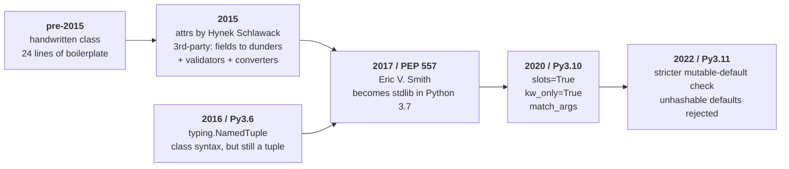
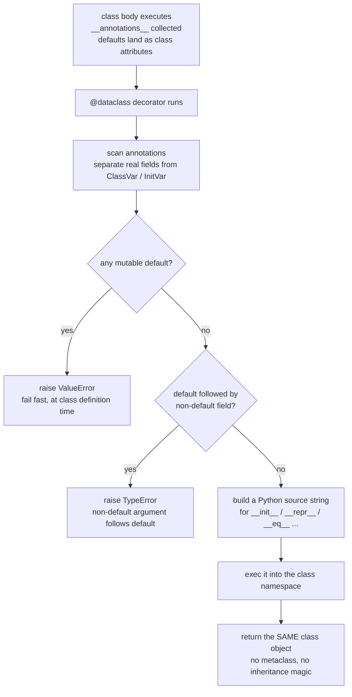
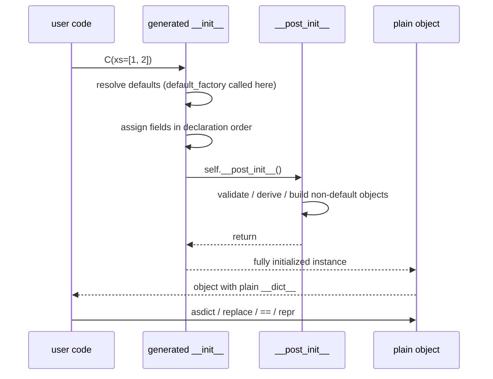

# dataclass 学习指南：声明形状，而不是写步骤

> 衔接：本目录的 `config.py`（`TrainConfig` / `FMConfig`）就是 dataclass 的标准用法；
> 本文把那份代码背后的**哲学、渊源、架构、流程**全部摊开。
>
> 验证环境：Python 3.12.9。文中所有报错文本、`__hash__ is None`、`asdict` 的深拷贝行为、`InitVar` 类属性残留，都是**实测**结果，不是背来的。
> 用到 3.10+ 特性的地方（`slots` / `kw_only` / `match_args`）单独标注。

---

## 0. 一句话，然后三句话

> **`@dataclass` 的核心哲学：把「写样板代码的步骤」换成「声明数据的形状」。**
> 你只写字段注解（**what**），装饰器在 `import` 那一刻替你生成 `__init__` / `__repr__` / `__eq__`（**how**）；生成完它就收工，运行时**零魔法**——你的对象仍然是个普通对象。

同一件事，三种说法，任选一种记住：

| 说法 | 内容 |
|---|---|
| **类比版** | 你画**模具**（字段声明），它替你在类创建期浇一次**铸件**（dunder 方法） |
| **形式化版** | `@dataclass : (annotations, defaults, flags) ⟶ class with generated dunders`，执行时机是类创建期，**只执行一次** |
| **反例版** | 它**不是** pydantic：运行时**不校验类型**。`Point(x="abc")` 静默通过，因为警察不是它 |

```
一句话：注解当模具，import 时浇一次，铸出一个普通类；运行时不加班。
```

---

## 1. 思想（idea）：它到底想解决什么问题

### 1.1 病灶：结构性样板代码（boilerplate）占满屏幕

Python 里所有"装数据的小类"，你几乎每次都在重复同一套动作：

```python
class Point:
    def __init__(self, x, y):
        self.x = x
        self.y = y

    def __repr__(self):
        return f"Point(x={self.x!r}, y={self.y!r})"

    def __eq__(self, other):
        if not isinstance(other, Point):
            return NotImplemented
        return (self.x, self.y) == (other.x, other.y)

    __hash__ = None      # eq 了但不 frozen，那就不可 hash
```

**24 行里真正的信息只有 3 个词：`Point`、`x`、`y`。** 其余全是从"我想装两个数"这个**意图**里机械推导出来的。这就是 boilerplate 的定义：**意图与实现的比例失调**。

更糟的是它的**维护病**：加一个字段 `z`，你得同步改 4 处（`__init__` 签名、`__init__` 赋值、`__repr__`、`__eq__` 元组）。**漏改一处，`__eq__` 就静默骗你半年**——这是"多打几行字"远不能比的代价，因为它制造的是**不一致（inconsistency）**，而不一致是最难测的 bug 类别。

```
意图:  { x, y }
实现:  __init__ ×2 行赋值 + __repr__ 字符串 + __eq__ 元组 + 手工 __hash__
         ↑ 这 4 处必须永远保持同步，而人做不到"永远"
```

### 1.2 洞察：注解本身就是**机器可读的元数据**

PEP 526（变量注解，Python 3.6）让下面这行有了双重身份：

```python
x: int = 0
```

- 对**人**：一个叫 `x` 的字段，类型 `int`，默认 0。
- 对**机器**：类命名空间里多了一条 `__annotations__['x'] = int`，外加类属性 `x = 0`。

既然机器已经能读到"这里要一个叫 `x` 的东西、类型是 `int`、缺省值是 0"，那**凭什么还要人肉把它翻译成 `__init__` 的三行赋值？**

> **核心洞察：注解描述的是"结构"，而"结构 → 行为"这个映射是**可机械推导**的。凡是可机械推导的，就应该交给机器。**

这句话是整个 dataclass 的地基。它同时也解释了 dataclass 的**功能边界**——凡是"不可机械推导"的（怎么校验？出错怎么报？要不要强制转类型？），它一概不做。见 §1.4。

这是 declarative（声明式）对 imperative（命令式）在 Python 标准库里最干净的一次落地。

### 1.3 关键机制：两个时钟（two clocks）

这是最容易误解的一点，必须先钉死：**`@dataclass` 不是运行时魔法，它是类创建期的代码生成器。**

理解模型必须区分两个时间点：

```text
        ┌──── Clock 1: CLASS CREATION (import time) ─────────────────┐
        │  class body 执行:                                          │
        │     a: int = 1                →  __annotations__['a']=int  │
        │     xs: list = field(default_factory=list)                 │
        │                          │                                 │
        │      @dataclass ─────────┘  读注解 + 读默认值 + 读开关       │
        │           │                                                │
        │           ▼   生成（编译成函数，写进类命名空间）              │
        │      __init__   __repr__   __eq__                          │
        │      (__hash__ / __lt__ / __slots__ / __match_args__)      │
        └───────────────────────────┬────────────────────────────────┘
                                    │ 生成完，装饰器返回同一个类，散场
                                    ▼
        ┌──── Clock 2: INSTANCE CREATION (runtime) ──────────────────┐
        │  C(xs=[1, 2])                                              │
        │      │                                                     │
        │      ▼  生成的 __init__: 按声明顺序逐字段赋值                │
        │  self.xs = xs;  self.total = 0.0                           │
        │      │                                                     │
        │      ▼  __post_init__()   ← 唯一留给你插手的钩子             │
        │  self.total = sum(self.xs) * scale                         │
        └───────────────────────────┬────────────────────────────────┘
                                    ▼
            普通对象：c.__dict__ == {'xs': [1, 2], 'total': 6.0}
            没有 descriptor、没有元类、没有属性访问拦截
```

**读图指引**：先看上面那个框——一切都在 `import` 时发生，**只发生一次**；再看中间那句"散场"——这是 dataclass 与 ORM / pydantic 的分水岭；最后看下面那个框——运行时对象就是个薄薄的普通对象，dot 访问就是普通属性查找。

顺手一个冷知识，正好证明"生成的是真函数，而不是包装器"：

```python
import inspect
inspect.getsource(C.__init__)
# OSError: could not get source code
```

因为你根本没有 `.py` 源码可读——它是 `exec` 一段模板字符串编译出来的。它**生成的是真函数**，所以调试器、`help(C)`、`functools` 之外的 introspection 都把它当亲儿子看；但它也**没有源文件可指**，所以我没法 `getsource` 给你看。§3.4 用"等价的示意源码"替代。

### 1.4 三条设计红线：为什么它这么"小"

dataclass 的克制不是偷懒，是刻意的。三条红线：

| 红线 | 内容 | 后果 |
|---|---|---|
| **只做机械推导** | 生成 dunder 是可以从注解 100% 推出的；校验/转换不是 | 所以它永不做校验 |
| **不做运行时拦截** | 不写 `__setattr__` 钩子（除非 `frozen=True`），不写 descriptor | 所以零运行时开销 |
| **失败要早（fail fast）** | 可变默认值、默认值顺序错，在**类定义时**就抛异常 | 所以你 import 就炸，而不是训练第 300 步 NaN |

这三条决定了它今天的形状。**记住这张表，你就知道什么时候不该用 dataclass**——需要校验与强转的时候（→ pydantic / attrs）。

---

## 2. 渊源（origin）：它出现之前，大家怎么活，卡在哪

### 2.1 时间线



### 2.2 旧方案对比：三条路，各有什么病

| 方案 | 你得到的 | 你付出的 |
|---|---|---|
| 手写 class | 完全自由，标题清晰 | 24 行样板；改一个字段要改 4 处；`__eq__` 极易漏同步 |
| `namedtuple` | `__init__`/`__repr__`/`__eq__`/`__hash__` 全自动，省内存 | **接口被 tuple 污染**：能 `p[0]` 乱索引、能和无关键字的 `(1,2)` 相等、不能加方法/校验，字段名与位置死绑 |
| `attrs` | 一切都有，还能 validator / converter | 第三方依赖；风格重；团队得统一约定 |

`namedtuple` 那个"接口污染"值得单独说，因为它是最典型的**抽象泄漏（abstraction leak）**：

```python
from collections import namedtuple
P = namedtuple("P", "x y")
p = P(1, 2)
print(p[0], p == (1, 2), len(p))   # 1 True 2   ← 名字型对象，却活在元组的世界里
```

你只想要"两个具名整数"，却顺手获得了一整套**序列协议**：索引、切片、解包、与裸元组相等。别人传错东西你拦不住，因为**"P 和 tuple 无差别"是你自己宣布的**。

dataclass 在这一点上干净得多：

```python
@dataclass
class P:
    x: int
    y: int

print(P(1, 2) == (1, 2))   # False  ← 只在同类之间比，不会横向漂移
```

### 2.3 PEP 557 的取舍：为什么它故意比 attrs 少

PEP 557 的定位非常明确：**做 attrs 的最小子集，只覆盖 80% 的人真正需要的事**。

- **做的**：字段声明 → `__init__` / `__repr__` / `__eq__` / 可选 `order` / 可选 `frozen` / `__post_init__` 钩子。
- **不做的**：validator、converter、类型强转、序列化协议、ORM 那套 descriptor。
- **留下的口子**：`__post_init__` 给你自己校验；`field(metadata=...)` 给第三方库挂信息。

```text
        能力谱系（能力 →
  namedtuple ── dataclass ──────────── attrs ────────────── pydantic
  纯数据，无钩子   标准库最小集        完整校验/转换          运行时强校验+schema
                  ↑ 就停在这里，故意停的
```

> 这段渊源的现实意义：**挑工具时先问一句"这件事是可机械推导，还是需要策略？"** 前者交给 dataclass，后者交给 pydantic / 手写 `__post_init__`。这条边界十年没变过。

---

## 3. 架构（architecture）：四块积木

### 3.1 组成

```text
┌──────────────────────────────────────────────────────────────────┐
│ 1. FIELD DECLARATIONS    注解 + 默认值   ← 你写的部分（唯一真相源） │
│      a: int = 1                                                  │
│      xs: list = field(default_factory=list)                      │
├──────────────────────────────────────────────────────────────────┤
│ 2. DECORATOR FLAGS      @dataclass(init/repr/eq/order/frozen/…)  │
│                          ← 开关：要不要生成、生成什么              │
├──────────────────────────────────────────────────────────────────┤
│ 3. field()              逐字段微调: default_factory / init=False   │
│                           / repr=False / compare=False / metadata │
├──────────────────────────────────────────────────────────────────┤
│ 4. __post_init__()      你唯一的运行时钩子: 校验 / 派生 / 建对象    │
└──────────────────────────────────────────────────────────────────┘
```

四块各有明确边界，**不要跨块办不该办的事**：

| 积木 | 该做的事 | 不该做的事（常见越界） |
|---|---|---|
| ① 字段声明 | 描述形状 | 在注解里写业务逻辑 |
| ② 开关 | 全局策略（要不要 eq、要不要 frozen） | 用它表达字段级差异 |
| ③ `field()` | 字段级微调 | 拿它做校验（它不做） |
| ④ `__post_init__` | 校验、派生、建不可默认的对象 | 塞进去一整套 I/O 与网络请求 |

### 3.2 开关 → 生成物 对照表（背下这张就等于会用了）

| 开关（默认值） | 生成什么 | 备忘 |
|---|---|---|
| `init=True` | `__init__(self, ...)` | 参数顺序 = 字段声明顺序 |
| `repr=True` | `__repr__`，形如 `C(xs=[1, 2], total=6.0)` | 调试直接可用 |
| `eq=True` | `__eq__` 逐字段比较 | **并顺手把 `__hash__` 设为 `None`**（陷阱 2） |
| `order=False` | 若开则 `__lt__ __le__ __gt__ __ge__` | 元组式字典序比较 |
| `frozen=False` | 若开则 `__setattr__`/`__delattr__` 抛 `FrozenInstanceError`，且 `eq=True` 时生成 `__hash__` | 真不可变，可进 set / 当 dict key |
| `slots=False` | （3.10+）若开则重建类、写 `__slots__` | 省内存、防手滑加属性；实例**没有** `__dict__` |
| `kw_only=False` | （3.10+）若开则字段全部 keyword-only | 治"同名参数顺序记不住" |
| `match_args=True` | `__match_args__`，供 `case C(x, y):` 解构 | 注意：`__match_args__` **含 InitVar**（实测） |
| `unsafe_hash=False` | 强制生成 `__hash__` | 叫 unsafe 是有原因的，见陷阱 2 |

### 3.3 `field()` 参数速查

| 参数 | 作用 | 典型场景 |
|---|---|---|
| `default` | 静态默认值 | 不可变值 |
| `default_factory` | 可调用对象，**每次实例化时调一次** | `list` / `dict` / 嵌套 dataclass / Tensor |
| `init=False` | 不进 `__init__` 签名 | **派生字段**（只能由 `__post_init__` 写） |
| `repr=False` | 不进 `__repr__` | 大数组、大 buffer（打印会刷屏） |
| `compare=False` | 不参与 `__eq__` | 缓存、计数器、rng |
| `hash=None` | 单独控制 hash 参与 | 少见，慎用 |
| `metadata` | 任意 dict，dataclass **不看** | 给第三方（序列化、CLI 生成器）挂信息 |
| `kw_only=True` | 单字段 keyword-only | 给"可选字段"断后 |

### 3.4 生成物长什么样（等价示意源码）

`inspect.getsource` 拿不到（无源文件），但生成结果等价于下面这些。**看得见它替你写了什么，你就真正懂它了**：

```python
# 等价示意：@dataclass class C: xs: list = field(default_factory=list); total: float = 0.0
class C:
    def __init__(self, xs=NOTHING, total=0.0):
        if xs is NOTHING:
            xs = []                    # default_factory 在这里被调用
        self.xs = xs                   # 按声明顺序赋值
        self.total = total
        self.__post_init__()           # 最后一行，唯一的钩子

    def __repr__(self):
        return f"{self.__class__.__qualname__}(xs={self.xs!r}, total={self.total!r})"

    def __eq__(self, other):
        if other.__class__ is self.__class__:
            return (self.xs, self.total) == (other.xs, other.total)
        return NotImplemented

    __hash__ = None                    # eq=True 且 frozen=False 的默认结果
```

### 3.5 两种"伪字段"：`ClassVar` 与 `InitVar`

```python
from typing import ClassVar
from dataclasses import dataclass, field, InitVar, fields

@dataclass
class Demo:
    n: ClassVar[int] = 7          # 类变量：不进 __init__，不进 fields()，不进 __eq__
    scale: InitVar[float] = 2.0   # 只进 __init__ 的参数，不存成实例字段
    xs: list = field(default_factory=list)
    total: float = field(init=False, default=0.0)

    def __post_init__(self, scale):   # InitVar 以参数形式送到这里
        self.total = sum(self.xs) * scale

d = Demo([1, 2])
print([f.name for f in fields(d)])   # ['xs', 'total']   ← 两个伪字段都不在
print(d.__dict__)                    # {'xs': [1, 2], 'total': 6.0}
print(Demo.scale)                    # 2.0  ← 类属性残留！见陷阱 5
```

**读法**：`ClassVar` = "类级别常量，别当字段"；`InitVar` = "构造参数，但别存下来"。前者是给 `fields()` / `__eq__` 的声明，后者是给 `__init__` 与 `__post_init__` 的临时通道。

---

## 4. 流程（flow）：跟着一个对象走完全程

### 4.1 类创建期（Clock 1）：装饰器内部做了什么



**读图指引**：注意两条早退分支（`E` / `G`）——dataclass 把**能静态查出来的错误全部提前到 import 时**。这就是为什么它敢说"你不用写 `__init__`"：它替你写的同时，还替你做了静态检查。

### 4.2 实例生命周期（Clock 2）：一次构造的时序



### 4.3 一次真实走账

```python
from dataclasses import dataclass, field, InitVar

@dataclass
class Report:
    xs: list = field(default_factory=list)
    scale: InitVar[float] = 2.0
    total: float = field(init=False, default=0.0)

    def __post_init__(self, scale):       # t4
        self.total = sum(self.xs) * scale

r = Report([1, 2, 3])
print(r)             # Report(xs=[1, 2, 3], total=12.0)
print(r.__dict__)    # {'xs': [1, 2, 3], 'total': 12.0}
```

按时间顺序发生的事：

```text
t1  Report 类创建，生成 __init__(self, xs=factory, scale=2.0)
t2  Report([1, 2, 3]) 进入 __init__
t3  self.xs = [1, 2, 3];  self.total = 0.0      ← 只赋真字段
t4  __post_init__(self, 2.0) → self.total = 12.0
t5  返回对象；之后 dot 访问 = 普通属性查找，零额外开销
```

---

## 5. 用法手册：从 6 行到工程级，七个台阶

### L1 最小可用

```python
from dataclasses import dataclass

@dataclass
class Point:
    x: int = 0
    y: int = 0

p, q = Point(1, 2), Point(1, 2)
print(p)           # Point(x=1, y=2)
print(p == q)      # True
print(p == (1, 2)) # False   ← 不和裸元组混为一谈
```

### L2 默认值：可变的一律 factory

```python
@dataclass
class A:
    xs: list = []                            # ❌ ValueError（陷阱 1）

@dataclass
class B:
    xs: list = field(default_factory=list)   # ✅ 每个实例独立
    table: dict = field(default_factory=dict)
```

为什么这么严？因为 `xs: list = []` 在**类创建时只求值一次**，所有实例共享同一个 list——Python 最经典的"静默共享状态"bug。dataclass 选择在**定义时直接炸给你看**：

```python
# 反例：不用 dataclass 的世界，这个 bug 可以活十年
class Naive:
    xs = []          # 类属性，全体实例共享
Naive().xs.append(1)
print(Naive().xs)    # [1]  ← 新对象身上居然有别人的数据
```

### L3 `__post_init__`：唯一钩子，三种用法

```python
from dataclasses import dataclass, field

@dataclass
class TrainConfig:
    n_epochs: int = 1000
    lr: float = 1e-3
    rng_seed: int = 42
    rng: object = field(init=False)          # 用途②：派生/非默认字段，外部不许传

    def __post_init__(self):
        # 用途①：校验
        if self.n_epochs <= 0:
            raise ValueError(f"n_epochs 必须为正，收到 {self.n_epochs}")
        if not 0 < self.lr < 1:
            raise ValueError(f"lr 应在 (0, 1) 区间，收到 {self.lr}")
        # 用途③：建"不能当默认值"的东西
        import random
        self.rng = random.Random(self.rng_seed)
```

三种模式一句话总结：**校验（validate）、派生（derive）、建不可默认的对象（non-default init）**。

> 设计味道：**校验放在构造点**（object invariants live with the object）。这样"存在一个非法的 TrainConfig"这件事在类型层面就不可能——下游代码可以放心假设 `lr > 0`，不用到处 if。

### L4 三个现代开关：`frozen` / `slots` / `kw_only`

```python
@dataclass(frozen=True, slots=True)
class Hyper:
    lr: float = 1e-3
    wd: float = 0.01

h = Hyper()
h.lr = 1e-2      # FrozenInstanceError
hash(h)          # 可用：frozen + eq=True 自动生成 __hash__
{Hyper(): 1}     # 能进 set
hasattr(h, "__dict__")   # False —— slots

@dataclass(kw_only=True)
class Job:
    name: str
    retries: int = 3

Job(name="train")        # ✅
Job("train")             # TypeError: takes 1 positional argument but 2 were given
```

**选型口诀**：
- 超参 / 配置 / 坐标 / ID → `frozen=True`（可 hash、可进 set、防手滑改）。
- 会被原地改的累加器（loss meter、running stats）→ 保持可变。
- 字段多且同类型的类 → `kw_only=True`，把"第 3 个参数是 lr 还是 wd"这种事故从根上删掉。
- 海量小对象 → `slots=True`（省 `__dict__` + 防动态加属性）。

### L5 继承与字段顺序（最容易踩的坑）

```python
@dataclass
class Base:
    a: int = 0

@dataclass
class Child(Base):
    b: int = 1        # ✅ 都有默认值

# 陷阱：默认值后面接无默认值字段
try:
    @dataclass
    class Bad(Base):
        b: int         # TypeError: non-default argument 'b' follows default argument
except TypeError as e:
    print(e)
```

规则只有一条：**父类字段永远排在前**，而"有默认值的不能排在无默认值的前面"。所以父类一旦有默认值，子类就再也不能加无默认值字段——这正是 `kw_only=True` 在继承场景下的救命用途：

```python
@dataclass(kw_only=True)
class Base2:
    a: int = 0

@dataclass(kw_only=True)
class Child2(Base2):
    b: int             # ✅ 合法，因为全部 keyword-only
```

另一个硬约束：**frozen 与非 frozen 不能互相继承**。

```python
@dataclass(frozen=True)
class F1:
    a: int = 0

try:
    @dataclass
    class F2(F1):
        b: int = 1
except TypeError as e:
    print(e)   # cannot inherit non-frozen dataclass from a frozen one
```

### L6 工具函数四件套

```python
from dataclasses import dataclass, asdict, astuple, replace, fields, is_dataclass, make_dataclass

@dataclass
class Cfg:
    lr: float = 1e-3
    tag: str = "base"

c = Cfg()
asdict(c)                 # {'lr': 0.001, 'tag': 'base'}   ← 递归 + deepcopy
replace(c, lr=3e-4)       # Cfg(lr=0.0003, tag='base')     ← 造新对象，旧的不动
[f.name for f in fields(c)]# ['lr', 'tag']
is_dataclass(c)           # True
```

`replace()` 有两个常被忽略的好脾气：它**重新跑一遍 `__init__` + `__post_init__`**（所以派生字段会重算、校验会重跑），且原对象**不受影响**——这是"不可变风格"的基础设施。

### L7 四个工程模式（直接抄）

```python
# ① 配置树：组合优于继承（config.py 就是这么干的）
@dataclass
class TrainConfig:
    lr: float = 1e-3
    n_epochs: int = 1000

@dataclass
class FMConfig:
    train: TrainConfig = field(default_factory=TrainConfig)   # 每个实例独立
    seed: int = 42
    device: str = "cpu"                                       # 不可变值，不需要 factory

# ② 不可变 ID / 结果对象
@dataclass(frozen=True, slots=True)
class RunId:
    name: str
    seed: int

# ③ 会被原地更新的累加器
@dataclass
class Meter:
    n: int = 0
    total: float = 0.0
    def update(self, x: float) -> None:
        self.n += 1
        self.total += x
    @property
    def mean(self) -> float:
        return self.total / max(self.n, 1)

# ④ 带派生量的 batch schema（本项目下一步正好用得上，见 §6.3）
```

---

## 6. 实战：逐行点评本目录的 `config.py`

你的 `config.py` 其实已经是教科书级用法。按"四块积木"逐条对一遍：

| 你的写法 | 对应积木 | 评价 |
|---|---|---|
| `n_epochs: int = 1000`，并注释"`1e3` 是 float" | ① 字段声明 | 好注释：把"注解即契约"点破了。`1e3` 在注解 `int` 下是**类型谎言**，会成为后来的踩坑点 |
| `__post_init__` 里 `raise ValueError` | ④ 钩子·校验 | 典范。**在构造点失败**，远好于训练第 300 步才 NaN |
| `train: TrainConfig = field(default_factory=TrainConfig)` | ③ field | 典范。组合优于继承，且避免所有 `FMConfig` 共享一个 `TrainConfig` |
| `dataclasses.asdict(cfg)` | 序列化 | 输出嵌套 dict，直接 `json.dump` 打日志 |
| `device: str = field(default_factory=lambda: "cpu")` | ③ field | ⚠️ **可商榷**：`str` 不可变，`device: str = "cpu"` 完全等价。留着无害，但会让读者以为"这里非 factory 不可" |
| `@dataclass` 没开 `slots` / `frozen` | ② 开关 | 配置对象通常在启动时构造一次，收益不大；若想更严可考虑 `TrainConfig(frozen=True)` |

### 6.1 关于 `device` 那行的小辩论

```python
device: str = field(default_factory=lambda: "cpu")   # 能跑，但不是必需
device: str = "cpu"                                  # 等价，更直白
```

**规则的准确表述是**：`default_factory` 用于**可变对象**，或**需要在实例化时求值**（依赖时间、随机数、环境变量、其他字段）。`str` 两者都不满足。

保留它的唯一理由是"风格一致（一律 factory）"——这理由成立，但要知道自己是**选风格**，而不是**被规则逼的**。这种区分在做架构决策时很关键。

### 6.2 如果写成 `train: TrainConfig = TrainConfig()` 会怎样

实测（Python 3.12.9）：

```text
ValueError: mutable default <class 'TrainConfig'> for field train is not allowed: use default_factory
```

注意它连 **dataclass 实例**都拦——因为 `eq=True` 的实例不可 hash，dataclass 就保守判定"可能可变"，一律拒绝。这条规则在 3.11 之后更严（从"只查 list/dict/set"扩展到"按 hashable 判断"）。

### 6.3 顺手的下一步：把"派生"能力焊到 batch 上

同样的模式，直接能用在 flow matching 的训练循环里：

```python
from dataclasses import dataclass, field
from torch import Tensor

@dataclass(slots=True)
class FlowBatch:
    x0: Tensor                     # noise    ~ N(0, I)
    x1: Tensor                     # data     ~ p_data
    t:  Tensor                     # (B,)     ~ U[0, 1]

    x_t:      Tensor = field(init=False)
    v_target: Tensor = field(init=False)

    def __post_init__(self):
        assert self.x0.shape == self.x1.shape, "x0 / x1 形状必须一致"
        t = self.t.view(-1, *([1] * (self.x0.dim() - 1)))
        self.x_t      = (1 - t) * self.x0 + t * self.x1   # linear interpolant
        self.v_target = self.x1 - self.x0                 # 要回归的 velocity
```

**为什么这里非 dataclass 不可**：`x_t` 与 `v_target` 是**定义**出来的，不是**传**进来的。`field(init=False)` 把它们锁成派生量，谁都塞不进一个错的——**在结构层面消灭一整类 bug**。这才是"声明式"的真红利，不是少打字。

---

## 7. 陷阱清单：8 条，全部实测

| # | 坑 | 现象（Python 3.12.9 实测） | 正解 |
|---|---|---|---|
| 1 | 可变默认值 | `ValueError: mutable default <class 'list'> for field xs is not allowed: use default_factory` | `field(default_factory=list)` |
| 2 | **`eq=True` + `frozen=False` → 不可 hash** | `C.__hash__ is None`；`hash(C(1))` → `TypeError: unhashable type: 'C'` | 要当 key 就 `frozen=True`；或明知风险用 `unsafe_hash=True` |
| 3 | 默认值后接无默认值字段 | `TypeError: non-default argument 'b' follows default argument` | 有默认值的往后排；继承同理 |
| 4 | frozen / 非 frozen 互相继承 | `TypeError: cannot inherit non-frozen dataclass from a frozen one` | 整条继承链统一 frozen |
| 5 | `InitVar` 的类属性残留 | `d.__dict__` 里没有 `scale`，但 `hasattr(d, 'scale')` **为 True**（`Demo.scale == 2.0`） | 判断"有没有存下来"要查 `fields()`，别用 `hasattr` |
| 6 | **运行时完全不校验类型** | `Point(x="abc")` 静默通过（`x: int` 被无视） | 校验放 `__post_init__`，或换 pydantic |
| 7 | `asdict` 是**深拷贝** | 改 `d["xs"]` 不影响原对象（实测 `[1, 2]` vs `[1, 2, 99]`） | 热路径上别每步 `asdict`；嵌套 dataclass 会被拍平成 dict |
| 8 | 该用 `eq=False` 却用了默认 | 两个"逻辑上不同"的对象被判相等 | 需要 identity 语义时显式 `@dataclass(eq=False)` |

两条体感层面的坑：

- **`slots=True` 后不能动态加属性**：`h.new_field = 1` → `AttributeError`。省内存 + 防手滑的代价是"猴子补丁式调试"失效。
- **`metadata` 不是给 dataclass 看的**：它只是被打包存起来，给序列化库 / CLI 生成器用。

### 附：自己动手验证的脚本

把这段存成 `probe.py` 跑一遍，比读十遍文章都记得牢：

```python
from dataclasses import dataclass, field, asdict, fields, InitVar

# 1) 可变默认值
try:
    @dataclass
    class A:
        xs: list = []
except Exception as e:
    print("1)", type(e).__name__, "|", e)

# 2) eq 导致不可 hash
@dataclass
class B:
    x: int = 0
print("2) B.__hash__ =", B.__hash__)
try:
    hash(B())
except TypeError as e:
    print("   ", e)

# 3) post_init + InitVar
@dataclass
class C:
    xs: list = field(default_factory=list)
    scale: InitVar[float] = 2.0
    total: float = field(init=False, default=0.0)
    def __post_init__(self, scale):
        self.total = sum(self.xs) * scale

c = C([1, 2, 3])
print("3)", c, "| __dict__ =", c.__dict__, "| fields =", [f.name for f in fields(c)])
print("   hasattr(c,'scale') =", hasattr(c, "scale"), "| C.scale =", C.scale)

# 4) asdict 深拷贝
d = asdict(c)
d["xs"].append(99)
print("4) original =", c.xs, "| copy =", d["xs"])

# 5) frozen 继承
@dataclass(frozen=True)
class F1:
    a: int = 0
try:
    @dataclass
    class F2(F1):
        b: int = 1
except TypeError as e:
    print("5)", e)

# 6) 运行时完全不校验类型：注解只是一句"声明"，没人核对
@dataclass
class D:
    x: int = 0

d = D(x="not an int")        # 静默通过，类型注解被无视
print("6) D(x='not an int') 没报错，x =", repr(d.x))
```

---

## 8. 选型：四个亲兄弟，谁在什么时候干活

```text
namedtuple ── 工作都在类创建期 ── 运行时: 仍是 tuple（省内存、可解包，但接口被 tuple 污染）
dataclass  ── 工作都在类创建期 ── 运行时: 普通对象，零魔法        ← 标准库甜点区
attrs      ── 类创建期 + 可选运行时校验 / 转换
pydantic   ── 工作在【实例创建期】每次校验 + 强转                 ← 有开销，换外部输入的安全
TypedDict  ── 只有注解，生成 0 行代码，运行时不生成对象            ← 纯给 type checker 看
```

**读图指引**：横轴不是"功能多少"，而是**"活儿在哪个时钟上干"**。dataclass 站在"零运行时开销"这一端，pydantic 站在"边界处宁可慢也要拦"那一端。你的选择应该由**数据是否跨越信任边界**决定：

| 场景 | 选 | 理由 |
|---|---|---|
| 内部流转的 batch / config / 中间结果 | **dataclass** | 快、无依赖、可调试、零魔法 |
| 来自 JSON / HTTP / 用户输入 / 配置文件 | **pydantic** | 校验 + 类型强转 + 可读报错 + JSON schema |
| 需要 validator / converter 且不想引入 pydantic | **attrs** | 中间地带 |
| 只需要类型提示、不要运行时对象 | **TypedDict** | 生成 0 行代码 |
| 极省内存的只读小元组，且确实想要序列协议 | **NamedTuple** | 真的是元组时才行 |
| 配置树 / 实验记录 / 日志记录 | **dataclass**（+ `asdict`） | 一行序列化 |

---

## 9. 自测：六题，答案就在题下

**Q1** `@dataclass` 在什么时候执行？一次还是每次实例化？
<details><summary>答案</summary>
类创建期（`import` 时）执行**一次**。它生成 dunder 方法后就散场；实例化只调用生成好的普通 `__init__`，没有额外魔法。
</details>

**Q2** 为什么 `xs: list = []` 会报错，而 `xs: list = field(default_factory=list)` 不会？
<details><summary>答案</summary>
类体里的 `[]` 在**类创建时求值一次**，所有实例会共享同一个 list（静默共享状态）。`default_factory` 是**每次实例化调用一次**，保证独立。dataclass 选择在定义时就抛 `ValueError`，属于 fail fast。
</details>

**Q3** 为什么 `@dataclass class C: x: int` 之后 `hash(C(1))` 会失败？怎么修？
<details><summary>答案</summary>
因为 `eq=True`（默认）会把 `__hash__` 设为 `None`：值相等但可变的对象，hash 会破坏 set/dict 的语义。修法：`frozen=True`（自动生成 `__hash__`），或 `unsafe_hash=True`（自负风险）。
</details>

**Q4** `field(init=False)` 的字段能从哪里赋值？
<details><summary>答案</summary>
只能由类内部的 `__post_init__`（或之后的方法）赋值，外部无法通过构造参数传入。这正好用来锁死"派生量"。
</details>

**Q5** `InitVar` 和 `ClassVar` 的区别？
<details><summary>答案</summary>
`InitVar`：进 `__init__` 参数、只传给 `__post_init__`，**不**成为实例字段。`ClassVar`：类级别常量，不进 `__init__`、不进 `fields()`、不进 `__eq__`。两者都不是真实字段，但方向相反（一个进、一个不进）。
</details>

**Q6** 什么时候你会放弃 dataclass 改用 pydantic？
<details><summary>答案</summary>
当数据**跨越信任边界**（用户输入、网络、磁盘上的旧配置），需要运行时校验、类型强转、可读的错误路径、JSON schema 时。dataclass 只描述形状，不保证内容合法（除非你自己在 `__post_init__` 里写）。
</details>

---

## 10. 合上书再看一眼

**记忆锚点**

> **`@dataclass` = 用注解当模具，在 `import` 时浇一次，铸出一个普通类；运行时它已经不加班了。**

**三件套口诀**（配 `config.py` 正好）

1. **声明形状** → 全写 `x: int = 0`，别手写 `__init__`；
2. **守门 `__post_init__`** → 校验、派生、建不可默认的对象，一个钩子全干；
3. **可变默认值必 factory** → `field(default_factory=...)`，否则类定义时就炸。

**互补式重复：同一件事的四种说法**

| 角度 | 说法 |
|---|---|
| 类比 | 模具与铸件：你画形状，它浇一次 |
| 形式化 | `(annotations, defaults, flags) ⟶ generated dunders`，类创建期一次 |
| 例子 | `Point` 从 24 行缩到 6 行，且改字段自动同步 |
| 反例 | `Point(x="abc")` 静默通过——它生成代码，**不生成警察** |

**最后一句**：dataclass 教你的是一个更大的道理——**凡是能从"结构"机械推导出来的东西，都不该用人的手去维护**。配置、schema、序列化、样板，都是同一类东西。

---

## 附录：API 速查

| 东西 | 说明 |
|---|---|
| `@dataclass(init, repr, eq, order, unsafe_hash, frozen, match_args, kw_only, slots, weakref_slot)` | 主装饰器，全部开关 |
| `field(default, default_factory, init, repr, compare, hash, metadata, kw_only)` | 字段级微调 |
| `__post_init__(self, [InitVar...])` | 唯一的构造后钩子 |
| `InitVar[T]` | 只传不存的构造参数 |
| `ClassVar[T]` | 类级常量，不是字段 |
| `fields(cls)` / `fields(obj)` | 返回真实字段列表（不含伪字段） |
| `asdict(obj)` | 递归转 dict（deepcopy；单位矩阵级的小坑：慢） |
| `astuple(obj)` | 递归转 tuple |
| `replace(obj, **changes)` | 复制并改，重跑 `__post_init__` |
| `is_dataclass(x)` | 判断（类或实例都返回 True） |
| `make_dataclass(name, fields)` | 运行时动态造类 |
| `KW_ONLY`（3.10+） | 放在字段位置，标记其后的字段全部 kw-only |
