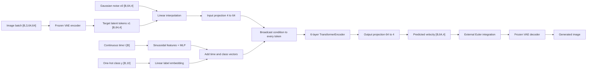

# FlowMatching 模型架构说明

> 文档状态：代码现状说明  
> 更新时间：2026-11-16  
> 主要依据：[`flow_matching.py`](./flow_matching.py)、[`config.py`](./config.py)、[`train_flow_matching.py`](./train_flow_matching.py)、[`vae.py`](./vae.py)

这份文档回答的不是“Flow Matching 论文里有哪些变体”，而是“当前仓库里的 `FlowMatching` 究竟长什么样，张量如何流动，它在训练和采样时承担什么职责”。代码里有两层容易混在一起的行为：一层是 `FlowMatching.forward()` 计算速度场，另一层是训练器选择 $x_0$、$x_1$、时间 $t$，再用预测速度积分。把这两层拆开以后，模型结构会清楚很多。

## 1. 一句话概括

当前模型学习一个**类别条件、连续时间条件、定义在 VAE latent token 上**的速度场：

$$
v_\theta(\mathbf{x}_t,t,y)
:
\mathbb{R}^{B\times S\times 4}\times[0,1]^B\times\{0,1\}^{B\times 10}
\rightarrow
\mathbb{R}^{B\times S\times 4}.
$$

默认配置下，$B$ 是 batch size，$S=64$ 是 latent token 数，$4$ 是每个 latent token 的通道数，$10$ 是类别数。模型输出与 $\mathbf{x}_t$ 同形状，但它预测的不是最终图像，而是当前位置的速度 $\dot{\mathbf{x}}_t$。训练器随后用这个速度场把高斯噪声逐步积分成 VAE latent，最后交给 VAE decoder 还原图像。

这里最容易产生误解的一点是：**`FlowMatching` 不等于完整的生成流程**。完整流程还包括 VAE encoder、velocity matching loss、数值积分和 VAE decoder。`FlowMatching` 类只负责中间的“条件速度预测”。

## 2. 系统上下文

下面的图把 `FlowMatching` 内部模块和外部依赖分开。VAE 在训练时冻结，既为 Flow Matching 提供 latent target，也在采样结束后把 latent 解码成图像。



图中带中文说明的正文负责解释，模块节点本身使用英文，避免在渲染后的图示里混入中英文标签。

## 3. 模型内部结构

### 3.1 组件总览

| 组件 | 代码位置 | 输入到输出 | 是否可训练 | 主要职责 |
|---|---|---:|---:|---|
| `Img2Tokens` | [`flow_matching.py`](./flow_matching.py#L11) | `[B,3,64,64] -> [B,64,64]` | 是 | 把原始图像切成 token；当前 Flow Matching 主路径未使用 |
| `input_proj` | [`flow_matching.py`](./flow_matching.py#L131) | `[B,S,4] -> [B,S,64]` | 是 | 把窄 VAE latent 投到 Transformer 宽度 |
| `time_embed` | [`flow_matching.py`](./flow_matching.py#L56) | `[B] -> [B,64]` | 部分可训练 | 用固定频率构造时间特征，再由 MLP 变换 |
| `label_embed` | [`flow_matching.py`](./flow_matching.py#L133) | `[B,10] -> [B,64]` | 是 | 把 one-hot 类别投到同一条件空间 |
| `dit` | [`flow_matching.py`](./flow_matching.py#L136) | `[B,S,64] -> [B,S,64]` | 是 | 6 层、8 头的双向 self-attention token mixer |
| `output_proj` | [`flow_matching.py`](./flow_matching.py#L148) | `[B,S,64] -> [B,S,4]` | 是 | 把隐表示投回 latent velocity |
| `get_xt_and_xt_dot()` | [`flow_matching.py`](./flow_matching.py#L248) | `(x0,x1,t) -> (xt,x1-x0)` | 无参数 | 构造直线插值路径和训练目标 |

`Img2Tokens` 和 Flow Matching 主路径的关系需要特别说明。`Img2Tokens` 用 `stride=8`、`kernel_size=8` 的卷积把每个 $8\times8$ RGB patch 映射成一个 64 维 token，但 `FlowMatching.forward()` 并没有调用它。当前训练入口先从冻结 VAE 得到每 token 4 维的 latent，再把 `latent_channels=4` 投影到 `d_model=64`。因此，`Img2Tokens` 是文件里保留的像素 tokenization 组件，不是当前速度场的实际输入层。

### 3.2 前向计算公式

对于第 $i$ 个 latent token，代码先做特征投影：

$$
\mathbf{h}_i^{(0)}
=
\mathbf{W}_{\mathrm{in}}\mathbf{x}_{t,i}
+\mathbf{b}_{\mathrm{in}}
+\mathbf{u}(t)
+\mathbf{e}(y),
$$

其中：

- $\mathbf{x}_{t,i}\in\mathbb{R}^4$ 是插值后的第 $i$ 个 VAE latent token。
- $\mathbf{u}(t)\in\mathbb{R}^{64}$ 是时间嵌入。
- $\mathbf{e}(y)\in\mathbb{R}^{64}$ 是类别嵌入。
- 条件向量在所有 $S$ 个 token 上广播，因此同一张图的所有 token 获得相同的时间与类别上下文。

接着，将 $S$ 个 token 组成的矩阵送入 6 层 Transformer：

$$
\mathbf{H}^{(L)}
=
\operatorname{TransformerEncoder}
\left(
\left[
\mathbf{h}_1^{(0)},\ldots,\mathbf{h}_S^{(0)}
\right]
\right).
$$

最后逐 token 投影回 4 维：

$$
\hat{\mathbf{v}}_i
=
\mathbf{W}_{\mathrm{out}}\mathbf{h}_i^{(L)}
+\mathbf{b}_{\mathrm{out}}.
$$

所有 $\hat{\mathbf{v}}_i$ 拼起来，就是 `forward()` 返回的 `[B, S, 4]` velocity。代码在 [`flow_matching.forward()`](./flow_matching.py#L241) 中用三步完成这件事：先投影 $x_t$，再构造并广播条件，最后经过 Transformer 和输出投影。

## 4. 连续时间嵌入

Flow Matching 的 $t$ 是连续标量，不是离散类别编号，因此这里使用类似 Transformer 正弦位置编码的多频率表示。设 Transformer 宽度为 $d=64$，半宽度为 $d/2=32$，第 $j$ 个频率为：

$$
\omega_j
=
\exp\left(
-\log(10000)\frac{j}{d/2}
\right),
\qquad j=0,\ldots,31.
$$

对时间 $t$ 构造：

$$
\mathbf{a}(t)
=
\left[
t\omega_0,\ldots,t\omega_{31}
\right],
$$

再拼接正弦和余弦：

$$
\mathbf{z}(t)
=
\left[
\sin(\mathbf{a}(t)),
\cos(\mathbf{a}(t))
\right]
\in\mathbb{R}^{64}.
$$

最后经过：

$$
\mathbf{u}(t)
=
\operatorname{Linear}_{64\rightarrow64}
\left(
\operatorname{SiLU}
\left(
\operatorname{Linear}_{64\rightarrow64}(\mathbf{z}(t))
\right)
\right).
$$

频率表完全由 `embedding_dim` 和 `max_period` 决定，所以它不是可学习参数。代码用

```python
self.register_buffer("frequencies", frequencies, persistent=False)
```

把它登记成非持久 buffer。这样它会跟随 `model.to(device)` 和 dtype 转换移动，但不会进入优化器的参数更新，也不会写入 `state_dict()`。真正可训练的是后面的两层 MLP，共 8,320 个参数。

多频率基函数的直觉是：低频坐标描述缓慢变化，高频坐标描述细致变化；MLP 再学习如何组合这些时间特征。它让距离很近的两个 $t$ 仍然具有可区分的表示，而不是像整数 label embedding 那样只能查一张有限大小的表。

## 5. 时间与类别如何注入

类别输入是 `[B, 10]` 的 one-hot 向量，`label_embed` 是普通的 `nn.Linear(10, 64)`，不是 `nn.Embedding` 查表。得到时间向量和类别向量后，代码直接相加：

$$
\mathbf{c}(t,y)
=
\mathbf{u}(t)+\mathbf{e}(y).
$$

随后通过下面的广播操作加到每个 token 上：

```python
hidden = hidden + condition[:, None, :]
```

因此条件不是只加在第一个 token，也不是通过 cross-attention 注入，而是作为所有 token 的公共加性偏置。这个设计有清楚的优点：实现简单，计算代价低，条件通过 self-attention 自然扩散到整个序列。它也有明确的表达边界：时间与类别在进入 Transformer 前已经被压成一个加性向量，如果要表达更复杂的乘性调制，需要改成 FiLM、AdaLN 或 cross-attention。

## 6. Transformer backbone

`FlowMatching` 把 backbone 命名为 `self.dit`，但当前实现不是完整的 DiT。它没有 patch embedding、spatial positional embedding、AdaLN 或 diffusion timestep modulation；它就是一个标准的 `nn.TransformerEncoder`。

默认参数对应下面的计算结构：

| 属性 | 默认值 | 含义 |
|---|---:|---|
| `d_model` | 64 | token 隐表示宽度 |
| `n_layer` | 6 | TransformerEncoderLayer 层数 |
| `n_head` | 8 | 每层 attention head 数 |
| head dimension | 8 | 默认配置下 $64/8=8$ |
| `dim_feedforward` | 256 | 默认配置下 $4d=4\times64$ |
| activation | GELU | 前馈网络激活函数 |
| `batch_first` | `True` | 输入输出布局均为 `[B,S,d]` |
| attention mask | 无 | 所有 token 双向可见 |
| positional embedding | 无 | 当前没有显式空间位置信号 |

每个 encoder layer 先做 self-attention 和残差连接，再做逐 token 前馈网络和残差连接。代码没有显式传入 `dropout`、`norm_first` 等参数，所以其余行为采用当前 PyTorch 版本的 `TransformerEncoderLayer` 默认值。这里的 self-attention 没有 mask，64 个 latent token 之间可以全局交换信息，而不是像 causal language model 那样只能看左侧上下文。

### 6.1 缺少位置编码的实际含义

`VAE.encode_tokens()` 按行优先顺序把 `[B,4,8,8]` flatten 成 `[B,64,4]`，所以每个 token 对应二维 latent grid 中的一个空间位置。但当前 Transformer 收到 token 后，没有把“第 0 个位置”还是“第 37 个位置”作为额外特征告诉它。

没有位置编码并不代表模型把 token 随意重新排列：输入顺序仍然决定输出顺序。问题在于，Transformer 本身没有绝对位置 ID 或二维坐标，两个内容相同、位置不同的 token 会得到相同的 attention 行，空间位置信息只能间接来自 token 内容，不能由架构显式区分。对于图像 latent，通常应该增加二维 spatial positional embedding，或者让卷积/位置编码先给 token 注入位置信息。这是当前架构最值得注意的结构性缺口。

## 7. 默认张量形状

以 `FlowMatchingModelConfig` 和 `VAEConfig` 的默认值为例，完整形状变化如下：

| 阶段 | 形状或取值 | 来源 |
|---|---:|---|
| 原始图像 | `[B,3,64,64]` | dataset / VAE |
| VAE posterior mean | `[B,4,8,8]` | VAE encoder |
| 目标 latent token $x_1$ | `[B,64,4]` | `flatten` 后 `transpose(1,2)` |
| 高斯噪声 $x_0$ | `[B,64,4]` | `torch.randn_like(x1)` |
| 连续时间 $t$ | `[B]` | 每个样本独立采样 |
| one-hot 类别 $y$ | `[B,10]` | dataset |
| 插值 latent $x_t$ | `[B,64,4]` | `(1-t)x0 + t*x1` |
| 投影后的 token | `[B,64,64]` | `input_proj` |
| 时间、类别、条件向量 | `[B,64]` | embedding / addition |
| Transformer 输出 | `[B,64,64]` | 6 层 encoder |
| 预测速度 | `[B,64,4]` | `output_proj` |
| 采样后解码图像 | `[B,3,64,64]` | VAE decoder |

`FlowMatching.forward()` 真正强制检查的是 $x_t$ 的 rank 为 3，以及最后一维等于 `latent_channels`。它没有固定检查 token 数必须为 64，所以从接口上说，它接受任意 `[B,S,4]` 序列；当前 VAE 在 `64\times64` 图像、8 倍下采样下恰好产生 `S=64`。如果修改图像大小或 VAE 下采样倍率，Flow Matching 仍可计算，但训练器和 VAE 的 token 数必须同步。

## 8. Flow Matching 的训练路径

当前代码采用线性插值路径。给定噪声 $x_0$ 和目标 latent $x_1$：

$$
\mathbf{x}_t=(1-t)\mathbf{x}_0+t\mathbf{x}_1,
\qquad
\mathbf{u}^{\star}=\mathbf{x}_1-\mathbf{x}_0.
$$

`get_xt_and_xt_dot()` 把时间 reshape 成 `[B,1,1]`，在保持广播语义的同时支持三维 token tensor。目标速度是常数 $\mathbf{x}_1-\mathbf{x}_0$，而网络输入会随着 $t$ 改变。训练目标是：

$$
\mathcal{L}(\theta)
=
\mathbb{E}_{x_0,x_1,t,y}
\left[
\left\|
v_\theta(\mathbf{x}_t,t,y)
-
(\mathbf{x}_1-\mathbf{x}_0)
\right\|_2^2
\right].
$$

训练脚本使用 `F.mse_loss`，默认会把 batch、token 和 channel 上的所有元素取平均。训练路径可以概括为：

```mermaid
sequenceDiagram
    participant Data as DataLoader
    participant VAE as Frozen VAE
    participant Flow as FlowMatching
    participant Loss as MSE loss
    participant Opt as AdamW

    Data->>VAE: image batch
    VAE-->>Flow: x1 latent tokens
    Flow->>Flow: sample x0 and t, build x_t
    Flow->>Flow: predict velocity
    Flow->>Loss: compare with x1 - x0
    Loss-->>Opt: scalar loss
    Opt-->>Flow: update trainable parameters
```

需要看清两条边界。第一，$x_1$ 来自 `VAE.encode_tokens()`，它使用 VAE posterior mean，而不是 posterior 采样；Flow Matching 学习的是从高斯噪声到“VAE 编码均值”的速度场。第二，Flow Matching 网络不计算 loss，也不拥有 optimizer；这些都由 [`train_flow_matching.py`](./train_flow_matching.py#L138) 组织。

### 8.1 当前训练循环的一个细节

训练器对一个外层的 image batch 先采样一次 $x_0$，随后在内层循环中采样 `total_steps=24` 次不同的 $t$，每一次都执行 forward、MSE、backward 和 optimizer step。因此同一个 $x_0,x_1$ 对一个 batch 会贡献 24 个不同时间点的监督信号。这个做法仍然是在估计上面的期望，但它不是“每画一个时间点就重新抽一个噪声”的 canonical 写法。

另外，`accu_loss` 在内层每次训练步都累加，最后却除以 `len(train_dataloader)`，而没有除以“batch 数 × `total_steps`”。所以日志中的 `mean_loss` 会带有 `total_steps` 的尺度，不能直接和普通单次 loss 对比；`best_loss` 记录的是最后一步的 `loss.item()`，也不是 epoch 的严格均值。这些行为属于训练脚本的记账现状，不改变 `FlowMatching` 的模型接口。

## 9. 采样与解码路径

采样不在 `FlowMatching` 类内部实现，而在 [`train_flow_matching.py`](./train_flow_matching.py#L198) 的 `eval()` 中。它从标准高斯 latent 开始，使用显式 Euler：

$$
\mathbf{x}_{k+1}
=
\mathbf{x}_k+\Delta t\,v_\theta(\mathbf{x}_k,t_k,y),
\qquad
\Delta t=\frac{1}{N},
\qquad
t_k=\frac{k}{N}.
$$

默认 $N=24$，连续调用 24 次。最后一次更新使用 $t=23/24$，将状态推进到近似 $t=1$ 的终点；模型本身不需要在第 24 次之前再次评估 $t=1$。之后通过 VAE 的 `decode_tokens()` 把 `[B,64,4]` 变回 `[B,4,8,8]`，再解码成 `[B,3,64,64]` 图像。

这个采样器是密集网格上的 24 次 Euler 采样，不是 score-based ODE 的专用 solver，也没有 classifier-free guidance、negative prompt 或 cross-attention 条件。当前类别条件完全来自 `label_embed` 的加性向量。

## 10. 参数与计算量

在当前默认配置下，模型共有 **309,508 个可训练参数**。这个数字可以通过模块账单核对：

| 模块 | 参数量公式 | 数值 |
|---|---:|---:|
| `input_proj` | $64\times4+64$ | 320 |
| `time_embed.mlp` | $2(64^2+64)$ | 8,320 |
| `label_embed` | $10\times64+64$ | 704 |
| 6 个 Transformer layer | $6\times49{,}984$ | 299,904 |
| `output_proj` | $4\times64+4$ | 260 |
| **总计** |  | **309,508** |

其中 `time_embed.frequencies` 有 32 个浮点数，但因为它不是 parameter，也不持久化，所以不计入这 309,508 个参数。单个 Transformer layer 的 49,984 个参数分别来自 self-attention、输出投影、两层 FFN 和两个 LayerNorm；实际参数名可以通过 `model.named_parameters()` 核对。

模型的主要计算瓶颈在 self-attention 和前馈网络。默认只有 64 个 token，因此 attention 的序列长度很小；真正的瓶颈通常来自 batch size、VAE 编解码和多次训练步，而不是 64 个 token 之间的二次 attention。若把 VAE latent 网格增大到 $16\times16$，token 数会变成 256，attention 的计算和显存占用会明显上升。

## 11. 接口契约与扩展落点

现在把最容易踩的约束集中列出来。它们不是额外的抽象层，而是从当前代码直接推出的边界：

- `input_proj` 的输入通道必须等于 VAE 的 `latent_channels`；两者默认都是 4，但 `FlowMatching` 没有去查询 VAE 配置，因此换 VAE 时要手动同步。
- `d_model` 必须是正偶数，这是 `TimestepEmbedding` 拼接 `sin`/`cos` 的要求；同时必须能被 `n_head` 整除。
- `T` 必须是浮点数，形状为 `[B]` 或 `[B,1]`，并且落在 $[0,1]$；训练和采样都应保持相同的时间方向。
- `label_batch` 必须是浮点 one-hot，每一行恰好有一个 1；类别维必须等于 `category_num=10`。
- `FlowMatching.forward()` 只返回速度，不自动做 Euler 积分、不多步采样、不计算 loss，也不负责 VAE 解码。
- `total_steps` 存储在模型配置中，但 `FlowMatching.forward()` 本身并不使用它；它主要用于训练器的内层循环、`one_step` 和采样步数。
- `register_buffer(..., persistent=False)` 让频率表跟随设备，但不会出现在默认 `state_dict()`；重新构造同配置模型时，频率会按公式重新生成。

如果要把当前的“latent-token Transformer velocity field”升级成更完整的 DiT，最直接的改造点是：在 `input_proj` 后加入二维位置编码；用 AdaLN 或 FiLM 替代简单加法条件；把 VAE latent patch 或像素 patch 的 tokenizer 纳入主路径；并将采样器从固定 24 步 Euler 扩展为可配置的 ODE solver。当前的 `get_xt_and_xt_dot()` 已经提供了训练路径，但模型类还没有封装训练 loss 和采样接口。

## 12. 小结

当前 `flow_matching.py` 的模型可以概括成一条紧凑链路：冻结 VAE 把图像变成 64 个 4 维 latent token；高斯噪声与目标 latent 做直线插值得到 $x_t$；时间向量和类别向量相加后广播到每个 token；6 层、8 头双向 Transformer 在 token 之间混合信息；输出投影给出与 $x_t$ 同形状的速度。训练器用速度目标 $x_1-x_0$ 做 MSE，采样器再用 Euler 法走 24 步，最后由 VAE 解码。

因此，读这份代码时要始终保留两个视角：**模型负责条件速度场，Flow Matching 的“流动”由外部训练目标和采样积分完成**。这也是理解现有实现、判断是否能加入位置编码或真正 DiT 结构时最重要的分界线。
