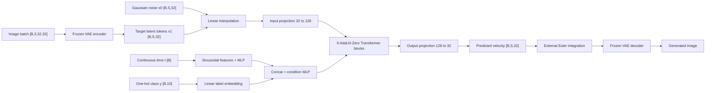

# FlowMatching 模型架构说明

> 文档状态：代码现状说明  
> 更新时间：2026-11-18
> 主要依据：[`flow_matching.py`](./flow_matching.py)、[`config.py`](./config.py)、[`train_flow_matching.py`](./train_flow_matching.py)、[`vae.py`](./vae.py)

这份文档回答的不是“Flow Matching 论文里有哪些变体”，而是“当前仓库里的 `FlowMatching` 究竟长什么样，张量如何流动，它在训练和采样时承担什么职责”。代码里有两层容易混在一起的行为：一层是 `FlowMatching.forward()` 计算速度场，另一层是训练器选择 $x_0$、$x_1$、时间 $t$，再用预测速度积分。把这两层拆开以后，模型结构会清楚很多。

## 1. 一句话概括

当前模型学习一个**类别条件、连续时间条件、定义在 VAE latent token 上**的速度场：

$$
v_\theta(\mathbf{x}_t,t,y)
:
\mathbb{R}^{B\times S\times 32}\times[0,1]^B\times\{0,1\}^{B\times 10}
\rightarrow
\mathbb{R}^{B\times S\times 32}.
$$

默认配置下，$B$ 是 batch size，$S=16$ 是 latent token 数，$32$ 是每个 latent token 的通道数，$10$ 是类别数。模型输出与 $\mathbf{x}_t$ 同形状，但它预测的不是最终图像，而是当前位置的速度 $\dot{\mathbf{x}}_t$。训练器随后用这个速度场把高斯噪声逐步积分成 VAE latent，最后交给 VAE decoder 还原图像。

这里最容易产生误解的一点是：**`FlowMatching` 不等于完整的生成流程**。完整流程还包括 VAE encoder、velocity matching loss、数值积分和 VAE decoder。`FlowMatching` 类只负责中间的“条件速度预测”。

## 2. 系统上下文

下面的图把 `FlowMatching` 内部模块和外部依赖分开。VAE 在训练时冻结，既为 Flow Matching 提供 latent target，也在采样结束后把 latent 解码成图像。



图中带中文说明的正文负责解释，模块节点本身使用英文，避免在渲染后的图示里混入中英文标签。

## 3. 模型内部结构

### 3.1 组件总览

| 组件 | 代码位置 | 输入到输出 | 是否可训练 | 主要职责 |
|---|---|---:|---:|---|
| `Img2Tokens` | [`flow_matching.py`](./flow_matching.py#L11) | `[B,3,32,32] -> [B,16,64]` | 是 | 把原始图像切成 token；当前 Flow Matching 主路径未使用 |
| `input_proj` | [`flow_matching.py`](./flow_matching.py) | `[B,S,32] -> [B,S,128]` | 是 | 把 VAE latent 投到 Transformer 宽度 |
| `time_embed` | [`flow_matching.py`](./flow_matching.py#L56) | `[B] -> [B,128]` | 部分可训练 | 用固定频率构造时间特征，再由 MLP 变换 |
| `label_embed` | [`flow_matching.py`](./flow_matching.py) | `[B,10] -> [B,128]` | 是 | 把 one-hot 类别投到同一条件空间 |
| `condition_mlp` | [`flow_matching.py`](./flow_matching.py) | `[B,256] -> [B,128]` | 是 | 学习时间与类别条件的交互 |
| `flow_matching` | [`flow_matching.py`](./flow_matching.py) | `[B,S,128] -> [B,S,128]` | 是 | 6 层、8 头的 AdaLN-Zero token blocks |
| `output_proj` | [`flow_matching.py`](./flow_matching.py) | `[B,S,128] -> [B,S,32]` | 是 | 把隐表示投回 latent velocity |
| `get_xt_and_xt_dot()` | [`flow_matching.py`](./flow_matching.py) | `(x0,x1,t) -> (xt,x1-x0)` | 无参数 | 构造直线插值路径和训练目标 |

`Img2Tokens` 和 Flow Matching 主路径的关系需要特别说明。`Img2Tokens` 用 `stride=8`、`kernel_size=8` 的卷积把每个 $8\times8$ RGB patch 映射成一个 64 维 token，但 `FlowMatching.forward()` 并没有调用它。当前训练入口先从冻结 VAE 得到每 token 32 维的 latent，再把 `latent_channels=32` 投影到 `d_model=128`。因此，`Img2Tokens` 是文件里保留的像素 tokenization 组件，不是当前速度场的实际输入层。

### 3.2 前向计算公式

对于第 $i$ 个 latent token，代码先做特征投影：

$$
\mathbf{h}_i^{(0)}
=
\mathbf{W}_{\mathrm{in}}\mathbf{x}_{t,i}
+\mathbf{b}_{\mathrm{in}}
+\mathbf{p}_i,
$$

其中：

- $\mathbf{x}_{t,i}\in\mathbb{R}^4$ 是插值后的第 $i$ 个 VAE latent token。
- $\mathbf{p}_i\in\mathbb{R}^{128}$ 是第 $i$ 个 token 的固定 sinusoidal 位置向量。
- $\mathbf{u}(t)\in\mathbb{R}^{128}$ 是时间嵌入。
- $\mathbf{e}(y)\in\mathbb{R}^{128}$ 是类别嵌入。
- 全局条件 $\mathbf{c}(t,y)$ 不直接加到 token 上，而是进入每个 block 的 AdaLN。

接着，将 $S$ 个 token 组成的矩阵送入 6 个 AdaLN-Zero block：

$$
\mathbf{c}(t,y)
=
\operatorname{MLP}
\left(
[\mathbf{u}(t);\mathbf{e}(y)]
\right),
$$

$$
\mathbf{H}^{(l+1)}
=
\operatorname{AdaLNZeroBlock}_l
\left(
\mathbf{H}^{(l)},\mathbf{c}(t,y)
\right).
$$

最后逐 token 投影回 4 维：

$$
\hat{\mathbf{v}}_i
=
\mathbf{W}_{\mathrm{out}}\mathbf{h}_i^{(L)}
+\mathbf{b}_{\mathrm{out}}.
$$

所有 $\hat{\mathbf{v}}_i$ 拼起来，就是 `forward()` 返回的 `[B, S, 4]` velocity。代码在 [`flow_matching.forward()`](./flow_matching.py) 中先投影 $x_t$ 并加入位置编码，再构造全局 time/class 条件，依次穿过 6 个 AdaLN-Zero block，最后投影回 latent velocity。

## 4. 连续时间嵌入

Flow Matching 的 $t$ 是连续标量，不是离散类别编号，因此这里使用类似 Transformer 正弦位置编码的多频率表示。设 Transformer 宽度为 $d=128$，半宽度为 $d/2=64$，第 $j$ 个频率为：

$$
\omega_j
=
\exp\left(
-\log(10000)\frac{j}{d/2}
\right),
\qquad j=0,\ldots,63.
$$

对时间 $t$ 构造：

$$
\mathbf{a}(t)
=
\left[
t\omega_0,\ldots,t\omega_{63}
\right],
$$

再拼接正弦和余弦：

$$
\mathbf{z}(t)
=
\left[
\sin(\mathbf{a}(t)),
\cos(\mathbf{a}(t))
\right]
\in\mathbb{R}^{128}.
$$

最后经过：

$$
\mathbf{u}(t)
=
\operatorname{Linear}_{128\rightarrow128}
\left(
\operatorname{SiLU}
\left(
\operatorname{Linear}_{128\rightarrow128}(\mathbf{z}(t))
\right)
\right).
$$

频率表完全由 `embedding_dim` 和 `max_period` 决定，所以它不是可学习参数。代码用

```python
self.register_buffer("frequencies", frequencies, persistent=False)
```

把它登记成非持久 buffer。这样它会跟随 `model.to(device)` 和 dtype 转换移动，但不会进入优化器的参数更新，也不会写入 `state_dict()`。真正可训练的是后面的两层 MLP，共 33,024 个参数。

多频率基函数的直觉是：低频坐标描述缓慢变化，高频坐标描述细致变化；MLP 再学习如何组合这些时间特征。它让距离很近的两个 $t$ 仍然具有可区分的表示，而不是像整数 label embedding 那样只能查一张有限大小的表。

## 5. 时间与类别如何注入

类别输入是 `[B, 10]` 的 one-hot 向量，`label_embed` 是普通的 `nn.Linear(10, 128)`。one-hot 经过线性层后等价于一张 10 行的可学习 embedding 表。时间向量和类别向量不直接相加，而是先拼接，再通过 `condition_mlp` 学习二者交互：

$$
\mathbf{c}(t,y)
=
\operatorname{MLP}
\left(
[\mathbf{u}(t);\mathbf{e}(y)]
\right).
$$

这个全局条件向量随后进入每个 Transformer block 的 AdaLN-Zero 调制层。对某一层归一化后的 token 表征 $\mathbf{h}$：

$$
\operatorname{AdaLN}(\mathbf{h};\mathbf{c})
=
(1+\boldsymbol{\gamma}(\mathbf{c}))
\operatorname{LN}(\mathbf{h})
+\boldsymbol{\beta}(\mathbf{c}).
$$

每个 block 分别生成 attention 与 MLP 的 scale、shift 和 residual gate。调制投影零初始化，因此 block 在训练开始时是恒等残差。条件不必只在网络入口注入一次，而是在每一层重新影响残差分支的尺度和贡献。

## 6. Transformer backbone

`FlowMatching` 把 backbone 命名为 `self.flow_matching`。它不是完整的 DiT：没有 pixel patch embedding，也没有 spatial-adaptive norm，但每个 block 都包含 self-attention、FFN 和全局 time/class AdaLN-Zero 调制。

默认参数对应下面的计算结构：

| 属性 | 默认值 | 含义 |
|---|---:|---|
| `d_model` | 128 | token 隐表示宽度 |
| `n_layer` | 6 | AdaLN-Zero Transformer block 数 |
| `n_head` | 8 | 每层 attention head 数 |
| head dimension | 16 | 默认配置下 $128/8=16$ |
| `dim_feedforward` | 512 | 默认配置下 $4d=4\times128$ |
| activation | GELU | 前馈网络激活函数 |
| attention mask | 无 | 所有 token 双向可见 |
| positional embedding | 固定 1D sinusoidal | 为 token 顺序提供显式位置信号 |
| conditioning | AdaLN-Zero | 每层生成 scale、shift 与 residual gate |

每个 block 先对 token 做无仿射 LayerNorm，再用 AdaLN 的 scale/shift 调制后进入 self-attention；attention 输出乘以 gate 后回到残差。FFN 分支使用同样流程。这里的 self-attention 没有 mask，所有 latent token 之间可以全局交换信息。

### 6.1 一维位置编码提供了什么

`VAE.encode_tokens()` 按行优先顺序把 `[B,32,H,W]` flatten 成 `[B,S,32]`。`SinusoidalPositionEmbedding` 根据 `FlowMatchingModelConfig.num_tokens` 生成固定位置向量，并在进入 Transformer 前加到 token 表征上。这样，内容相同但位置不同的 token 不再拥有完全相同的输入。

当前编码仍是按行优先编号的一维序列位置，并没有显式告诉模型 `(row, col)` 两个坐标。默认 32×32 图像按 4 倍压缩得到 8×8 spatial latent，对应 64 个 token。如果继续降低空间压缩倍率，token 数会按网格边长平方增长，因此训练入口保留 BF16 autocast 和可配置 batch size。

## 7. 默认张量形状

以 `FlowMatchingModelConfig` 和 `VAEConfig` 的默认值为例，完整形状变化如下：

| 阶段 | 形状或取值 | 来源 |
|---|---:|---|
| 原始图像 | `[B,3,32,32]` | dataset / VAE |
| VAE posterior mean | `[B,32,8,8]` | VAE encoder |
| 原始 VAE latent token | `[B,64,32]` | `flatten` 后 `transpose(1,2)` |
| 标准化目标 $x_1$ | `[B,64,32]` | 按 channel 减均值、除标准差 |
| 高斯噪声 $x_0$ | `[B,64,32]` | `N(0, I)` |
| 连续时间 $t$ | `[B]` | 每个样本独立采样 |
| one-hot 类别 $y$ | `[B,10]` | dataset |
| 插值 latent $x_t$ | `[B,64,32]` | `(1-t)x0 + t*x1` |
| 投影后的 token | `[B,64,128]` | `input_proj` |
| 时间、类别、条件向量 | `[B,128]` | embedding / addition |
| Transformer 输出 | `[B,64,128]` | 6 层 encoder |
| 预测速度 | `[B,64,32]` | `output_proj` |
| 采样后解码图像 | `[B,3,32,32]` | 逆标准化后交给 VAE decoder |

`FlowMatching.forward()` 真正强制检查的是 $x_t$ 的 rank 为 3，以及最后一维等于 `latent_channels`。它没有固定检查 token 数必须为 64，所以从接口上说，它接受任意 `[B,S,32]` 序列；当前 VAE 在 `32\times32` 图像、4 倍下采样下恰好产生 `S=64`。如果修改图像大小或 VAE 下采样倍率，Flow Matching 仍可计算，但训练器和 VAE 的 token 数必须同步。

## 8. Flow Matching 的训练路径

当前代码采用线性插值路径。冻结 VAE 先给出原始 posterior mean 组成的 token $z_1$；训练器再按 channel 统计量 $\mu_c,\sigma_c$ 做可逆坐标变换：

$$
\mathbf{x}_1=\frac{\mathbf{z}_1-\boldsymbol{\mu}}{\boldsymbol{\sigma}}.
$$

VAE 训练时使用的 KL weight 很小，32 个 latent channel 的尺度差异也很大，直接让 `N(0, I)` 对准原始 latent 会浪费模型容量。标准化以后，Flow Matching 的目标分布与标准高斯源处在更接近的数值尺度上；采样结束时再执行

$$
\hat{\mathbf{z}}_1=\hat{\mathbf{x}}_1\boldsymbol{\sigma}+\boldsymbol{\mu}
$$

之后才进入 VAE decoder。均值、标准差会随 checkpoint 一起保存。

在线性路径中，给定噪声 $x_0$ 和标准化目标 latent $x_1$：

$$
\mathbf{x}_t=(1-t)\mathbf{x}_0+t\mathbf{x}_1,
\qquad
\mathbf{u}^{\star}=\mathbf{x}_1-\mathbf{x}_0.
$$

`get_xt_and_xt_dot()` 把时间 reshape 成 `[B,1,1]`，在保持广播语义的同时支持三维 token tensor。目标速度是常数 $\mathbf{x}_1-\mathbf{x}_0$，而网络输入会随着 $t$ 改变。训练目标是：

$$
\mathcal{L}(\theta)
=
\mathbb{E}_{x_0,x_1,t,y}
\left[
\left\|
v_\theta(\mathbf{x}_t,t,y)
-
(\mathbf{x}_1-\mathbf{x}_0)
\right\|_2^2
\right].
$$

训练脚本使用 `F.mse_loss`，默认会把 batch、token 和 channel 上的所有元素取平均。训练路径可以概括为：

```mermaid
sequenceDiagram
    participant Data as DataLoader
    participant VAE as Frozen VAE
    participant Flow as FlowMatching
    participant Loss as MSE loss
    participant Opt as AdamW

    Data->>VAE: image batch
    VAE-->>Flow: x1 latent tokens
    Flow->>Flow: sample x0 and t, build x_t
    Flow->>Flow: predict velocity
    Flow->>Loss: compare with x1 - x0
    Loss-->>Opt: scalar loss
    Opt-->>Flow: update trainable parameters
```

需要看清两条边界。第一，先由 `VAE.encode_tokens()` 得到 posterior mean，而不是 posterior sample；再做 channel 标准化，Flow Matching 才会见到 $x_1$。第二，Flow Matching 网络不计算 loss，也不拥有 optimizer；这些都由 [`train_flow_matching.py`](./train_flow_matching.py) 组织。

### 8.1 当前训练循环的一个细节

训练器对一个 image batch 先编码得到 $x_1$，再采样一次 $x_0$ 和每个样本各自的 $t$，随后只执行一次 forward、MSE、backward 和 optimizer step。不同 batch 会重新采样噪声与时间，因此一个 epoch 内的所有 optimizer step 合起来估计上面的期望。

`accu_loss` 每个 batch 累加一次，最后除以 DataLoader 的 batch 数，因此日志里的 `mean_loss` 是 epoch 内 batch 等权均值。最佳 checkpoint 也按这个值选择。

## 9. 采样与解码路径

采样不在 `FlowMatching` 类内部实现，而在 [`train_flow_matching.py`](./train_flow_matching.py) 的 `sample()` 中。它从标准化坐标里的标准高斯 latent 开始，使用显式 Euler：

$$
\mathbf{x}_{k+1}
=
\mathbf{x}_k+\Delta t\,v_\theta(\mathbf{x}_k,t_k,y),
\qquad
\Delta t=\frac{1}{N},
\qquad
t_k=\frac{k}{N}.
$$

默认 $N=100$，连续调用 100 次。最后一次更新使用 $t=99/100$，将状态推进到近似 $t=1$ 的终点；模型本身不需要在第 100 次之前再次评估 $t=1$。之后先执行逆标准化，再由 VAE 的 `decode_tokens()` 解码。默认 VAE 把 `[B,64,32]` 变回 `[B,32,8,8]`，再还原为 32×32 RGB 图像。

训练过程中的可视化采样使用 `SAMPLES_PER_CLASS=10`：10 个类别各生成 10 个独立 latent，共 100 张图；保存网格时 `nrow=10`，因此每一行对应一个类别。

这个采样器是密集网格上的 100 次 Euler 采样，不是 score-based ODE 的专用 solver，也没有 classifier-free guidance、negative prompt 或 cross-attention 条件。条件通过 `condition_mlp` 和逐层 AdaLN-Zero 注入。

## 10. 参数与计算量

在当前默认配置下，模型共有 **1,882,500 个可训练参数**。这个数字可以通过模块账单核对：

| 模块 | 参数量公式 | 数值 |
|---|---:|---:|
| `input_proj` | $128\times32+128$ | 4,224 |
| `time_embed.mlp` | $2(128^2+128)$ | 33,024 |
| `label_embed` | $10\times128+128$ | 1,408 |
| `condition_mlp` | $256\times128+128+128^2+128$ | 49,408 |
| 6 个 AdaLN-Zero block | $6\times296{,}832$ | 1,780,992 |
| `output_proj` | $128^2+128+32\times128+32$ | 20,640 |
| **总计** |  | **1,889,696** |

其中时间频率和位置编码缓存不是 parameter，也不持久化。单个 AdaLN-Zero block 的 296,832 个参数包含 self-attention、FFN，以及从条件向量生成六组调制参数的投影；LayerNorm 本身使用非仿射形式。

模型的主要计算瓶颈在 self-attention 和前馈网络。默认有 64 个 token，attention 仍需计算 $64^2$ 个 pair；真正的瓶颈通常来自 batch size、VAE 编解码、前馈网络和多次训练步，而不是只看序列长度就能判断。若继续把压缩倍率降到 2，得到 $16\times16$ latent，token 数会变成 256，attention 的计算和显存占用会明显上升。

## 11. 接口契约与扩展落点

现在把最容易踩的约束集中列出来。它们不是额外的抽象层，而是从当前代码直接推出的边界：

- `input_proj` 的输入通道必须等于 VAE 的 `latent_channels`；两者默认都是 32。
- `num_tokens` 必须等于 VAE 的 `latent_size²`。训练器和分析器都会检查这个契约。
- `d_model` 必须是正偶数，这是 `TimestepEmbedding` 拼接 `sin`/`cos` 的要求；同时必须能被 `n_head` 整除。
- `T` 必须是形状 `[B,1]` 的浮点张量，并且落在 $[0,1]$；训练和采样都应保持相同的时间方向。
- `label_batch` 必须是浮点 one-hot，每一行恰好有一个 1；类别维必须等于 `category_num=10`。
- `FlowMatching.forward()` 只返回速度，不自动做 Euler 积分、不多步采样、不计算 loss，也不负责 VAE 解码。
- `total_steps` 存储在模型配置中，但 `FlowMatching.forward()` 本身并不使用它；它主要决定采样器的 Euler 步数。
- `register_buffer(..., persistent=False)` 让频率表跟随设备，但不会出现在默认 `state_dict()`；重新构造同配置模型时，频率会按公式重新生成。

如果继续升级成更完整的 DiT，最直接的改造点是把一维位置编号升级成二维位置编码，并把 VAE latent patch 或像素 patch 的 tokenizer 纳入主路径。当前已经具备 AdaLN-Zero、动态 token 数和可配置采样器。

## 12. 小结

当前链路是：冻结 VAE 把 32×32 图像变成 32 维 latent token，训练器按 channel 标准化；高斯噪声与目标 latent 做直线插值；时间与类别条件先拼接经 MLP，再逐层通过 AdaLN-Zero 调制 6 个双向 Transformer block；输出投影给出速度。训练器用 $x_1-x_0$ 做 MSE，采样器走 100 步 Euler，逆标准化后由 VAE 解码。默认 latent grid 是 8×8，共 64 个 tokens。

因此，读这份代码时要始终保留两个视角：**模型负责条件速度场，Flow Matching 的“流动”由外部训练目标和采样积分完成**。这也是理解现有实现、判断是否能加入位置编码或真正 DiT 结构时最重要的分界线。

## 13. Pixel U-Net Flow

[`pixel_flow_unet.py`](./pixel_flow_unet.py) 和 [`train_pixel_flow_unet.py`](./train_pixel_flow_unet.py) 提供完全不使用 VAE 的对照路径。默认模型直接接收并输出 `[B,3,32,32]`，在 `[-1,1]` 图像坐标中执行 CFM，采样最后裁剪并映射回 `[0,1]`。

网络使用四层 Conv U-Net：32、64、128、256 channels，默认对应 32→16→8→4 的空间尺度。time/class FiLM 条件由 [`pixel_unet_blocks.py`](./pixel_unet_blocks.py) 中的共享残差块注入。模型约 617 万参数；当前 32×32、batch 512、400 epochs 的 best velocity MSE 为 `0.177583`。

绕开 VAE 后，生成图的全局 mean、std 和梯度强度接近真实图像，但对象语义仍不稳定，说明 VAE decoder 不是全部误差来源。当前 latent 是 2,048 个数值，像素表示是 3,072 个数值；在 32×32 图像上，直接建模像素空间已经足够小，因此 Pixel Flow 的视觉质量仍明显领先 latent 路线。

## 14. Pixel U-Net DDPM

[`pixel_ddpm.py`](./pixel_ddpm.py) 与 [`train_pixel_ddpm.py`](./train_pixel_ddpm.py) 复用同一个 Pixel Conv U-Net backbone，在 `[B,3,32,32]` 图像坐标上执行 1000-step ε-prediction DDPM。它不经过 VAE，训练目标是预测加噪图像中的标准噪声，采样则执行 1000-step ancestral reverse process。模型参数量与 Pixel Flow 相同，约 617 万。

Pixel DDPM 从旧 200-epoch epoch checkpoint 恢复到 400 epochs 后，best noise MSE 从 `0.03099425` 降到 `0.03066244`。复现最佳结果时应读取 `pixel_ddpm_best.pt`，若要继续训练则读取第 400 轮完整状态 `pixel_ddpm_epoch.pt`。完整比较和实现取舍见 [当前实验报告](./flow_matching_current_experiment_report.md)。
