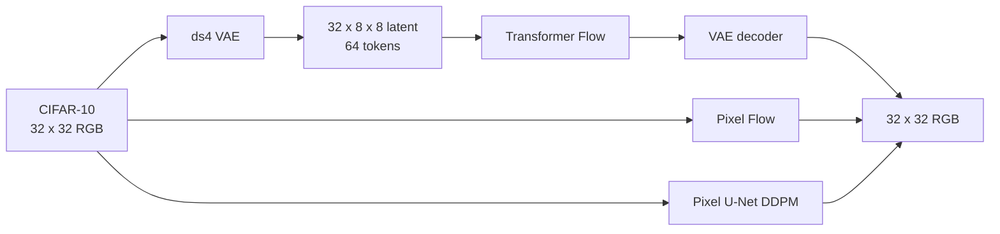
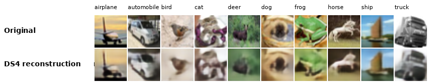
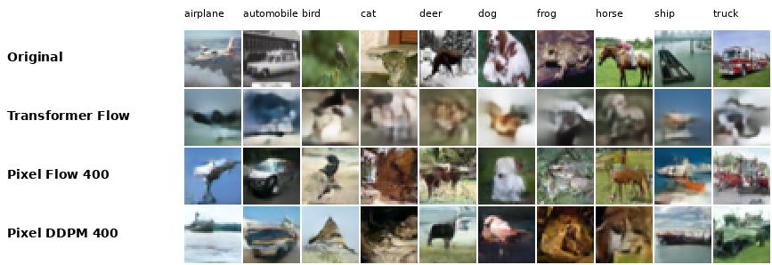
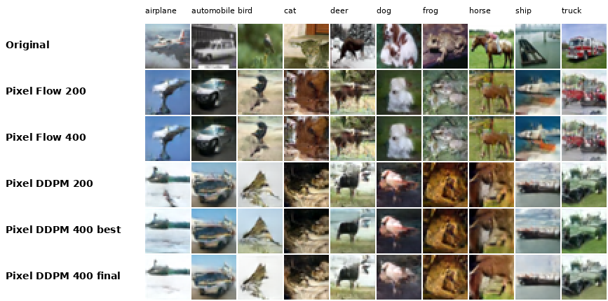

# ds4 VAE、Transformer Flow 与 Pixel 模型实验报告

> 数据：CIFAR-10 原生 32×32 RGB  
> VAE：32 channels、`downsample_factor=4`、`8×8` spatial latent、64 tokens  
> latent 生成：Transformer Flow，batch size 512、200 epochs  
> Pixel 生成：Pixel Flow 与 Pixel DDPM，均续训至 400 epochs  
> GPU：NVIDIA GeForce RTX 5080 Laptop GPU

当前工作区保留三条生成路线：直接建模 VAE latent 的 Transformer Flow、直接建模像素的 Pixel Flow，以及直接建模像素的 Pixel DDPM。这样既能观察 VAE bottleneck 的收益和代价，也保留了当前画质最好的 pixel 路径：Transformer 负责全局 latent 关系，pixel 模型则完全绕开 decoder。

## 0. 结论先行

当前 latent Transformer 已经能把生成 latent 的 channel mean error 和 round-trip error 控制到较低水平，但生成图仍明显柔于 pixel 路线。Pixel Flow 与 Pixel DDPM 从 epoch 200 续训到 400 后都刷新了 best loss，说明旧 checkpoint 中的模型、optimizer 和 scheduler 可以完整恢复；不过改善幅度分别只有 `0.84%` 和 `1.07%`，属于细节级优化。

如果目标是当前项目的最佳 32×32 生成质量，Pixel DDPM 仍是首选，Pixel Flow 是更快、更容易调试的折中。如果目标是比较 VAE latent 与像素空间，Transformer Flow 是现在唯一保留的 latent 生成 baseline。

## 1. 当前链路



Transformer 使用 6 层双向 AdaLN-Zero block，在 64 个 token 之间做全局 attention，再用 100-step Euler 从高斯噪声积分为生成 latent。Pixel Flow 与 Pixel DDPM 使用共享的 pixel U-Net block，但前者预测速度，后者预测扩散噪声。

## 2. ds4 VAE

VAE 使用完整 10,000 张测试集和 posterior mean 重建。图中每一列对应一个类别，上排是原始图，下排是 ds4 重建。



| latent shape | 参数量 | MSE ↓ | MAE ↓ | PSNR ↑ | SSIM ↑ | LPIPS ↓ |
|---|---:|---:|---:|---:|---:|---:|
| `32×8×8` | 1,847,427 | 0.003529 | 0.042174 | 25.0150 | 0.885128 | 0.033074 |

这组数值说明 decoder 已经能较好地恢复整体颜色、背景和类别结构。LPIPS 仍是当前 VAE 的短板，也解释了为什么生成 latent 即使统计相近，decode 后仍可能缺少清晰局部纹理。

## 3. Transformer Flow

| 模型 | 参数量 | best velocity MSE | 训练耗时 | 采样 |
|---|---:|---:|---:|---:|
| Transformer Flow | 1,889,696 | 1.276781 | 43 分 45 秒 | 100-step Euler |

latent distribution 诊断使用每类 64 张真实图片和 64 个生成 latent：

| mean error ↓ | std ratio → 1 | outside 3σ ↓ | real round-trip ↓ | generated round-trip ↓ |
|---:|---:|---:|---:|---:|
| 0.005474 | 0.891522 | 0.002859 | 0.089477 | 0.102525 |

generated round-trip 与真实 latent 的自身误差只差约 `0.013`，说明生成值整体已经靠近 VAE 熟悉的空间；但 std ratio 明显小于 1，表示生成分布仍是 under-dispersed。模型更容易生成“平均、安全”的 latent，而不是覆盖完整的高频差异，这与视觉上的柔化一致。

## 4. 当前三条路径的视觉对照



图中每一列是一个类别，行依次为原始图、Transformer Flow、Pixel Flow 和 Pixel DDPM。Pixel 两条路径的轮廓、颜色层次和局部纹理都更稳定；Transformer Flow 能生成正确的全局色块和大体语义，但细节明显更软。

这不是说 VAE 路线没有信息，而是当前瓶颈主要落在两处：

1. 生成 latent 的方差和 channel 相关性没有完全匹配真实 encoder 分布；
2. VAE decoder 对 latent 的小偏移比较敏感，latent MSE 的改善不会等比例转化为图像锐度。

## 5. Pixel 模型续训

| 模型 | 旧 best（200 epochs） | 新 best（400 epochs） | 相对变化 | 续训耗时 |
|---|---:|---:|---:|---:|
| Pixel Flow | 0.17909550 | **0.17758336** | **-0.84%** | 1 小时 43 分 50 秒 |
| Pixel DDPM | 0.03099425 | **0.03066244** | **-1.07%** | 2 小时 10 分 59 秒 |

两个模型都从原始 epoch checkpoint 恢复了模型、optimizer 和 scheduler，并把 cosine horizon 扩展到 400。Pixel DDPM 的 epoch-400 final loss 是 `0.031989`，比 best 略差，因此最佳结果仍应读取 `pixel_ddpm_best.pt`；需要继续训练时才读取 `pixel_ddpm_epoch.pt`。



图中包含两个模型的 200-epoch best、400-epoch best，以及 Pixel DDPM 的 400-epoch final。终点模型没有出现崩坏，但视觉变化很小，与不到 1.1% 的 loss 改善一致。

## 6. 当前选择

最终画质优先时选择 Pixel DDPM；需要更短、更简单的采样流程时选择 Pixel Flow。Transformer Flow 应保留为 latent 路线 baseline，但下一步若继续研究 latent 质量，重点应放在 whitening、decoder-aware loss 或 latent discriminator，而不是增加 token 数后再堆训练 epoch。

## 7. 复现命令

```bash
python3 train_vae.py
python3 train_flow_matching.py

python3 train_pixel_flow_unet.py \
  --resume outputs_pixel_flow_unet_bs512_e200/pixel_flow_epoch.pt \
  --epochs 400 \
  --output-dir outputs_pixel_flow_unet_continue400_bs512

python3 train_pixel_ddpm.py \
  --resume outputs_pixel_ddpm_unet_bs512_e200/pixel_ddpm_epoch.pt \
  --epochs 400 \
  --output-dir outputs_pixel_ddpm_unet_continue400_bs512
```

## 8. 产物

### 模型

- [ds4 VAE best](./outputs_vae_latent32_ds4_ssim01_lpips01_bs512_e200/vae_best.pt)
- [Transformer Flow best](./outputs_flow_transformer_latent32_ds4_bs512_e200/flow_matching_best.pt)
- [Pixel Flow 400-epoch best](./outputs_pixel_flow_unet_continue400_bs512/pixel_flow_best.pt)
- [Pixel DDPM 400-epoch best](./outputs_pixel_ddpm_unet_continue400_bs512/pixel_ddpm_best.pt)
- [Pixel DDPM epoch-400 final](./outputs_pixel_ddpm_unet_continue400_bs512/pixel_ddpm_epoch.pt)

### 指标与视觉对比

- [ds4 VAE test metrics](./outputs_vae_latent32_ds4_ssim01_lpips01_bs512_e200/test_reconstruction_metrics.json)
- [Transformer latent diagnosis](./outputs_flow_transformer_latent32_ds4_bs512_e200/latent_distribution.md)
- [Current model comparison](./outputs_ds4_full_comparison/model_comparison.png)
- [Pixel continuation comparison](./outputs_ds4_full_comparison/pixel_continuation.png)
- [Machine-readable summary](./outputs_ds4_full_comparison/summary.json)

### 训练日志

- [ds4 VAE](./logs/vae_latent32_ds4_ssim01_lpips01_bs512_e200.log)
- [Transformer Flow](./logs/flow_transformer_latent32_ds4_bs512_e200.log)
- [Pixel Flow continuation](./logs/pixel_flow_continue400_bs512.log)
- [Pixel DDPM continuation](./logs/pixel_ddpm_continue400_bs512.log)
