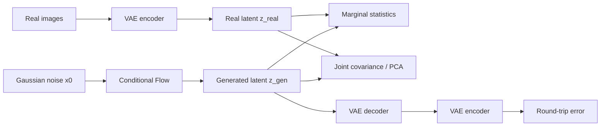

# Latent 分布怎么看：从 Flow Matching 理论到本实验诊断

latent Flow 的图像效果，不能只看最后生成的 PNG。完整链路是：

$$
x \xrightarrow{E} z_{\text{real}}
\xrightarrow{\text{Flow Matching}}
z_{\text{gen}}
\xrightarrow{D} \hat{x}.
$$

其中 $E$ 是 VAE encoder，$D$ 是 VAE decoder。生成图变软，可能来自三个不同位置：VAE 没有把细节写进 latent，Flow 没有覆盖真实 latent 分布，或者生成的 latent 已经离开 decoder 熟悉的区域。要分清这三种情况，必须同时看 latent 的边缘统计、联合结构和 decoder round-trip。

本文先用理论把这条链路走一遍，再读取本项目的诊断产物。当前实验数据来自 CIFAR-10、32×32 RGB、ds4 VAE、32 个 latent channels 和 8×8 latent grid；对应的完整实验报告是 [`flow_matching_current_experiment_report.md`](./flow_matching_current_experiment_report.md)。

## 1. Flow Matching 到底在 latent space 里学什么

VAE 把图片压缩成空间 latent：

$$
z=E(x)\in\mathbb{R}^{C\times H_z\times W_z}.
$$

本实验中，$C=32$、$H_z=W_z=8$。训练代码把它展平为 64 个 token，每个 token 有 32 个 channel：

$$
z\in\mathbb{R}^{64\times32}.
$$

Flow Matching 另外采样一个高斯源点：

$$
x_0\sim\mathcal{N}(0,I).
$$

然后用直线概率路径连接源点和真实 latent：

$$
x_t=(1-t)x_0+t x_1,
\qquad
u^\star=x_1-x_0,
$$

其中 $x_1$ 是经过标准化的真实 VAE latent。模型学习速度场：

$$
v_\theta(x_t,t,y)\approx u^\star,
$$

训练目标是：

$$
\mathcal{L}_{\text{FM}}
=
\mathbb{E}_{x_0,x_1,t,y}
\left[
\left\|v_\theta(x_t,t,y)-(x_1-x_0)\right\|_2^2
\right].
$$

采样时从新的高斯噪声出发，用 Euler 积分：

$$
x_{t+\Delta t}
=x_t+\Delta t\,v_\theta(x_t,t,y).
$$

最后反标准化并交给 decoder：

$$
\hat{x}=D(\hat{z}_1).
$$

这里有一个关键条件：Flow 学到的 $p_\theta(z\mid y)$ 必须既接近真实 encoder 分布，又落在 decoder 能稳定解释的 latent 区域内。只看 velocity MSE，无法验证这两个条件。

## 2. 一张图看懂诊断链路



这张图对应三个问题：每个 channel 的数值范围是否相似，channel 与空间位置的联合关系是否相似，生成 latent 是否能被 VAE 编码器和 decoder 互相还原。

## 3. 第一层：看每个 channel 的边缘分布

把 token 和样本维度展开后，对每个 channel 比较真实 latent 与生成 latent 的均值、标准差和分位数：

$$
\Delta_\mu=|\mu_{\text{gen}}-\mu_{\text{real}}|,
\qquad
r_\sigma=
\frac{\sigma_{\text{gen}}}{\sigma_{\text{real}}}.
$$

| 指标 | 它回答的问题 | 读法 |
|---|---|---|
| `mean_abs_error` | 生成中心是否偏移 | 越接近 0 越好 |
| `std_ratio` | 生成变化范围是否足够 | 接近 1 最好；明显小于 1 表示方差收缩 |
| `q10 / median / q90` | 尾部和中位数是否相似 | 三个分位点都接近才算形状相似 |
| `outside_real_3sigma` | 是否出现大量越界样本 | 只能做粗筛，不能代替联合分布检查 |

当前实验的类别平均结果如下：

| class | mean\|Δmean\| | mean std-ratio | real round-trip | generated round-trip |
|---|---:|---:|---:|---:|
| airplane | 0.0066 | 0.9058 | 0.0913 | 0.1108 |
| automobile | 0.0061 | 0.8488 | 0.0866 | 0.1028 |
| bird | 0.0026 | 0.9100 | 0.0876 | 0.0991 |
| cat | 0.0048 | 0.8941 | 0.0880 | 0.1022 |
| deer | 0.0027 | 0.9189 | 0.0912 | 0.1022 |
| dog | 0.0041 | 0.8679 | 0.0876 | 0.1000 |
| frog | 0.0055 | 0.9379 | 0.0919 | 0.0985 |
| horse | 0.0041 | 0.9001 | 0.0883 | 0.1005 |
| ship | 0.0092 | 0.8603 | 0.0909 | 0.1048 |
| truck | 0.0091 | 0.8715 | 0.0914 | 0.1043 |

结果说明：生成 latent 的均值已经相当接近真实 latent，但标准差大多只有真实值的 85%–94%。模型生成了分布的中心，却没有覆盖完整的变化范围。这就是 under-dispersed latent：图像通常有正确的颜色块和大体语义，但局部纹理会偏安全、偏平均。

`outside_real_3sigma` 约为 0.2%–0.4%，没有显示出大量爆炸性越界。因此当前首要问题不是少数离群点，而是整体方差偏小。

## 4. 为什么逐 channel 标准化仍然不够

训练时使用了逐 channel 的标准化：

$$
x_1=\frac{z-\mu_c}{\sigma_c}.
$$

它解决的是单个 channel 的均值和尺度问题，并没有解决协方差：

$$
\Sigma_{ij}
=
\operatorname{Cov}(z_i,z_j).
$$

当前 VAE latent 的 channel 标准差差异很大。训练日志中，很多 channel 的标准差约为 `0.008–0.012`，少数 channel 的标准差约为 `0.59–0.96`。逐 channel 标准化会把它们缩放到相近范围，但 channel 之间原有的相关性、空间结构和非高斯形状仍然存在。

因此，真实 latent 可能位于一个带有强相关性的薄 manifold 上，而 Flow 的源点却来自各向同性高斯。直线路径

$$
x_t=(1-t)x_0+t x_1
$$

会穿过大量真实数据没有覆盖的区域，速度场必须在那里完成一条很难的全局运输路径。

联合分布至少还应比较：

$$
\Delta_\Sigma
=
\frac{\|\Sigma_{\text{gen}}-\Sigma_{\text{real}}\|_F}
{\|\Sigma_{\text{real}}\|_F},
$$

以及 covariance 的特征值谱、PCA 投影和不同空间 token 之间的相关性。当前 `analyze_latent_distribution.py` 主要统计 marginal，尚未计算完整 covariance，因此现有报告不能证明联合分布已经匹配。

## 5. 第二层：按空间 token 看分布

8×8 latent grid 中，每个 token 对应原图的一个空间区域。报告里的 `token_mean_abs_error` 和 `token_std_ratio` 可以把 token 下标还原成二维坐标：

$$
\text{row}=\lfloor i/8\rfloor,
\qquad
\text{col}=i\bmod 8.
$$

这一步要回答的是：Flow 的误差是否集中在某些空间区域。比如当前报告中：

- automobile 的最低 token std-ratio 约为 `0.7711`；
- ship 的最低 token std-ratio 约为 `0.7852`；
- truck 的最大 token mean error 约为 `0.0452`。

如果这些热点在多个类别中总出现在相近的二维位置，通常说明模型的空间建模或 latent 边界位置存在系统性问题；如果热点随类别变化，则更像是类别条件和物体结构的联合建模不足。

## 6. 第三层：round-trip 检查 latent manifold

对真实 latent 和生成 latent 分别执行：

$$
z
\xrightarrow{D}D(z)
\xrightarrow{E}E(D(z)).
$$

定义：

$$
\epsilon_{\text{rt}}
=
\left\|E(D(z))-z\right\|_2.
$$

真实 latent 的 round-trip error 是 VAE 自身的基线。生成 latent 如果显著更高，说明 decoder 虽然仍能输出一张图，但这个 latent 已经偏离了 decoder 训练过的有效区域。

当前实验中：

```text
real round-trip      ≈ 0.089–0.092
generated round-trip ≈ 0.098–0.111
```

生成 latent 的 round-trip 误差普遍高于真实 latent，说明它不是单纯“图片 decoder 本来就糊”，还存在 Flow 输出偏离 VAE manifold 的问题。VAE 的重建上限和 Flow 的分布误差在最后一步叠加，所以生成图会比真实重建更加柔和。

## 7. 当前结论应该怎样读

本实验的 latent Flow 不是“完全没有学会”。它已经学会了：

1. 类别条件下的 latent 均值大致位置；
2. 主要颜色和轮廓对应的低频结构；
3. VAE latent 的大致数值范围。

它没有充分学会：

1. 真实 latent 的完整方差；
2. channel 与空间 token 的联合相关性；
3. decoder 对细节敏感的那些 latent 方向；
4. 真实 latent manifold 的边界和局部曲率。

因此，`velocity MSE=1.2768` 只能说明速度回归已经收敛到一个有限容量下的水平，不能直接等价为图像质量。当前最有解释力的证据是：`std-ratio < 1` 加上 `generated round-trip > real round-trip`。

## 8. 如何复现当前诊断

使用已有脚本按类别抽取真实 latent、采样生成 latent，并生成 JSON 与 Markdown 报告：

```bash
python analyze_latent_distribution.py \
  --checkpoint outputs_flow_transformer_latent32_ds4_bs512_e200/flow_matching_best.pt \
  --vae-checkpoint outputs_vae_latent32_ds4_ssim01_lpips01_bs512_e200/vae_best.pt \
  --max-real 512 \
  --generated 512 \
  --batch-size 64 \
  --output outputs_flow_transformer_latent32_ds4_bs512_e200/latent_distribution.json
```

脚本会同时写出同名的 `.md` 报告。当前目录中的已有版本是 64 张真实图片和 64 个生成 latent 每类的诊断结果；扩大到 512 或 2048 后，分位数和尾部统计会更稳定。

需要注意，现有脚本使用 VAE posterior mean，而不是 posterior sampling。这是为了避免 VAE 自身的随机噪声混入比较，使诊断集中在 Flow 的分布误差上。

## 9. 下一步最值得补的检查

如果要把“latent 分布”从边缘统计推进到完整诊断，优先增加四类图：

1. real/generated 的每 channel histogram 或 violin plot；
2. real/generated covariance heatmap 和特征值谱；
3. PCA 投影，观察生成样本是否只挤在真实分布中心；
4. 8×8 token 的 mean error 与 std-ratio 热力图。

如果这些图确认生成分布收缩，修复顺序应是：先提高 VAE 的可重建细节和 latent 规则性，再考虑 full-covariance whitening 或 learned prior，最后才比较更大的 Flow backbone、Rectified Flow 或更多采样步数。单纯增加 Euler steps 只能减小积分误差，不能恢复 latent 中已经没有的细节，也不能补回 Flow 没有覆盖的方差。

