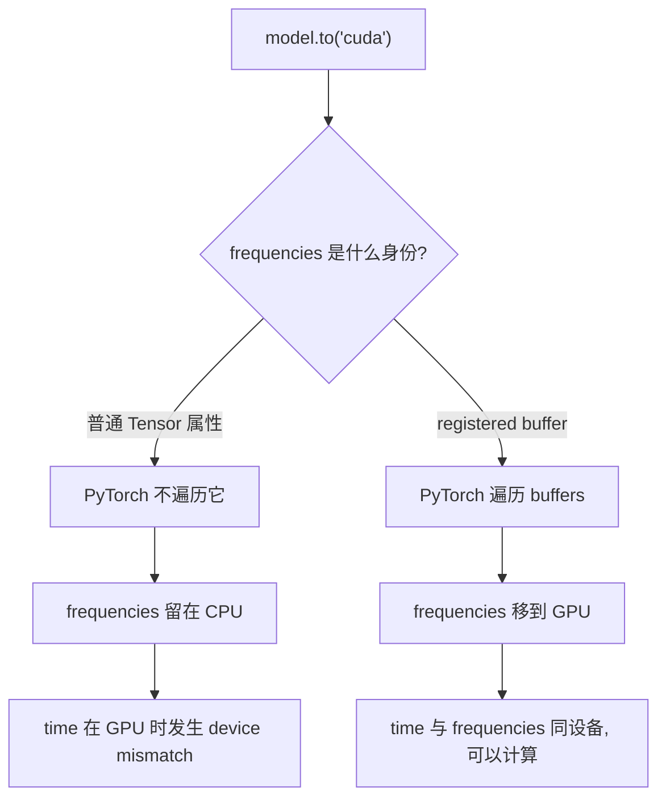

# 普通 Tensor 成员变量与 register_buffer 的区别

> 文档状态：代码解释  
> 更新时间：2026-11-16  
> 关联代码：[`flow_matching.py`](./flow_matching.py#L56)

在 `TimestepEmbedding` 中，频率表既可以直接赋值为普通成员变量，也可以通过 `register_buffer()` 登记。两种写法在普通 Python 代码里都能用 `self.frequencies` 访问，前向计算也不一定立刻报错，但它们交给 PyTorch 管理的内容不同。当前代码选择后者，原因是频率表虽然不需要训练，却必须跟随模型一起移动设备和转换精度。

## 1. 先区分类型注解和实例属性

下面这行只是类型注解，没有创建张量：

```python
class TimestepEmbedding(nn.Module):
    frequencies: torch.Tensor
```

它告诉类型检查器和读者“这个属性预期是 `torch.Tensor`”，但运行时不会执行赋值。如果没有在 `__init__()` 中创建 `self.frequencies`，访问它会得到：

```text
AttributeError: 'TimestepEmbedding' object has no attribute 'frequencies'
```

真正意义上的普通 Tensor 成员变量需要在 `__init__()` 中赋值：

```python
class TimestepEmbedding(nn.Module):
    def __init__(self, embedding_dim: int, max_period: float = 10_000.0):
        super().__init__()
        half_dim = embedding_dim // 2
        frequencies = torch.exp(
            -math.log(max_period)
            * torch.arange(half_dim, dtype=torch.float32)
            / half_dim
        )
        self.frequencies = frequencies
```

这时 `self.frequencies` 是一个很普通的 Python 对象引用。`nn.Module` 的 `__getattr__` 能找到它，`forward()` 也能正常读取它，但 `nn.Module` 不会把它登记进自己的 buffer 表。

## 2. 为什么前向计算仍然可能正常

`TimestepEmbedding.forward()` 做的是：

```python
angles = time[:, None] * self.frequencies[None, :]
```

如果 `time` 和 `self.frequencies` 都在 CPU 上，普通属性完全够用：

```python
time = torch.rand(8)                    # CPU
time_embed = TimestepEmbedding(64)      # frequencies 也在 CPU
embedding = time_embed(time)            # 可以正常运行
```

如果两者都在同一个 GPU 上，同样可以运行：

```python
time = torch.rand(8, device="cuda")
time_embed = TimestepEmbedding(64).to("cuda")
```

但第二种写法只是“看起来正确”。频率表是普通属性，`.to("cuda")` 并不会自动搬运它，因此除非 `frequencies` 已经在 GPU 上，否则接着调用 `forward()` 就会失败。

## 3. 设备迁移问题

最典型的问题发生在下面的顺序中：

```python
model = TimestepEmbedding(64)  # frequencies 创建在 CPU
model.to("cuda")               # Linear 权重搬到 GPU
```

在这个过程里，`model.to("cuda")` 会遍历该模块及其子模块的 parameter 和 buffer。`self.frequencies` 只是普通属性，不在遍历范围内，所以它仍然留在 CPU。

随后执行：

```python
time = torch.rand(8, device="cuda")
output = model(time)
```

`time` 在 CUDA，`self.frequencies` 在 CPU，乘法无法执行，会得到类似：

```text
RuntimeError: Expected all tensors to be on the same device,
but got at least two devices, cuda:0 and cpu!
```

可以把差异画成两条路径：



手动搬一次也能暂时解决：

```python
self.frequencies = frequencies.to(device)
```

但这种解决方式只覆盖当前设备。模型以后还可能经历：

```python
model.cpu()
model.to("cuda")
model.to("mps")
model.float()
model.to(torch.bfloat16)
```

每一条路径都需要你记得同步普通属性。模型越大、嵌套越深，这种手工维护越容易漏。

## 4. `register_buffer` 实际接管了什么

当前代码的写法是：

```python
self.register_buffer("frequencies", frequencies, persistent=False)
```

它把频率表登记到 `nn.Module._buffers`，于是频率表获得了正式的非参数张量身份。之后：

- `self.frequencies` 仍然可以正常访问；
- `model.to(device)` 会将它一起搬运；
- `model.cpu()`、`model.cuda()` 等便捷方法也会同步它；
- 浮点 buffer 会参与 `model.float()`、`model.half()` 等 dtype 转换；
- `model.buffers()` 和 `model.named_buffers()` 可以枚举它；
- 它仍然不会进入 `model.parameters()`，所以不会被优化器当作可学习参数。

这让频率表有了和 Linear 权重一致的运行生命周期，同时不会混入训练参数。

## 5. 普通属性和 buffer 的行为对比

| 操作或性质 | 普通 `self.frequencies` | `register_buffer()` |
|---|---:|---:|
| 在 `forward()` 中读取 | 可以 | 可以 |
| 默认被 optimizer 更新 | 否 | 否 |
| 随 `model.to(device)` 移动 | 否 | 是 |
| 随 `model.cpu()`、`model.cuda()` 移动 | 否 | 是 |
| 随浮点 dtype 转换改变 | 否 | 是 |
| 出现在 `model.buffers()` | 否 | 是 |
| 出现在 `model.named_buffers()` | 否 | 是 |
| 默认进入 `state_dict()` | 否 | 是 |
| 可通过 `persistent=False` 排除 | 不适用 | 是 |

这里最后两行特别容易混淆。默认 buffer 会进入 `state_dict()`，但当前代码明确传入了：

```python
persistent=False
```

因此，频率表不写入 checkpoint。它下次构造模型时会根据 `embedding_dim` 和 `max_period` 重新计算。换句话说，当前使用的非持久 buffer 并不负责“把固定频率保存下来”，它负责“让 PyTorch 知道这是一张需要跟随模块运行的固定张量”。

## 6. 为什么不用 Parameter

也可以这样写：

```python
self.frequencies = nn.Parameter(frequencies, requires_grad=False)
```

它跟随设备移动，也不会产生梯度，表面上能工作。但语义不对：`nn.Parameter` 表示模型参数，所以它会出现在：

```python
model.parameters()
```

这会污染参数枚举和参数统计。使用优化器时虽然没有梯度更新，但它仍可能被放进参数组、参数裁剪或权重衰减逻辑。固定频率表不是可训练权重，`register_buffer` 才准确表达它的角色。

可以按语义分成三类：

```python
# 需要通过反向传播学习
self.weight = nn.Parameter(torch.randn(...))

# 不学习, 但需要在模型设备上参与计算
self.register_buffer("frequencies", frequencies, persistent=False)

# 普通 Python 配置, 不是张量
self.max_period = max_period
```

## 7. 什么时候普通 Tensor 属性可以接受

普通 Tensor 属性并非绝对禁止。如果张量确实只服务于一次同步计算、不需要跟随模型生命周期，它可能足够。例如短生命周期函数中的临时张量，或者明确只在 CPU 上运行的辅助计算。

但对于 `TimestepEmbedding` 这类模块，频率表具有三个特征：

1. 每次 `forward()` 都要参与计算；
2. 必须和输入 `time` 位于同一个设备；
3. 是固定非参数状态，不需要优化器管理。

这三个特征正好落在 `register_buffer` 的职责范围内。普通属性当然能存这份数据，却把设备同步和 dtype 同步的责任留给了调用者。

## 8. 推荐的判断方式

可以按下面的顺序判断应该使用哪种成员：

```text
需要梯度并参与训练?
├── 是 -> nn.Parameter
└── 否
    ├── 是张量, 需要在 forward 中使用,
    │   并应随模型移动?
    │   ├── 是 -> register_buffer
    │   └── 否 -> 普通 Tensor 属性, 但要明确生命周期
    └── 是普通配置或标量?
        └── 普通 Python 属性
```

如果未来需要把频率表放进 checkpoint，保留 `register_buffer`，只把 `persistent` 改成 `True` 或删除该参数即可。若需要训练它，则应改成 `nn.Parameter`。若只是保存显示名称、周期数值之类的配置，继续使用普通 Python 属性更合适。

## 9. 小结

直接在类里定义 `self.frequencies` 能在当前设备和当前 dtype 下计算，但它只是一个普通属性，PyTorch 的设备迁移、dtype 转换和模块状态枚举都不会自动处理它。`register_buffer()` 的价值不在于让张量“能够被访问”，而在于给它一个明确的非参数模型状态身份，让频率表跟随模型走；而 `persistent=False` 只是进一步说明，这张确定性频率表不需要写入 checkpoint。
