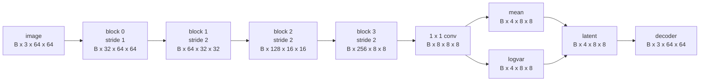
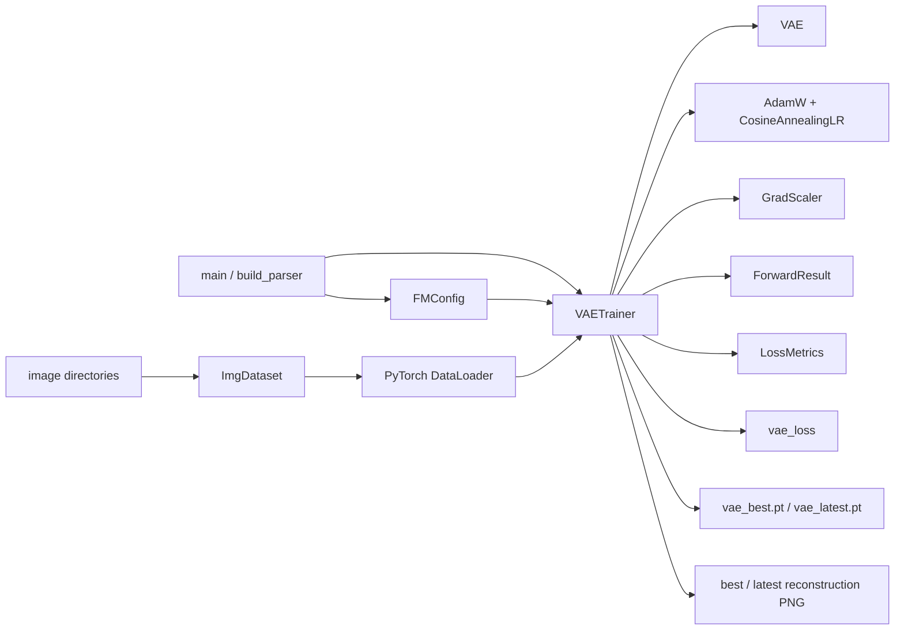
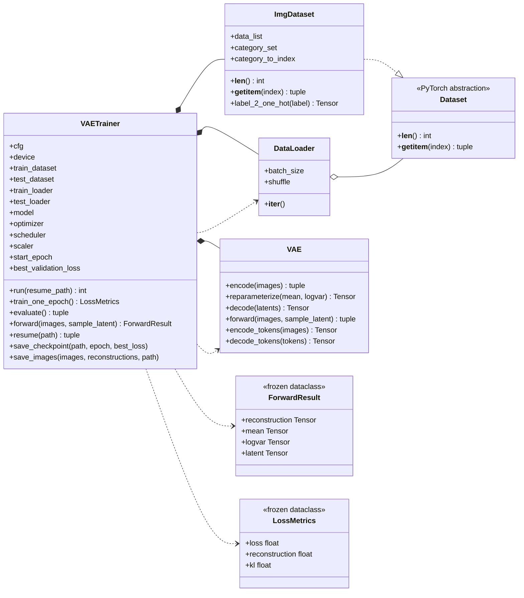
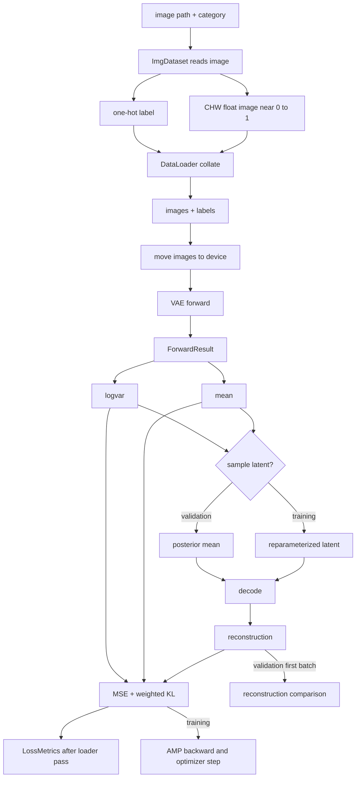
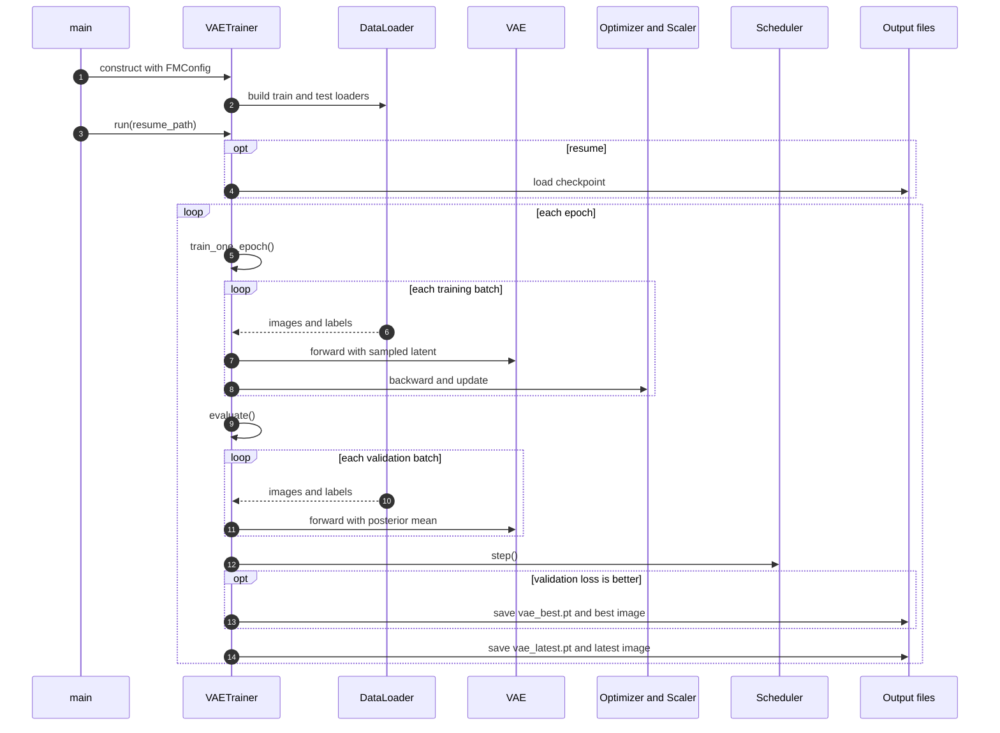
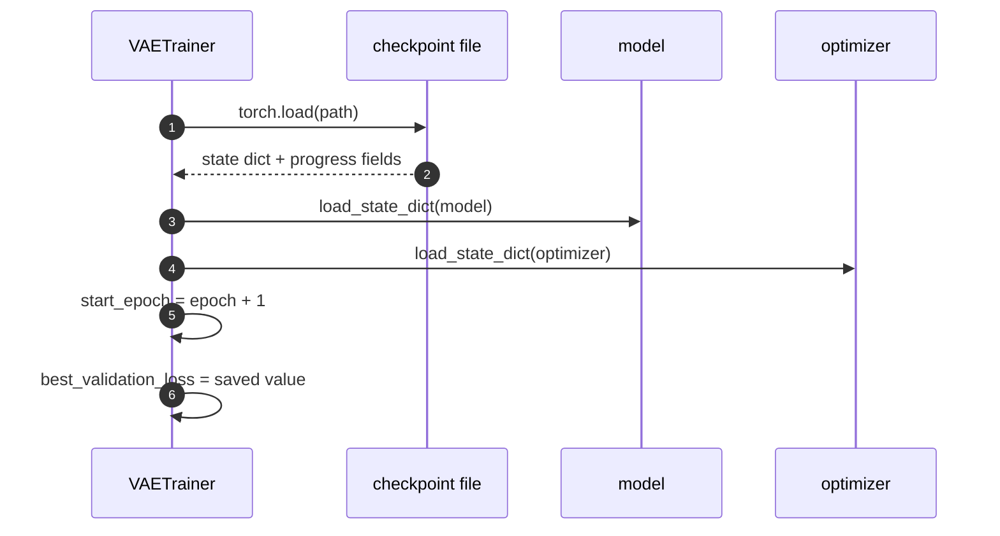

# `train_vae.py` 紧凑版架构说明：一个训练器，复用现成组件

> 状态：与当前工作区代码同步  
> 训练入口：[`train_vae.py`](./train_vae.py)  
> 数据来源：[`dataset.py`](./dataset.py)  
> 模型定义：[`vae.py`](./vae.py)  
> 配置定义：[`config.py`](./config.py)

这次整理的目标很直接：上一版为了把训练流程拆成职责清晰的小对象，引入了很多 dataclass 和服务类，结果代码本身变得比训练闭环还难浏览。当前版本收束到三个有明确用途的类：`VAETrainer` 负责一次完整训练运行，`ForwardResult` 承载跨训练与验证函数的前向张量，`LossMetrics` 承载跨 epoch 聚合与日志函数的三个指标。其余能力直接复用项目已有的 `ImgDataset`、PyTorch `DataLoader`、模型、优化器、调度器与 AMP 工具。

一句话概括当前结构：**`VAETrainer` 是可变训练状态的唯一所有者，两个 frozen dataclass 只负责给跨函数数据命名；除此之外不再为单调用者的动作单独造服务类。**

## 1. 训练器在做什么

VAE 负责把图像编码成连续 latent，再从 latent 解码回图像。默认输入是 `64 x 64` RGB；编码器输出通道数为 `4`、空间尺寸为 `8 x 8` 的 Gaussian posterior 参数，因此单张图的 latent 形状是 `[4, 8, 8]`。训练 loss 由两部分组成：

$$
\mathcal{L}
=
\operatorname{MSE}(\hat{\mathbf{x}},\mathbf{x})
\;+\;
\lambda_{\mathrm{KL}}\mathcal{L}_{\mathrm{KL}}.
$$

重建项要求输出图像接近输入，KL 项约束 encoder 的 posterior 靠近标准正态。`train_vae.py` 的职责不是重复定义这套数学，而是组织每个 epoch 的训练、验证、日志、图片输出和 checkpoint。

训练完成后的模型还有第二个使用场景：flow matching 可以通过 `VAE.encode_tokens()` 把 latent 变成 token，再通过 `decode_tokens()` 解码生成的 token。训练脚本保留 checkpoint 中的模型结构和图像尺寸，就是为了让这两个接口能在训练后被准确恢复。

## 2. VAE 在学什么

普通 autoencoder 只要求编码器把图片压成一个点，解码器再把它还原；它可以让每个样本拥有完全不同的编码，却不一定得到一个适合生成和插值的连续空间。VAE 在这一点上多走了一步：encoder 不输出单个 latent 点，而是为每张图输出一个概率分布，通常是每个 latent 位置上的独立 Gaussian：

在进入公式之前，先把符号和代码名称对齐会轻松很多：

| 符号 | 读法与含义 | 当前代码中的对应物 |
|---|---|---|
| \(\mathbf{x}\) | 一张真实图像；粗体表示由多个像素值组成的向量或张量 | DataLoader 提供的 `images`，单样本形状 `[3,64,64]` |
| \(\hat{\mathbf{x}}\) | decoder 从 latent 重建出的图像 | `reconstruction` |
| \(\mathbf{z}\) | latent；图像经过 encoder 后的连续隐藏表示 | `latent`，单样本形状 `[4,8,8]` |
| \(\phi\) | encoder 的全部可学习参数 | 主要是 `VAE.encoder` 中的权重 |
| \(\theta\) | decoder 的全部可学习参数 | 主要是 `VAE.decoder` 中的权重 |
| \(q_{\phi}(\mathbf{z}\mid\mathbf{x})\) | encoder 对给定图像给出的 latent 后验分布 | `encode()` 产生的 `mean` 与 `logvar` 共同定义它 |
| \(\boldsymbol{\mu}\) | Gaussian posterior 的均值 | `mean`，形状 `[B,4,8,8]` |
| \(\boldsymbol{\sigma}^{2}\) | Gaussian posterior 的 variance；逐元素平方后形如 \(\sigma^2\) | `logvar.exp()` |
| \(\log\boldsymbol{\sigma}^{2}\) | log-variance，网络实际输出的稳定参数化 | `logvar`，形状与 `mean` 相同 |
| \(\boldsymbol{\epsilon}\) | 从标准正态采出的随机噪声 | `torch.randn_like(mean)` |
| \(\mathcal{L}_{\mathrm{rec}}\) | 重建损失；代码用 MSE 实现 | `reconstruction_loss` |
| \(\mathcal{L}_{\mathrm{KL}}\) | 单个样本所有 latent 坐标上的 KL 之和 | `vae_loss()` 中逐样本求和后的标量 |
| \(D_{\mathrm{KL}}\) | 从后验与先验定义出的 KL divergence | `kl_loss` 的理论来源 |
| \(\lambda_{\mathrm{KL}}\) | KL 项在总 loss 中的权重 | `VAETrainConfig.kl_weight`，当前默认 `1e-4` |
| \(B\) | 一次处理的 batch size | 默认配置中是 `batch_size`，实际可使用不同值 |

这里的粗体不是装饰。图像、latent、mean 和 logvar 都是逐元素张量，而不是单个标量；因此 \(\mu_i\)、\(\sigma_i^2\) 表示把张量展平后第 \(i\) 个元素对应的均值和 variance。当前默认 latent 共有 \(4\times8\times8=256\) 个元素，所以 KL 会对这 256 个位置求和。

$$
q_{\phi}(\mathbf{z}\mid\mathbf{x})
=
\mathcal{N}\bigl(\boldsymbol{\mu}_{\phi}(\mathbf{x}),
\operatorname{diag}(\boldsymbol{\sigma}_{\phi}^{2}(\mathbf{x}))\bigr).
$$

读这条式子时，可以先把它拆成三步：输入 \(\mathbf{x}\)，经过参数为 \(\phi\) 的 encoder，产生“给定这张图时 latent 的概率分布” \(q_{\phi}(\mathbf{z}\mid\mathbf{x})\)。这个分布不是一个 latent 点，而是每个 latent 坐标各有一组 \(\mu_i\) 和 \(\sigma_i^2\)。`mean` 和 `logvar` 合起来描述的是同一组 latent 坐标，不是两份互相独立的编码。

代码实际让网络输出 `mean` 和 `logvar`，因为方差必须为正，log-variance 不必额外约束符号。为了让采样这一步仍能反向传播，`VAE.reparameterize()` 使用重参数化技巧：

$$
\mathbf{z}
=
\boldsymbol{\mu}
+
\boldsymbol{\sigma}\odot\boldsymbol{\epsilon},
\qquad
\boldsymbol{\sigma}=\exp\left(\frac{1}{2}\log\boldsymbol{\sigma}^{2}\right),
\qquad
\boldsymbol{\epsilon}\sim\mathcal{N}(\mathbf{0},\mathbf{I}).
$$

随机性被推给与参数无关的 `epsilon`，因此 `mean` 和 `logvar` 仍能收到梯度。训练时 `sample_latent=True` 走这条路径；验证时 `sample_latent=False`，直接解码 posterior mean，减少随机采样带来的指标抖动。

VAE 的损失可以从负 ELBO 读出来。这里出现的四个分布承担不同角色：

| 分布 | 方向 | 含义 |
|---|---|---|
| \(p(\mathbf{x})\) | 数据本身 | 真实图像在数据分布中的概率；训练时不显式建模，只从样本中观察 |
| \(q_{\phi}(\mathbf{z}\mid\mathbf{x})\) | 图像 → latent | encoder 给出的近似后验，回答“看到这张图后，latent 可能在哪里” |
| \(p_{\theta}(\mathbf{x}\mid\mathbf{z})\) | latent → 图像 | decoder 的生成分布，回答“给定这个 latent，会生成什么图” |
| \(p(\mathbf{z})\) | 固定先验 | 训练前预先规定的 latent 分布，当前取标准正态 |

$$
\mathcal{L}_{\mathrm{VAE}}
=
-\mathbb{E}_{q_{\phi}(\mathbf{z}\mid\mathbf{x})}
\left[\log p_{\theta}(\mathbf{x}\mid\mathbf{z})\right]
+
D_{\mathrm{KL}}\left(
q_{\phi}(\mathbf{z}\mid\mathbf{x})
\|p(\mathbf{z})
\right).
$$

负号修饰的是 reconstruction log-likelihood，所以最大化它的对数似然等价于最小化这一项损失；KL 描述了近似后验与先验的差异，同样是非负项。两者相加就是负 ELBO，训练时一起最小化。代码用 MSE 代理第一项，并取标准正态先验 \(p(\mathbf{z})=\mathcal{N}(\mathbf{0},\mathbf{I})\)，于是 KL 有闭式解：

$$
D_{\mathrm{KL}}
=
-\frac{1}{2}\sum_{i}
\left(
1+\log\sigma_i^2-\mu_i^2-\sigma_i^2
\right).
$$

逐项对应到代码，可以这样读：常数 \(1\) 是 `1.0`，\(\log\sigma_i^2\) 是 `logvar`，\(\mu_i^2\) 是 `mean.square()`，\(\sigma_i^2\) 是 `logvar.exp()`。`sum(dim=(1,2,3))` 对每个样本的 4 个 channel 与 \(8\times8\) 个空间位置求和，因此先把每个样本变成单个标量；随后 `kl_per_batch.mean()` 再对 batch 求平均。最终 `kl_loss` 的单位是“KL sum per sample”，而不是对 256 个坐标再取平均。

总损失仍按最初的定义组合：

$$
\mathcal{L}
=
\mathcal{L}_{\mathrm{rec}}
+
\lambda_{\mathrm{KL}}\,\mathcal{L}_{\mathrm{KL}}.
$$

代码中的 `vae_loss()` 先计算 `reconstruction_loss = F.mse_loss(reconstruction, target)` 和 `kl_loss`，再返回 `reconstruction_loss + kl_weight * kl_loss`。`kl_weight` 控制正则强度：太小会接近普通 autoencoder，太大又会让 decoder 很难使用 latent 中的信息。当前默认值是 `1e-4`，所以日志必须把 reconstruction 与 KL 分开保留。

还有一层概率解释值得放在这里。后验 \(q_{\phi}(\mathbf{z}\mid\mathbf{x})\) 是“给定图片以后，latent 大概在哪里”；先验 \(p(\mathbf{z})=\mathcal{N}(\mathbf{0},\mathbf{I})\) 是“编码之前，整个 latent 空间应该是什么样”。KL 项把不同图片的后验拉向同一个先验附近，从而让采样空间连贯。可是 KL 并不等于“保证所有样本编码互不重叠”：两张图仍可能拥有相近的 mean，尤其在 KL 权重很小或 latent 容量不足时。因此，重建图只说明 decoder 能把某条 latent path 拉回图像，不自动说明 latent 空间适合任意插值。

## 3. 为什么默认 latent 是 `[4, 8, 8]`

`[4, 8, 8]` 不是卷积“碰巧得到”的形状，而是三个配置和一条尺寸链共同决定的结果：

| 维度 | 数值 | 直接来源 | 含义 |
|---|---:|---|---|
| channel | `4` | `VAEConfig.latent_channels` | 每个空间位置保留多少个连续 latent 特征 |
| height | `8` | `64 / downsample_factor` | 图像高度经过三次 2 倍缩小 |
| width | `8` | `64 / downsample_factor` | 图像宽度经过三次 2 倍缩小 |

默认 `image_size=64`、`downsample_factor=8`，而 encoder 的四个 block 中，第一个 `stride=1`，后面三个 `stride=2`。卷积块的 kernel 是 `3`、padding 是 `1`，所以每次 stride-2 卷积后空间边长按

$$
H_{\text{out}}
=
\left\lfloor
\frac{H_{\text{in}}+2-3}{2}
\right\rfloor+1
=
\frac{H_{\text{in}}}{2}
$$

缩小。连续应用三次，`64 -> 32 -> 16 -> 8`。于是 encoder 最后一个 block 输出的空间网格是 `[B, 256, 8, 8]`。最后的 `1 x 1` 卷积把 `256` 个通道映射到 `latent_channels * 2 = 8`，再按 channel 一分为二，得到 `[B, 4, 8, 8]` 的 `mean` 和 `logvar`。latent 本身与它们同形，所以单个样本是 `[4, 8, 8]`。

把整条尺寸链画出来，会比只看最终数字更容易核对：



图中前三个空间缩小点分别跨过 `fold`，所以每跨一次，feature 的空间分辨率减半、channel 数加倍；最后一个 `1 x 1` 卷积只调整 channel，不改变 `8 x 8` 网格。`latent_channels=4` 决定最终每个位置只留 4 个 latent 数值，因此 `8` 个输出 channel 正好分成 `mean` 和 `logvar` 各 4 个。

“一分为二”不是为了造出两份 latent，而是让每个 latent 位置同时拥有 Gaussian 的均值和 log-variance。`4` 是参数量上的选择，`8 x 8` 是空间压缩上的选择；把二者分开看，比死记一个三维形状更重要。如果把 `image_size` 改成 `128`，其他配置不变，空间尺寸会变成 `16 x 16`；如果只想改空间压缩率，应改 `downsample_factor` 并同步修改对应的 stride 结构，而不是只改一个配置数字。

decoder 走的是对称但不等同的路径。它先把 `[B, 4, 8, 8]` 升到 256 通道，然后做三次 nearest 2x upsample：`8 -> 16 -> 32 -> 64`，最后用卷积投影回 RGB。`padding=1` 和 `kernel_size=3` 在这里保持偶数尺寸的边长，因此 encoder 与 decoder 的接口能够闭合。

这个 `[4, 8, 8]` 张量共有

$$
4\times8\times8=256
$$

个连续数值。把 channel 轴移到最后，会得到

$$
[B,4,8,8]
\longrightarrow
[B,64,4],
$$

即每个空间位置一个 4 维 token，共 64 个 token。这正是 `VAE.encode_tokens()` 做的事情：`flatten(start_dim=2).transpose(1, 2)` 先把 `8 x 8` 摊平成 64 个位置，再把 4 个 latent channel 变成 token feature。flow matching 在这里处理的不是原始 `3 x 64 x 64 = 12288` 个像素，而是 `64 x 4 = 256` 个 latent 数值，随后通过 `decode_tokens()` 还原成图像。

latent 的压缩既不是免费的，也不是简单的“省显存”。`8 x 8` 决定了每个 latent cell 要概括一块 `8 x 8` 像素区域，channel `4` 决定它对局部纹理、颜色和结构能保留多少信息。缩小空间尺寸会让 token 序列更短，降低后续 flow matching 的序列长度；但压缩过强会丢失细节，过强 KL 又会把有用信息压向先验。因此“为什么是 `[4,8,8]`”最终是一个接口折中：既让 VAE 能近似重建，又让下游 Transformer 面对足够短的 token 序列。

## 4. 从多对象结构压缩到单类

上一版把数据集装载、loss 统计、checkpoint 管理、图片写出、结果快照和训练进度分别做成了独立抽象。这样确实让每个对象很小，但当前项目只有一个训练入口，每个所谓“服务”也只有一个调用者。读者为了理解一次 epoch，需要在十几个类型之间来回跳转。

当前版本采用更小的设计面，但保留了两个真正跨函数、且靠字段顺序很难辨认的数据契约：

- `ImgDataset` 负责目录扫描、图片解码和标签构造。
- PyTorch `DataLoader` 负责 collate、shuffle、drop-last、worker 和 pinned memory。
- `VAE` 负责 encode、reparameterize、decode 和 token 转换。
- `AdamW`、`CosineAnnealingLR`、`GradScaler` 负责各自标准的训练职责。
- `ForwardResult` 让 `forward()` 的四个返回张量拥有稳定名字，训练与验证不需要猜位置。
- `LossMetrics` 让训练、验证和日志共享同一组指标字段，避免 `dict[str, float]` 在层间漂移。
- `VAETrainer` 负责把这些对象按一次训练运行的时序组织起来，并持有 epoch、最佳验证 loss、路径和 loader 等运行状态。

因此，当前文件没有回到“所有东西都是一团字典和元组”的过程式写法，也没有继续为每件小事造类。类化的判据是：一个数据结构会跨函数边界传递、字段语义容易被位置顺序淹没，并且有一个自然的只读生命周期；不满足这些条件的单次动作，就留在 `VAETrainer` 的方法里。

## 5. 总体架构

下图展示运行时的依赖关系。箭头表示“谁构造、持有或调用谁”，不表示模块 import 方向。数据自左向右流入训练闭环，输出和 checkpoint 则从训练器流向磁盘。



`main()` 只解析 `--resume` 并创建 `VAETrainer`。训练器在构造阶段读取 `FMConfig`，建立 train/test 两个 `ImgDataset`，再分别交给 `DataLoader`。模型和优化组件也在这里初始化，但它们的内部行为仍由各自类负责。

这套结构的关键是依赖方向简单：数据和模型互不知道对方，checkpoint 也不参与前向计算；只有训练器需要同时看见它们。以后想换数据来源，优先替换 Dataset；想换模型，改训练器里 VAE 的构造点；训练循环本身不需要知道目录扫描或卷积层的细节。

## 6. 类图与对象关系

当前代码自己声明三个类。`VAETrainer` 是唯一有可变运行状态的对象；`ForwardResult` 与 `LossMetrics` 是不可变的跨函数值对象。类图中另外出现的 `ImgDataset`、`DataLoader`、`VAE` 和优化组件都属于外部协作者。



这里的组合关系表示训练期间由 `VAETrainer` 持有对应对象，而不是说其他对象不能独立使用。`ImgDataset` 仍能单独遍历，`VAE` 仍能单独做 encode/decode，`DataLoader` 也能装别的 Dataset。训练器只是为了一次完整运行，把这些对象绑定在一起。

`VAETrainer` 的属性可以按用途分成三组。配置与运行位置包括 `cfg`、`device` 和 `output_dir`；数据管线包括两个 dataset 和两个 loader；训练状态包括 model、optimizer、scheduler、scaler、起始 epoch 和最佳验证 loss。所有字段都在构造阶段显式赋值，没有依赖某个函数“之前已经悄悄初始化过”的隐式顺序。

`ForwardResult` 描述一次 `forward()` 的结果：重建图、posterior mean、logvar 和采样后的 latent。训练分支只需要前三个字段计算 loss，验证分支只需要重建图做可视化；即使调用者暂时不使用 `latent`，保留它也让返回值与 `VAE.forward()` 的完整模型契约对齐。frozen 只冻结字段重新绑定，不深拷贝内部 Tensor。

`LossMetrics` 描述一次遍历某个 loader 后的平均 loss。它不是可变累加器，而是聚合完成后的只读结果；训练和验证各自在方法内部维护三个局部浮点累加量，最后一次构造它。这样既避免每个 batch 反复创建对象，也避免了在 `dict[str, float]` 中用字符串索引三个固定字段。

## 7. 自定义 Dataset 与标准 DataLoader

项目自己的 `ImgDataset` 继承 PyTorch `Dataset`，在构造时扫描 `data_dir` 下的一层类别目录，并把图片路径和类别名保存到 `data_list`。`__getitem__()` 读取图片，用 `torchvision.io.read_image()` 得到 CHW 张量，再除以 `255.5`；标签则通过 `label_2_one_hot()` 变成 one-hot 向量。除数是 `255.5` 而不是 `255.0`，所以实际像素范围略低于 `[0, 1]`，当前训练代码沿用这一 Dataset 行为。

训练器默认执行：

```python
self.train_dataset: Dataset = train_dataset or ImgDataset(cfg.data_cfg.train_dir)
self.test_dataset: Dataset = test_dataset or ImgDataset(cfg.data_cfg.test_dir)
```

默认路径来自 `DataConfig`，但构造参数允许注入任意 PyTorch `Dataset`。测试时可以把 `ImgDataset` 包在 `Subset` 里，只取少量样本；真实训练则直接使用完整目录。这保留了可测试性，又不需要额外构造一个数据装载服务类。

标准 `DataLoader` 在训练器里直接装配：

| 设置 | 训练 loader | 验证 loader | 原因 |
|---|---|---|---|
| `shuffle` | `True` | `False` | 训练重新打乱，验证可重复 |
| `drop_last` | `True` | 默认 `False` | 训练 batch 形状稳定，验证不漏样本 |
| `pin_memory` | 跟随 CUDA | 跟随 CUDA | 减少 GPU 拷贝等待 |
| `persistent_workers` | `num_workers > 0` | 同一策略 | 避免没有 worker 时非法参数 |
| `batch_size` | 配置值 | 配置值 | 两个阶段采用同一批大小 |

VAE 训练不使用类别标签，所以 loader 返回 one-hot label 后，训练和验证都用 `for images, _` 忽略它。保留标签输出是为了继续兼容项目自己的 `ImgDataset`，也方便未来接入条件 VAE 或分类辅助任务；当前代码没有假装这些标签参与了 loss。

## 8. 一个 batch 的数据流

下面的图沿训练路径走完一个 batch，并把验证分支放在同一张图里。两条分支共享 Dataset、DataLoader、VAE forward 和 loss；只在 latent 是否采样以及是否反向传播处分开。



用默认形状走一遍：DataLoader 提供 `images` 为 `[B, 3, 64, 64]`；encoder 输出的参数图先得到 `[B, 8, 8, 8]`，再按 channel 切成两个 `[B, 4, 8, 8]` 的 `mean` 与 `logvar`。训练分支通过重参数化得到 `[B, 4, 8, 8]` 的 latent，验证分支直接使用 posterior mean。最终重建图恢复为 `[B, 3, 64, 64]`。

训练分支的执行顺序是 `zero_grad -> forward -> vae_loss -> scaler.scale().backward() -> unscale -> clip -> scaler.step() -> scaler.update()`。验证分支位于 `@torch.inference_mode()` 中，不构造 autograd 图；它会保存第一个验证 batch 的原图和重建图，用于 `latest_reconstruction.png` 以及可能更新的 best 图片。

## 9. 一个 epoch 的控制流

数据流说明一个 batch 怎么算，控制流说明谁在什么时候推动训练状态。当前版本把这些步骤直接留在 `VAETrainer.run()` 中，读者不必追踪多个回调对象才能拼出完整 epoch。



`train_one_epoch()` 首先调用 `model.train()`；`evaluate()` 首先调用 `model.eval()`。即使当前 VAE 主要使用 GroupNorm，显式 mode 切换仍然正确，也让以后加入 Dropout 或 BatchNorm 时不需要重新设计调用方。

训练和验证都先把每个 batch 的 `loss`、`reconstruction` 和 `kl` 三个标量累计起来，再除以 batch 数量。训练 loader 使用 `drop_last=True`，各 batch 大小相同；验证 loader 可能保留较小尾批，因此这里的验证结果是“batch 均值的均值”，不保证等价于按样本数严格加权的全局均值。这是现有语义，文档不把它误称为样本加权平均。聚合完成后才创建一次 `LossMetrics`，因此 frozen dataclass 不会进入热路径的每条样本循环。

两个阶段结束后，训练器先读取本轮实际使用的 learning rate，再推进 scheduler。best 判定发生在 scheduler step 之后，并使用严格小于 `<`；相同验证 loss 不会反复覆盖最佳 checkpoint。

## 10. checkpoint 与 resume

`save_checkpoint()` 仍写出与之前兼容的七个字段：

| 字段 | 用途 |
|---|---|
| `epoch` | 最后完成的 epoch 下标 |
| `best_validation_loss` | 已观察到的最佳验证 loss |
| `model` | VAE state dict |
| `optimizer` | AdamW state dict |
| `vae_config` | 恢复模型的通道和降采样结构 |
| `image_size` | 恢复输入和 latent 空间布局 |
| `data_config` | 训练数据路径快照 |

文件写入使用同目录临时文件加 `Path.replace()`。目标文件不会在 `torch.save()` 中途被留下半份内容，因此进程中断后，`vae_latest.pt` 要么还是旧的完整 checkpoint，要么已经是新的完整 checkpoint。



这里有一个必须明确保留的兼容边界：checkpoint 没有保存 scheduler state。resume 会恢复模型权重、optimizer state、起始 epoch 和最佳验证 loss，但新建 scheduler 的计数不会从原训练曲线当前位置继续；optimizer 参数组里带回的 LR 数值，之后仍会在 scheduler step 时被新计数覆盖。这与重构前脚本的行为一致，不能被描述为“scheduler 完整续训”。如果未来要补齐，应新增 scheduler state，同时兼容没有该字段的旧 checkpoint。

## 11. 设计原则

### 11.1 以一次训练运行为对象边界

面向对象不等于“一个动作一个类”。当前 `VAETrainer` 的职责很宽，但它们都围绕同一个生命周期：构造运行环境、训练、验证、保存并支持恢复。拆成十几个只在单一路径调用的对象，会增加跳转成本，却没有带来独立复用或独立变化。

### 11.2 只在跨函数数据契约值得时才建简单类

`ForwardResult` 与 `LossMetrics` 留在独立类中，并非为了“多做一个对象”，而是因为它们都跨越函数边界。前者把四个 Tensor 返回从位置元组变成命名字段，后者把三个固定指标从字符串字典变成有类型属性。两者都没有行为、没有外部资源，也不承担训练控制，因此用最小的 frozen dataclass 就足够。

反过来，`save_checkpoint()` 的临时文件路径、`evaluate()` 内部的 `images` 和 `reconstructions` 都只在单一局部流程里短暂使用，不需要为它们再建类。可见“简单类”不是行数的装饰品，而是为重要数据结构安一个稳定名字。

### 11.3 复用成熟抽象

项目已经有 `ImgDataset`，PyTorch 已经提供 `Dataset`、`DataLoader`、`AdamW`、scheduler 和 `GradScaler`。当前代码不重新包装这些能力，而是在装配点直接使用。OOP 的价值来自正确组合现有对象，而不是重写它们。

### 11.4 组合优先

`VAETrainer` 通过 has-a 关系持有 dataset、loader、model、optimizer 和 scheduler。没有创建 `TrainerWithData`、`TrainerWithCheckpoint` 这类继承层级，因为训练器不是 dataset 或 optimizer 的某种特化版本。

### 11.5 单一可变状态所有者

epoch、最佳 loss、当前 model、optimizer、scheduler 和 scaler 都由训练器持有。`train_one_epoch()`、`evaluate()` 和 `resume()` 围绕这些状态工作，而不是再从全局变量或其他对象里取第二份副本。可变状态集中后，一次运行的因果顺序更容易追。

### 11.6 外部组件保持自己的职责

Dataset 不负责优化参数，VAE 不负责写 checkpoint，DataLoader 不负责判断 best loss。训练器只协调，不侵入外部组件内部；外部组件只提供接口，不知道完整 epoch 的控制顺序。这样，替换数据源或模型时仍有明确落点。

### 11.7 显式优于隐式

全部非 `self` 参数和返回值都有类型标注，实例属性也标注了关键类型；`FMConfig` 集中配置，CLI 只暴露 `--resume` 和 `--help`。读者可以从方法签名看出输入输出，不需要从调用处反推隐式元组。

### 11.8 保持可测试性，但不为测试造层次

构造器允许注入 `train_dataset` 和 `test_dataset`，所以在 CPU 上可以用 `Subset` 跑四条训练样本、三条验证样本。训练器没有额外的 loader service；测试只需要把小型 Dataset 注入同一个类即可。

### 11.9 行为优先于形式

本次压缩保留了 CLI、checkpoint key、输出文件名、AMP 路径、best 判定和 resume 边界。目标不是追求“类越少越高级”，而是在当前规模下选择让完整训练闭环一次读完的结构。如果未来出现第二个训练器、第二种 checkpoint 消费者或外部指标系统，再沿真实的复用点拆分。

## 12. 取舍与扩展边界

`VAETrainer` 仍然承担了多种方法。它现在保留了面向阅读的关键注释，273 行非空非注释代码、37 行注释和空白分隔共同组成 357 行源码，对应一个完整、唯一的训练流程；但如果继续加入 EMA、early stopping、多任务 loss、分布式训练和外部指标回调，类会把不同变化原因重新揉在一起。

那时应按变化原因拆分，而不是按方法数量拆分。例如，checkpoint 同时被其他工具消费时，可以抽出独立持久化模块；指标需要同时写 W&B 与 TensorBoard 时，可以抽出 observer；出现第二个模型训练器时，再考虑共享训练基类或组合训练循环。

当前可替换点也很清楚：数据源通过构造参数注入；模型在 `__init__()` 中构造；优化器、scheduler 和 loss 都在同一个装配区域；训练控制顺序集中在 `run()`；文件路径集中在初始化阶段。修改时先判断变化属于哪个区域，比机械地把方法搬到新类更重要。

## 13. 运行与验证

常规入口保持不变：

```bash
python train_vae.py
python train_vae.py --resume path/to/vae_latest.pt
```

输出目录来自 `cfg.vae_train_cfg.output_dir`，稳定产物是 `vae_best.pt`、`vae_latest.pt`、`best_reconstruction.png` 和 `latest_reconstruction.png`。

当前实现从上一版 12 个自定义类的 556 行文件压缩到 1 个主训练器和 2 个跨函数 dataclass。保留关键流程注释后，源码总计 357 行，其中 37 行注释用于解释设计原因与边界，而不是重复 Python 语法；相比旧版仍减少约 36%。已通过 Python 编译、CLI help、源码类型检查，以及 CPU smoke test；测试确认 `ForwardResult` 的四张量形状、`LossMetrics` 的训练/验证返回值、checkpoint 字段、四类输出文件和从已有 checkpoint 继续训练。smoke test 使用 `ImgDataset` 的 `Subset`，没有修改生产数据配置。
