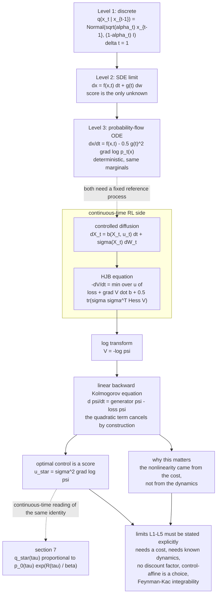
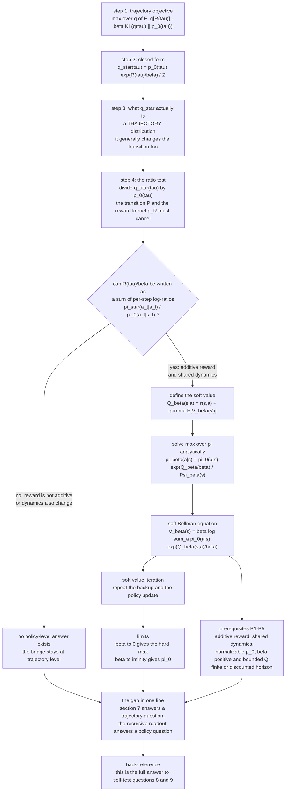
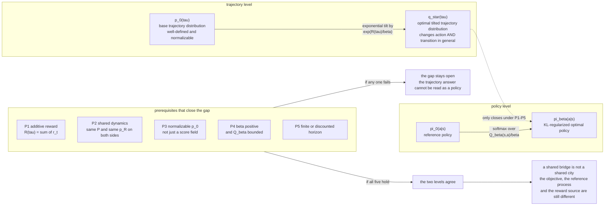
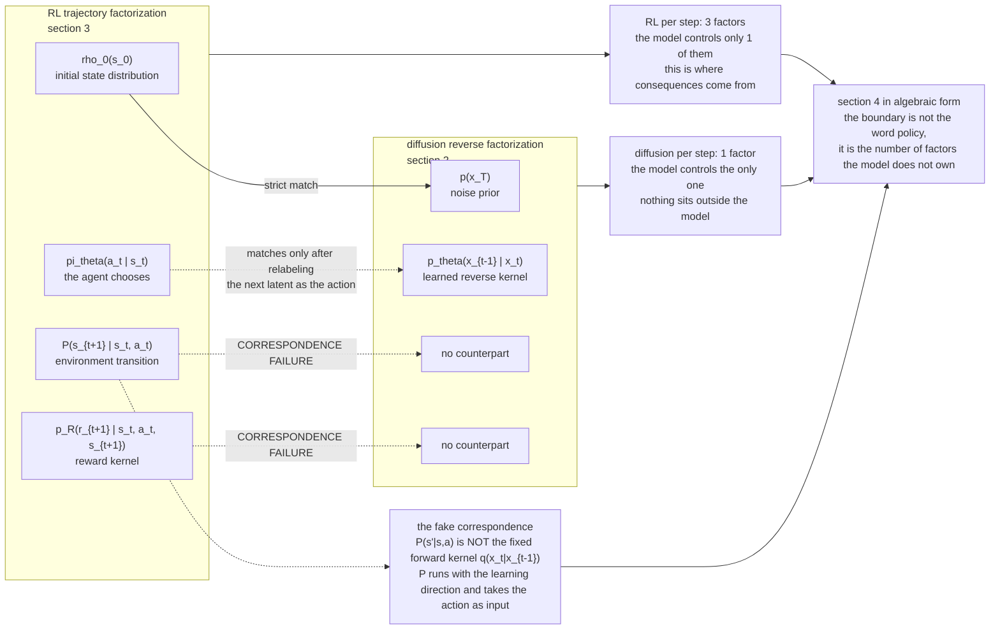
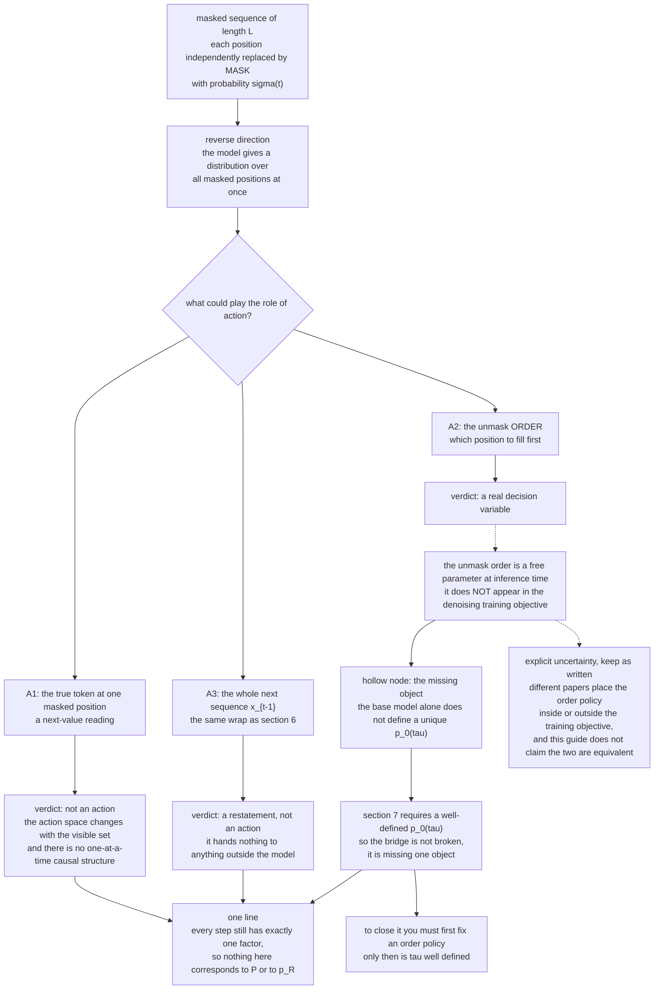
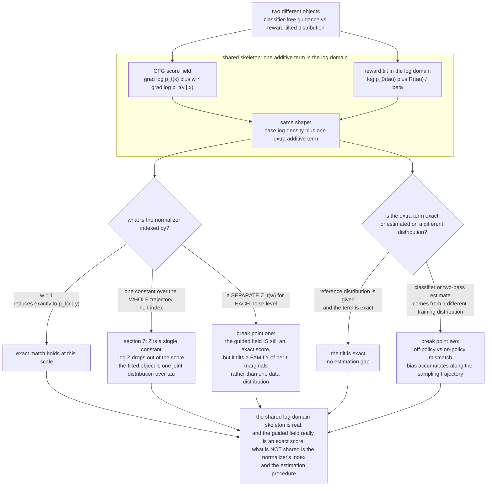
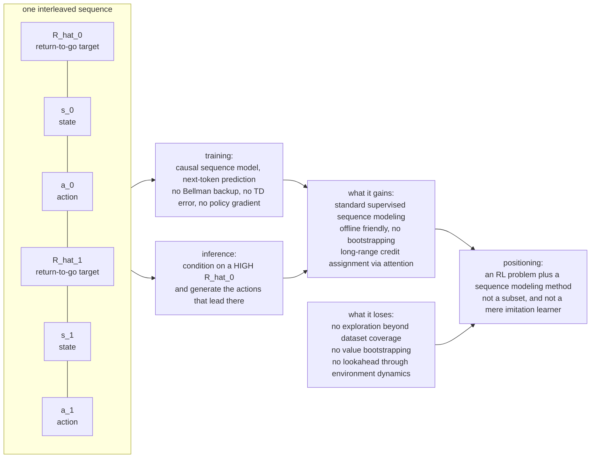
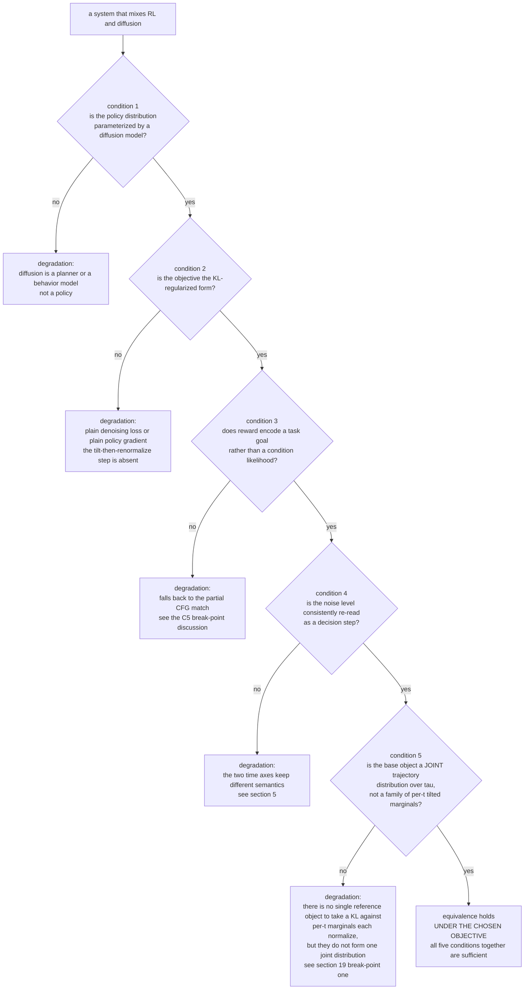
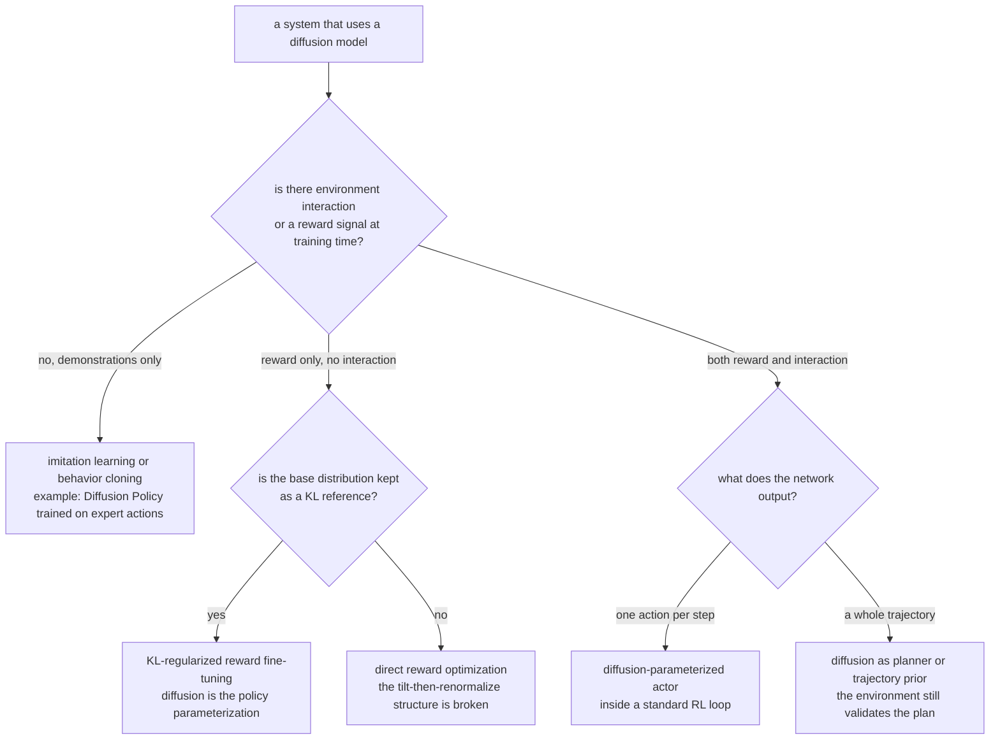

# 强化学习与扩散模型：本质上是同一种技术吗？

> 衔接：[第 18 章：扩散模型](chapter18_diffusion_models_notes.md) 与 [第 19 章：强化学习](chapter19_reinforcement_learning_notes.md)
>
> 核心问题：RL 和 diffusion model 都在沿一条随机轨迹逐步更新，它们是否只是同一种技术的不同表现？
>
> 一句话结论：**不是。Diffusion 的核心是学习数据分布的反向去噪过程；RL 的核心是在 action 会改变未来的闭环中优化长期回报。二者可以共享 stochastic process 与 optimal control 的数学语言，但共享语言不等于共享任务。**

---

## 0. 先把“本质”分成三层

“它们本质上是不是一样”之所以容易争起来，是因为不同的人在不同抽象层回答同一个词。先把抽象高度钉住，很多争论会自动消失。

| 抽象层 | 看见的东西 | RL 与 diffusion 是否相同 |
|---|---|---|
| 很高：优化 | 都用 neural network、sampling、gradient descent | 相似，但几乎所有 deep learning 都相似 |
| 中间：随机过程 | 都能表示成一条 Markov trajectory，也都能优化 path distribution | 有深刻联系，可以互相借数学工具 |
| 任务本身 | 一个学习生成数据，一个学习在后果中行动 | **不同** |

可以先记住下面这张地图：

```text
Diffusion
data --fixed corruption--> noise
noise --learned reverse--> generated sample

RL
state --policy--> action --environment--> reward + next state
  ^                                             |
  +---------------- closed loop ----------------+
```

Diffusion 主要问：

> 怎样把一个容易采样的分布，逐步变成复杂的数据分布？

RL 主要问：

> 当前 action 会改变未来；怎样行动，才能让整段未来的 expected return 最大？

前者的关键词是 **distribution modeling**，后者的关键词是 **decision under consequences**。接下来先解释它们为什么长得像，再看这两句话究竟把系统劈成了哪两种结构。

---

## 1. 为什么第一眼真的很像

把两边最显眼的部分抽出来，都是一串随机变量：

\[
\text{Diffusion:}\qquad
x_T\rightarrow x_{T-1}\rightarrow\cdots\rightarrow x_0,
\]

\[
\text{RL:}\qquad
s_0\rightarrow a_0\rightarrow s_1\rightarrow a_1\rightarrow\cdots.
\]

它们还有一整排共同词汇：

- 都会谈 state、transition、trajectory 与 sampling；
- 都常满足 Markov property；
- 都可能由一个共享参数的 neural network 反复执行；
- 都能写成对随机轨迹的期望；
- 都可能加入 condition、guidance 或 reward；
- 在适用的 continuous-time formulation 中，都可以借用 SDE 或 ODE 来描述。

只看程序运行画面，也很容易得到“只是皮肤不同”的印象：网络接收当前状态，输出某种更新，然后重复很多次。

```text
current representation -> neural network -> stochastic update -> next representation
```

但这张图故意抹掉了三个决定身份的问题：

1. 这条轨迹为什么存在？
2. 谁决定 transition？
3. 什么信号告诉网络“做对了”？

Diffusion 与 RL 的分界恰好就藏在这三个问题里。

---

## 2. Diffusion 的母问题：把噪声变成数据

以 DDPM 为例。给定真实样本 \(x_0\sim p_{\text{data}}\)，forward process 按预先规定的 noise schedule 加噪。

取 \(\beta_t\in(0,1)\)，令

\[
\alpha_t=1-\beta_t,
\qquad
\bar\alpha_t=\prod_{s=1}^{t}\alpha_s.
\]

\(\alpha_t\) 是单步保留的 signal 比例，\(\bar\alpha_t\) 是从 \(0\) 到 \(t\) 的累计保留比例：

\[
q(x_t\mid x_{t-1})
=
\mathcal N\!\left(
\sqrt{\alpha_t}x_{t-1},
(1-\alpha_t)I
\right).
\]

整条 forward path 是：

\[
q(x_{1:T}\mid x_0)
=
\prod_{t=1}^{T}q(x_t\mid x_{t-1}).
\]

这里的 transition 不是 agent 探索出来的，也不是 environment 对 action 的反馈。它是一份人为设计、固定不学的 corruption protocol：逐步衰减 signal，同时加入 Gaussian noise。

由于线性 Gaussian 可以合并，训练时能一步得到任意噪声等级的样本：

\[
x_t
=
\sqrt{\bar\alpha_t}x_0
+
\sqrt{1-\bar\alpha_t}\,\epsilon,
\qquad
\epsilon\sim\mathcal N(0,I).
\]

模型学习反向过程：

\[
p_\theta(x_{0:T})
=
p(x_T)
\prod_{t=1}^{T}p_\theta(x_{t-1}\mid x_t).
\]

常见的 \(\epsilon\)-prediction objective 是：

\[
\mathcal L_{\text{simple}}(\theta)
=
\mathbb E_{x_0,t,\epsilon}
\left[
\left\|
\epsilon-\epsilon_\theta(x_t,t)
\right\|_2^2
\right].
\]

训练信号非常直接：噪声 \(\epsilon\) 是我们亲手加进去的，所以 target 已知。一次训练并不需要从 \(T\) 走到 \(0\)：

```text
clean sample x_0
      + random noise epsilon
      + random noise level t
                |
                v
             noisy x_t
                |
                v
       epsilon_theta(x_t, t)
                |
                v
          MSE with epsilon
```

生成时才真正执行多步 reverse sampling：

```text
x_T ~ Normal(0, I) -> x_{T-1} -> ... -> x_1 -> x_0
```

因此 diffusion 的 network 本质上在学习 noisy data distribution 的局部几何。用 score parameterization 表达，就是在估计下面这个 score。其中，\(p_t\) 表示经过第 \(t\) 级加噪后，随机变量 \(x_t\) 的边缘分布：

\[
s_\theta(x_t,t)
\approx
\nabla_{x_t}\log p_t(x_t).
\]

这个向量告诉采样器：在当前噪声等级下，往哪个方向移动会更像该分布中的数据。到这里没有 reward，没有为了发现高回报 action 而进行的 exploration，也没有 action 改变外部世界之后产生的新证据。

---

## 3. RL 的母问题：在行动后果中优化长期回报

RL 从一个 MDP 开始：

\[
(\mathcal S,\mathcal A,P,R,\rho_0,\gamma).
\]

Policy \(\pi_\theta(a_t\mid s_t)\) 只负责选择 action。为与第 19 章的 MDP 记法保持一致，下面把 \(P(s'\mid s,a)\) 记为 state transition，把 \(p_R(r\mid s,a,s')\) 记为 reward kernel；deterministic reward 只是这个 kernel 的退化情形。Action 交给 environment 后，environment dynamics 再生成 next state 与 reward：

\[
s_{t+1}\sim P(\cdot\mid s_t,a_t),\quad
r_{t+1}\sim p_R(\cdot\mid s_t,a_t,s_{t+1}).
\]

令
\[
\tau=(s_0,a_0,r_1,s_1,a_1,r_2,\ldots,s_T)
\]
表示一条 trajectory（有限 horizon 时最后一步是 \(T\)）。它的概率因此分解为：

\[
p_{\pi_\theta}(\tau)
=
\rho_0(s_0)
\prod_{t=0}^{T-1}
\pi_\theta(a_t\mid s_t)
P(s_{t+1}\mid s_t,a_t)
p_R(r_{t+1}\mid s_t,a_t,s_{t+1}).
\]

真正优化的是整段 trajectory 的 return：

\[
G_t
=
\sum_{k=0}^{T-t-1}\gamma^k r_{t+k+1},
\]

\[
J(\theta)
=
\mathbb E_{\tau\sim p_{\pi_\theta}}
\left[G_0\right].
\]

RL 最特别的地方不只是“有 reward”，而是 **policy 参与制造自己的训练分布**：

```text
policy changes actions
        |
        v
actions change visited states
        |
        v
visited states change future data and rewards
        |
        +----------> policy update
```

这会带来 diffusion 原始训练目标里不存在的一组核心难题：

- **temporal credit assignment**：很晚才出现的 reward 应该归功于前面哪个 action？
- **exploration vs exploitation**：要不要尝试当前看起来不够好的 action，以获取新证据？
- **distribution shift**：policy 一更新，接下来访问的 state distribution 也会改变；
- **counterfactual value**：没选的 action 本来会带来什么后果？通常观察不到。

即使是 offline RL，数据已经固定，这些问题也没有消失。算法仍在估计“如果换一种 policy，action 会通过 environment 带来什么后果”；只是它失去了主动补采样的机会，coverage 反而成为更硬的信息边界。

---

## 4. 真正的架构分界：谁控制下一步

把上一节的概率分解和 diffusion 的 reverse factorization 并排放置，差异会变得很具体。

Diffusion reverse process：

\[
p_\theta(x_{0:T})
=
p(x_T)
\prod_{t=1}^{T}
\underbrace{p_\theta(x_{t-1}\mid x_t)}_{\text{learned reverse transition}}.
\]

RL trajectory：

\[
p_{\pi_\theta}(\tau)
=
\rho_0(s_0)
\prod_{t=0}^{T-1}
\underbrace{\pi_\theta(a_t\mid s_t)}_{\text{agent chooses}}
\underbrace{P(s_{t+1}\mid s_t,a_t)}_{\text{environment transition}}
\underbrace{p_R(r_{t+1}\mid s_t,a_t,s_{t+1})}_{\text{reward}}.
\]

普通 diffusion 中，模型给出的 reverse kernel 本身就产生下一个 latent。普通 RL 中，policy 只选 action；它不能任意指定 next state，世界保留否决权。正是这层 agent/environment 分离，赋予了 action “后果”的含义。

| 维度 | Diffusion model | Reinforcement Learning |
|---|---|---|
| 首要任务 | 学习并采样 data distribution | 学习最大化 expected return 的 policy |
| 基本对象 | noisy sample \(x_t\) | state \(s_t\)、action \(a_t\) |
| 网络通常输出 | noise、score、velocity 或 reverse mean | action distribution、value 或 advantage |
| Transition 来源 | forward 固定；reverse 由生成模型参数化 | policy 选 action；environment 决定后果 |
| 学习信号 | 已知噪声、score matching、ELBO 等 | reward、return、TD target、advantage 等 |
| 数据从哪里来 | 通常从给定 dataset 加噪构造 | online 时由 policy 与 environment 共同产生 |
| 时间步含义 | noise level / solver step | 因果决策时间 |
| 核心困难 | 分布估计、反向生成、sampling efficiency | 探索、归因、控制、policy-induced shift |
| 典型输出 | 一个新样本 | 一套面对 state 的行为规则 |
| 是否天然需要外部 reward | 否 | 通常需要 reward、utility、preference 或 goal 等目标信号 |

所以两者不只是“loss 名字不同”。它们对系统边界的切法都不同：diffusion 把问题切成 fixed corruption 与 learned reverse；RL 把问题切成 agent policy 与 environment dynamics。

> → 这两条 factorization 的逐因子并排见 §17《两条 factorization 的逐项并排》。

---

## 5. 两个时间轴不是同一种时间

最容易制造错觉的是下标 \(t\)。两边都写 \(t=0,1,2,\ldots\)，但同一个字母没有保证同一种语义。

在 diffusion 中，\(t\) 通常表示 noise level：

```text
high t                                              low t
more noise --------------------------------------> less noise
```

从 \(x_t\) 到 \(x_{t-1}\) 是对同一个候选样本进行 refinement。一个 reverse step 走得不好，可能让最终样本偏离数据分布；但并不是外部世界因为这次行动而永久改变。

在 RL 中，\(t\) 表示 agent 与 environment 的一次因果交互：

```text
state_t -> action_t -> world changes -> state_{t+1}
```

选错 action 可能让机器人摔倒、棋局丢子，或者永远失去之后能访问的某些 state。未来输入之所以改变，是 action 的真实后果，而不只是数值求解器走到了下一个 index。

因此：

> **Diffusion timestep 更像“样本目前有多模糊”；RL timestep 更像“故事已经真实发生到哪里”。**

这不是说 diffusion step 完全没有因果依赖，也不是说所有 RL 都必须对应墙上时钟。区别在于该时间轴在问题中承担的角色：一个组织生成过程，一个组织行动与后果。

---

## 6. 为什么 diffusion 又确实能写成一个 MDP

既然区别这么明确，为什么许多论文仍然把 reverse diffusion 称为 policy，把 denoising 称为 decision process？因为 MDP 是非常宽的建模语言。

可以这样包装 reverse diffusion：

| MDP 部件 | Diffusion 中的对应物 |
|---|---|
| state | \(s_t=(x_t,t)\) |
| action | 预测的 noise、score，或直接选择 \(x_{t-1}\) |
| transition | sampler / reverse update rule |
| initial distribution | 通常取 \(x_T\sim\mathcal N(0,I)\)（有限 noise schedule 下是近似） |
| terminal state | 最终样本 \(x_0\) |
| reward | 可选的 image quality、preference 或 task score |

若把 action 直接定义成下一步样本，甚至可以写成：

\[
\pi_\theta(a_t\mid s_t)
\equiv
p_\theta(x_{t-1}\mid x_t),
\qquad
a_t=x_{t-1}.
\]

数学上没有问题。但要注意包装前后发生了什么：

- Vanilla diffusion training 原本用已知 noise target，不需要 reward；
- 一旦加入 terminal reward 并用 policy optimization 调整 reverse process，才真正引入了 RL objective；
- “能称为 policy”只说明它是 conditional distribution，不自动产生 exploration、credit assignment 与 environment control 的全部问题。

一个普通分类器也能包装成 one-step contextual bandit：输入是 state，类别是 action，标签正确给 \(+1\)。这并不意味着 supervised classification 与 RL 是同一门技术。

因此应当区分两句话：

> **Diffusion can be represented as an MDP.** —— 对。

> **Therefore diffusion is RL.** —— 推论不成立。

MDP 是容器，不是身份证。真正决定范式的是 objective、feedback 与因果结构。

---

## 7. 最深的桥：control as inference

虽然“都是 MDP”还不足以把二者等同起来，但在 **control as inference** 这一层，它们确实出现了一座很深的桥。

设 \(p_0(\tau)\) 是一个 base trajectory distribution。它可以来自预训练 diffusion model，也可以来自某个 reference policy。现在希望新的轨迹分布 \(q(\tau)\) 偏向高 reward，同时不要偏离 base distribution 太远：

\[
\max_q
\left\{
\mathbb E_{\tau\sim q}[R(\tau)]
-
\beta\,\mathrm{KL}\!\left(q(\tau)\|p_0(\tau)\right)
\right}.
\]

第一项说“多产生高 reward 轨迹”，第二项说“不要为了 reward 把原模型彻底拆掉”。\(\beta>0\) 控制保守程度。

把 KL 展开：

\[
\mathcal J(q)
=
\int q(\tau)R(\tau)\,d\tau
-
\beta
\int q(\tau)
\log\frac{q(\tau)}{p_0(\tau)}\,d\tau.
\]

再加入归一化约束 \(\int q(\tau)d\tau=1\)。对 \(q(\tau)\) 做变分并令导数为零：

\[
R(\tau)
-
\beta\left(
\log\frac{q(\tau)}{p_0(\tau)}+1
\right)
-
\lambda
=0.
\]

整理得到：

\[
\boxed{
q^*(\tau)
=
\frac{1}{Z}
p_0(\tau)
\exp\!\left(\frac{R(\tau)}{\beta}\right)
}
\]

其中 \(Z\) 是 normalization constant。这个结果的直觉很漂亮：

```text
new trajectory distribution
        =
base trajectory distribution
        x
exponentiated preference for high reward
```

如果 \(p_0\) 是由预训练 diffusion 的 reverse process 诱导出的 trajectory distribution，那么 reward、classifier 或 preference model 可以把概率质量推向更符合目标的区域。如果 \(p_0\) 是由 reference policy 与 environment 诱导出的 trajectory distribution，这就是 entropy/KL-regularized RL 熟悉的结构。

这座桥说明：

> 生成可以被看成在 path space 中做 inference；控制也可以被看成对高 reward trajectory 做 posterior-like inference。

但桥两端仍不是同一座城市。普通 diffusion 的训练目标是恢复 data distribution；RL 的 reward 可以要求任何外部目标，例如“跑得更快”“耗电更少”或“赢棋”。只有在选定特定 objective、reference process 与 reward 后，两边才会落进同一个 path-space optimization 公式。

换句话说，**统一框架揭示的是联系，不是抹除区别**。

> → 这座桥的完整推导见 §16《control-as-inference 的完整推导》，它的连续时间版本见 §15《连续时间层：SDE、probability-flow ODE 与 HJB》。

---

## 8. Score、guidance 与 reward：相像，但不要直接画等号

Diffusion 中的 score 是：

\[
\nabla_x\log p_t(x).
\]

它描述 probability density 在样本空间里增长最快的方向。若做 conditional generation，可以利用 Bayes rule：

\[
\nabla_x\log p_t(x\mid y)
=
\nabla_x\log p_t(x)
+
\nabla_x\log p_t(y\mid x).
\]

第二项会把样本推向更符合 condition \(y\) 的区域，因此外观看起来很像“沿 reward 上升”。若把能量或 reward 定义为某个 log-likelihood，二者甚至能形成严格对应。

但一般情况下：

\[
\boxed{
\underbrace{\nabla_x\log p_t(x)}_{\text{data score}}
\qquad\text{vs.}\qquad
\underbrace{\nabla_a Q(s,a)}_{\text{control gradient}}
}
\]

Score 回答“哪里更像数据”；reward 回答“什么结果更值得”。真实世界里很常见的样本未必奖励高，高奖励行为也未必在训练数据中常见。把 likelihood 与 desirability 混成一件事，会直接混淆 imitation 与 optimization：

- 学习专家数据分布，首先是在模仿常见行为；
- 使用 reward 超过 behavior policy，才是在做控制意义上的改进；
- 数据里概率最高的 action，不必是长期回报最高的 action。

这也是为什么“给 diffusion 加 guidance”和“解决一个 RL 问题”有联系，却并不自动等价。

> → classifier-free guidance 与 reward tilt 的逐项对照见 §19《CFG 与 reward tilt：在哪里等价、在哪里断裂》。

---

## 9. 两者组合时，究竟是谁在做什么

现实方法经常把 diffusion 和 RL 放进同一个系统。判断它属于什么，不要看模型名字，要看训练信号与它在系统中的角色。

### 9.1 用 RL 调整 diffusion generator

预训练 diffusion 提供 base distribution，reward model 对最终样本打分，再用 policy gradient、value-based 方法或 KL-regularized objective 调整 reverse process。

```text
pretrained diffusion -> generated sample -> reward model
          ^                                  |
          +---------- policy update ---------+
```

这里 diffusion 是 policy parameterization，RL 是优化方法。二者组合了，但不是同义词。

### 9.2 用 diffusion 表示 policy

连续控制中的 action distribution 可能复杂、多峰。Diffusion model 可以根据当前 observation 生成一个 action，或者一次生成一段 action sequence：

\[
p_\theta(a_{t:t+H}\mid o_t).
\]

如果它只在 expert demonstrations 上用 denoising loss 训练，这通常更接近 behavior cloning。网络叫 Diffusion Policy，并不意味着训练过程已经是 reinforcement learning。

若再利用 environment reward、Q-function 或 online interaction 改进这套 policy，系统才加入 RL。

### 9.3 用 diffusion 生成规划轨迹

还可以让 diffusion 学习 dataset 中的 state-action trajectories：

\[
p_\theta(s_0,a_0,s_1,a_1,\ldots,s_H,a_H),
\]

然后按 goal 或 high return 做 conditioning/guidance，从候选轨迹中执行第一步，再重新规划。这时 diffusion 是 trajectory model 或 planner；environment 仍负责验证计划是否真的可执行。

三种组合可以压成一张表：

| 系统 | Diffusion 的角色 | RL 是否出现 |
|---|---|---|
| 图像 diffusion 的标准 noise prediction | generative model | 否 |
| Expert action 上训练 Diffusion Policy | behavior model / policy class | 不一定，常是 imitation learning |
| Reward fine-tuning diffusion | stochastic policy / generator | 是 |
| Return-guided trajectory diffusion | planner / trajectory prior | 取决于 reward 与优化方式 |
| RL actor 使用 diffusion distribution | expressive policy class | 是 |

“Diffusion”更多描述模型怎样表示和生成分布；“RL”更多描述问题怎样提供反馈以及优化什么目标。一个是 model family，一个是 learning/decision paradigm，这正是它们能够自由组合的原因。

> → 两个范式真正合体的案例见 §20《Decision Transformer：RL as sequence modeling》。

---

## 10. 三个分离实验：不用术语也能判断

如果一套说法听起来很抽象，可以做三个思想实验。

### 10.1 删除 reward

Diffusion 仍然可以从图片 dataset 学会生成图片，因为 noise target 仍然可构造，并且与 ELBO / likelihood 有概率联系；实践中的 unweighted noise-MSE 是这个故事的简化目标，不应直接等同于 exact likelihood。

RL 若完全没有 reward、preference、goal 或其他效用信号，就无法定义哪套 policy 更好。它可以继续探索、模仿或建模世界，却不再有 control objective。

### 10.2 删除 environment interaction

标准 diffusion 本来就在固定 dataset 上训练，基本定义没有受损。

Online RL 会失去产生新 transition 的闭环，只能退到 offline RL。此时 unseen action 的后果可能无法从数据识别，问题并没有自动变成普通 supervised learning。

### 10.3 更换 environment dynamics

保持 reward function 不变，只把地面从干燥改成结冰。RL 的最优 policy 可能彻底改变，因为同一个 action 现在会造成不同后果。

标准 image diffusion 没有这层外部 dynamics；它关心训练数据分布与 corruption/reverse process。更换一个不存在的“地面物理”不会改变它的定义。

这三个实验指向同一条分界：

> **Diffusion 主要学习“什么样的样本像数据”；RL 主要学习“做什么会带来更好的未来”。**

---

## 11. 常见说法逐句验货

| 说法 | 判断 | 更准确的版本 |
|---|---|---|
| “它们都是一步步从随机性走到目标。” | 部分正确 | 都可形成随机轨迹，但目标与 transition 的语义不同 |
| “Diffusion 加噪就是 RL exploration。” | 错误 | 加噪是预定的 corruption；exploration 是为了解未知 action 后果而采集信息 |
| “Reverse diffusion 就是 policy。” | 有条件正确 | 可以把 reverse kernel 当 policy，但这是建模选择，不代表 vanilla training 是 RL |
| “Diffusion timestep 就是 environment timestep。” | 通常错误 | 前者通常是 noise level，后者是 action 造成后果的因果时间 |
| “Score 就是 reward gradient。” | 通常错误 | Score 指向高 density；reward gradient 指向高 utility，二者只在特殊构造下对应 |
| “Diffusion Policy 都是 RL。” | 错误 | 只用 demonstrations 和 denoising loss 时通常是 imitation learning |
| “RL 可以 fine-tune diffusion。” | 正确 | 可把 reverse process 视为 stochastic policy，再用 reward 优化 |
| “它们能统一到 optimal control，所以完全一样。” | 错误 | 统一描述保留了不同 objective、dynamics 与 feedback source |

特别需要警惕最后一句。把两件事放进同一条公式，往往代表我们找到了一个更强的抽象；它不代表公式里的各个量失去了原来的语义。

---

## 12. 最终心智模型

先把两者分别压成一句不会混的定义：

```text
Diffusion:
learn the geometry of a data distribution,
then transport noise into samples.

Reinforcement Learning:
learn behavior whose consequences maximize long-term return.
```

再把它们的联系补回来：

```text
                 stochastic trajectories
                         |
          +--------------+--------------+
          |                             |
  distribution modeling          sequential control
          |                             |
      Diffusion                         RL
          |                             |
          +---- control as inference ---+
```

因此，对最初的问题可以给出三句话逐层收束：

1. **工程与任务层面：不是同一种技术。** Diffusion 学分布与反向生成，RL 学 action 在 environment 中的长期价值。
2. **数学结构层面：确实有共同骨架。** 两者都能操纵 stochastic trajectory，也都能进入 path-space optimization、SDE 与 optimal control。
3. **特定构造下：可以互相变身或组合。** Reverse diffusion 可以参数化 policy，reward 可以引导生成，diffusion 也可以建模 action sequence；但这是额外定义带来的统一，不是所有 diffusion 天生就是 RL。

最短的防混口诀是：

> **像数据，是 diffusion 首先关心的；值不值得，是 RL 必须回答的。**

> → 什么时候它们字面上就是同一个东西见 §21《什么时候它们字面上就是同一个东西》，工程判断表见 §22《判断表与陷阱清单》。

---

## 13. 自测

1. 为什么“都使用 Markov chain”不足以证明 RL 与 diffusion 是同一种技术？
2. Diffusion 的 forward transition 与 RL 的 environment transition 分别由谁决定？
3. 为什么说 reverse diffusion 的 network 通常直接参数化 next latent，而 RL policy 不能直接指定 next state？
4. Diffusion timestep 与 RL timestep 的语义差在哪里？
5. 删除 reward 后，为什么 vanilla diffusion 仍能训练，而 RL 的最优 policy 失去定义？
6. 为什么固定 dataset 上的 offline RL 仍不同于普通 supervised learning？
7. 怎样把 reverse diffusion 包装成 MDP？这种包装为什么不能证明 vanilla diffusion training 就是 RL？
8. 在 KL-regularized objective 中，\(\beta\) 变大时，新分布为什么会更接近 base distribution？
9. 为什么 \(q^*(\tau)\propto p_0(\tau)e^{R(\tau)/\beta}\) 是两者的一座桥，而不是二者相同的证明？
10. Score 与 reward gradient 在什么意义上不同？什么特殊构造下它们可能对应？
11. 只在 expert demonstrations 上训练的 Diffusion Policy 为什么通常更接近 imitation learning？
12. 给 diffusion generator 加 reward fine-tuning 时，diffusion 与 RL 分别承担什么角色？

### 答案 1

“都使用 Markov chain”只说明两条轨迹能共用同一种**表示语言**，不能说明它们优化的任务相同（见 §0、§1）。真正决定身份的是三件事：objective 是什么、transition 由谁决定、反馈从哪里来。

Markov property 是容器，不是身份证。容器相同，不代表里面装的任务相同。

### 答案 2

Diffusion 的 forward transition \(q(x_t\mid x_{t-1})\) 由预先固定的 noise schedule 决定，是一份人为设计、不参与学习的 corruption protocol（见 §2）。RL 的 environment transition \(P(s_{t+1}\mid s_t,a_t)\) 由外部世界决定；policy 只能选择 \(a_t\)，不能直接指定 \(s_{t+1}\)（见 §3、§4）。

\[
\underbrace{q(x_t\mid x_{t-1})}_{\text{fixed corruption}}
\qquad\text{vs.}\qquad
\underbrace{P(s_{t+1}\mid s_t,a_t)}_{\text{environment decides}}
\]

### 答案 3

Reverse diffusion 的 reverse kernel \(p_\theta(x_{t-1}\mid x_t)\) 直接产生下一个 latent：模型输出什么，下一个 \(x_{t-1}\) 就是什么（见 §4）。

RL policy \(\pi_\theta(a_t\mid s_t)\) 只产生 action。下一步 state 要经过 environment dynamics：

\[
a_t\sim\pi_\theta(\cdot\mid s_t),
\qquad
s_{t+1}\sim P(\cdot\mid s_t,a_t).
\]

世界保留否决权，这正是 action 具有“后果”的原因（见 §3、§4）。

### 答案 4

Diffusion 的 \(t\) 通常是 noise level / solver step：它描述同一个候选样本当前有多模糊，\(x_t\to x_{t-1}\) 是对该样本的 refinement（见 §2、§5）。

RL 的 \(t\) 是因果决策步：\(s_t\to a_t\to s_{t+1}\)，action 会真实改变 world 与之后能访问的 state（见 §3、§5）。

因此两个 \(t\) 同时出现时，必须显式限定语义；§15 与 §17 会继续沿用这条消歧约定。

### 答案 5

Vanilla diffusion 的训练信号是**我们自己加进去的 noise**：给定 \(x_t\) 与 \(\epsilon\)，target 已知，因此删除 reward 不影响 denoising objective 的构造（见 §2、§10.1）。

RL 的“好”由 reward、preference、goal 或其他 utility 定义。删除这些信号后，仍然可以探索或模仿，但已经没有 control objective 可以优化，也就不存在“最优 policy”（见 §10.1）。

### 答案 6

Offline RL 的数据虽然固定，算法仍在估计**如果换一种 policy**，action 会通过 environment 带来什么后果；这仍然是 counterfactual value 问题（见 §3）。

普通 supervised learning 只要求拟合已观察到的 \((x,y)\) 对应关系，不需要回答“没选的那个 action 本来会怎样”。数据覆盖不到的区域既不会改变 label 的定义，也不会自动变成 distribution shift 问题（见 §3、§10.2）。

### 答案 7

一种标准包装是令（见 §6）：

\[
s_t=(x_t,t),\qquad
a_t=x_{t-1},\qquad
\pi_\theta(a_t\mid s_t)\equiv p_\theta(x_{t-1}\mid x_t).
\]

数学上没有问题，但这是**建模选择**：它没有创造 exploration、credit assignment 或 environment control，只是把 reverse kernel 重新命名。Vanilla diffusion training 仍然用已知 noise target，不需要 reward（见 §6）。

### 答案 8

在 objective \(\mathbb E_q[R(\tau)]-\beta\,\mathrm{KL}(q\|p_0)\) 中，\(\beta\) 是 KL 项的权重（见 §7）。\(\beta\) 变大时，偏离 \(p_0\) 的代价变高，最优解就被拉回 base distribution。

闭式解把这个直觉写得很直接：

\[
q^*(\tau)=\frac{1}{Z}p_0(\tau)\exp\!\left(\frac{R(\tau)}{\beta}\right).
\]

当 \(\beta\to\infty\) 时，\(\exp(R(\tau)/\beta)\to 1\)，于是 \(q^*\to p_0\)；当 \(\beta\to 0\) 时，分布趋向硬 max 的高 reward 轨迹（见 §16 Step 6）。

### 答案 9

它是一座桥，因为它说明两边都能落进同一个 path-space optimization 形式：生成可以看成对高 reward trajectory 做 posterior-like inference，控制也可以看成在 trajectory 上做 KL-regularized 优化（见 §7）。

它不是相同性的证明，因为 \(q^*(\tau)\) 是**trajectory-level 的闭式解**，一般同时改变 action 分布与 transition 分布；要让它读成 policy，必须额外满足加性 reward 与共享 dynamics 等条件（见 §16 Step 3、Step 4、Step 8）。

### 答案 10

Score 描述样本空间里 probability density 增长最快的方向：

\[
\nabla_x\log p_t(x).
\]

Reward gradient \(\nabla_a Q(s,a)\) 描述的是哪个 action 会让 expected return 变大（见 §8）。前者回答“哪里更像数据”，后者回答“什么结果更值得”。

只有在特殊构造下二者才可能对应，例如把 reward 直接定义为某个 log-likelihood。一般情况下，样本常见与行为值得并不相等（见 §8）。

### 答案 11

Diffusion Policy 用 \(p_\theta(a_{t:t+H}\mid o_t)\) 表示 policy，但如果它只在 expert demonstrations 上用 denoising loss 训练，学到的就是专家行为的分布（见 §9.2）。

这个过程没有 reward、没有 action 之后的 environment feedback，也没有“超过 behavior policy”的控制改进，因此更接近 behavior cloning / imitation learning；“Diffusion Policy”这个名字描述的是 model class，不是 training paradigm（见 §9.2）。

### 答案 12

这是一个组合系统，两个角色分工明确（见 §9.1、§9.3）：

| 组件 | 角色 |
|---|---|
| Diffusion | policy parameterization / generator，提供 base distribution 与可采样的 reverse process |
| RL | optimization method，用 reward、Q-function 或 KL-regularized objective 调整这个 generator |

Diffusion 描述“模型怎样表示和生成分布”，RL 描述“问题怎样提供反馈、优化什么目标”。组合之后仍然不是同义词（见 §9）。

---

## 14. 相关文档

| 文件 | 建议先看什么 |
|---|---|
| [第 18 章：扩散模型](chapter18_diffusion_models_notes.md) | Forward、reverse、ELBO、noise prediction 与 sampling |
| [第 19 章：强化学习](chapter19_reinforcement_learning_notes.md) | MDP、return、Bellman、exploration、policy gradient 与 offline RL |
| [信息论学习指南](information_theory_guide.md) | KL divergence 与 entropy，为 control-as-inference 补数学背景 |

---

**Part II 导读：从「像不像」走到「哪里真的接触」**

§0–§14 回答的是直觉与分界：两边都沿随机轨迹走，但谁控制 transition、反馈从哪里来，把两个任务劈成了不同结构。Part II 不再重复这些结论，而是把两个领域**真正接触的位置**逐条推导出来。

清单如下：**§15** 连续时间层（SDE、probability-flow ODE 与 HJB）；**§16** control as inference 的完整推导；**§17** 两条 factorization 的逐项并排；**§18** Text / masked diffusion 里什么扮演 action；**§19** CFG 与 reward tilt 在哪里等价、在哪里断裂；**§20** Decision Transformer；**§21** 什么时候它们字面上就是同一个东西；**§22** 判断表与陷阱清单；**§23** 深挖部分自测。其中 §23 是 Part II 的自测，已随本节一并给出。

需要先说清楚一件事：**§0–§14 的结论不变，Part II 是加厚，不是改口。** 新内容会把桥搭得更精确，也会把桥的边界钉得更死；它不会把「不是同一种技术」改成「其实是同一种技术」。

---

## 15. C1 连续时间层：SDE、probability-flow ODE 与 HJB

这一节只做一件事：把 §2 的离散加噪连续化，再看 continuous-time RL 的 HJB equation 与它共享了什么、不共享什么。直觉上，diffusion 一侧会依次经过 **discrete chain → SDE → probability-flow ODE** 三级阶梯；RL 一侧则是 **controlled diffusion → HJB equation** 一条支线。两条支线会在 log-transform 之后相遇——但相遇的到底是什么，只能靠推导看出来。

### 15.1 第一级：离散链是 \(\Delta t=1\) 的递推

从 §2 已有的单步 forward transition 出发，不做任何改写：

\[
q(x_t\mid x_{t-1})=\mathcal N\!\left(\sqrt{\alpha_t}\,x_{t-1},\,(1-\alpha_t)I\right).
\]

把 \(t\) 读成 index 而不是物理时间，这一步就是「\(\Delta t=1\) 的递推」。连续化的全部工作发生在下一级：让每一步的变动量随步长一起缩小，同时把步数增加。

### 15.2 第二级：SDE 极限，score 是唯一未知量

令单步方差随步长缩小，把很多步串起来，forward process 的连续极限写作

\[
dx=f(x,t)\,dt+g(t)\,dw .
\]

其中 \(w\) 是 standard Wiener process。对应的 reverse-time SDE 是

\[
dx=\left[f(x,t)-g(t)^2\nabla_x\log p_t(x)\right]dt+g(t)\,d\bar w .
\]

读法很直接：drift 里多出来的那一项，恰好是 score。因此 reverse-time SDE 里**唯一的未知量**就是 \(\nabla_x\log p_t(x)\)，这正好解释了 §2 末尾「score parameterization 在同一套语言里」那句话的来处。

### 15.3 第三级：probability-flow ODE，确定性的一级

同一组 marginals \(p_t(x)\) 也可以由一条确定性 ODE 生成：

\[
\frac{dx}{dt}=f(x,t)-\frac{1}{2}g(t)^2\nabla_x\log p_t(x).
\]

与上一级相比，只差一个系数与一项 Wiener increment，但这一级的性质完全变了：drift 是确定的，没有新噪声注入。这一步是 C4 的前置（masked diffusion 的 reverse 算子是并行、确定的），也是与 optimal control 对接的那一级——因为确定性 drift 才能写成 control-affine 形式。

### 15.4 第四级：continuous-time RL 与 HJB equation

RL 一侧从 controlled diffusion 出发：

\[
dX_t=b(X_t,u_t)\,dt+\sigma_{\mathrm{sde}}(X_t)\,dW_t .
\]

这里 \(u_t\) 是 control，\(b\) 是 drift，\(\sigma_{\mathrm{sde}}\) 是 volatility。定义 running cost \(\ell(x,u)\) 与 value function \(V(t,x)\)，则 \(V\) 满足 HJB equation：

\[
-\partial_t V(t,x)=\min_u\left\{\ell(x,u)+\nabla_x V(t,x)^\top b(x,u)+\tfrac{1}{2}\mathrm{tr}\!\left(\sigma_{\mathrm{sde}}\sigma_{\mathrm{sde}}^\top\nabla_x^2V(t,x)\right)\right\}.
\]

这条方程与上一级的 probability-flow ODE 并不同源：HJB 描述的是最优控制，\(\min_u\) 是为了挑 control。形状上的相似，必须再走一步才能看清。

### 15.5 第五级：log-transform，把非线性来源定位出来

不能只说「两边都有 HJB」。做一次 log-transform：

\[
V(t,x)=-\log\psi(t,x).
\]

于是 \(\nabla V=-\nabla\psi/\psi\)，而 \(\nabla^2V\) 含有 \((\nabla\psi)(\nabla\psi)^\top/\psi^2\) 与 \(-\nabla^2\psi/\psi\) 两项。代回 HJB，含有 \((\nabla\log\psi)(\nabla\log\psi)^\top\) 的那一项恰好被 \(\tfrac12\sigma_{\mathrm{sde}}\sigma_{\mathrm{sde}}^\top\) 的二次项抵消，方程退化为**线性**方程：

\[
\partial_t\psi=\mathcal A_{\mathrm{bk}}\psi-\ell\,\psi,
\qquad
\mathcal A_{\mathrm{bk}}\psi=b^\top\nabla\psi+\tfrac{1}{2}\mathrm{tr}\!\left(\sigma_{\mathrm{sde}}\sigma_{\mathrm{sde}}^\top\nabla^2\psi\right).
\]

其中 \(\mathcal A_{\mathrm{bk}}\) 是 backward Kolmogorov generator。这里出现了本节最重要的一句话：

> **非线性来自 cost，而不是来自动力学。** 去掉 cost 的指数变换后，控制问题与一个线性的 diffusion expectation 问题等价——这正是 §7 那座桥的连续时间版本。

顺手还能推出第二件事。若取 quadratic / KL running cost \(\ell=\tfrac{1}{2\sigma_{\mathrm{sde}}^2}\|u\|^2\)，对 \(u\) 求最小值得

\[
u^*(t,x)=\sigma_{\mathrm{sde}}^2\nabla_x\log\psi(t,x).
\]

而 \(\psi\) 在路径测度意义下就是**高回报路径的未归一化密度**。因此最优 control 是**一个 score 场**，这与 §7 的 \(q^*\propto p_0e^{R/\beta}\) 是同一件事的连续时间读出。

### 15.6 边界条件：这一节不能推出什么

下面的 limits 是并列交付物，不是补充说明。

| # | 边界 | 说明 |
|---|---|---|
| L1 | HJB 需要一个 **cost**，而 diffusion 的自然目标不是 cost | 恢复 \(p_{\text{data}}\) 是**分布匹配**，不是最小化累积 cost；只有把 ELBO / variational bound 重新读成 cost 之后，映射才成立。这一步是**读法**，不是恒等。 |
| L2 | HJB 假设 **dynamics 已知且固定** | \(b\) 与 \(\sigma_{\mathrm{sde}}\) 是给定函数；RL 的 \(P(s'\mid s,a)\) 通常未知，且要随数据估计。PDE 对两者都可以写，但**学习问题**不同。 |
| L3 | 折扣因子没有对等物 | 有限视界 HJB 不含 \(\gamma\)；continuing task 需要 \(\gamma<1\)。无折扣的 continuous-time 形式只对应有限视界或终端代价问题，直接套到无限视界 continuing task 上会发散。 |
| L4 | control-affine 是一项**建模选择** | \(u^*=\sigma_{\mathrm{sde}}^2\nabla\log\psi\) 要求 cost 是二次型，且 control 只进 drift。把 diffusion 的 drift 解释成 control 是 additional definition，不是发现。 |
| L5 | log-transform 是**精确的代数恒等式**，但期望形式依赖 Feynman–Kac 的可积性条件 | \(\psi\) 必须能写成路径测度下的期望，且 terminal condition 可积；在未加条件的连续时间控制问题里，这个表示不一定存在。 |

> **HJB 共享结构能推出**：在高斯动力学 + 二次 / KL cost 的设定下，最优 control 是一条 score，而最优 value function 是某个路径密度的对数。这是 §7 那座桥的连续时间版本。
>
> **HJB 共享结构不能推出**：diffusion 的生成目标就是 RL 的控制目标。两者的方程形状可以重合，但要求解的未知量、约束条件与数据来源不同。

### 15.7 公式符号表（所属 section：§15）

| 变量 | 含义 | 形状或维度 | 单位 |
|---|---|---|---|
| \(x\) / \(x_t\) | 样本 / 加噪后的 noisy sample，与 §2 一致 | \(\mathbb R^d\) | 无量纲 |
| \(t\) | continuous time index，或在 §2 中为离散 noise level | \(\mathbb R_{\ge0}\) | time-unit |
| \(f(x,t)\) | forward drift | \(\mathbb R^d\) | x-unit / time-unit |
| \(g(t)\) | diffusion coefficient | \(\mathbb R\) | x-unit / \(\sqrt{\text{time-unit}}\) |
| \(p_t(x)\) | 加噪后的 marginal distribution，与 §2 一致 | density on \(\mathbb R^d\) | 无量纲 |
| \(w\) / \(\bar w\) | forward / reverse-time standard Wiener process | \(\mathbb R^d\) | \(\sqrt{\text{time-unit}}\) |
| \(X_t\) | 受控过程的 state | \(\mathbb R^d\) | x-unit |
| \(u_t\) | control | \(\mathbb R^m\) | x-unit / time-unit |
| \(b(x,u)\) | controlled drift | \(\mathbb R^d\) | x-unit / time-unit |
| \(\sigma_{\mathrm{sde}}(X_t)\) | volatility（与 §18 的 \(\sigma_{\mathrm{mask}}\) 无关） | \(\mathbb R^{d\times m}\) | x-unit / \(\sqrt{\text{time-unit}}\) |
| \(V(t,x)\) | value function | \(\mathbb R\) | cost 单位 |
| \(\ell(x,u)\) | running cost | \(\mathbb R\) | cost 单位 / time-unit |
| \(\psi(t,x)\) | log-transform 后的**未归一化路径密度**，满足 \(V=-\log\psi\) | density on \(\mathbb R^d\) | 无量纲 |
| \(\mathcal A_{\mathrm{bk}}\) | backward Kolmogorov generator | linear differential operator on \(\psi\) | time-unit\(^{-1}\) |
| \(u^*(t,x)\) | 最优 control | \(\mathbb R^m\) | x-unit / time-unit |
| \(\nabla_x\log p_t(x)\) | data score | \(\mathbb R^d\) | log-density / x-unit |
| 与 §17 同名不同义 | 本节 \(t\) 是 noise level / continuous time index；§17 的 \(t\) 是因果决策步 | — | 无量纲（两边各自） |

### 15.8 连续时间阶梯图

这张图把三级阶梯与 HJB 的汇合点画在一张图上：离散链、SDE 极限、probability-flow ODE 是单向推导；右侧 controlled diffusion 与 HJB 是另一条支线；两条支线在 log-transform 后得到同一个线性结构。读图时注意最后那条虚线——它表示「同一件事的另一种读法」，不表示两边是同一个任务。



**一句话总结**：这一节把 diffusion 的离散链连续化成 SDE 与 probability-flow ODE，又在 continuous-time RL 的 HJB 上做了一次 log-transform，从而**在特定 cost 与 Gaussian dynamics 下**推出「最优 control 是 score」；超出的部分，L1–L5 已经逐条挡在门外。

---

## 16. C2 control-as-inference 的完整推导

§7 给了一个漂亮的闭式解，但没有展开上游推导，也没有说清它成立的前提。这一节把这条链补齐，并且回答一个更容易被跳过的问题：**它为什么还不是 policy？**

### 16.1 Step 0：记号的边界条件

本节所有 \(R\) 都写作 \(R(\tau)\)，表示 trajectory return，而不是 §3 的 reward function。本节所有 \(\beta\) 都是 KL 保守系数且 \(\beta>0\)。本节所有 \(p_0(\tau)\) 都是 base **trajectory** distribution——它可以来自预训练 diffusion 的 reverse process，也可以来自某个 reference policy。

这三条限定必须一直带着。裸着写 \(\beta\) 或 \(R\)，读者就无法判断它指的是 §2 的单步噪声方差、§3 的 reward function，还是本节的对象。

### 16.2 Step 1：从 trajectory-level objective 出发

\[
\max_q\left\{\mathbb E_{\tau\sim q}[R(\tau)]-\beta\,\mathrm{KL}\!\left(q(\tau)\|p_0(\tau)\right)\right\}.
\]

第一项奖励高 return 的轨迹，第二项限制新分布不能离 base distribution 太远。这是一个关于**整条轨迹的分布** \(q(\tau)\) 的优化问题。

### 16.3 Step 2：闭式解

沿 §7 的变分法（此处不重复推导）得到

\[
q^*(\tau)=\frac{1}{Z}p_0(\tau)\exp\!\left(\frac{R(\tau)}{\beta}\right),
\qquad
Z=\int p_0(\tau)\exp\!\left(\frac{R(\tau)}{\beta}\right)d\tau .
\]

到这里为止，一切都在 trajectory level。接下来的两步是本节真正的承重件。

### 16.4 Step 3：关键观察——\(q^*\) 是 trajectory distribution，不是 policy

\(q^*(\tau)\) 定义在**整条 trajectory** 上，它通常**同时改变** action 分布与 transition 分布。把它直接读成「policy」会立刻遇到一个矛盾：\(q^*\) 并没有保留 environment dynamics 不变。

把 §3 的 factorization 写回来：

\[
p_\pi(\tau)=\rho_0(s_0)\prod_t \pi(a_t\mid s_t)P(s_{t+1}\mid s_t,a_t)p_R(r_{t+1}\mid s_t,a_t,s_{t+1}).
\]

\(q^*(\tau)\) 关于整条 \(\tau\) 重新分配概率质量，因此一般**不能**写成「同一个 \(P\)、同一个 \(p_R\)、只换 \(\pi\)」的形式。这不是技术细节，而是这一节与 §4 的分界保持一致的唯一方式。

### 16.5 Step 4：什么条件下才能变回 policy

要让 \(q^*\) 读成一个 policy，它必须与 \(p_0\) **共享同一个 transition kernel 与同一个 reward kernel**，只有 action 的那一项不同。把两边的 factorization 相除，\(P\) 与 \(p_R\) 必须**整体约掉**：

\[
\frac{q^*(\tau)}{p_0(\tau)}
=\frac{\pi^*(a_t\mid s_t)}{\pi_0(a_t\mid s_t)}\quad\text{(对每个 }t\text{ 成立)}
\quad\Longleftrightarrow\quad
\frac{R(\tau)}{\beta}=\sum_t \log\frac{\pi^*(a_t\mid s_t)}{\pi_0(a_t\mid s_t)}+\text{const}.
\]

这是本节最重要的公式。它说明 trajectory-level 的等价要求 \(R(\tau)/\beta\) **可以分解成逐步 log-ratio 之和**。不是所有 reward 都能这样分解——只有**加性 reward**才可以。这一条同时解释了为什么 RL 里 reward 通常写成 \(\sum_t r_t\)，而不是任意函数。

### 16.6 Step 5：用动态规划得到 soft Bellman equation

有了上面这个加性条件，就可以把 trajectory-level 优化**递归化**。定义 KL-regularized optimal value：

\[
V^\beta(s)=\max_{\pi(\cdot\mid s)}\left\{\mathbb E_{a\sim\pi}\!\left[r(s,a)+\gamma\,\mathbb E_{s'\sim P}\!\left[V^\beta(s')\right]\right]-\beta\,\mathrm{KL}\!\left(\pi(\cdot\mid s)\|\pi_0(\cdot\mid s)\right)\right\}.
\]

内层对 \(\pi\) 的 maximization 可以用拉格朗日法解析求出，与 §7 的变分手法是**同一招**，只是这里对 \(\pi\) 求：

\[
\pi^\beta(a\mid s)=\frac{1}{\Psi^\beta(s)}\,\pi_0(a\mid s)\exp\!\left(\frac{\mathcal Q^\beta(s,a)}{\beta}\right),
\]

其中

\[
\mathcal Q^\beta(s,a)=r(s,a)+\gamma\,\mathbb E_{s'\sim P}\!\left[V^\beta(s')\right],
\qquad
\Psi^\beta(s)=\sum_{a}\pi_0(a\mid s)\exp\!\left(\frac{\mathcal Q^\beta(s,a)}{\beta}\right).
\]

把 \(\pi^\beta\) 代回 objective，\(\log\Psi^\beta\) 那一项成为 value 的自然形式：

\[
V^\beta(s)=\beta\log\Psi^\beta(s)
=\beta\log\sum_{a}\pi_0(a\mid s)\exp\!\left(\frac{\mathcal Q^\beta(s,a)}{\beta}\right).
\]

这就是 **soft Bellman equation**。中间那个 \(\beta\log\sum\exp(\cdot/\beta)\) 是 **soft max**。这一步必须显式写出来，因为它是「soft」这个字的全部来源，也是后面两个极限行为的依据。

### 16.7 Step 6：soft value iteration

把上式整理成迭代形式，便于与读者熟悉的 Bellman backup 对照：

\[
\mathcal Q_{k+1}(s,a)=r(s,a)+\gamma\,\mathbb E_{s'}\!\left[\beta\log\sum_{a'}\pi_0(a'\mid s')\exp\!\left(\frac{\mathcal Q_k(s',a')}{\beta}\right)\right],
\]

\[
\pi_{k+1}(a\mid s)=\frac{\pi_0(a\mid s)\exp\!\left(\mathcal Q_{k+1}(s,a)/\beta\right)}{\sum_{a'}\pi_0(a'\mid s)\exp\!\left(\mathcal Q_{k+1}(s,a')/\beta\right)}.
\]

收敛后即得 \(\pi^\beta\)。两个极限必须写明：\(\beta\to 0\) 时 soft max 退化为硬 max，得到普通 Bellman optimality operator；\(\beta\to\infty\) 时 \(\pi^\beta\to\pi_0\)，正则化项完全压过 reward。

### 16.8 Step 7：与 §13 自测第 8、9 题对接

§13 第 8 题问「\(\beta\) 变大时新分布为什么更接近 base distribution」，第 9 题问「为什么 \(q^*(\tau)\propto p_0(\tau)e^{R(\tau)/\beta}\) 是一座桥，而不是相同性的证明」。这两题的完整答案分别对应 Step 6 的两个极限与 Step 3、Step 4 的分解条件——答案中的回指不是补充说明，而是推导链的正式出口。

### 16.9 Step 8：这座桥成立的确切前提

| # | 前提 | 若不满足会怎样 |
|---|---|---|
| P1 | reward 是**加性**的（\(R(\tau)=\sum_t r_t\)） | Step 4 的分解不成立，soft Bellman 无法从 trajectory-level 结果导出 |
| P2 | KL 是**逐 step 可分解**的，即 \(P\) 与 \(\rho_0\) 在 \(q\) 与 \(p_0\) 中相同 | 若 \(q\) 也改了 dynamics，KL 不能写成 policy 的逐 step 和，递归化失败 |
| P3 | \(p_0\) **可归一化** | 若 \(p_0\) 只是 score 场而非归一化分布，KL 与 \(Z\) 都无定义（§19 会从另一侧遇到同一个问题） |
| P4 | \(\beta>0\) 且 \(\mathcal Q^\beta\) 有界 | \(\beta\to 0\) 与 \(\beta\to\infty\) 两个极限的行为需要它 |
| P5 | 有限或折扣视界，使 \(V^\beta\) 有限 | 无限视界不折扣时 soft value 可能发散 |

> §7 的 \(q^*(\tau)\) 是 **trajectory-level 的闭式解**；soft Bellman 与 soft value iteration 是它在 **加性 reward + 共享 dynamics** 条件下的**递归读出**。两者之间隔着 Step 4 那条分解条件——它**不是自动成立的，而是必须逐条验证的**。

边界条件如下：

| # | 边界 | 说明 |
|---|---|---|
| N1 | 不能推出「所有 KL-regularized RL 都等于 diffusion」 | 推导方向是「trajectory-level 闭式解在额外条件下塌缩成 policy 递归」，不是「两边本来同一个对象」。 |
| N2 | 不能推出 \(\pi^\beta\) 的闭式形式在一般 reward 下仍然成立 | 闭式形式依赖 P1 的加性分解；reward 任意依赖整条 trajectory 时，只有 \(q^*(\tau)\) 一层可用。 |
| N3 | 不能推出 β 是无量纲系数 | β 乘在 KL 上，必须与 reward 同量纲，否则 objective 的两项无法相加。符号表已按 reward 单位记录。 |
| N4 | 不能推出 soft value iteration 一定收敛 | 收敛还需要 P4 的有界性与 P5 的视界条件；缺少其中任何一条，迭代不保证收敛到固定点。 |

### 16.10 公式符号表（所属 section：§16）

| 变量 | 含义 | 形状或维度 | 单位 |
|---|---|---|---|
| \(q(\tau)\) | 待优化的 trajectory distribution | density on trajectory space | 无量纲 |
| \(q^*(\tau)\) | 闭式解（tilted trajectory distribution） | density on trajectory space | 无量纲 |
| \(p_0(\tau)\) | base trajectory distribution（本节含义；§2 的 \(p_0\) 易被读成数据分布，此处不同） | density on trajectory space | 无量纲 |
| \(\pi_0(a\mid s)\) | reference policy | conditional distribution | 无量纲 |
| \(\pi^\beta(a\mid s)\) | KL-regularized optimal policy | conditional distribution | 无量纲 |
| \(R(\tau)\) | trajectory return（本节含义；§3 的 \(R\) 是 reward function，此处不同） | \(\mathbb R\) | reward 单位 |
| \(r(s,a)\) | per-step reward | \(\mathbb R\) | reward 单位 |
| \(\beta\) | KL 保守系数（本节含义；§2 的 \(\beta_t\) 是噪声方差，此处不同） | \(\mathbb R_{>0}\) | reward 单位 |
| \(Z\) | normalization constant | \(\mathbb R_{>0}\) | 无量纲 |
| \(\Psi^\beta(s)\) | soft value 的 exponential 归一化项 | \(\mathbb R_{>0}\) | 无量纲 |
| \(V^\beta(s)\) | KL-regularized soft value | \(\mathbb R\) | reward 单位 |
| \(\mathcal Q^\beta(s,a)\) | KL-regularized soft action value | \(\mathbb R\) | reward 单位 |
| \(\gamma\) | discount factor | \([0,1)\) | 无量纲 |
| \(s\) / \(a\) / \(s'\) | state / action / next state | \(\mathcal S\) / \(\mathcal A\) / \(\mathcal S\) | 无量纲 |
| \(\tau\) | trajectory | \(\mathcal S\times\mathcal A\times\cdots\) | 无量纲 |
| 与 §2 / §3 同名不同义 | \(R\)、\(\beta\)、\(p_0\) 三者在本节的语义与 §2 / §3 不同 | — | — |

### 16.11 推导链图

这张图是本节的主流程：从 trajectory objective 出发，经过闭式解与「它还不是 policy」的判断，进入那个决定性的菱形分支。`no` 那条出边是整张图的信息量所在——它提醒读者：软 Bellman 只在加性 reward 与共享 dynamics 同时成立时才出现。



### 16.12 对象关系图：trajectory level 到 policy level 的缺口

上一张图讲流程，这一张讲对象关系。左右两侧分别是 trajectory level 与 policy level 的答案，中间的虚线只有在 P1–P5 全部成立时才会闭合。它想说明的不是「两边等价」，而是**等价需要哪些门票**。



**一句话总结**：§7 的 \(q^*(\tau)\) 是关于整条 trajectory 的闭式解；只有 reward 可加、dynamics 共享、\(p_0\) 可归一化、\(\beta\) 与 \(\mathcal Q^\beta\) 有界、视界有限或折扣这五张门票齐备时，它才会塌缩成一个 policy-level 的 soft Bellman 递归。桥是真的，桥的门槛也是真的。

---

## 17. C3 两条 factorization 的逐项并排

§4 给了对照表，那是**维度对维度**的比较：任务、对象、网络输出、transition 来源。这一节把它升级为**因子对因子**的比较，因为只有把两个乘积逐项拆开，才能看出哪一项严格对应、哪一项需要重新定义后才对应、哪一项**根本没有对应物**。

### 17.1 Step 1：两条 factorization 并排写出

两边都直接引用既有正文，不改一字。

Diffusion reverse factorization（§2 / §4）：

\[
p_\theta(x_{0:T})=p(x_T)\prod_{t=1}^{T}p_\theta(x_{t-1}\mid x_t).
\]

RL trajectory factorization（§3 / §4）：

\[
p_{\pi_\theta}(\tau)=\rho_0(s_0)\prod_{t=0}^{T-1}\pi_\theta(a_t\mid s_t)P(s_{t+1}\mid s_t,a_t)p_R(r_{t+1}\mid s_t,a_t,s_{t+1}).
\]

肉眼可见的第一件事：**RL 的每一层有三个因子，diffusion 的每一层只有一个。**

### 17.2 Step 2：逐因子对照表

| # | RL 的因子 | diffusion 的因子 | 对应判定 | 判定依据 |
|---|---|---|---|---|
| 1 | \(\rho_0(s_0)\)（initial state distribution） | \(p(x_T)\)（noise prior） | **严格对应** | 两者都是「过程起点上的给定分布」，都不含参数、不参与学习 |
| 2 | \(\pi_\theta(a_t\mid s_t)\)（agent 选择） | \(p_\theta(x_{t-1}\mid x_t)\)（learned reverse kernel） | **需要重新定义后才对应** | 只有把「下一个 latent」硬编码成 action（§6 已给的包装）才对齐；这个重新定义**改变了 action 的语义** |
| 3 | \(P(s_{t+1}\mid s_t,a_t)\)（environment transition） | — | **对应失败** | diffusion 中没有外部 dynamics。reverse kernel 同时扮演「policy」与「transition」两个角色，二者不可分离 |
| 4 | \(p_R(r_{t+1}\mid s_t,a_t,s_{t+1})\)（reward kernel） | — | **对应失败** | diffusion 的训练信号是已知的噪声 target，不是 consequence 产生的 scalar feedback |

### 17.3 Step 3：结构差异的精确陈述

> **RL 每一步有 3 个因子，diffusion 每一步只有 1 个。** 这个「1 vs 3」的差异才是 §4 分界的代数形式。

展开来说：

- 在 RL 中，模型只控制 3 个因子中的 1 个（\(\pi_\theta\)），另外 2 个由外部决定——这**就是**「后果」的来源；
- 在 diffusion 中，模型控制唯一的那个因子，**没有任何东西在模型之外**。

说「两者都是条件分布的乘积」在代数上正确。但正因为每一步的**因子个数不同**，这两个乘积描述的系统类型不同。§4 说「谁控制下一步」，这里给出它的代数证据。

### 17.4 Step 4：时间方向的反转

第二处结构差异：**被学习的那个方向，两边是相反的。**

- Diffusion 的乘积从 \(t=T\) 走到 \(t=1\)（reverse），而**同样方向的 forward 链** \(q(x_{1:T}\mid x_0)=\prod_t q(x_t\mid x_{t-1})\) 是**固定不学**的；
- RL 的乘积从 \(t=0\) 走到 \(t=T-1\)（forward，因果方向），而**它是被学习的那一支**。

因此：若只看「都是乘积」，你会以为它们同构；一旦标出「哪一个乘积含参数」，就会发现**参数在时间轴上的位置相反**。这与 §5 的「两个时间轴」结论互为印证。

### 17.5 Step 5：一处必须点名的假对应

读者最容易自行补上的对应是：

> 「\(P(s_{t+1}\mid s_t,a_t)\) 对应 diffusion 的 forward kernel \(q(x_t\mid x_{t-1})\)。」

它**看起来像**——两边都是「不由模型决定的 transition」——但**是错的**。

| 维度 | \(P(s_{t+1}\mid s_t,a_t)\) | \(q(x_t\mid x_{t-1})\) |
|---|---|---|
| 在哪个方向被使用 | forward（与学习方向**同向**） | forward（与学习方向**反向**） |
| 是否依赖 action / 模型输出 | **是**，\(P\) 以 \(a_t\) 为输入 | **否**，\(q\) 完全不含模型输出 |
| 在系统中的角色 | 决定 agent 的**后果** | 定义**训练 target** |
| 若不改会怎样 | 换 dynamics 则最优 policy 改变（§10.3） | 换 noise schedule 则 target 改变，但**任务不变** |

这张表是本节最容易被跳过、也最值得停下来看的一处。明显缺位的项（\(P\) 与 \(p_R\)）读者会警觉；「看似对应实则不对应」的项才更容易悄悄混进心智模型里。

### 17.6 边界条件：这一节不能推出什么

| # | 边界 | 说明 |
|---|---|---|
| B1 | 「因子个数不同」不能推出「RL 比 diffusion 更复杂」 | 这里的 3 与 1 描述的是**控制结构**，不是难度排序。diffusion 的采样质量、score 估计与 likelihood 问题并没有因此变简单。 |
| B2 | 「严格对应」不代表可以互换 | \(\rho_0(s_0)\) 与 \(p(x_T)\) 的结构相同，但一个定义环境的起始状态，一个定义生成过程的噪声先验；换掉其中任何一个，替换的都不是同一个对象。 |
| B3 | 这里的对照**不涉及** reward 是否已知 | 对照只回答「每一步有哪些因子」，不回答「reward 从哪里来」。reward 的来源、稀疏性与估计方式属于另一层问题。 |
| B4 | §6 的 MDP 包装仍然成立 | 本节没有推翻 §6。它只是指出：包装之后，action 的语义已经被重新定义，因此不能把包装当成「两者本来相同」的证据。 |

### 17.7 公式符号表（所属 section：§17）

这张表是跨链对照表，因此「属于哪条链」这一列不可省略。同名符号 \(t\) 与 \(T\) 在两条链中**语义不同**，必须分别读出。

| 变量 | 属于哪条链 | 含义 | 形状或维度 | 单位 |
|---|---|---|---|---|
| \(\rho_0(s_0)\) | RL | initial state distribution | distribution on \(\mathcal S\) | 无量纲 |
| \(\pi_\theta(a_t\mid s_t)\) | RL | agent 选择的 policy | conditional distribution | 无量纲 |
| \(P(s_{t+1}\mid s_t,a_t)\) | RL | environment transition kernel | conditional distribution | 无量纲 |
| \(p_R(r_{t+1}\mid s_t,a_t,s_{t+1})\) | RL | reward kernel | conditional distribution | 无量纲 |
| \(s_t\) / \(a_t\) | RL | state / action | \(\mathcal S\) / \(\mathcal A\) | 无量纲 |
| \(r_t\) | RL | reward | \(\mathbb R\) | reward 单位 |
| \(\tau\) | RL | trajectory | \(\mathcal S\times\mathcal A\times\cdots\) | 无量纲 |
| \(t\)（RL 侧） | RL | 因果决策步 | index | 无量纲 |
| \(T\)（RL 侧） | RL | horizon 长度 | index | 无量纲 |
| \(p(x_T)\) | diffusion | noise prior | distribution on \(\mathbb R^d\) | 无量纲 |
| \(p_\theta(x_{t-1}\mid x_t)\) | diffusion | learned reverse kernel | conditional density | 无量纲 |
| \(x_t\) | diffusion | 第 \(t\) 级 noisy sample | \(\mathbb R^d\) | 无量纲 |
| \(t\)（diffusion 侧） | diffusion | noise level | index | 无量纲 |
| \(T\)（diffusion 侧） | diffusion | 最大 noise level | index | 无量纲 |
| 与 §15 同名不同义 | 两条链 | 本节 \(t\) 是 noise level 或因果步；§15 的 \(t\) 可以是 continuous time index | — | 无量纲 |

### 17.8 逐因子对应图

这张图是本节的核心可视化：实线表示严格对应，点划线表示需要重新定义后才对应，空心节点表示**对应失败**。请特别注意最下面那条从 \(P\) 指向「假对应」的虚线——它标出的正是读者最容易自行补上、却最应该被拒绝的那条边。



**一句话总结**：两条 factorization 的差别不在「有没有乘积」，而在每一层有几个因子、参数落在时间轴的哪一侧、以及哪些量根本不在模型手里——\(P\) 与 \(p_R\) 的缺席，就是 §4 那道人机分界线的代数签名。

---

## 18. C4 Text / masked diffusion 里什么扮演 action

这一节是类比真正吃紧的地方。图像 diffusion 至少有「连续样本 + 高斯噪声」这套直觉；换成 text、换成 masked diffusion 之后，「state 是 text prefix，那么 action 是什么」这个问题会逼出前面几节一直在回避的对象。

本节讨论的是 **masked / absorbing diffusion** 这一族模型，不是全部 text generation 方法。

### 18.1 Step 1：把 masked diffusion 的机制写清楚

给定一条长度 \(L\) 的 token 序列 \(x_0=(x_0^1,\ldots,x_0^L)\)。Forward process 是**逐位置独立**的 absorbing（mask）过程：每个位置以概率 \(\sigma_{\mathrm{mask}}(t)\in[0,1]\) 被替换成 `[MASK]`，且 \(\sigma_{\mathrm{mask}}(0)=0\)、\(\sigma_{\mathrm{mask}}(1)\approx 1\)。

> **注意**：这里的 \(\sigma_{\mathrm{mask}}\) 是 mask 概率，与 §15 的 volatility \(\sigma_{\mathrm{sde}}\) 无关。两者只是字母相同。

记 \(x_t\) 为第 \(t\) 级的 masked sequence，\(\mathcal M_t\) 为**当前仍可见**的位置集合。Reverse 方向：模型 \(p_\theta(x_0\mid x_t)\) 在**所有被 mask 的位置上同时**给出条件分布。

这一点先记住——「同时」两个字决定了后面哪个候选可以成为 action。

### 18.2 Step 2：三个候选「action」，逐个验证

不能直接给答案，必须写成「候选 → 验证 → 判定」。

| 候选 | 内容 | 验证 | 判定 |
|---|---|---|---|
| **A1** | action = 某个 mask 位置的**真实 token** | 这是「取下一个 value」的读法。但它只在一个位置上有定义，而 masked diffusion 的 reverse 算子**同时**在所有 mask 位置上给出分布，位置之间**不是**逐步因果的 | **不成立**——action 空间随 \(\mathcal M_t\) 变化，且没有「一次一个」的因果结构 |
| **A2** | action = **unmask 的顺序**（先填哪个位置） | 这一读法确实产生一个真正的序列决策问题，文献里也确实有「学 decoding order」的工作 | **可以构造，但不在 base model 里**——见 Step 3 |
| **A3** | action = **整个下一步序列**（下一次 unmask 后的 \(x_{t-1}\)） | 与 §6 的「把 \(x_{t-1}\) 当 action」是同一个退化包装 | **技术上可行但无信息量**——它把「模型生成一切」重述了一遍，没有把任何东西交给外部 |

三个候选的差别不在措辞，而在**有没有一个量真的离开了模型**。A1 与 A3 只是把模型的输出换个名字；只有 A2 引入了一个模型没有规定的自由度。

### 18.3 Step 3：真正的断点

把断点写成一条可检验的命题：

> **Masked diffusion 的 trajectory distribution 依赖于 unmask 顺序，而 unmask 顺序不属于 base model。**

展开来说：

- 在 §7 的推导里，\(p_0(\tau)\) 是**base model 诱导出的 trajectory distribution**——diffusion 的噪声 schedule 是预先固定的，因此 \(p_0(\tau)\) 是**给定的**；
- 在 masked diffusion 里，把一条 masked sequence 逐步 unmask 成完整序列的路径**不由模型单独决定**：模型给的是「给定当前 mask 状态下的条件分布」，而从「下一步 unmask 哪些位置」到「最终 trajectory」之间还需要一个**顺序策略**；
- 这个顺序策略在训练目标里**不存在**（训练只做 denoising / likelihood），它是 inference 时的**自由参数**。因此**无法写出一个唯一的 \(p_0(\tau)\)** 来充当 §7 的 base distribution——必须先**选定**顺序策略，才能定义 \(\tau\)。

### 18.4 Step 4：这说明了什么

| 维度 | 影响 |
|---|---|
| 对 control-as-inference 的影响 | §7 的推导要求 \(p_0(\tau)\) 与 KL 都是良定义的。在 masked diffusion 上这**需要额外加一个顺序策略**——桥不是断了，而是**多了一个 §7 里没有的对象** |
| 对「什么扮演 action」的影响 | 只有 **A2（顺序）** 是一个真正的、把决策交给外部 / oracle 的量；A1 与 A3 都是重述 |
| 对读者判断的实用意义 | 看到「text diffusion 也能当 policy」类说法时，问一句：**顺序策略是什么、它从哪来**。若答不上来，这个说法就还停在 A3 的水平 |
| 与 C3 的关系 | 这正是 §17「对应失败」的一个具体实例：masked diffusion 的**每一步仍然只有一个因子**，因此没有与 \(P\) / \(p_R\) 对应的对象；顺序策略不是 environment，它是**缺少的那一项的替代品**，而且必须由人补上 |

### 18.5 显式的不确定处

> 「学 decoding order」这类做法在不同论文里的目标函数并不一致：有些把它当 pure inference-time search，有些把 order 也纳入训练目标（此时它更像 policy）。本 guide **不宣称**这两种做法等价；只要求读者看清**顺序策略是在训练目标之内还是之外**，因为这决定它是否真的扮演 action。

这条不确定声明必须保留，不能被改写成更强的结论。它同时也是这一节的诚实边界：**在哪里放顺序策略，是一个 modelling choice，不是自然事实。**

### 18.6 边界条件：这一节不能推出什么

| # | 边界 | 说明 |
|---|---|---|
| M1 | 不能推出「masked diffusion 不是 policy，所以不能做 RL」 | 反过来才对：只要把顺序策略写进目标，masked diffusion 就可以被当作 policy 使用。本节说的是**base model 本身**没有指定这个对象。 |
| M2 | 不能推出「顺序策略就是 environment」 | 它不是环境，它替代的是被 §17 标为「对应失败」的那两个因子。把它叫 environment，会让 §4 的分界线重新模糊。 |
| M3 | 不能推出「所有 text generation 都有这个问题」 | 这里的结构来自 absorbing / masked 的 forward 过程；自回归模型沿左到右顺序生成，顺序是给定的，不存在这个自由度。 |
| M4 | 不能推出「并行 reverse 是错的」 | 并行恰恰是 masked diffusion 的效率来源。本节只指出：并行算子给出的分布不足以单独确定一条 trajectory。 |

### 18.7 公式符号表（所属 section：§18）

| 变量 | 含义 | 形状或维度 | 单位 |
|---|---|---|---|
| \(L\) | token 序列长度 | index | 无量纲 |
| \(x_t\) | 第 \(t\) 级的 masked sequence | \(\mathcal V^L\) | 无量纲 |
| \(x_t^i\) | 序列第 \(i\) 个位置的 token（可能被 mask） | \(\mathcal V\) | 无量纲 |
| `[MASK]` | absorbing state，被遮盖的位置 | special token | 无量纲 |
| \(\sigma_{\mathrm{mask}}(t)\) | mask 概率（与 §15 的 \(\sigma_{\mathrm{sde}}\) 无关） | \([0,1]\) | 无量纲 |
| \(\mathcal M_t\) | 当前仍可见的位置集合 | \(2^{\{1,\ldots,L\}}\) | 无量纲 |
| \(p_\theta(x_0\mid x_t)\) | reverse 方向的条件分布 | conditional distribution | 无量纲 |
| \(\tau\) | unmask 过程中的 trajectory | sequence of masked states | 无量纲 |
| order policy | 决定下一步 unmask 哪些位置的顺序策略 | mapping from state to order | 无量纲 |
| 与 §15 同名不同义 | \(\sigma_{\mathrm{mask}}\) 是 mask 概率；§15 的 \(\sigma_{\mathrm{sde}}\) 是 volatility | — | 无量纲（两者各自） |

### 18.8 「什么扮演 action」图

这张图的重点不是左边的 unmask 流程，而是右下角那个**空心节点与悬空虚线**：顺序策略确实是唯一真实的决策变量，但它同时**不在** denoising 训练目标里。因此 §7 所需要的那条 base trajectory distribution 在这里缺一个对象，必须有人补上。



**一句话总结**：在 masked diffusion 里，唯一真正扮演 action 的量是 **unmask 的顺序**；而它恰恰不在 base model 的训练目标里。因此 §7 那座桥不是断在 control-as-inference 上，而是缺了一个必须由使用者先补上的对象——这也与 §17 的「对应失败」是同一件事的两种说法。

---

## 19. C5 CFG 与 reward tilt：在哪里等价、在哪里断裂

§8 的结论是「score 不是 reward gradient」。这句话成立，但它**没有回答**一个紧接着就会被问出来的问题：那 classifier-free guidance（CFG）呢？CFG 看上去就是「在 score 上加一项」，而 §7 的 \(q^*(\tau)\) 看上去也是「在 log-density 上加一项」。两者到底在哪里重合、在哪里分叉？

本节只处理**离散 / 一般形式**的两者对照。CFG 的连续时间版本（reverse-time SDE 与 probability-flow ODE 上的 guidance）属于 §15 的 scope，这里不重复。

先声明本节记号（沿用 §16 的语义，不回退到 §2 / §3 的同名含义）：本节所有 \(\beta\) 都是 KL 保守系数且 \(\beta>0\)，所有 \(R\) 都写成 \(R(\tau)\) 表示 trajectory return，所有 \(p_0\) 都写成 \(p_0(\tau)\) 表示 base trajectory distribution；所有 \(t\) 都写成「noise level \(t\)」，指 diffusion 的加噪等级，不是 §17 的因果决策步。

### 19.1 第一层：从 §8 的 Bayes 分解出发，guidance scale 做了什么

从 §8 已有的恒等式出发，不改一字。对 noise level \(t\) 上的边缘分布 \(p_t(x)\) 与 condition \(y\)：

\[
\nabla_x\log p_t(x\mid y)
=
\nabla_x\log p_t(x)
+
\nabla_x\log p_t(y\mid x).
\]

CFG 引入一个 guidance scale \(w\)，把第二项乘上系数：

\[
\tilde s_w(x,t)
\;=\;
\nabla_x\log p_t(x)
+
w\,\nabla_x\log p_t(y\mid x).
\]

当 \(w=1\) 时，\(\tilde s_w\) 精确退化为 conditional score \(\nabla_x\log p_t(x\mid y)\)。当 \(w>1\) 时，它把采样往「更像 condition \(y\)」的方向推得更用力。这就是 CFG 的全部机制——**一项加法，一个系数**。

### 19.2 第二层：这个引导场确实是一个精确 score，先把这个陷阱拆掉

常见的错误说法是：「CFG 的引导场不是任何分布的 score，因为它没有归一化」。这句话是**错的**，而且错在一个可以一行算清的地方。

定义

\[
\tilde p_t(x)
\;=\;
\frac{1}{Z_t(w)}\,p_t(x)\,p_t(y\mid x)^w,
\qquad
Z_t(w)
\;=\;
\int p_t(x)\,p_t(y\mid x)^w\,dx .
\]

只要 \(Z_t(w)<\infty\)，\(\tilde p_t\) 就是一个合法的概率密度。对它取 log 再取梯度：

\[
\nabla_x\log\tilde p_t(x)
=
\underbrace{\nabla_x\log p_t(x)}_{}
+
w\,\nabla_x\log p_t(y\mid x)
-
\underbrace{\nabla_x\log Z_t(w)}_{=\,0}.
\]

最后一项为零，因为 \(Z_t(w)\) **不依赖 \(x\)**——它是对 \(x\) 积分之后剩下的常数。于是

\[
\nabla_x\log\tilde p_t(x)\;=\;\tilde s_w(x,t)
\]

**精确成立**，不是近似，也不是「在某种意义下」。所以引导场**确实是**某个分布的 score 场。任何写成「CFG 无法归一化」「CFG 的引导场不对应任何分布」的句子都是数学错误。

这里要留下一个**条件性警告**，而不是普遍结论：当 \(w>1\) 且 \(p_t(y\mid x)\) 的尾部较重时，\(\int p_t(x)p_t(y\mid x)^w\,dx\) 可能发散；此时 \(Z_t(w)=\infty\)，连逐 noise level 的归一化对象都不存在。这是「可能失效的边界」，不是「CFG 的定义性质」。

### 19.3 第三层：真正的断裂点——\(Z\) 的下标

既然引导场是精确 score，那等价性是不是就成立了？不是。真正的分叉在**归一化常数被什么索引**。

把 §7 的闭式解在 log 域写出来：

\[
\log q^*(\tau)
=
\log p_0(\tau)
+
\frac{R(\tau)}{\beta}
-
\log Z,
\qquad
Z=\int p_0(\tau)\exp\!\left(\frac{R(\tau)}{\beta}\right)d\tau .
\]

两式并排：

\[
\underbrace{\log p_0(\tau)+\frac{R(\tau)}{\beta}-\log Z}_{\text{§7 的 reward tilt}}
\qquad\text{vs.}\qquad
\underbrace{\log p_t(x)+w\log p_t(y\mid x)-\log Z_t(w)}_{\text{CFG}} .
\]

左边是「base log-density + 一项」，右边也是「base log-density + 一项」。**这是它们确实接触的地方。**两者的加法骨架同形，而且各自都归一化。

断裂点在于索引结构：

| | §7 的 reward tilt | CFG |
|---|---|---|
| 归一化常数 | \(Z\)，对**整条 trajectory** 只有一个 | \(Z_t(w)\)，**每个 noise level 各自一个** |
| 归一化的对象 | 一个联合分布 \(q^*(\tau)\)，定义在 trajectory space 上 | 一族逐 \(t\) 的边缘分布 \(\tilde p_t(x)\) |
| 这个常数含不含被求导的变量 | 不含 \(\tau\)，故 log 域求导时消失 | 不含 \(x\)，故 log 域求导时消失 |

两边的常数**都不含被求导的变量**，所以两边的引导场都是精确 score。差别在下一步：CFG 的 \(Z_t(w)\) 带 \(t\) 下标，意味着你对每一个 noise level 各自做了一次「倾斜 + 重归一化」。这样得到的是**一族逐 \(t\) 倾斜的边缘分布**，而没有任何保证说这族边缘分布来自对**某一个**联合分布的加噪过程。

§7 的倾斜是**一个轨迹分布被整体倾斜**；CFG 的倾斜是**一族边缘分布各自被倾斜**。前者能当 KL 的参考对象，后者不能——不是因为它不可归一化，而是因为**它根本不是一个联合对象**。

本节的论点到这里可以压成一句必须逐字守住的话：

> **CFG 的引导场是精确 score；断裂点不是「不存在归一化」，而是「归一化不能跨 \(t\) 复用成一个联合分布」。**

### 19.4 第四层：第二个断裂点——估计流程与采样分布不匹配

归一化结构是第一处断裂。第二处断裂出现在**那一项是怎么算出来的**。

§7 的 \(R(\tau)/\beta\) 是一个**给定的**函数：reward 是多少、\(\beta\) 取多少，写下来就是确定的。求解 \(q^*\) 只要求这个函数可积，不要求采样过程参与。

CFG 的 \(w\log p_t(y\mid x)\) 通常来自下面三条路之一：

1. 一个**单独训练**的 classifier 在 noisy sample 上估计 \(p_t(y\mid x)\)；
2. 同一模型训出 conditional 与 unconditional 两路，再做组合；
3. 一个训练在别的数据分布上的外部打分模型。

三条路都有一个共同问题：这个估计器是在**它自己的训练分布**上拟合的，而采样器此刻走过的是**当前采样分布**。当 \(t\) 靠近 \(0\)、采样轨迹已经偏离训练覆盖时，估计出的 \(\log p_t(y\mid x)\) 与真实值之间的偏差会被逐噪声等级地累加进整条采样轨迹——每一步都只是「稍微偏了一点」，整条轨迹出来就是系统性的 artifact，例如过饱和、过平滑、prompt 服从度换来了多样性崩塌。

这不是实现瑕疵，而是**结构性的**：一个在分布 A 上拟合的项，被用于对分布 B 的采样轨迹做引导，误差不会自己消失。

### 19.5 第五层：把两处断裂和一处重合摊在同一张图上



**读图要点**：上半段两条路径**共享**同一个骨架（base log-density 加一项），所以「它们接触」是真的；分叉发生在两个不同的问题上。第一个问题是**归一化常数被什么索引**：整条 trajectory 上的单一常数 vs 每个 noise level 各自的常数。第二个问题是**那一项是给定的还是估计的**。图中必须注意：`BAD1` 这个节点说的是「倾斜的是一族逐 \(t\) 边缘分布」，**不是**「没有归一化」——前者是结构差异，后者是错误陈述。

### 19.6 边界条件：这一节不能推出什么

| # | 边界 | 说明 |
|---|---|---|
| Q1 | 不能推出「CFG 与 reward tilt 是同一件事」 | 共享的是 log 域的加法骨架，不共享的是归一化对象的索引结构与估计流程。 |
| Q2 | 不能推出「CFG 的引导场不是精确 score」 | 当 \(Z_t(w)<\infty\) 时它是精确 score；这一点本节已逐行证明，不得回退。 |
| Q3 | 不能推出「CFG 无法归一化」 | 每个 noise level 的倾斜边缘在 \(Z_t(w)<\infty\) 时各自归一化；真正的断点是这些边缘**不构成一个联合对象**。 |
| Q4 | 不能推出「\(Z_t(w)\) 一定发散」 | 发散是 \(w>1\) 且条件似然尾部较重时的**条件性**风险，不是 CFG 的定义性质。 |
| Q5 | 不能推出「估计偏差必然导致失败」 | 偏差是结构性的，但幅度取决于估计器质量、\(t\) 区间与任务；小偏差下 CFG 仍然十分有效。 |
| Q6 | 不能推出「reward tilt 一定可计算」 | §7 的 \(Z\) 一般也不可积出闭式；这也是为什么实践中要靠 §16 的递归或采样近似。 |

### 19.7 公式符号表（所属 section：§19）

| 变量 | 本节含义 | 形状或维度 | 单位 |
|---|---|---|---|
| \(x\) / \(x_t\) | noise level \(t\) 上的 noisy sample（与 §2 一致） | \(\mathbb R^d\) | 无量纲 |
| noise level \(t\) | diffusion 加噪等级（与 §15 的 continuous time、§17 的因果决策步均不同） | index | 无量纲 |
| \(y\) | condition：class label / text / 任意条件信号 | \(\mathcal Y\) | 无量纲 |
| \(w\) | guidance scale，\(w\ge1\)；\(w=1\) 时精确退化为 conditional score | \(\mathbb R_{\ge1}\) | 无量纲 |
| \(p_t(x)\) | noise level \(t\) 上的 unconditional marginal | density on \(\mathbb R^d\) | 无量纲 |
| \(p_t(y\mid x)\) | condition likelihood，**不是** reward 的 log-likelihood | density on \(\mathcal Y\) | 无量纲 |
| \(\tilde s_w(x,t)\) | guided score field | \(\mathbb R^d\) | log-density / x-unit |
| \(\tilde p_t(x)\) | 倾斜后的逐 noise level 分布 | density on \(\mathbb R^d\) | 无量纲 |
| \(Z_t(w)\) | 逐 noise level 的归一化常数，**不依赖 \(x\)**，可能发散 | \(\mathbb R_{>0}\cup\{\infty\}\) | 无量纲 |
| \(\tau\) | 一条完整 trajectory | trajectory space | 无量纲 |
| \(p_0(\tau)\) | base trajectory distribution（§7 语义；与 §2 的 \(p_0\) 不同） | density on trajectory space | 无量纲 |
| \(R(\tau)\) | trajectory return（§7 语义；与 §3 的 reward function 不同） | \(\mathbb R\) | reward 单位 |
| \(\beta\) | KL 保守系数（§7 语义；与 §2 的噪声方差 \(\beta_t\) 不同），\(\beta>0\) | \(\mathbb R_{>0}\) | reward 单位 |
| \(Z\) | 整条 trajectory 上的**单一**归一化常数 | \(\mathbb R_{>0}\) | 无量纲 |
| \(q^*(\tau)\) | 倾斜后的联合 trajectory 分布 | density on trajectory space | 无量纲 |
| 与 §15 同名不同义 | 本节 noise level \(t\) 是 diffusion 加噪等级；§15 的 \(t\) 可以是 continuous time index | — | 无量纲（两者各自） |
| 与 §2 同名不同义 | 本节 \(\beta\) 是 KL 保守系数；§2 的 \(\beta_t\) 是单步噪声方差 | — | reward 单位 vs 无量纲 |
| 与 §2 / §3 同名不同义 | 本节 \(p_0(\tau)\) 是 base trajectory distribution，\(R(\tau)\) 是 trajectory return；§2 的 \(p_0\) 是数据分布，§3 的 \(R\) 是 reward function | — | 无量纲 / reward 单位 |

### 19.8 与 §7 的对照：两处重合、两处断裂

| 对照项 | 重合还是断裂 | 一句话依据 |
|---|---|---|
| log 域的加法骨架 | **重合** | 两边都是「base log-density + 一项」。 |
| 引导场是精确 score | **重合** | 两边的归一化常数都不含被求导的变量，求导时消掉。 |
| 归一化对象的索引结构 | **断裂** | §7 是整条 trajectory 上一个常数；CFG 是每个 noise level 各自一个。 |
| 额外项的来源 | **断裂** | §7 的 \(R(\tau)/\beta\) 是给定函数；CFG 的 \(w\log p_t(y\mid x)\) 通常是估计量。 |

**一句话总结**：CFG 与 reward tilt 在 log 域的加法形式上确实共享同一骨架，而且引导场**真的是**一个精确 score；真正的分叉有两处——\(Z_t(w)\) 带 \(t\) 下标，所以倾斜的是**一族逐 \(t\) 边缘分布**而不是一个数据分布；以及那一项通常是**估计量**，会在与采样分布不匹配时累积偏差。接触是真的，等价不是。

---

## 20. C6 Decision Transformer：两个范式真正合体的案例

§9 的组合表把现实系统分成三类：用 RL 调整 diffusion generator、用 diffusion 表示 policy、用 diffusion 生成规划轨迹。三行都是**组合**——一边提供表示，另一边提供优化方法。Decision Transformer（DT）不一样：它不是在两个模块之间搭桥，而是把 RL 的问题**直接写进**一个 sequence model 的输入输出格式里。

这一节回答两件事：这个合体为什么是真的，以及合体之后读者到底**得到了什么**、**失去了什么**。

### 20.1 Step 1：把 RL trajectory 重排成一条序列

§3 的 trajectory 是 \((s_0,a_0,r_1,s_1,a_1,r_2,\ldots,s_T)\)，return 是

\[
G_t
=
\sum_{k=0}^{T-t-1}\gamma^k r_{t+k+1}.
\]

DT 不改这两个定义，只换一种摆放方式：把 **return-to-go target** \(\hat R_t\) 插到每一步的开头，得到一条交错序列

\[
(\hat R_0,s_0,a_0,\hat R_1,s_1,a_1,\ldots,\hat R_T,s_T).
\]

\(\hat R_t\) 是「希望从第 \(t\) 步起拿到多少 return」的**目标值**，不是实际已经累计的 \(G_t\)。这个区别是本节最容易混掉的一处：\(G_t\) 来自已经发生的 reward，\(\hat R_t\) 是喂给模型的愿望。symbol table 把两者分列两行。

### 20.2 Step 2：训练目标就是 next-token prediction

用一个 causal（autoregressive）sequence model 在这条序列上做 supervised 预测：

\[
\mathcal L_{\mathrm{DT}}(\theta)
=
\sum_t
-\log
\pi_\theta\!\left(a_t\mid \hat R_{0:t},\,s_{0:t},\,a_{0:t-1}\right).
\]

读法很直接：给定左侧全部上下文——包括已经出现的 return-to-go、state 与历史 action——预测下一个 action。这里**没有 Bellman backup，没有 TD error，也没有 policy gradient**。它在形式上就是自回归语言模型的逐 token 预测，只不过 token 里混进了 state、action 与 return-to-go。

这一步就是「看起来完全不像 RL」的来源：训练代码里找不到任何 RL 专属算子。

### 20.3 Step 3：为什么它仍然算 RL

有两条连接把它钉回 RL 的问题侧。

第一条是**推理目标**。测试时把 \(\hat R_0\) 设成一个期望的高回报，模型就生成「在数据中通向该回报的 action」：

\[
\hat R_0\ \text{设得高}
\quad\Longrightarrow\quad
\text{生成的 action 序列趋向数据中对应高 return 的行为}.
\]

模型没有在训练时最大化任何 reward，但它在**使用**时回答的是「怎样拿到这个 return」这个问题。

第二条是与 §7 的结构对应。§7 的最优解

\[
q^*(\tau)\propto p_0(\tau)\exp\!\left(\frac{R(\tau)}{\beta}\right)
\]

做的事是**按 return 重加权整条 trajectory 分布**。DT 做的事是**按 return-to-go 条件化整条 action 序列**：给定一个高 \(\hat R_0\)，模型采样出的行为被推向数据中与高 return 相关的区域。两者不是同一个对象——一个是显式重加权、一个是条件化采样——但在「用 return 改变行为分布」这一层上是同一件事的两种实现。这条连接必须显式写出，否则读者会以为 DT 与 control-as-inference 毫无关系。

### 20.4 Step 4：得到什么

| 得到 | 机制 |
|---|---|
| 标准 supervised sequence modeling | 直接复用 Transformer、teacher forcing 与成熟的训练基础设施 |
| offline 友好 | 不需要 environment interaction，也不需要 bootstrapping；绕开了 §10.2 里 offline RL 的 coverage 与 bootstrap 不稳定问题 |
| 长程 credit assignment | 交给 attention 的上下文窗口处理，不需要逐步 backup |
| 无需显式 value function | 没有 Q-network、没有 TD target，训练目标只有 next-token cross-entropy |

### 20.5 Step 5：失去什么

| 失去 | 机制 |
|---|---|
| 没有 exploration | 完全依赖 dataset 的 coverage；数据里没有的高回报行为不会被发现。这对应 §3 的 exploration vs exploitation 难题 |
| 没有 value bootstrapping | 因此不使用 Bellman 结构；在数据稀疏、需要长程组合泛化的任务上可能更弱 |
| return 是输入而非被优化的量 | 模型不保证能实现该 return，只保证「模仿数据中该 return 附近的行为」；把 \(\hat R_0\) 设得过高不会创造新策略，只会外推出不可靠的行为 |
| 不建模 transition | 只建模 action，不做 lookahead；stochastic environment 下不能像 model-based 方法那样向前推演 |

得到与失去是同一枚硬币的两面：**DT 用「不去碰 environment」换来了「不依赖 environment interaction」**，代价是 dataset coverage 成为不可绕过的上限。

### 20.6 Step 6：一条序列同时承载三种量



**读图要点**：中间那条链是**一条**序列，`R_hat`、state、action 在同一条序列里交错；训练时它被当作 next-token prediction 的样本，推理时它被一个高 `R_hat_0` 条件化。左右两侧分别是收益与代价，最后收敛到定位句：这是「RL 的问题 + sequence modeling 的方法」，既不是 RL 的子集，也不是纯 imitation learning。

### 20.7 边界条件：这一节不能推出什么

| # | 边界 | 说明 |
|---|---|---|
| D1 | 不能推出「DT 是 RL 的子集」 | 它没有 policy gradient、Bellman backup 或 environment interaction；把它塞进 value-based RL 的分类里会丢掉它的全部结构。 |
| D2 | 不能推出「DT 不是 RL」 | 它的推理目标是 return 最大化，建模对象是 return-conditioned action distribution；这与 §7 的 reweighting 是同一问题侧的两种表达。 |
| D3 | 不能推出「DT 等价于 imitation learning」 | 它确实用 supervised loss，但条件里含 return-to-go；普通 behavior cloning 不条件化 return，因此不能把「高回报」当输入查询。 |
| D4 | 不能推出「return-to-go 可以任意大」 | \(\hat R_t\) 是数据分布中的一个条件，超出覆盖范围的外推没有保证；这不是 value function，不能用 Bellman backup 自我修正。 |
| D5 | 不能推出「DT 取代了 value-based agent」 | 得到与失去都是真的：它在 offline 与长程 credit assignment 上有优势，在 exploration 与 dynamics lookahead 上有明确缺口。 |

### 20.8 公式符号表（所属 section：§20）

| 变量 | 本节含义 | 形状或维度 | 单位 |
|---|---|---|---|
| \(\tau\) | 一条 RL trajectory（与 §3 同族；本节把它重排成交错序列） | \(\mathcal S\times\mathcal A\times\cdots\) | 无量纲 |
| \(s_t\) | 第 \(t\) 步 state（与 §3 一致） | \(\mathcal S\) | 无量纲 |
| \(a_t\) | 第 \(t\) 步 action（与 §3 一致） | \(\mathcal A\) | 无量纲 |
| \(r_t\) | 第 \(t\) 步 reward（与 §3 一致） | \(\mathbb R\) | reward 单位 |
| \(G_t\) | 实际 return（与 §3 一致） | \(\mathbb R\) | reward 单位 |
| \(\hat R_t\) | **return-to-go target**：喂给模型的期望回报，与 \(G_t\) 不同 | \(\mathbb R\) | reward 单位 |
| \(\pi_\theta(a_t\mid\cdot)\) | 本节是 sequence model 预测出的 action 分布；条件集是 \(\hat R_{0:t},s_{0:t},a_{0:t-1}\)，比 §3 的 \(\pi_\theta(a_t\mid s_t)\) 宽 | conditional distribution | 无量纲 |
| \(\theta\) | sequence model 参数 | \(\mathbb R^p\) | 无量纲 |
| horizon / context 长度 | 序列窗口长度，决定 attention 能回看多远 | index | 无量纲 |
| 与 §3 同名不同义 | 本节 \(\hat R_t\) 是目标 return；§3 的 \(G_t\) 是实际 return；§3 的 \(R\) 是 reward function | — | reward 单位 |

### 20.9 与 §9 组合表的关系

§9 的组合表按「谁在做什么」分类，三行都是**分工**。DT 给出第四种形态：**RL 的问题没有被拆给两个模块，而是被重新编码成 sequence modeling 的输入格式**。这不是推翻 §9，而是它的补充——判断一个系统属于什么，仍然要看训练信号与它在系统中的角色；DT 的训练信号是 supervised loss，但它服务的目标是 return-conditioned action generation。

**一句话总结**：Decision Transformer 把 RL 的 trajectory 重排成带 return-to-go 的序列，用 no Bellman / no TD / no policy gradient 的 supervised loss 训练，却在推理时用高 \(\hat R_0\) 查询「通向该回报的行为」；因此它是「RL 的问题 + sequence modeling 的方法」的真正合体——既不是 RL 的子集，也不是纯 imitation learning，代价是 exploration、value bootstrapping 与 dynamics lookahead 全部让位给 dataset coverage。

---

## 21. C7 什么时候它们字面上就是同一个东西

这是最初那个问题最尖锐的版本：「本质是否相同」在 §12 给出了三层答案，但还有一个更强的问法——**在什么条件下，两边可以字面上写成同一个数学对象？**

答案是：可以，但要付出可逐条检查的代价。这一节给出一份**五条条件的清单**，并明确它的方向：**满足全部五条 ⟹ 在选定 objective 下等价**。这是**充分条件**，不是必要条件——不满足这五条并不意味着两个领域无关，只意味着**不能声称字面等价**。

### 21.1 先给框架：等价是相对于一组假设的

「等价」不是二元事实，而是相对于 {选定的 objective, 选定的对象空间, 选定的参考分布} 说的。所以清单的每一条都写成**条件—后果**对，并且每一条都必须给出**缺这条会退化成什么**。

先声明本节记号（沿用 §16 与 §19 的语义，不回退到 §2 / §3 的同名含义）：\(\beta\) 是 KL 保守系数且 \(\beta>0\)；\(R(\tau)\) 是 trajectory return；\(p_0(\tau)\) 是 base trajectory distribution。

### 21.2 五条条件

| # | 条件 | 数学形式 | 缺这一条退化成什么 |
|---|---|---|---|
| **1** | **policy 的分布类**：RL 的 policy 必须由 diffusion model 参数化，reverse kernel 直接充当 policy | \(\pi_\theta(a_t\mid s_t)\ \text{由}\ p_\theta(x_{t-1}\mid x_t)\ \text{给出}\) | 退化为「diffusion 只是 planner 或 behavior model」；两边是分工关系，不是同一个对象 |
| **2** | **objective 的形式**：必须是 KL-regularized 目标，而不是普通 policy gradient 或普通 denoising loss | \(\max_q\{\mathbb E_q[R(\tau)]-\beta\,\mathrm{KL}(q(\tau)\|p_0(\tau))\}\) | 退化为「有 reward 但没有 tilt-then-renormalize 结构」：没有 \(q^*(\tau)\propto p_0(\tau)e^{R(\tau)/\beta}\) 这一步，桥只剩外观相似 |
| **3** | **reward 的来源与语义**：\(R(\tau)\) 必须真的编码任务目标 | \(R(\tau)\ \text{来自 task objective，而非 condition log-likelihood}\) | 退化为 §19 的**部分对应**：此时 \(R(\tau)/\beta\) 与 \(w\log p_t(y\mid x)\) 形状相同，但语义仍是「更像 condition」而非「更值得」 |
| **4** | **时间轴的语义**：noise level 必须被一致地重新解释为决策步，且 transition 的后果真实存在于被建模的对象中 | \(\text{noise level }t\ \longleftrightarrow\ \text{decision step }t\ \text{(一致的映射)}\) | 退化为 §5 的两条时间轴：noise level 只是 corruption 等级，不携带因果后果，强行对齐会得到假对应 |
| **5** | **base distribution 的封闭性**：\(p_0(\tau)\) 必须是一个**联合的** trajectory distribution（对整条 \(\tau\) 定义、可归一化） | \(p_0(\tau)\ \text{是 trajectory space 上的单一分布}\) | 退化为 §19 的断裂点一：只有一族逐 noise level 各自倾斜的边缘分布，**没有单一参考对象可以取 KL** |

条件 5 的判据必须逐字守住：**是「是不是一个联合的 trajectory distribution」，不是「能不能归一化」。** 局部倾斜出来的 \(\tilde p_t\) 在 \(Z_t(w)<\infty\) 时各自都能归一化，但仍然不满足条件 5——它们不是一个联合对象。把这一条写成「不可归一化 ⟹ 不满足」即为数学错误，也与 §19 的证明矛盾。

反过来看，这个「缺一条退化为什么」的对照说明了一件事：**五条条件不是装饰，每一条都在堵一个具体的失败模式。**

### 21.3 一个同时满足全部五条的真实构造

取 §9.1 的组合：**pretrained diffusion + KL-regularized reward fine-tuning**。逐条勾选：

| 条件 | 在这个构造里如何满足 |
|---|---|
| 1 | reverse process \(p_\theta(x_{t-1}\mid x_t)\) 直接被读成 stochastic policy；生成过程就是 action 采样过程 |
| 2 | 目标显式写成 §7 / §16 的 KL-regularized 形式，reward model 提供 \(R(\tau)\)，\(\beta\) 控制保守程度 |
| 3 | reward model 编码的是任务目标（图像质量、prompt 服从度、任务成功率），不是 condition likelihood |
| 4 | noise level 被当作决策步使用：每个 noise level 上的 reverse kernel 就是该步的 policy；后果由 reward model 对**最终产物**打分体现 |
| 5 | \(p_0(\tau)\) 由预训练 diffusion 的整条 reverse process 诱导，定义在 trajectory space 上，是一个联合分布 |

**结论**：这个构造满足全部五条，因此在 KL-regularized objective 下，diffusion 侧的 \(q^*(\tau)\) 与 RL 侧的 \(q^*(\tau)\) **是同一个数学对象**。这是「字面上就是同一个东西」的正面实例，也是用户可以真正拿去做设计的构造。

### 21.4 一个看起来满足、实则不满足的对照

取 §9.2 的 **Diffusion Policy，只用 expert demonstrations 训练**。它确实满足一部分条件，这正是它容易误导人的原因：

| 条件 | 是否满足 | 说明 |
|---|---|---|
| 1 | **满足** | reverse kernel 确实被当作 action distribution 使用 |
| 2 | **不满足** | 训练目标是 denoising loss，不是 KL-regularized objective；没有 reward，也没有 tilt-then-renormalize 那一步 |
| 3 | **不满足** | 不存在编码任务目标的 \(R(\tau)\)；数据里只有专家行为 |
| 4 | **部分满足** | noise level 被当作生成步使用，但没有「后果」维度：模型不接收任何关于行为结果的外部反馈 |
| 5 | **满足但与条件 2 无关** | \(p_0(\tau)\) 可以是良定义的联合分布，但缺少条件 2 的 objective，KL 参考对象没有被放进目标里 |

**结论**：它是「满足条件 1 与 5、但不满足条件 2 与 3」的系统。因此即使在形式上拥有一部分对应关系，也**不能**声称字面等价；按 §9 与 §11 的判定，它通常更接近 imitation learning。这里的关键是**逐条指出哪一条不满足**，而不是笼统地说「它不算 RL」——前者可检查，后者只是结论。

### 21.5 条件 1–5 的判定图



**读图要点**：从「一个混合了 RL 与 diffusion 的系统」出发，依次经过条件 1–5。每一条 `no` 出边都指向一个**具名的退化结果**，而不是笼统的 "not equivalent"；只有五条全部走 `yes`，才落到最下方的等价节点。注意右下角那句限定：**UNDER THE CHOSEN OBJECTIVE**——等价是相对于选定目标说的，这正是 21.1 的框架。这张图判的是**数学条件**；§22 的决策树判的是**工程可观察量**，两者语义一致但不重复。

### 21.6 边界条件：这一节不能推出什么

| # | 边界 | 说明 |
|---|---|---|
| E1 | 不能把这五条读成**必要条件** | 它们不满足时，只能说「不能声称字面等价」，不能说「两者一定无关」。清单的方向是充分条件。 |
| E2 | 不能推出「满足五条后所有问题都相同」 | 等价是相对于选定 objective 的；换 objective、换 reference distribution，等价关系需要重新检查。 |
| E3 | 不能推出「条件 5 = 可归一化」 | 判据是**联合对象是否存在**；逐 noise level 各自归一化并不构成一个联合分布。 |
| E4 | 不能推出「Diffusion Policy 都不是 RL」 | §9.2 明确给出反例方向：只要加入 environment reward、Q-function 或 online interaction，系统就加入 RL。这里的对照只针对「只用 expert demonstrations 训练」这一种。 |
| E5 | 不能推出「五条条件覆盖了所有统一方式」 | 清单只覆盖「policy 由 diffusion 参数化 + KL-regularized RL」这条路径；§15 的连续时间等价、第四章的 factorization 对照各有自己的前提，不在这五条里。 |

### 21.7 跨 section 符号对照表（所属 section：§21）

这张表是整份 guide 里最容易出错的一张，因为 \(\beta\)、\(R\)、\(p_0\)、\(t\) 在四处语境下含义不同。必须逐行读。

| 符号 | §2 语境 | §3 / §5 语境 | §7 / §16 语境 | §19 / §20 语境 | 本节（§21）采用 |
|---|---|---|---|---|---|
| \(\beta\) | 单步噪声方差 \(\beta_t\in(0,1)\) | — | KL 保守系数，\(\beta>0\)，单位与 reward 相同 | 同 §7，KL 保守系数 | §7 语义（KL 保守系数） |
| \(R\) | — | reward function \(R(s,a)\) | trajectory return \(R(\tau)\) | \(R(\tau)\)，trajectory return | §7 语义，写成 \(R(\tau)\) |
| \(p_0\) | 数据分布 \(p_{\text{data}}\) 的初始读法 | — | base trajectory distribution \(p_0(\tau)\) | \(p_0(\tau)\)，base trajectory distribution | §7 语义，写成 \(p_0(\tau)\) |
| \(t\) | noise level | 因果决策步 | 整条轨迹的索引（与 §3 同族） | §19 是 noise level；§20 是序列位置 | 条件 4 中**两条时间轴都要显式讨论** |
| \(Z\) | — | — | 整条 trajectory 上的单一归一化常数 | §19 另有 \(Z_t(w)\)，逐 noise level 各自一个 | 条件 5 的核心：**单一常数 vs 逐 \(t\) 常数** |
| \(w\) | — | — | — | §19 的 guidance scale，\(w\ge1\) | 只在条件 3 的退化讨论中作为对照出现 |
| \(\tilde p_t\) | — | — | — | §19 的逐 noise level 倾斜分布 | 条件 5 的反面例子 |

**使用规则**：在 §21 的正文、公式与图中，\(\beta\) 一律指 KL 保守系数，\(R\) 一律写成 \(R(\tau)\)，\(p_0\) 一律写成 \(p_0(\tau)\)，noise level 一律写成「noise level \(t\)」。这条规则来自 §5 的全局约定，也是 §19 与 §16 之间的接缝。

**一句话总结**：字面等价成立于「policy 由 diffusion 参数化 + objective 是 KL-regularized + reward 编码任务目标 + 时间轴一致重读 + \(p_0(\tau)\) 是**联合 trajectory distribution**」这五条**同时**满足时；pretrained diffusion + KL-regularized reward fine-tuning 是正面实例，只用 expert demonstrations 训练的 Diffusion Policy 缺的是条件 2 与 3，而 CFG 式逐 \(t\) 倾斜缺的是条件 5——缺的从来不是「归一化」，而是**一个联合对象**。

---

## 22. C8 判断表与反等价陷阱清单

§21 给的是**数学条件**。但读者手上拿到的是论文、代码库或一份设计评审，能看到的是 loss 函数、是否有 environment、reward 从哪来、网络输出什么。这一节把 §21 的五条条件翻译成**工程可观察量**，再做一件事：把最常被误用的五条反等价推理逐条拆掉。

### 22.1 判断表：从可观察事实到范式归属

表按「先看最外层的可观察量」组织，每一行都是**问题 → 是 → 结论**的形式。判断顺序不可跳：先看训练时有没有 interaction 与 reward，再看 base distribution 有没有被保留成 KL reference，最后看网络输出什么。

| # | 观察项 | 是 → 结论 | 依据 |
|---|---|---|---|
| 1 | 训练时没有任何 environment interaction，也没有 reward，只有 demonstrations + denoising loss | **imitation learning / behavior cloning**（例：只用 expert action 训练的 Diffusion Policy） | §9.2、§11、§21 条件 2 与 3 |
| 2 | 训练时有 reward，但没有 environment interaction；且 base distribution 被保留为 KL reference | **KL-regularized reward fine-tuning**；diffusion 是 policy parameterization | §9.1、§7、§21 全部五条 |
| 3 | 训练时有 reward，但没有 environment interaction；base distribution **没有**被保留成 KL reference | **direct reward optimization**；tilt-then-renormalize 结构被破坏 | §19 断裂点一、§21 条件 2 |
| 4 | 训练时有 reward **且**有 environment interaction；网络每步输出一个 action | **diffusion-parameterized actor**，位于标准 RL loop 内 | §9.2 后半段、§3 |
| 5 | 训练时有 reward 且/或有 interaction；网络一次输出**整条 trajectory** | **diffusion as planner / trajectory prior**；environment 仍负责验证计划可执行性 | §9.3 |
| 6 | 训练时只有 supervised loss，但推理时用高 return-to-go 条件化生成 action | **Decision Transformer 类**：RL 的问题 + sequence modeling 的方法 | §20、§21 条件 3 |
| 7 | 训练时只有 conditional denoising loss，guidance 用 condition likelihood 的梯度 | **conditional generation with guidance**；与 reward tilt 只有形式对应 | §19、§21 条件 3 的退化 |

有一点必须写在表外：**这张表只能定位「落在哪个范式」，不能替代数学论证。** 第 2 行之所以是 RL，靠的是 §7 与 §16 的推导；表格只是把那个结论的**可观察特征**列出来，方便快速筛查。

### 22.2 与 §11 逐句验货的分工

§11 与本节容易被读成同一张表的两份拷贝，其实分工不同：

| | §11 常见说法逐句验货 | §22 判断表与陷阱清单 |
|---|---|---|
| 回答的问题 | **别人说了什么，对不对？** | **我手上这个系统，是什么？** |
| 输入 | 一句流行的说法 | 一份可观察的工程事实（loss、interaction、reward 来源、网络输出） |
| 输出 | 对该说法的判定与更准确的版本 | 该系统所属的范式，以及支撑它的数学条件 |
| 失败模式 | 被漂亮口号说服 | 被训练代码的表象说服（例如「用了 supervised loss 所以不是 RL」） |

两张表最好**配合使用**：先用本节定位系统，再用 §11 检查围绕它流传的说法是否站得住。

### 22.3 反等价陷阱清单

每条都是「常见错误说法 → 为什么错 → 更正后的说法」。这五条覆盖的是**推论方向**的错误，不是术语错误。

#### 陷阱 1：能写成 MDP ⟹ 就是 RL

**常见错误说法**：「diffusion 的 reverse process 可以写成一个 MDP，所以 diffusion 就是 RL。」

**为什么错**：MDP 是一套**表示语言**，不是任务身份。§6 已经指出 diffusion 可以被包装成 MDP；但这个包装把「下一个 latent」硬编码成 action，action 的语义已经被重新定义。§17 给出了更强的反例：RL 每一步有 3 个因子（policy、environment transition、reward kernel），diffusion 每一步只有 1 个——**模型之外没有任何东西决定后果**。把「能写进 MDP」当成 RL 的判据，等于把「能用同一套数学语言描述」当成「是同一个问题」。

**更正后的说法**：能写成 MDP 只说明共用一套**表示语言**；是不是 RL，取决于是否存在**不由模型决定的后果**。§17 的 factor 计数是可以直接检查的判据。

#### 陷阱 2：guidance 像 reward ⟹ CFG 就是 reward maximization

**常见错误说法**：「classifier-free guidance 在 score 上加了一项，reward tilt 也在 log-density 上加了一项，所以 CFG 就是在做 reward maximization。」

**为什么错**：§19 把这句话拆得很细。**加法骨架确实重合**，而且引导场确实是精确 score；但有两处断裂。第一，CFG 的归一化常数 \(Z_t(w)\) 带 \(t\) 下标，倾斜的是**一族逐 noise level 的边缘分布**，没有单一联合对象可以取 KL；reward tilt 的 \(Z\) 是整条 trajectory 上的单一常数。第二，CFG 的那一项通常是**估计量**（单独训练的 classifier 或两路组合），估计分布与采样分布不匹配时偏差会沿轨迹累积；reward tilt 的 \(R(\tau)/\beta\) 是给定的。更根本的是语义：\(p_t(y\mid x)\) 是「更像不像这个 condition」，不是「值不值得」——§8 的核心结论在这里依然适用。

**更正后的说法**：CFG 与 reward tilt 共享 log 域的加法骨架，但**共享骨架不等于共享目标**。CFG 是 condition likelihood 的引导，reward tilt 是 task objective 的重加权；两者的归一化对象索引结构也不同。

#### 陷阱 3：Decision Transformer 用 supervised loss ⟹ 它不是 RL

**常见错误说法**：「Decision Transformer 的 loss 就是 cross-entropy，没有 policy gradient，也没有 Bellman backup，所以它不是 RL。」

**为什么错**：§20 指出了这种推理的反面。DT 的训练目标确实是 supervised next-token prediction，但①它的**推理目标**是 return maximization——把 \(\hat R_0\) 设高，模型生成通向该回报的 action；②它建模的是 **return-conditioned action distribution**，与 §7 的按 return 重加权 trajectory 分布是同一问题侧的两种表达。判断一个系统属于哪一侧，要看它**回答什么问题**，而不只看它用什么 loss 训练。反过来，这条陷阱也禁止另一个方向的错误：DT 不是纯 imitation learning，因为普通 behavior cloning 不把 return 当条件。

**更正后的说法**：DT 是「**RL 的问题 + sequence modeling 的方法**」的合体。用 supervised loss 训练不取消它的 RL 问题侧；同样，它的 return-to-go 是输入条件，不是被优化的量——这也正是它失去 exploration 与 value bootstrapping 的原因。

#### 陷阱 4：都在优化 path distribution ⟹ objective 相同

**常见错误说法**：「diffusion 在优化 \(p_\theta(x_{0:T})\)，RL 在优化 \(p_{\pi_\theta}(\tau)\)，都是 path distribution，所以优化的是同一个东西。」

**为什么错**：§7 已经给出了这个问题的关键分离。**路径分布的参数化相同**，不等于**目标函数相同**。Diffusion 的 denoising loss 对齐的是 data distribution；RL 的 objective 是 \(\mathbb E[R(\tau)]\) 及其 KL 正则版本。§21 的条件 2 把这一点写成了可勾选项：只有当目标**显式取 KL-regularized 形式**时，两边的 \(q^*(\tau)\) 才是同一个对象；否则路径分布只是**共同的语言**，不是共同的目标。

**更正后的说法**：两边都能用 path-space 语言写，这是抽象上的收益；但**目标函数必须单独检查**。「都在优化 path distribution」只说明可以放进同一个公式框架。

#### 陷阱 5：统一框架成立 ⟹ 区别被抹除

**常见错误说法**：「既然 §7 和 §21 能把它们统一到一个公式，那说明这两个领域的区别只是一种说法。」

**为什么错**：这是对「统一」这个词的操作化误读。§7 末尾已经写过：统一框架揭示的是**联系**，不是抹除区别。§21 的五条条件把这句话变成了可检查的清单——每一条都在堵一个具体的失败模式：policy 不从 diffusion 来会退化成分工关系，objective 不是 KL-regularized 会丢失 tilt-then-renormalize，reward 不编码任务目标会退回 condition matching，时间轴不一致会产生假对应，base distribution 不是联合对象会失去 KL 参考。五条都满足时，**在选定 objective 下**才等价；换一个 objective 需要重新检查。

**更正后的说法**：统一框架的价值是让「两边在什么条件下重合」变成**可证、可检查、可反驳**的命题。等价是有前提的结论，不是无条件的事实；而前提清单本身，恰恰是两者区别最精确的表述方式。

### 22.4 工程可观察量的判定树



**读图要点**：这张树的节点全部是**工程可观察量**——有没有 interaction、有没有 reward、有没有保留 KL reference、网络输出 action 还是一条 trajectory。它与 §21 的判定图语义一致但不重复：§21 判的是数学条件，这里判的是「打开代码库能看到的东西」。两条路径的对应关系是：`A1` 对应条件 2 与 3 不满足，`A2` 对应五条全部满足，`A3` 对应条件 2 的退化，`A4` 与 `A5` 是条件 1 的分叉（diffusion 是 policy 还是 planner）。

### 22.5 边界条件：这一节不能推出什么

| # | 边界 | 说明 |
|---|---|---|
| F1 | 决策表不能替代数学论证 | 表只给出**可观察特征的定位**；为什么这样定位，仍然要回到 §7、§16、§19 与 §21 的推导。 |
| F2 | 五个陷阱不能读成「五个领域互不相干」 | 每条陷阱都指出一个错误推论，而不是否认两边存在真实联系。§19 的加法骨架与 §21 的正面实例都是真的。 |
| F3 | 判断顺序不可随意调换 | 先看 interaction 与 reward，再看 KL reference，最后看网络输出——跳过外层直接看 loss 会造成误分类（这正是陷阱 3 的成因）。 |
| F4 | 「有 reward」不等于「在优化 reward」 | 有的系统把 reward 当观测或条件使用，不进入 objective；§9 的组合表已经提醒过这一点。 |
| F5 | 表外还有其它组合形态 | 本表覆盖 §9 的五类系统与 §20 的 DT 类；不宣称穷举所有混合架构。 |

### 22.6 公式符号表（所属 section：§22）

本节不含新公式。判定树与陷阱中出现的符号沿用前面 section 的定义，不得引入新记号：

| 符号 | 本节含义 | 形状或维度 | 单位 |
|---|---|---|---|
| \(R(\tau)\) | trajectory return（§7 语义；与 §3 的 reward function 不同） | \(\mathbb R\) | reward 单位 |
| \(\beta\) | KL 保守系数（§7 语义；与 §2 的噪声方差不同），\(\beta>0\) | \(\mathbb R_{>0}\) | reward 单位 |
| \(p_0(\tau)\) | base trajectory distribution（§7 语义） | density on trajectory space | 无量纲 |
| \(Z_t(w)\) / \(Z\) | §19 的逐 noise level 常数 / §7 的单一常数 | \(\mathbb R_{>0}\cup\{\infty\}\) | 无量纲 |
| \(w\) | guidance scale，\(w\ge1\) | \(\mathbb R_{\ge1}\) | 无量纲 |
| \(\hat R_t\) | return-to-go target（§20 语义，与 \(G_t\) 不同） | \(\mathbb R\) | reward 单位 |
| \(G_t\) | 实际 return（§3 语义） | \(\mathbb R\) | reward 单位 |
| noise level \(t\) / decision step \(t\) | 两条时间轴，必须分别读（§5） | index | 无量纲 |
| 与 §15 同名不同义 | 本节与 §15 都用 \(t\)；§15 的 \(t\) 可以是 continuous time index，本节指 noise level 或决策步 | — | 无量纲 |

**一句话总结**：判断一个混合系统落在哪个范式，先看「有没有不由模型决定的后果」，再看「objective 是不是 KL-regularized」，最后才看网络输出什么；五条反等价陷阱的共同结构是**把「共享的语言或骨架」误读成「共享的目标」**——MDP 是语言、log 域的加法骨架是形式、supervised loss 是工具、path distribution 是坐标、统一框架是联系，它们都不等于同一个任务。

---

## 23. 深挖部分自测（8 题 + 8 答案）

这里的八道题覆盖 §15–§22 各一道。题目只问**推导**，不问结论——§11 与 §12 已经验过货，这一节练的是「能不能自己把链条走一遍」。每题答案都指向对应的 source section；如果卡住，先回读那一节，再回来重做。

### 题目 1（对应 §15）

在 §15.5 中，把 \(V(t,x)=-\log\psi(t,x)\) 代回 HJB equation 之后，含有 \((\nabla\log\psi)(\nabla\log\psi)^\top\) 的那一项为什么会被抵消？这个抵消说明了什么——**非线性到底来自哪里**？请把代数步骤写出来，并说明这一步在什么条件下才允许（不要只给结论）。

### 题目 2（对应 §16）

§16.5 说 \(q^*(\tau)/p_0(\tau)\) 只有在 \(R(\tau)/\beta\) 能分解成逐步 log-ratio 之和时，才能把 trajectory-level 的解读回一个 policy。请解释：为什么**共享同一个 transition kernel 与 reward kernel** 是这一步的前提？如果 \(q^*\) 也改变了 dynamics，soft Bellman 的递归化会在哪一步失败？

### 题目 3（对应 §17）

§17.3 把两条 factorization 的差别压成「RL 每一步 3 个因子，diffusion 每一步 1 个」。请从 §3 与 §2 的 factorization 各自重新数一遍，指出多出来的两个因子分别是什么；再回答：为什么这个「1 vs 3」不是修辞，而是 §4「谁控制下一步」的代数形式？

### 题目 4（对应 §18）

§18.2 逐一验证了三个候选「action」（A1 真实 token、A2 unmask 顺序、A3 整个下一步序列）。请解释：为什么 A1 会因为「action 空间随 \(\mathcal M_t\) 变化」而被否掉？这与 §17 标为「对应失败」的两项有什么结构上的联系？

### 题目 5（对应 §19）

§19.2 说 CFG 的引导场**确实是**精确 score，§19.3 又说真正的断裂点在 \(Z_t(w)\) 带 \(t\) 下标。请把这两句话摆在一起：为什么「存在一个归一化常数」不足以让 CFG 与 reward tilt 等价？请分别写出 \(Z\) 与 \(Z_t(w)\) 的定义，并回答「这个差异是『不存在归一化』还是『归一化不能跨 \(t\) 复用』」。

### 题目 6（对应 §20）

§20.2 的训练目标里没有 Bellman backup、没有 TD error、也没有 policy gradient。请说明：在这样的训练目标下，DT 为什么还能被放到 RL 的问题侧？请分别从「推理目标」与「return-conditioned action distribution」两条连接来解释，并指出它在哪一点上失去了 exploration。

### 题目 7（对应 §21）

§21.4 的对照系统「只用 expert demonstrations 训练的 Diffusion Policy」在五条条件里**满足**条件 1 与 5、**不满足**条件 2 与 3。请解释：为什么「满足条件 1」还不够？具体说明缺了条件 2 之后，§7 的 tilt-then-renormalize 结构会退化成什么。

### 题目 8（对应 §22）

§22.3 的陷阱 4 说「都在优化 path distribution ⟹ objective 相同」是错的。请从 §7 与 §21 的条件 2 出发，构造一个只差 objective 的反例：两边使用同一个 path-space 参数化，但一边是 denoising loss、一边是 KL-regularized reward objective。说明为什么路径分布的**语言相同**不能推出**目标相同**。

### 答案 1

见 §15.5 的代换过程。令 \(V=-\log\psi\)，于是 \(\nabla V=-\nabla\psi/\psi\)，且

\[
\nabla^2V=-\frac{\nabla^2\psi}{\psi}+\frac{(\nabla\psi)(\nabla\psi)^\top}{\psi^2}.
\]

代回 HJB 后，含 \((\nabla\psi)(\nabla\psi)^\top\) 的那一项带 \(\tfrac12\mathrm{tr}(\sigma_{\mathrm{sde}}\sigma_{\mathrm{sde}}^\top)\) 的二次项；把 \(\psi\) 的因子提出后，这一项与 min 里由 quadratic cost 产生的同型项**恰好相消**，方程退化为线性形式

\[
\partial_t\psi=\mathcal A_{\mathrm{bk}}\psi-\ell\,\psi .
\]

所以「非线性来自 cost，而不是来自动力学」——这是代数恒等式的结论，不是类比。它成立需要 \(\psi>0\) 且可微，以及 §15.6 的 L5：Feynman–Kac 表示可积，否则 \(\psi\) 不能写成路径测度下的期望。

### 答案 2

见 §16.4 与 §16.5。\(q^*(\tau)\) 定义在整条 trajectory 上，它一般**同时改变** action 分布与 transition 分布。要把 \(q^*\) 读成 policy，必须让「同一个 \(P\)、同一个 \(p_R\)、只有 \(\pi\) 不同」成立；否则 \(q^*(\tau)/p_0(\tau)\) 里会残留 \(P\) 与 \(p_R\) 的比值，无法整理成逐步 log-ratio 之和。

失败点在 §16.6 的递归化：soft Bellman 的 \(\pi^\beta(a\mid s)\) 是从「只在 policy 那一项上做 KL」推出来的；若 dynamics 也被改动，逐 step 的 KL 分解不成立，P2 前提失效，trajectory-level 的解就停在 \(q^*(\tau)\) 一层，不能变成 policy 递归。

### 答案 3

见 §3 的 \(p_{\pi_\theta}(\tau)\) 与 §2 的 \(p_\theta(x_{0:T})\)。RL 每一步有 \(\pi_\theta(a_t\mid s_t)\)、\(P(s_{t+1}\mid s_t,a_t)\) 与 \(p_R(r_{t+1}\mid s_t,a_t,s_{t+1})\) 三个因子；diffusion 每一步只有 learned reverse kernel \(p_\theta(x_{t-1}\mid x_t)\) 一个。

多出来的两项是 environment transition 与 reward kernel。它们不是「模型内部还能再拆出两块」，而是**模型之外的对象**：\(P\) 决定 action 的后果，\(p_R\) 产生与后果绑定的 scalar feedback。因此 §17 的 factor 计数就是 §4「谁控制下一步」的代数形式——模型控制 1 个、外部控制 2 个，这才是「后果」这个词的具体含义。

### 答案 4

见 §18.2 的 A1 行与 §18.3。A1 把「某个 mask 位置的正确 token」当 action，但 masked diffusion 的 reverse 算子**同时**在所有被 mask 的位置上给出分布，位置之间没有逐步因果结构；随着 \(\mathcal M_t\) 变化，候选 action 的集合本身在变，因此不存在一个稳定的 action space。

与 §17 的联系在结构层面：A1 与 A3 都只把模型输出换个名字，**没有任何东西离开模型**；§17 标为「对应失败」的 \(P\) 与 \(p_R\) 正是那两个「在模型之外」的因子。所以 §18 的结论不是「text diffusion 不能做 RL」，而是「base model 本身没有指定一个能扮演 action 的对象」。

### 答案 5

见 §19.2 与 §19.3。定义分别是

\[
Z=\int p_0(\tau)\exp\!\left(\frac{R(\tau)}{\beta}\right)d\tau
\quad\text{（§7，整条 trajectory 一个常数）},
\qquad
Z_t(w)=\int p_t(x)\,p_t(y\mid x)^w\,dx
\quad\text{（CFG，每个 noise level 各自一个）}.
\]

两者都不含被求导的变量，所以取梯度时都消掉——这就是引导场是精确 score 的原因。但 \(Z_t(w)\) 的 \(t\) 下标说明：CFG 对每个 noise level 各自做了一次「倾斜 + 重归一化」，得到的是一族逐 \(t\) 倾斜的边缘分布，**没有任何保证**这族边缘来自某一个联合分布；§7 的 \(Z\) 则对应一个真正的联合 trajectory 分布。

所以差异是**「归一化不能跨 \(t\) 复用成一个联合对象」**，不是「不存在归一化」。条件性警告另算：当 \(w>1\) 且尾部较重时 \(Z_t(w)\) 可能发散，那时连逐 \(t\) 的归一化对象也没有，但这是边界情形，不是普遍结论。

### 答案 6

见 §20.3 与 §20.5。两条连接是：①**推理目标**——把 \(\hat R_0\) 设成期望的高回报，模型生成通向该回报的 action；②**return-conditioned action distribution**——它建模的是「给定 return 条件时的 action 分布」，与 §7 的按 return 重加权 trajectory 分布是同一问题侧的两种表达。

失去 exploration 的地方在数据来源：DT 完全依赖 dataset 的 coverage，训练时不与环境交互，也不用 bootstrapping 自我修正；因此数据里没有的高回报行为不会被发现。这说明它换来的是 offline 友好与长程 credit assignment，付出的是 coverage 上限。

### 答案 7

见 §21.2 与 §21.4。条件 1 只保证「policy 的分布类来自 diffusion」——即 reverse kernel 被当作 action distribution 使用。但等价还要求 objective 本身是 KL-regularized 的，这正是条件 2。

缺了条件 2，§7 的 tilt-then-renormalize 结构失去落点：训练目标是 denoising loss，相当于只对齐 \(p_\theta(x_{0:T})\) 与数据分布，没有 \(\mathbb E_q[R(\tau)]\) 这一项，也没有 \(\beta\,\mathrm{KL}(q\|p_0)\) 带来的「按 reward 指数重加权再归一化」。缺条件 3 则更直接：不存在编码任务目标的 \(R(\tau)\)，reward 的位置被 condition likelihood 占着。两者都不满足时，即使分布类对得上，也只能得到 imitation learning 那一侧的结论。

### 答案 8

见 §7 的 target 与 §21.2 的条件 2。反例可以这样构造：两边都用同一条 trajectory space 上的参数化 \(p_\theta(\tau)\)；一边最小化 denoising loss（对齐 data distribution），另一边最大化 \(\mathbb E_q[R(\tau)]-\beta\,\mathrm{KL}(q\|p_0)\)。

两个目标的最优解不同：denoising loss 的解是数据分布本身，KL-regularized objective 的解是 \(q^*(\tau)\propto p_0(\tau)\exp(R(\tau)/\beta)\)。路径分布的**语言相同**（都用 path-space 密度），但**目标不同**，所以最优对象不同。这正是条件 2 存在的意义：只有当 objective 显式取 KL-regularized 形式时，两边的 \(q^*(\tau)\) 才重合。

**一句话总结**：这八道题分别把 §15–§22 的链条各走一遍——连续时间层的抵消、trajectory 到 policy 的分解条件、1 vs 3 的 factor 计数、masked diffusion 的 action 缺口、\(Z\) 与 \(Z_t(w)\) 的索引差异、DT 的两条 RL 连接、五条条件的逐条退化、以及 objective 不同则最优对象不同。**能自己走完这八条链，才算真正拿到「什么时候字面等价」的判据。**
