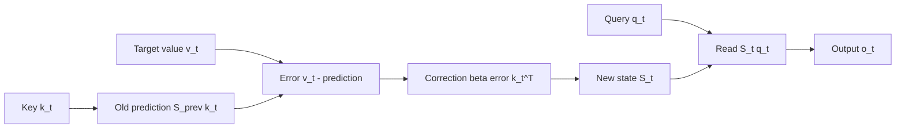
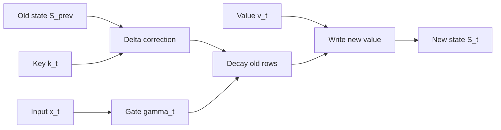
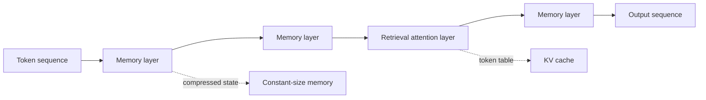

# 序列模型演化史：从 RNN 到 Hybrid DeltaNet

> 一条主线：**历史信息怎么存？怎么读？怎么忘？**
> 每个模型都是这三个问题的不同答案。
>
> 📖 阅读提示：本文公式均为 LaTeX，建议使用支持 KaTeX 的查看器（VS Code / Typora / Obsidian）以获得最佳渲染效果。

```
1990s          2014        2017          2020           2021         2024          2025
 RNN    →    LSTM    →  Transformer → Linear Attn →  DeltaNet → Gated DeltaNet → Hybrid
 压缩历史      学会遗忘      全表检索      记账本累加      纠错式写入    装上遗忘门      分工合作
 O(N)串行     O(N)串行     O(N²)并行      O(N)并行        O(N)并行      O(N)并行        粗活+细活
```

---

这条时间线先不要当成模型名的背诵表。它其实一直在追问同一件事：当第 $t$ 个 token 到来时，模型怎样让过去继续影响现在，同时又不让计算和记忆成本失控？下面的四个词是读完整条演化史的坐标系。

## 0. 先把四个词钉在同一条状态链上

假设输入是一串按顺序到来的 token：

```text
sequence:  我  →  吃  →  苹果
             t=1   t=2    t=3
             │     │      │
state:      h₀ →  h₁  →  h₂  →  h₃
```

- **序列（sequence）**：输入不是一袋无序 token，而是 $x_1,x_2,\ldots,x_T$ 这样的有序对象。
- **时间（time）**：这里主要指更新索引 $t$。它不一定是现实世界的秒数，而是“第几个输入到达、计算推进到哪一步”。
- **状态（state）**：处理到第 $t$ 步后，模型对当前上下文形成的内部表示，记作 $h_t$；它通常是一串数字，不是人类可直接读的句子。
- **记忆（memory）**：过去的信息已经改变了状态，而这个状态继续参与当前计算，所以历史对现在仍有影响。

最小的状态转移式只有一句：

$$h_t=f(h_{t-1},x_t)$$

如果还要产生预测，则再从状态读出：

$$y_t=g(h_t)$$

这四个词不是四个并列模块，而是同一条因果链上的四个观察角度：**序列给出顺序，时间标记更新，状态承载当前表示，记忆描述历史如何通过状态留下影响。**

### 一个小例子：当前输入相同，历史仍然不同

读到“苹果”时，当前输入都可以写成 $x_t=\text{“苹果”}$，但前文不同会带来不同的旧状态：

$$h_t^{(吃)}=f(h_{t-1}^{(我吃)},\text{“苹果”}),\qquad
h_t^{(用)}=f(h_{t-1}^{(我用)},\text{“苹果”})$$

于是同一个词可能被理解成水果，也可能被理解成品牌或设备。状态不是历史的逐字副本，而是面向任务的**压缩表示**：它只保留当前计算可能用得上的影响。这正是 RNN 的力量，也是它后来遇到长程依赖瓶颈的根源。

后面每一代模型都可以用三个问题检查：

1. **怎么存？** 历史被压成向量、账本矩阵，还是直接保留成 token 表？
2. **怎么读？** 当前输入只能读一个状态，还是可以对历史位置按需检索？
3. **怎么忘？** 信息被动覆写、由门控选择性衰减，还是根本不压缩而交给 mask 和上下文边界管理？

## 全局速览表

| 模型 | 状态形式 | 长程依赖 | 训练并行 | 推理状态大小 | 核心创新 |
|---|---|---|---|---|---|
| RNN | 向量 h | ✗ 梯度消失 | ✗ | O(d) | 循环压缩历史 |
| LSTM | 向量对 (h, c) + 门控 | ⚠️ 缓解 | ✗ | O(d) | 遗忘/输入/输出门 |
| Transformer | 无状态（KV cache） | ✅ 精确 | ✅✅✅ | O(N·d) | attention 全表路由 |
| Linear Attention | 矩阵 S | ⚠️ 有损累加 | ✅ | O(d²) 恒定 | kernel trick 去 softmax |
| DeltaNet | 矩阵 S + 纠错写入 | ⚠️ 更准的有损 | ✅（chunked） | O(d²) 恒定 | delta rule = 在线 SGD |
| Gated DeltaNet | 矩阵 S + 衰减门 γ | ✅ 可控遗忘 | ✅（chunked） | O(d²) 恒定 | 数据驱动的遗忘 |
| Hybrid | 上述混合 | ✅ 混合互补 | ✅ | O(d²)+少量O(N·d) | 分层分工 |

表中的“状态”要和上面的状态链对应起来：RNN 的 $h_t$ 是唯一记忆体；LSTM 把长期存储拆成 $c_t$，再用 $h_t$ 做工作区和输出；线性记忆模型把状态升级成一个可查询的矩阵 $S_t$；Transformer 则不再要求一个固定大小的状态代表全部历史，而是保留一张可检索的 token 表。

---

# 1. RNN（Recurrent Neural Network）

## 思想

**把全部历史压缩进一个固定向量**。每来一个新 token，就把旧状态和输入“搅拌”成新状态。也就是说，RNN 把上面的抽象状态链直接实现成：

```text
旧状态 hₜ₋₁ + 当前输入 xₜ  →  状态更新函数 f  →  新状态 hₜ  →  预测 yₜ
```

三个问题的答案：
- **怎么存？** 一个向量 h，容量固定
- **怎么读？** 输出层直接读 h
- **怎么忘？** 没得选——旧信息被反复覆写，永远"遗忘"（这是 bug 也是 feature）

## 📐 公式

状态更新（单步）：

$$h_t = \tanh(W_x x_t + W_h h_{t-1} + b)$$

梯度消失的数学根源——反向传播时误差沿时间连乘：

$$\frac{\partial h_t}{\partial h_{t-k}} = \prod_{i=0}^{k-1} \tanh'(a_{t-i}) \cdot W_h$$

由于 $|\tanh'(\cdot)| \le 1$，连乘项模长**指数衰减**（除非 $W_h$ 特征值全部大于 1，那又会梯度爆炸）——两头都是死路。

### 把“记忆”看成状态的传递

用“我吃苹果”走一遍，RNN 并不是在第三步突然读取一份独立的历史文件：

```text
t=1: h₁ = f(h₀, “我”)       当前状态带上“我”的影响
t=2: h₂ = f(h₁, “吃”)       “我”不再作为原 token 出现，而是通过 h₁ 继续参与
t=3: h₃ = f(h₂, “苹果”)     “苹果”的解释同时受当前输入和 h₂ 影响
```

所以“记忆”不是额外外挂的缓存，而是**过去已经改变了状态**。如果两段历史不同，即使当前 $x_t$ 相同，旧状态也不同，得到的 $h_t$ 通常不同。这一点解释了 RNN 为什么能处理顺序，也解释了为什么状态容量和梯度传播距离会成为硬约束。

## 比喻

**传话游戏** 📣：第一个人看到句子，把意思压缩成一句话传给下一个人。传到最后，开头的内容早被稀释得没影了——这就是梯度消失的直观形态：模型"想不起"很久之前的事。

## PyTorch 手搓

```python
import torch

batch, T, d_in, d_hidden = 2, 16, 32, 64

W_x = torch.randn(d_in, d_hidden) * 0.1   # 输入→状态
W_h = torch.randn(d_hidden, d_hidden) * 0.1 # 状态→状态（循环的"自转"）
b   = torch.zeros(d_hidden)

h = torch.zeros(batch, d_hidden)          # 唯一的记忆体，初始化全零
for t in range(T):
    x_t = x[:, t]                          # 本步输入 [B, d_in]
    h = torch.tanh(x_t @ W_x + h @ W_h + b)  # 搅拌：新输入 + 旧记忆
    # h 现在"同时装着"第 0~t 个 token 的压缩信息
```

> ⚠️ 教学版：真实模型权重应是 `nn.Parameter` 并被 `nn.Linear` 管理。

## 复杂度小结

- 时间 O(N·d²)，但 **N 步必须串行**——GPU 再强也只能排队
- 瓶颈：tanh 导数 ≤ 1，连乘 → 梯度消失；$W_h$ 特征值 > 1 时 → 梯度爆炸

### 一个容易混淆的形状问题

输入若是：

$$X\in\mathbb{R}^{B\times T\times d_{\text{in}}}$$

RNN 会沿着时间维 $T$ 逐步更新，并把每个时间步的状态堆叠成：

$$H=[h_1,h_2,\ldots,h_T]\in\mathbb{R}^{B\times T\times d_{\text{hidden}}}$$

最后一个状态 $h_T$ 只是整段序列的一个压缩摘要，不等于整个输出序列 $H$。多层 RNN 会把上一层的 $H$ 作为下一层的输入；只有在 `hidden_size == d_model` 时，最后一层输出才会恰好具有 `[B, T, d_model]` 的形状。保留时间维，意味着模型保留了“每一步处理到哪里”的状态轨迹，而不是只留下句末一个答案。

---

# 2. LSTM（Long Short-Term Memory）

## 思想

RNN 的病根：**所有信息挤在一个 h 里，读写不分家**。LSTM 的解法是分家：状态不再只有一个向量，而是由长期存储 $c_t$ 和工作状态 $h_t$ 共同组成。这样，“要长期保留什么”和“当前要对外暴露什么”可以是两件事。

- **细胞状态 c**：一条"高速公路"，信息可以原样通过多步（解决梯度消失）
- **隐藏状态 h**：当前时间步的工作区和对外接口，读取 $c_t$ 后再输出
- **三个门控**：信息进出 c 都要过安检，安检力度**由数据自己学**

## 📐 公式

四个门与状态更新（$\sigma$ 为 sigmoid，$\odot$ 为逐元素乘）：

$$f_t = \sigma(W_f [h_{t-1}, x_t]) \qquad \text{(遗忘门：旧记忆留多少)}$$

$$i_t = \sigma(W_i [h_{t-1}, x_t]) \qquad \text{(输入门：新信息写多少)}$$

$$\tilde{c}_t = \tanh(W_c [h_{t-1}, x_t]) \qquad \text{(候选内容：想写的新东西)}$$

$$o_t = \sigma(W_o [h_{t-1}, x_t]) \qquad \text{(输出门：露出多少给外界)}$$

核心更新——**加法路径导数恒为 1**，梯度沿 c 高速无损回流几百步：

$$c_t = f_t \odot c_{t-1} + i_t \odot \tilde{c}_t$$

$$h_t = o_t \odot \tanh(c_t)$$

## 比喻

**公司财务 + 三道审批门** 🏢：
- c 是对公账户，账本可以长期不动（高速公路）
- 遗忘门：旧预算保留比例，每季度审批一次
- 输入门：新开支入账比例
- 输出门：对外披露多少

对比 RNN 的传话游戏：LSTM 允许"把原话誊进笔记本原样保管"，而不是全靠脑子记。

## PyTorch 手搓

```python
def lstm_step(x_t, h_prev, c_prev, W, b):
    # W: [d_in + d_hidden, 4 * d_hidden]，把四个门的权重打包成一个矩阵
    gates = torch.cat([x_t, h_prev], dim=-1) @ W + b      # [B, 4H]
    i, f, g, o = gates.chunk(4, dim=-1)                    # 一刀切四份

    i = torch.sigmoid(i)   # 输入门 ∈ (0,1)：新内容写入比例
    f = torch.sigmoid(f)   # 遗忘门 ∈ (0,1)：旧记忆保留比例（学出 ≈1 = 长期记忆）
    g = torch.tanh(g)      # 候选内容：未经门控的原始写入值
    o = torch.sigmoid(o)   # 输出门：对外暴露比例

    c = f * c_prev + i * g    # 主记忆更新：高速公路上的加法（梯度友好的关键！）
    h = o * torch.tanh(c)       # 对外输出
    return h, c

h = torch.zeros(batch, d_hidden)
c = torch.zeros(batch, d_hidden)   # LSTM 比 RNN 多一个"账本"
for t in range(T):
    h, c = lstm_step(x[:, t], h, c, W_lstm, b_lstm)
```

## 复杂度小结

- 时间 O(N·d²)，依然**串行**，但细胞状态的高速公路让有效记忆长度从 ~10 步涨到 ~100+ 步
- 遗忘门 f 学出 ≈ 1 的行 = 长期记忆；≈ 0 的行 = 短期缓冲。门控把"遗忘"从 bug 变成了 **feature**——这一思想后面还会借尸还魂（Gated DeltaNet）

从 RNN 到 LSTM，变化不是“多了几个 sigmoid”这么简单，而是状态职责发生了拆分：RNN 只能把历史不断揉进 $h_t$，LSTM 则允许信息沿 $c_t$ 的加法路径稳定流动，再由 $h_t$ 决定这一刻要让什么信息参与下一层或输出。

---

# 3. Transformer（Self-Attention）

## 思想

**别压缩了，全员到齐，直接查表**。RNN/LSTM 把历史压成向量是"有损压缩"；Transformer 反其道而行——每个 token 的表示全程保留，用 attention 在需要时**按需检索**。三个问题的答案被彻底改写：
- **怎么存？** 不存！所有 token 的 K/V 摆在那里（KV cache 是推理期的缓存优化，不是架构必需）
- **怎么读？** Q 对全体 K 打相似度，softmax 变"采购权重"，对 V 加权求和
- **怎么忘？** 靠 causal mask 封死未来（decoder），或全靠数据自己学（encoder）

这里“时间”换了一种实现方式。Transformer 不靠 $h_{t-1}\to h_t$ 的递推来制造顺序，而是把位置编码和 causal mask 放进并行计算：每个位置仍然只能看到允许看到的历史位置。推理时的 KV cache 不是一个压缩后的单向量状态，而是已生成 token 的 key/value 表，因此它精确，却会随上下文长度 $N$ 增长。

## 📐 公式

Scaled Dot-Product Attention（Q、K、V 由输入经三个投影矩阵得到：$Q = XW_Q$，$K = XW_K$，$V = XW_V$）：

$$\mathrm{Attention}(Q, K, V) = \mathrm{softmax}\left(\frac{QK^\top}{\sqrt{d_k}}\right) V$$

缩放因子的由来：score 是 $q \cdot k = \sum_{j=1}^{d_k} q_j k_j$，$d_k$ 项独立求和使方差 $\propto d_k$；除以 $\sqrt{d_k}$ 把 logit 拉回 O(1)，防止 softmax 饱和。

Causal 版本（decoder 的自回归约束，$M$ 为 mask，未来位置取 $-\infty$）：

$$\mathrm{Attention}_{causal} = \mathrm{softmax}\left(\frac{QK^\top}{\sqrt{d_k}} + M\right) V, \qquad M_{ij} = \begin{cases} 0 & j \le i \\ -\infty & j > i \end{cases}$$

## 比喻

**图书馆检索系统** 📚：
- K/V 是全馆书架上的书（key 是书名索引，value 是书的内容）
- Q 是你的检索词
- QKᵀ 是检索词和每本书的匹配打分；softmax 把打分变成"借阅比例"
- 输出 = 按借阅比例混合出来的"知识套餐"

RNN 是"背了一脑子压缩笔记的人"，Transformer 是"带着检索词进图书馆的人"——信息从不丢失，只在需要时被调取。

## PyTorch 手搓（MHA + causal mask）

```python
import math

batch, T, d_model, n_head = 2, 16, 64, 8
d_k = d_model // n_head

w_q = torch.randn(d_model, d_model) * 0.05   # 教学用 randn；真模型用 nn.Linear
w_k = torch.randn(d_model, d_model) * 0.05
w_v = torch.randn(d_model, d_model) * 0.05

q = (x @ w_q).view(batch, T, n_head, d_k).transpose(1, 2)  # [B, H, T, d_k]
k = (x @ w_k).view(batch, T, n_head, d_k).transpose(1, 2)
v = (x @ w_v).view(batch, T, n_head, d_k).transpose(1, 2)

scores = q @ k.transpose(-1, -2) / math.sqrt(d_k)          # [B, H, T, T]

# causal mask：第 i 行封死 j > i 的"未来"，自回归生成的基石
mask = torch.triu(torch.ones(T, T, dtype=torch.bool), diagonal=1)
scores = scores.masked_fill(mask, float("-inf"))           # -inf → softmax 后 = 0

attn = torch.softmax(scores, dim=-1)                       # 每行 = 概率分布（采购单）
out = attn @ v                                             # 按单取货
```

## 复杂度小结

- 时间 O(N²·d)：每个 token 和所有 token 交互——全局性的定价
- 训练**完全并行**（矩阵乘伺候），GPU 越多越好——这是它掀翻 LSTM 的根本原因
- 推理靠 KV cache 把逐 token 生成从 O(N³) 拉回 O(N²)，但 cache 本身 O(N·d) 随上下文线性膨胀 → 催生后面所有"恒定状态"流派

---

# 4. Linear Attention

## 4.1 先说结论

Linear Attention 把历史 token 压成一个固定大小的 key 到 value 矩阵账本。新 token 查询这本账，不再和所有历史 token 两两配对，所以成本对序列长度 $N$ 近似线性。代价是压缩会丢细节：相似 key 可能写进同一块区域，产生串味；下一章 DeltaNet 就是来修这个问题的。

## 4.2 先认三个符号：Q、K、V

对第 $t$ 个 token，模型先得到 query $q_t$、key $k_t$、value $v_t$。$q_t$ 是当前 token 想查什么，$k_t$ 是历史信息的索引，$v_t$ 是真正要取回的内容。图书馆类比：$q_t$ 是检索词，$k_i$ 是书的索引标签，$v_i$ 是书的内容。

| 符号 | 含义 | 形状 |
|---|---|---|
| $N$（或 $T$） | token 数量 | 标量 |
| $d_k$ | query/key 宽度 | 标量 |
| $d_v$ | value/输出宽度 | 标量 |
| $d_\phi$ | feature map 后的宽度 | 标量 |
| $q_t,k_t$ | 第 $t$ 个 query/key | $[d_k]$ |
| $v_t$ | 第 $t$ 个 value | $[d_v]$ |
| $\phi(q_t),\phi(k_t)$ | 映射后的 query/key | $[d_\phi]$ |

整段序列堆起来后，$Q,K,V$ 的形状是 $[N,d_k]$、$[N,d_k]$、$[N,d_v]$。$N$ 是会变长的上下文，$d_k,d_v,d_\phi$ 是每个 token 的向量宽度。

## 4.3 普通 Attention 为什么是 $O(N^2)$

对一个 query $q_t$，causal Attention 可以写成：

$$
o_t=\frac{\sum_{i=1}^{t}\exp(q_t^\top k_i/\sqrt{d_k})v_i}{\sum_{i=1}^{t}\exp(q_t^\top k_i/\sqrt{d_k})}.$$

白话：$q_t$ 要和前面 $t$ 个 key 一一比较，再按分数混合 value。$N$ 个 query 各看 $N$ 个 key，就会出现 $N\times N$ 的匹配表，成本随 $N^2$ 增长。问题卡在 softmax：指数和归一化让每个权重同时依赖当前 $q_t$ 与每个 $k_i$，不能先把历史压成一个与 query 无关的矩阵。

## 4.4 Kernel trick：先把 key 写成账本

Kernel trick 寻找一个 feature map $\phi$，使相似度近似为：

$$\exp(q^\top k/\sqrt{d_k})\approx\phi(q)^\top\phi(k).$$

常见教学实现取 $\phi(x)=\operatorname{ELU}(x)+1$；它让特征为正，方便归一化。不同论文也会用其他映射，这个函数不是唯一答案。要留意：这通常是替代相似度，不是对原始 softmax 的逐项精确复制，所以输出可能和 full Attention 不完全一样。

代回上式，并利用矩阵乘法结合律：

$$
\begin{aligned}
S_t&=\sum_{i=1}^{t}\phi(k_i)v_i^\top\in\mathbb{R}^{d_\phi\times d_v},\\
z_t&=\sum_{i=1}^{t}\phi(k_i)\in\mathbb{R}^{d_\phi},\\
o_t&=\frac{\phi(q_t)^\top S_t}{\phi(q_t)^\top z_t}\in\mathbb{R}^{d_v}.
\end{aligned}
$$

逐行读：$S_t$ 是索引到内容的总账，$z_t$ 是归一化用的总账。分子形状是 $[1,d_\phi][d_\phi,d_v]=[1,d_v]$，分母形状是 $[1,d_\phi][d_\phi]=[1]$，所以输出是 $[d_v]$。

### `feature_map` 到底在做什么

`feature_map` 不是把 key 变成一个离散编号，而是把每个坐标换到另一个更适合计算的坐标系：

$$
\phi:\mathbb{R}^{d_k}\rightarrow\mathbb{R}^{d_\phi}.
$$

第 4 章的教学代码使用：

```python
def feature_map(x):
    return F.elu(x) + 1.0
```

这是逐元素变换。默认 $\alpha=1$ 时：

$$
\phi(x)=\operatorname{ELU}(x)+1=
\begin{cases}
x+1, & x>0,\\
e^x, & x\le 0.
\end{cases}
$$

例如 $x=-2$ 会变成 $e^{-2}\approx0.135$，$x=2$ 会变成 $3$。加 $1$ 的主要目的，是让 feature 大于 $0$，从而让归一化分母 $\phi(q_t)^\top z_t$ 少发生正负抵消。它不是 probability：输出不要求小于 $1$，也不要求总和为 $1$。

这里的 $\phi$ 通常只是一个便宜的替代 feature map，不保证精确复现 full Attention 的 softmax；它的价值在于让历史可以被累加成固定大小的状态。当前示例没有额外 projection，所以输入和输出的最后一维相同，即 $d_\phi=d_k$；真实实现也可以用 `Linear` 把 $d_k$ 投影到另一个 $d_\phi$。

### `S` 到底保存了什么

先暂时把 $\phi$ 当成恒等映射。对一条历史记录 $(k_i,v_i)$，写入项是 outer product：

$$
k_i v_i^\top\in\mathbb{R}^{d_k\times d_v}.
$$

它不是一个标量，也不是把 $k_i$ 和 $v_i$ 拼接起来；它会把 key 的每个坐标与 value 的每个坐标两两组合。一般使用 feature map 后，写入项的形状是 $[d_\phi,d_v]$；这里因为暂时令 $\phi$ 为恒等映射，所以写成 $[d_k,d_v]$。所有历史记录累加后得到：

$$
S_t=\sum_{i=1}^{t}\phi(k_i)v_i^\top.
$$

所以 $S_t$ 可以看成一张压缩的 key-to-value lookup table：行方向对应 feature key 的坐标，列方向对应 value 的坐标。它没有保留第 $i$ 条原始记录的位置，只保留“各种 key 方向总共对 value 贡献了什么”。

## 4.5 一个两维例子

暂时令 $\phi$ 为恒等映射，且 $d_\phi=d_k=2$：

$$k_1=\begin{bmatrix}1\\0\end{bmatrix},\quad v_1=\begin{bmatrix}10\\0\end{bmatrix};\qquad k_2=\begin{bmatrix}0\\1\end{bmatrix},\quad v_2=\begin{bmatrix}0\\20\end{bmatrix}.$$

于是：

$$
k_1v_1^\top=\begin{bmatrix}10&0\\0&0\end{bmatrix},\qquad
k_2v_2^\top=\begin{bmatrix}0&0\\0&20\end{bmatrix}.
$$

把两笔账相加：

$$
S_2=k_1v_1^\top+k_2v_2^\top=\begin{bmatrix}10&0\\0&20\end{bmatrix},\qquad
z_2=k_1+k_2=\begin{bmatrix}1\\1\end{bmatrix}.
$$

现在用 query 读取：

$$
\begin{bmatrix}1&0\end{bmatrix}S_2=\begin{bmatrix}10&0\end{bmatrix},\qquad
\begin{bmatrix}0&1\end{bmatrix}S_2=\begin{bmatrix}0&20\end{bmatrix}.
$$

$q=[1,0]^\top$ 查到第一行，$q=[0,1]^\top$ 查到第二行；如果 $q=[0.5,0.5]^\top$，则会把两行按比例混合。反过来，如果两条 key 都是 $[1,0]^\top$，一个 value 是“红”、一个是“绿”，它们会累加到同一行，查询时只能得到混合结果。这就是压缩账本的边界：它不是逐条保存原始记录。

## 4.6 它如何变成 recurrent state

因为 $S_t,z_t$ 都是累加和，每一步只需：

$$S_t=S_{t-1}+\phi(k_t)v_t^\top,\qquad z_t=z_{t-1}+\phi(k_t).$$

外积方向很关键：$\phi(k_t)$ 是 $[d_\phi]$，$v_t^\top$ 是 $[1,d_v]$，所以写入项是 $[d_\phi,d_v]$；读取统一写成 $\phi(q_t)^\top S_t$。

```mermaid
flowchart LR
    K[Key k_t] --> FK[Feature map phi(k_t)]
    V[Value v_t] --> W[Write outer product]
    FK --> W
    W --> S[State S_t]
    Q[Query q_t] --> FQ[Feature map phi(q_t)]
    FQ --> R[Read phi(q_t)^T S_t]
    S --> R
    R --> O[Output o_t]
```

图中左边是写入：每个 key/value 只更新固定大小的 $S_t$；右边是读取：当前 query 用自己的 feature 去查询 $S_t$。序列变长时，账本的形状不变。

---

## 4.7 PyTorch 手搓：代码和公式一一对应

```python
import torch
import torch.nn.functional as F

B, T, d_k, d_v, d_phi = 2, 16, 32, 64, 32
q_seq = torch.randn(B, T, d_k)
k_seq = torch.randn(B, T, d_k)
v_seq = torch.randn(B, T, d_v)

def feature_map(x):
    # x: [..., d_k] -> phi(x): [..., d_phi]
    # 这里 d_phi == d_k；真实模型可用 Linear 改变维度。
    return F.elu(x) + 1.0

S = torch.zeros(B, d_phi, d_v)  # [B, d_phi, d_v]
z = torch.zeros(B, d_phi)        # [B, d_phi]
outputs = []

for t in range(T):
    q_t = feature_map(q_seq[:, t])  # [B, d_phi]
    k_t = feature_map(k_seq[:, t])  # [B, d_phi]
    v_t = v_seq[:, t]               # [B, d_v]

    # batch 外积：phi(k_t) v_t^T -> [B, d_phi, d_v]
    S = S + torch.einsum("bi,bj->bij", k_t, v_t)
    z = z + k_t

    numerator = torch.einsum("bi,bij->bj", q_t, S)  # [B, d_v]
    denominator = (q_t * z).sum(dim=-1, keepdim=True)  # [B, 1]
    o_t = numerator / denominator.clamp_min(1e-6)
    outputs.append(o_t)

out = torch.stack(outputs, dim=1)  # [B, T, d_v]
assert out.shape == (B, T, d_v)
```

代码里的 `S` 就是公式里的 $S_t$，`z` 就是 $z_t$；`einsum("bi,bij->bj", ...)` 实现的正是 $\phi(q_t)^\top S_t$。第 $t$ 步更新后只能读到 $1...t$，所以这个递推天然满足 causal 约束。

## 4.8 复杂度与边界

- Transformer 显式构造 $N\times N$ 匹配关系，典型成本是 $O(N^2d)$；
- Linear Attention 每步更新 $S$ 的成本约为 $O(d_\phi d_v)$，整段约为 $O(Nd_\phi d_v)$，状态大小为 $O(d_\phi d_v+d_\phi)$；
- 训练时可以用 chunk 并行块内计算、块间递推；推理时则是一边读 token 一边更新状态。

这里的“linear”指**对序列长度 $N$ 近似线性**，不是所有矩阵乘法都只需 $O(d)$。它的代价是不能像 full Attention 那样回到某个历史位置逐条重查，相似 key 还会互相污染，长期累加可能饱和。

### 一句话检查

**先用 $\phi(k_t)v_t^\top$ 把历史写进固定大小的 $S_t$，再用 $\phi(q_t)^\top S_t$ 读取；$O(N^2)$ 下降的关键，是利用结合律不再显式构造 $N\times N$ 表。**

---
# 5. DeltaNet

## 5.1 先说结论：它改了哪一步

Linear Attention 的写入是“看到一条记录，就直接追加一条记录”。这样便宜，却可能让不同含义的 key 写进同一块矩阵。DeltaNet 在写入前先问一句：**我用旧记忆对这个 key 的答案是什么？答案和新 value 差多少？** 然后只写入这个差额。

要记住的 invariant 是：

$$
\text{read old memory}\;\to\;\text{compute error}\;\to\;\text{write correction}.
$$

这里的状态仍是一个 key 到 value 的矩阵，但它从“累加器”变成了会在线学习的联想记忆。

## 5.2 先固定对象和形状

本章使用：

| 符号 | 含义 | 形状 |
|---|---|---|
| $S_{t-1}$ | 处理第 $t$ 个 token 前的记忆矩阵 | $[d_v,d_k]$ |
| $k_t,q_t$ | 当前 key/query | $[d_k]$ |
| $v_t$ | 当前 value，也就是希望记住的答案 | $[d_v]$ |
| $\beta_t$ | 当前写入强度，通常在 $(0,1)$ | 标量 |
| $\hat v_t$ | 旧记忆对 $k_t$ 的预测 | $[d_v]$ |
| $e_t$ | 新答案和旧预测的差额 | $[d_v]$ |

矩阵乘法的方向是 $S_{t-1}k_t$：$[d_v,d_k][d_k]=[d_v]$。所以 $S$ 的每一行回答一个 value 通道，每一列对应一个 key 方向。

## 5.3 从 Linear Attention 的痛点重新推导

Linear Attention 的直接追加可以写成：

$$S_t=S_{t-1}+\beta_t v_t k_t^\top.$$

它完全没有查看旧答案。若同一个 key 先后对应“红”和“绿”，矩阵会把两次写入叠加起来。

DeltaNet 加上读取步骤：

$$
\hat v_t=S_{t-1}k_t,qquad e_t=v_t-\hat v_t.
$$

然后只把误差写回：

$$
S_t=S_{t-1}+\beta_t e_t k_t^\top.
$$

逐项读这条公式：$S_{t-1}k_t$ 是旧答案，$v_t-\hat v_t$ 是还缺什么，$e_tk_t^\top$ 把这个差额写回与 $k_t$ 对应的方向，$\beta_t$ 控制这次改多少。

## 5.4 为什么它等价于 online SGD

把“记忆矩阵对 key 给出的答案”当成一个小模型，当前样本的损失是：

$$
L_t(S)=\frac12\lVert Sk_t-v_t\rVert_2^2.
$$

其中 $\lVert\cdot\rVert_2^2$ 表示误差向量各元素平方后求和。对矩阵 $S$ 求梯度：

$$
\nabla_S L_t=(Sk_t-v_t)k_t^\top.
$$

在旧状态 $S_{t-1}$ 处走一步 gradient descent：

$$
S_t=S_{t-1}-\beta_t\nabla_S L_t
=S_{t-1}+\beta_t(v_t-S_{t-1}k_t)k_t^\top.
$$

这正好就是前面的 delta rule。因此可以把 DeltaNet 记成：**每来一个 token，就用它作为一个训练样本，对矩阵记忆做一步 online SGD。** 状态不是静态设计好的“缓存”，而是被序列一路训练出来的。

把它展开还能看到“擦除旧关联，再写入新值”：

$$
S_t=S_{t-1}(I-\beta_t k_tk_t^\top)+\beta_t v_tk_t^\top,
$$

其中 $I\in\mathbb{R}^{d_k\times d_k}$ 是 identity matrix。第一项沿着 $k_t$ 方向减少旧预测，第二项把目标 $v_t$ 写回去。

## 5.5 一个两维手算例子

令：

$$
S_{t-1}=\begin{bmatrix}1&0\\0&0\end{bmatrix},\quad
k_t=\begin{bmatrix}1\\0\end{bmatrix},\quad
v_t=\begin{bmatrix}0\\2\end{bmatrix},\quad
\beta_t=0.5.
$$

旧记忆的预测是：

$$
\hat v_t=S_{t-1}k_t=\begin{bmatrix}1\\0\end{bmatrix},\qquad
 e_t=v_t-\hat v_t=\begin{bmatrix}-1\\2\end{bmatrix}.
$$

写回项为：

$$
\beta_t e_tk_t^\top
=0.5\begin{bmatrix}-1&0\\2&0\end{bmatrix}.
$$

所以：

$$
S_t=\begin{bmatrix}0.5&0\\1&0\end{bmatrix},\qquad
S_tk_t=\begin{bmatrix}0.5\\1\end{bmatrix}.
$$

新预测从 $[1,0]$ 向目标 $[0,2]$ 走了一半。$\beta_t$ 越大，改错越猛；越小，记忆越稳定但适应越慢。



这张图和 Linear Attention 的差别只在写入前多了“先读旧答案、再算误差”。但这一步改变了状态的语义：它不再只是历史总和，而是一个会修正自己的映射。

## 5.6 PyTorch 手搓：逐行对应 delta rule

```python
import torch
import torch.nn.functional as F

T, d_k, d_v = 12, 4, 3
k_seq = torch.randn(T, d_k)
q_seq = torch.randn(T, d_k)
v_seq = torch.randn(T, d_v)
beta_raw = torch.randn(T)

S = torch.zeros(d_v, d_k)  # [d_v, d_k]
outputs = []

for t in range(T):
    # 归一化让 key 的长度大致固定，beta 更容易解释为写入比例。
    k_t = F.normalize(k_seq[t], dim=-1)  # [d_k]
    q_t = F.normalize(q_seq[t], dim=-1)  # [d_k]
    v_t = v_seq[t]                       # [d_v]
    beta_t = torch.sigmoid(beta_raw[t])   # 标量，范围 (0, 1)

    prediction = S @ k_t                 # [d_v]，旧记忆的答案
    error = v_t - prediction             # [d_v]，只写这个差额
    S = S + beta_t * torch.outer(error, k_t)  # [d_v, d_k]

    outputs.append(S @ q_t)              # [d_v]，读取更新后的记忆

out = torch.stack(outputs)                # [T, d_v]
assert out.shape == (T, d_v)
```

代码中的 `prediction`、`error`、`outer(error, k_t)` 分别对应 $S_{t-1}k_t$、$e_t$、$e_tk_t^\top$。这也是它和 Linear Attention 示例最值得对照的一行：直接写 $v_tk_t^\top$ 被改成了只写预测误差。

## 5.7 复杂度与边界

- 单步读取和写入约为 $O(d_kd_v)$，整段约为 $O(Nd_kd_v)$，状态大小为 $O(d_kd_v)$；
- 递推推理天然是一边读 token 一边更新；训练时可以用专门的 `chunk` kernel 把块内递推改写成矩阵运算；
- 它仍然没有真正的遗忘机制。长序列里，旧信息可能一直占据状态容量，最后出现饱和或互相干扰。

所以 DeltaNet 解决的是“写入前先纠错”，没有解决“旧信息什么时候该过期”。下一章只增加一个能力：让不同 value 通道拥有不同的保质期。

---

# 6. Gated DeltaNet

## 6.1 先说结论：在纠错记忆上加保质期

DeltaNet 会纠错，却接近永不遗忘。Gated DeltaNet 给旧记忆加一个逐通道的 decay gate：有些通道长期保留，有些通道快速衰减。它借用了 LSTM 的遗忘门思想，但门控对象从一个向量状态变成了矩阵状态的行。

每一步仍然遵守同一个顺序：

$$
\text{old memory}\;\to\;\text{delta correction}\;\to\;\text{decay old rows}\;\to\;\text{write new value}.
$$

## 6.2 符号和形状

| 符号 | 含义 | 形状 |
|---|---|---|
| $S_{t-1}$ | 旧记忆矩阵 | $[d_v,d_k]$ |
| $k_t,q_t$ | key/query | $[d_k]$ |
| $v_t$ | value | $[d_v]$ |
| $\beta_t$ | delta 写入强度 | 标量 |
| $\gamma_t$ | 每个 value 通道的保留比例 | $[d_v]$ |
| $W_\gamma$ | 从输入产生 gate 的参数 | $[d_v,d_{in}]$ |

门由当前输入产生：

$$
\gamma_t=\sigma(W_\gamma x_t+b_\gamma)\in(0,1)^{d_v}.
$$

$\gamma_{t,j}\approx1$ 表示第 $j$ 个 value 通道保留旧内容，$\gamma_{t,j}\approx0$ 表示它快速忘掉旧内容。这里的 gate 是逐行广播到矩阵：$\gamma_t[:,None]$ 的形状是 $[d_v,1]$。

## 6.3 从 DeltaNet 公式加上衰减

先计算旧预测：

$$
\hat v_t=S_{t-1}k_t.
$$

再沿 key 方向做 delta correction，最后衰减旧行并写入当前 value：

$$
S_t=\gamma_t[:,None]\odot
\left[S_{t-1}-\beta_t\hat v_tk_t^\top\right]
+\beta_t v_tk_t^\top.
$$

这条式子容易看漏括号。它的实际顺序是：

1. $S_{t-1}-\beta_t\hat v_tk_t^\top$：先从旧矩阵中擦掉当前 key 对应的旧预测；
2. $\gamma_t[:,None]\odot(\cdot)$：只衰减旧记忆，每一行可以有不同保留率；
3. $+\beta_t v_tk_t^\top$：把当前目标写进去。

代码里的“新写入”没有再乘一次 $\gamma_t$，因为 gate 表示旧内容的保质期；若把新写入也衰减，模型会很难立即记住刚到达的信息。



## 6.4 PyTorch 手搓：看清广播维度

```python
import torch
import torch.nn.functional as F

T, d_k, d_v = 12, 4, 3
k_seq = torch.randn(T, d_k)
q_seq = torch.randn(T, d_k)
v_seq = torch.randn(T, d_v)
beta_raw = torch.randn(T)
gamma_raw = torch.randn(T, d_v)

S = torch.zeros(d_v, d_k)  # [d_v, d_k]
outputs = []

for t in range(T):
    k_t = F.normalize(k_seq[t], dim=-1)      # [d_k]
    q_t = F.normalize(q_seq[t], dim=-1)      # [d_k]
    v_t = v_seq[t]                           # [d_v]
    beta_t = torch.sigmoid(beta_raw[t])      # scalar
    gamma_t = torch.sigmoid(gamma_raw[t])    # [d_v]

    prediction = S @ k_t                     # [d_v]
    old_corrected = S - beta_t * torch.outer(prediction, k_t)
    S = gamma_t[:, None] * old_corrected \
        + beta_t * torch.outer(v_t, k_t)

    outputs.append(S @ q_t)                  # [d_v]

out = torch.stack(outputs)                    # [T, d_v]
assert out.shape == (T, d_v)
```

`gamma_t[:, None]` 是关键：它把 $[d_v]$ 变成 $[d_v,1]$，从而让第 $j$ 行的所有 key 方向一起乘上 $\gamma_{t,j}$。如果写成 `gamma_t * S`，shape 通常无法按想要的“逐行衰减”广播。

## 6.5 复杂度与边界

- 与 DeltaNet 同级：整段约为 $O(Nd_kd_v)$，矩阵状态约为 $O(d_kd_v)$；
- $\gamma$ 小的行偏向短期模式，$\gamma$ 大的行偏向长期模式，因此一个矩阵可以同时承载不同时间尺度；
- gate 不是魔法橡皮擦：如果模型一直输出接近 1，旧信息仍然会饱和；如果长期接近 0，又会丢掉有用上下文。

到这里，线性记忆层负责“带着历史继续计算”；但如果任务要求逐字找回很久以前的一小段文本，压缩状态仍可能不够。Hybrid 架构因此把精确检索交给少数 full Attention 层。

---

# 7. Hybrid DeltaNet：让不同层各做擅长的事

## 7.1 为什么要混合

纯 Gated DeltaNet 便宜，适合长程信息流，却可能丢掉某个历史位置的精确细节。纯 full Attention 能逐 token 检索，却要付出 $N^2$ 的训练成本和随上下文增长的 KV cache。

Hybrid 的基本分工是：

- **memory layers**：大量使用 Gated DeltaNet，压缩、搬运和持续更新长程信息；
- **retrieval layers**：少量使用 full Attention，在关键位置做精确检索和重新对齐。

这不是把两种机制揉成一个模糊平均值，而是把它们放在不同 layer 里，让每层有清楚的职责。

## 7.2 先比较两种成本

设模型有 $L_m$ 个 memory layers、$L_a$ 个 attention layers，hidden width 为 $d$：

$$
\mathrm{FLOPs}\approx L_mO(Nd^2)+L_aO(N^2d).
$$

推理期状态近似为：

$$
\mathrm{State}\approx L_mO(d^2)+L_aO(Nd).
$$

第一项来自每个线性记忆层的固定矩阵状态，第二项来自每个 attention layer 的 KV cache。$L_a$ 较小时，实际吞吐和显存压力会明显降低；但只要仍保留 full Attention，严格的渐近式里仍然存在 $L_aO(N^2d)$，所以 Hybrid 是降低二次项的系数，不是把二次项凭空变成线性。精确检索能力依赖那几层 attention，不能把它们全部删掉。



图中的两条虚线代表两种记忆形态：memory layer 维护固定大小的 recurrent state，attention layer 保留可逐 token 查询的 KV table。

## 7.3 一个可运行的教学版调度骨架

下面的代码故意使用未优化的 Python loop，目的是让状态如何跨 token、层如何交替一眼可见；真实模型会用 fused kernel 和 chunked scan。

```python
import torch
import torch.nn as nn
import torch.nn.functional as F

class GatedDeltaMemory(nn.Module):
    """教学版 gated delta layer：输入输出都是 [B, T, D]。"""
    def __init__(self, d_model):
        super().__init__()
        self.to_k = nn.Linear(d_model, d_model)
        self.to_q = nn.Linear(d_model, d_model)
        self.to_v = nn.Linear(d_model, d_model)
        self.to_beta = nn.Linear(d_model, 1)
        self.to_gamma = nn.Linear(d_model, d_model)
        self.to_out = nn.Linear(d_model, d_model)

    def forward(self, x):
        B, T, D = x.shape
        k = F.normalize(self.to_k(x), dim=-1)      # [B, T, D]
        q = F.normalize(self.to_q(x), dim=-1)      # [B, T, D]
        v = self.to_v(x)                           # [B, T, D]
        beta = torch.sigmoid(self.to_beta(x))      # [B, T, 1]
        gamma = torch.sigmoid(self.to_gamma(x))    # [B, T, D]

        state = x.new_zeros(B, D, D)               # [B, D, D]
        outputs = []
        for t in range(T):
            k_t, q_t, v_t = k[:, t], q[:, t], v[:, t]
            beta_t = beta[:, t]                    # [B, 1]
            gamma_t = gamma[:, t]                  # [B, D]
            prediction = torch.bmm(state, k_t.unsqueeze(-1)).squeeze(-1)
            old_corrected = state - beta_t[:, None, :] * torch.einsum(
                "bi,bj->bij", prediction, k_t
            )
            state = gamma_t[:, :, None] * old_corrected + beta_t[:, :, None] * torch.einsum(
                "bi,bj->bij", v_t, k_t
            )
            outputs.append(torch.bmm(state, q_t.unsqueeze(-1)).squeeze(-1))
        return self.to_out(torch.stack(outputs, dim=1))  # [B, T, D]

class HybridBlock(nn.Module):
    def __init__(self, d_model, n_head, use_attention):
        super().__init__()
        self.use_attention = use_attention
        self.norm = nn.LayerNorm(d_model)
        if use_attention:
            self.attn = nn.MultiheadAttention(
                d_model, n_head, batch_first=True
            )
        else:
            self.memory = GatedDeltaMemory(d_model)
        self.ffn = nn.Sequential(
            nn.Linear(d_model, 4 * d_model),
            nn.GELU(),
            nn.Linear(4 * d_model, d_model),
        )

    def forward(self, x):
        h = self.norm(x)
        if self.use_attention:
            h, _ = self.attn(h, h, h, need_weights=False)
        else:
            h = self.memory(h)
        x = x + h                                  # residual 1
        return x + self.ffn(self.norm(x))           # residual 2

B, T, D, H = 2, 8, 32, 4
x = torch.randn(B, T, D)
schedule = [False, False, False, True]             # 3 memory : 1 attention
model = nn.Sequential(*[
    HybridBlock(D, H, use_attention=schedule[i % len(schedule)])
    for i in range(8)
])
out = model(x)
assert out.shape == (B, T, D)
```

跟踪一次 `forward`：每个 memory layer 只维护自己的 $[B,D,D]$ state；attention layer 则在这一层内部建立 token-to-token 关系；两者都通过 residual connection 把结果送给下一层。调度表改变的是“哪一层拥有哪种记忆”，不是输入输出 shape。

## 7.4 什么时候需要哪一种

- 任务主要要求持续理解、摘要和长程状态传递：memory layers 更划算；
- 任务需要复制编号、精确引用或找回局部片段：需要 retrieval layers；
- 任务两者都要：用少量 attention layers 提供精确锚点，其余层承担低成本的信息流。

这不是一个绝对的模型排行榜。最终取舍取决于上下文长度、硬件、吞吐目标和任务是否真的需要逐 token 精确检索。

---

## 终章：把整条演化链压成一个状态机

所有章节都可以放进同一条抽象：

$$
\text{state}_t=\mathrm{update}(\text{state}_{t-1},x_t),\qquad
\text{output}_t=\mathrm{read}(\text{state}_t,q_t).
$$

区别只在三件事：state 存多少、怎么读、什么时候忘。

| 模型 | state 存什么 | 怎么读 | 怎么忘 | 主要代价 |
|---|---|---|---|---|
| RNN | 固定向量 $h_t$ | 直接读 $h_t$ | 被后续更新覆盖 | 长程梯度困难 |
| LSTM | $h_t$ 与 $c_t$ 加门控 | 从 $c_t$ 选择性暴露 | forget gate | 仍需逐步递推 |
| Transformer | token-level K/V table | query 对历史逐项打分 | causal mask 只挡未来 | $O(N^2)$ 训练成本 |
| Linear Attention | 矩阵 $S_t$ 与归一化向量 $z_t$ | $\phi(q_t)^\top S_t$ | 基本不忘，可能饱和 | 相似 key 会混合 |
| DeltaNet | 矩阵 $S_t$ | $S_tq_t$ | 通过 prediction error 改写 | 仍可能长期饱和 |
| Gated DeltaNet | 矩阵 $S_t$ 加逐通道 $\gamma_t$ | $S_tq_t$ | gate 衰减旧行 | gate 学不好会遗忘或饱和 |
| Hybrid | memory state + 少量 KV table | 分层分工 | gate + causal mask | 线性项为主，但仍含少量 $O(N^2)$ |

迁移检查：

1. **如果当前 token 相同，为什么输出仍可能不同？** 因为旧 state 不同，$\mathrm{update}(state_{t-1},x_t)$ 的输入并不相同。
2. **如果任务要求逐字找回很久以前的一段文本，哪种 state 更可靠？** 可检索的 token-level KV table；固定大小的压缩 state 可能已经混合或遗忘细节。
3. **如果上下文继续变长，哪种成本会先爆？** full Attention 的 $N^2$ 匹配和 $O(Nd)$ KV cache；recurrent memory 的状态形状保持不随 $N$ 增长。
4. **DeltaNet 比 Linear Attention 多做了哪一个动作？** 写入前先算 $\hat v_t=S_{t-1}k_t$，只写 $v_t-\hat v_t$。
5. **Gated DeltaNet 比 DeltaNet 多保留了哪一个控制旋钮？** 每个 value 通道自己的 $\gamma_t$，决定旧信息的保质期。

最后把判断规则压成一句话：**如果任务需要“带着历史继续计算”，优先考虑 recurrent state；如果任务需要“回到历史某个位置精确取回”，就需要可检索的 token table；如果两种需求同时存在，让 Hybrid 用不同层分工。**
