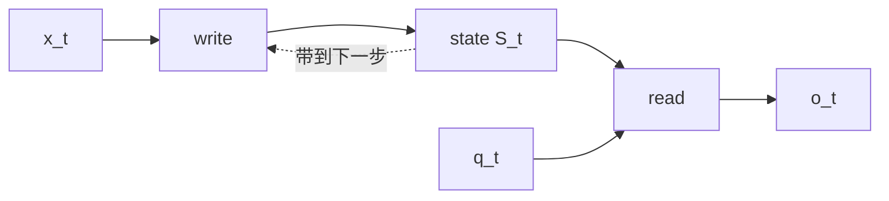
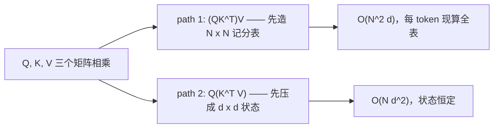
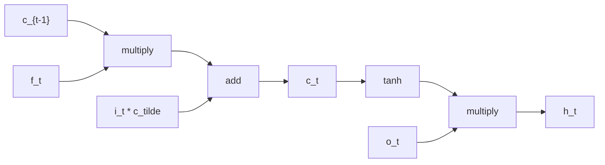
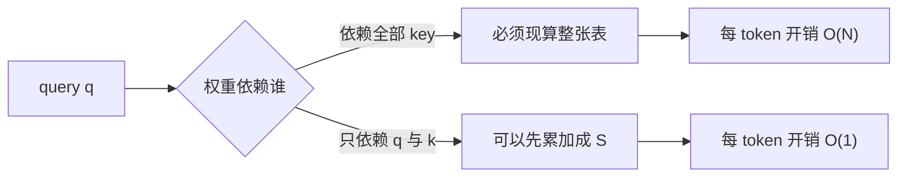
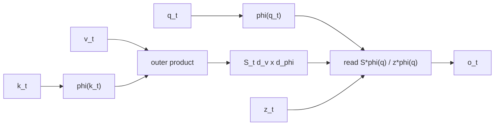
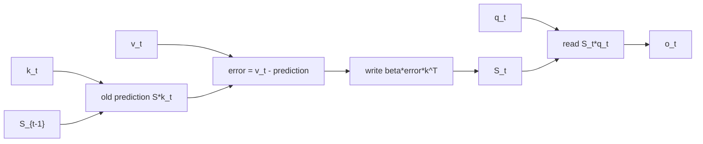
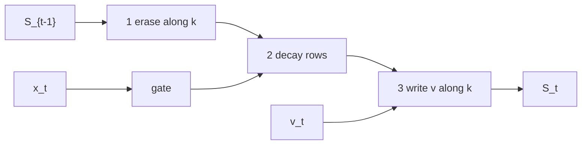

# 序列模型的记忆：从 RNN 到 Hybrid DeltaNet（v5）

> v5 · 2026-11 · 教学重构版。主线不变：历史要影响现在，而账本大小固定，七代模型只差一条写规则。本版把每一章重排成同一套教学节拍 —— 一句话公式 → 同一道例题逐步走一遍 → 错在哪 → 机制细看 → 类比 → 小结 —— 参照同目录 `RNN的记忆、序列、时间与状态.md` 的写法。v4 的技术内容一字未删，只换了讲法。

## 核心思想

一句话：序列模型的演化，就是把盲写改成先读后写，再加上过期。

```text
无地址       ──写脏全表──▶  装地址       （矩阵账本）
有地址但盲写 ──擦不掉旧值──▶ 先读后写     （delta rule）
先读后写     ──只增不减──▶  按行过期     （gate）
按行过期     ──压不出逐字──▶ 分层保真     （hybrid）
```

不变量：同一个 key 连写两次后立刻读，必须得到第二次的值；如果读到的是两次的平均，这份账本只会累加，不会改口。

## TL;DR

序列建模只有一个硬约束：历史要持续影响现在，而状态大小是固定的。在这条约束下，能选的记账方式只有四种 —— 不合并、累加、纠错、衰减；七代架构是这四种方式的接力，每次换手都是被上一步的具体失败逼出来的。看懂这四种写法，你就能只凭一条写规则，预测一个模型在"改口、串味、逐字召回"上的表现，而不用背它的结构图。

全文只算一道题：写 (A,1)、写 (B,5)、写 (A,3)，然后问 A 和 B 各是多少，答案应该是 3 和 5。每章重算一遍：题不变，机制变，读数跟着变。这是全文唯一的重复，而且每次重复都在换一套机器。

## 怎么读这本书

每一章都按同一套节拍走，六拍，一个不缺：

1. **一句话 + 一个式子**。先给出这一章模型的核心循环，boxed。这是全章唯一需要背的东西。
2. **同一道题走一遍**。还是写 (A,1)、写 (B,5)、写 (A,3) 那一题，分第一步、第二步、第三步手算。这拍回答"它到底在干什么"。
3. **对在哪，错在哪**。把上一步的每个读数拆开，错的一个数字指认一条机制。这拍回答"它为什么这样"。
4. **机制细看**。这一章真正的新东西：推导、账单、边界，都在这里。
5. **一个类比**。把机制挂到日常生活里的一个对应物上，给直觉一条回家的路。
6. **本章小结**。修好了上一章的什么病，留下了什么病给下一章。两章之间的接缝在这里焊上，所以章节不会跳跃。

如果你时间紧：直接看每章的第 1 拍和第 6 拍，再看 §8 的两张总表，就能拿到全文八成。剩下的拍是给你慢慢消化用的。

RNN 的基础推导如果不熟，可以先翻同目录的 `RNN的记忆、序列、时间与状态.md` —— 本教程每一章的节拍就是照它定的。§0.4 是「矩阵乘法六副眼镜」词汇表，后面每章按编号引用；六副眼镜的交互演示版在同目录 `matrix_multiplication_view.html`，那边每副眼镜都有可以动手玩的演示。

---

## 0. 先把题目出出来

### 0.1 三道验收标准，一条预算约束

在谈任何模型之前，先把"语言"这层皮剥掉。语言模型的困难常被描述成"语义太复杂"，但真正卡住架构演化的是一件更无聊的事：记账。

```text
t = 1       写 (A, 1)
t = 2       写 (B, 5)
t = 3       写 (A, 3)        ← A 改口了
t = 4..91   88 个与此无关的 token
t = 92      问：A 是多少？B 是多少？
```

正确答案 A=3、B=5。中间 88 个 token 想聊什么都行，它们唯一的义务是别把这两条记录冲掉。这类任务在文献里叫 associative recall（联想召回），有专门的合成测试集来考它；它不需要语法、不需要常识，只需要一本不乱账的簿子。而 1990 到 2025 年这一串架构，很大程度上是被这种"低智商"任务反复按在地上摩擦出来的。这件事值得先在心里打个记号：驱动架构演化的，很多时候不是"理解得更深"，而是"记账记得更准"。

把这道题拆成验收标准，就是下面四条。它们会一路用到 §8 的终表。

| 编号 | 要求 | 一句话检验 |
|---|---|---|
| R1 | 记得住 | 第 1 步写的记录，第 92 步还在 |
| R2 | 改得动 | A 改写成 3 之后，读出来是 3，不是 2 |
| R3 | 不串味 | 改 A 的时候，B 仍然是 5 |
| C0 | 预算固定 | N 从 4K 涨到 128K，状态大小不变 |

C0 写的是"状态大小"，不是"时间"。这个区别后面会咬人：串行带来的时间成本，往往比状态大小更早杀死一个架构 —— 而它不在任何一张复杂度表的显眼位置。

### 0.2 唯一的骨架

万变不离其宗，任何一步序列计算都能写成一对动作：

$$S_t=\mathrm{write}(S_{t-1},x_t),\qquad o_t=\mathrm{read}(S_t,q_t)$$

| 符号 | 含义 |
|---|---|
| $S_t$ | 第 $t$ 步之后的全部记忆，它的形状决定流派 |
| $x_t$ | 当前 token 的表示 |
| $k_t,v_t$ | 由 $x_t$ 投影出的地址与内容 |
| $q_t$ | 由 $x_t$ 投影出的提问 |
| $o_t$ | 读出的结果，交给下一层 |

$S_t$ 是唯一的存放地点：模型此刻拥有的全部历史，就是这一坨数，没有别的抽屉可以翻。注意 $k_t$ 和 $q_t$ 是同一个 token 经不同线性投影得到的两个向量 —— 这就是 Q/K/V 三件套的由来：一份拿去写账本，一份拿去查账本。



读图指引：先看左半段，$x_t$ 进 `write` 产出状态；再看右半段，$q_t$ 进 `read` 从状态取出输出；最后看那条虚线，它是唯一把历史带到下一步的通道。后面七章改的全是 `write` 这个框和 $S$ 的形状，`read` 那半条几乎一动没动 —— 这句话本身就是全文的目录。

### 0.3 全篇唯一值得亲手推的一步

问题是这样：账本里有 $N$ 条记录 $(k_i,v_i)$，现在来了一个 query $q$，怎么把内容取出来？你手上没有"索引"这种数据结构，只有向量；而向量之间能做的比较只有一种 —— 内积。所以"查"这件事唯一的自然形态就是：和每条记录算一个相似度，再按相似度把 value 加权求和。

$$o=\sum_{i=1}^{N}\big(q^\top k_i\big)\,v_i=\Big(\sum_{i=1}^{N}v_i k_i^\top\Big)q=Sq$$

第二个等号值得停一下。它看着像技巧，其实是矩阵乘法的定义：$(q^\top k_i)v_i$ 是一个标量乘一个向量，而这个结果恒等于 $(v_i k_i^\top)q$ —— 一个矩阵乘一个向量。形状也对得上：$v_i k_i^\top$ 是 $[d_v,d_k]$，乘上 $[d_k]$ 得到 $[d_v]$。

真正关键的不是这个恒等式，而是它允许你把求和挪到 query 前面。原来的写法要求"每来一个 query，就把 $N$ 条记录全扫一遍"；换完之后，$N$ 条记录可以先自己累加成一张矩阵，query 到了只做一次矩阵乘。从"每次读都扫全表"到"边写边维护一张表"，这个交换是整条演化史能存在的原因；没有它，后面所有 $O(N)$ 的模型都无从谈起。

这步交换在矩阵乘法里有名字：第一个等号是 01 号点积视角（每一格是一次相似度打分），第二个等号是 06 号括号视角（$(AB)C$ 与 $A(BC)$ 同值不同价），而 $vk^\top$ 这种写法是 04 号外积视角（一块 rank-1 地毯）。它们属于一套六视角词汇表，§0.4 一次备齐，后面每章按编号引用。

于是我们免费拿到两个基本动作：

- 写入 $S\leftarrow S+v k^\top$，一个 **outer product（外积）**，形状 $[d_v,d_k]$，含义是"把 $v$ 写进 $k$ 所指的那一列方向"；
- 读取 $o=Sq$，本质是 $d_v$ 个独立的内积并排算。

> **方向约定，全文唯一，后面不再改**：$S\in\mathbb{R}^{d_v\times d_k}$，行对应 value 通道，列对应 key 方向。有的资料写成 $S=\sum k v^\top$ 再配 $q^\top S$，两者互为转置、数学等价，但混着读会要命 —— 你在第 5 章看到 $kv^\top$、第 6 章看到 $Sk$，会以为作者换了模型，其实只是换了纸的朝向。

到这里，"记忆"这个词终于有了具体所指：一个矩阵，就是一个从 key 方向到 value 的线性映射。这句话要记住，因为它同时是这一派的全部力量，也是全部病根 —— 线性映射能做的事，和查表能做的事，不是一回事。伏笔在 §3.3 兑现。

于是剩下的全部问题被压成一句话：**当新记录到来时，你怎么把它合并进这个矩阵？**

### 0.4 六副眼镜：本篇通用的矩阵乘法词汇表

§0.3 那步推导不是孤立技巧。矩阵乘法只有一个定义：$(m\times r)\cdot(r\times n)\to(m\times n)$，中间那个 $r$ 是咬合的齿轮 —— 所有视角的分歧，归根结底都是“这个求和轴该怎么切”。同一个定义可以从六个角度读，每个角度在本篇都有一段戏份。词汇表整理自同目录的交互演示页 `matrix_multiplication_view.html`，那边每副眼镜都配了可以动手玩的演示；这里只收结论。

| 编号 | 眼镜 | 核心公式 | 你在看什么 | 本篇在哪里用 |
|---|---|---|---|---|
| 01 | 点积 | $c_{ij}=a_{i:}\cdot b_{:j}$ | 一格 = 一次相似度打分 | §3 的 attention 记分表 |
| 02 | 列 | $C_{:j}=A\,b_{:j}$ | A 列的混合，B 出配方 | §1–§2 的 $W_hh$ 全维搅拌 |
| 03 | 行 | $C_{i:}=a_{i:}\,B$ | B 行的混合，A 出配方 | 02 的对偶，同一乘法的另一半 |
| 04 | 外积 | $C=\sum_{k=1}^{r}a_{:k}b_{k:}^\top$ | rank-1 地毯逐层叠加 | §4–§6 的记忆写入 |
| 05 | 复合 | $(AB)x=A(Bx)$ | 矩阵即映射，乘即接力 | §0.3：定义为什么长这样 |
| 06 | 括号 | $(AB)C$ vs $A(BC)$ | 同值不同价 | §4 的命门、§5.7 的并行化 |

01 到 04 是四种“组织求和的刀法”：按格切、按列切、按行切、按层切。05 回答“这个定义为什么存在”—— 要求乘积恰好实现映射复合，逐列推导会被迫得到 $c_{ij}=\sum_k a_{ik}b_{kj}$，这是唯一满足复合律的乘法；维度链必须咬合、结合律天然成立，都从这里来。06 是这个定义送给工程师的自由：结合律保证值不变，括号随便选，账单天差地别。

06 号眼镜在本篇分量最重，先预支一张图：



标准 attention 走第一条括号，Linear Attention 走第二条 —— §3 和 §4 的全部冲突，都可以压缩成“括号能不能换”这一个问句。交互页的挑战题还有一句值得抄在这里：括号视角给出便宜的计算顺序，外积视角给出递推的记忆解释，两副眼镜叠着戴，Linear Attention 的全貌就出来了。这正是 §4 要干的事。

### 0.5 于是只剩四种记账方式

把 §0.2 的问题问出去，答案的空间小得出人意料。

| 方式 | 更新式 | 满足 | 违反 | 代表 |
|---|---|---|---|---|
| 不合并 | 每条 $(k_i,v_i)$ 原样留着 | R1 R2 R3 | C0 | Transformer |
| 累加 | $S\leftarrow S+v k^\top$ | C0 R1 | R2 R3 | Linear Attention |
| 纠错 | $S\leftarrow S+\beta(v-Sk)k^\top$ | C0 R1 R2 | R3（部分） | DeltaNet |
| 衰减 + 纠错 | 先按行乘 $\gamma$，再纠错 | C0 R1 R2 | R3、误伤 | Gated DeltaNet |

这四条值得各自看一眼它们的诱惑和代价，因为整篇文章就是它们互相打脸的过程。不合并最省事，不合并就不会丢，读的时候现场挑，代价是表随 $N$ 变长，于是"读"变成和 $N$ 条逐条比较，成本 $O(N^2)$。累加最便宜，一个外积写一次，代价是它压根不区分"新值"和"旧值"。纠错聪明，写之前先读一眼，只写差额，代价是多一次读，而且依赖 key 归一化才干净。衰减多一个旋钮，让旧内容按行过期，代价是门得学得准，学歪了会误伤无辜。

RNN 和 LSTM 不在这张表里，因为它们没有 $k$。这一点值得说透，否则很容易以为它们只是"压得更狠的线性注意力"。它们的写入是 $h_t=a(h_{t-1})+b(x_t)$：一个和输入同宽的向量，被稠密矩阵 $W_h$ 全维度搅拌之后灌回状态。没有地址，也没有"这次写哪个方向"这个概念 —— 每次写入都会碰到每一个坐标，只是碰得多和碰得少的区别。

所以它们是"没有页码的账本"。这不是"压得不够好"，而是"你无法指定要改哪一条"。一个人改不了书里的某一页，不是因为墨水不够，是因为这本书没有页码。

### 0.6 "忘"不是独立旋钮

一种常见的组织方式，是把"怎么存、怎么读、怎么忘"并列成三个对等的问题。这个框架读起来很顺，但埋了个陷阱：忘从来不是独立旋钮，它是写规则的副产品。

理由很朴素：记忆只有一份。想让旧内容活下来，唯一的办法是写的时候少动它；想让旧内容消失，唯一的办法还是写的时候多动它。你没法一边说"我要精确地改 A"，一边说"我顺便把 B 抹掉"，除非写规则里本来就带着"动 B"的动作。

拿 RNN 感受一下：你想让 B 一直留着，做不到，因为第 3 步写 A 时 $W_h$ 顺手就改了 B；你想让 B 消失，也做不到，你只能"少写点东西"，但那样 A 也留不住。矩阵账本里同样如此：想让 B 消失，只能给 $S$ 乘一个小于 1 的系数，而那会连带把 A 也乘进去。忘永远不是针对某一条记录的操作，它是整张表上的一个统一动作。

这一句在 §6 会变成 $\gamma$ 的定义。

---

## 1. RNN：一页没有页码的账本

> 本章接口：这是故事的起点。RNN 之前的做法（固定窗口）把"能看多远"写死在架构里；RNN 用一个向量承接任意长的历史，壮举与病根同时诞生。

### 1.1 一句话 + 一个式子

RNN 每一步都在做一件事：把旧状态和当前输入搅在一起，搅出新状态。

\[
\boxed{h_t=\tanh\big(W_x x_t+W_h h_{t-1}+b\big)}
\]

对照骨架 $S_t=\mathrm{write}(S_{t-1},x_t)$：这里的 $S_t$ 就是 $h_t$，只是它只有 $[d]$ 一个向量 —— 全文最小的一份状态，小到只有一个点。$W_x$ 是新输入的入口，$W_h$ 是旧状态的通道，$\tanh$ 负责把值压回 $(-1,1)$。

这个式子有一段来路。九十年代初的序列建模有个很具体的问题：多层感知机吃定长输入，而句子长短不一。当时的做法是开一个固定窗口，取前 $k$ 个词拼成向量，预测下一个词，窗口右移再算一次。这个办法的失败方式很有教育意义 —— 它把"历史能看多远"变成了一个超参数：$k$ 取 5，模型就永远只能看到 5 个词之前；想看得更远只能加大 $k$，参数量随 $k$ 线性增长。记忆长度被写死在架构里，而不是由数据决定。

RNN（Elman 1990 的 simple recurrent network；Jordan 1986 有一个把输出也接回状态的姊妹版本）只改了一句话：不要固定窗口，把上一步的状态当成这一步的输入。这个改法同时解决了两件事：变长输入，以及参数共享（同一个 $W_h$ 用 $N$ 次）。

暂时不需要理解 $\tanh$ 内部的细节，先理解"状态如何随序列不断更新"即可 —— 这和 `RNN的记忆、序列、时间与状态.md` 讲的是同一台机器，本文从这里继续往深处走。

### 1.2 同一道题，RNN 一步步怎么算

为了能心算，把 $\tanh$ 拿掉（它只把数值压到区间里，不改变"混合"这件事），并把 $W_h$ 取成 $0.5I$ —— 也就是"旧状态每步减半，再叠加新输入"。状态只有两维，约定第 1 维是 A 的槽、第 2 维是 B 的槽。

```text
h = [0, 0]                              # [slot_A, slot_B]

t=1   写 (A, 1)   h = 0.5*[0,0]   + [1,0] = [1.00, 0.00]
t=2   写 (B, 5)   h = 0.5*[1,0]   + [0,5] = [0.50, 5.00]
t=3   写 (A, 3)   h = 0.5*[0.5,5] + [3,0] = [3.25, 2.50]

t=92  问 A → 3.25（应为 3）   问 B → 2.5（应为 5）
```

第一步读到"写 (A,1)"：新输入把 1 放进第 1 维，旧状态是零，没什么好混的。第二步写 B：5 干净地落在第 2 维，但 A 的 1 被乘了 0.5 —— 从这一步起，记忆里的一切都开始衰减。第三步 A 改口成 3：新输入把 3 加到第 1 维，可原来那个被衰减过的 0.5 还在账上，叠出来 3.25；同一次写入乘的是整页的 $W_h$，第 2 维的 5 被顺手砍成 2.5。

两个数字都错，而且错法刚好相反，正好对应 R2 和 R3 两条失败。

### 1.3 错在哪一格

A 多出的 0.25 是 $1\times0.5\times0.5$，也就是第 1 步那个 1 衰减两次之后的残留。第 3 步明明重新写过 A，旧值还渗了一点进来 —— 说明"覆盖"根本没有发生，发生的只是"叠加"。B 从 5 掉到 2.5，则是因为第 3 步那次写入乘的是整页的 $W_h$，它顺手把第二个槽也砍了一半。B 自己什么都没做错，新写入伤及了无辜。

有人会说：这是你把 $W_h$ 设成标量倍单位阵的结果，太特殊。那就换成普通稠密矩阵 —— 情况只会更糟：两个槽以任意比例互相污染，而且污染比例是学出来的，你无法预测、也无法纠正。真正的 RNN 用 $\tanh$ 而不是线性，只是给混合加了非线性，没有改变混合这个事实。

所以病根不是容量不够。两维存两个数绰绰有余。病根是没有地址：写 B 的时候，模型并不知道"我只该动第二个槽"，它手里只有一个稠密矩阵，而这个矩阵的每一行都在看所有列。如果你想要的是一个能被单独修改的格子，那你需要的不是更好的优化器，而是一个索引。

用 §0.4 的 02 号眼镜（列视角）说得更狠一点：$W_hh_{t-1}$ 意味着旧状态的每个坐标都按 $W_h$ 的列配方被重新混一遍，mixing 是稠密的，没有任何一列能被单独豁免。“没有地址”翻译成矩阵语言，就是“这次 mixing 不可分离”。

### 1.4 机制细看：连"记得久"也做不到

就算暂时接受混合，RNN 还有第二个更硬的问题：记忆长度和训练稳定性共用同一个旋钮。

线性化地看上面那个递推（把 $\tanh$ 当恒等），$t-k$ 步的信息传到 $t$ 步，权重是 $\|W_h\|^k$，也就是一条几何衰减：

```text
lambda = 0.9    k=100: 2.7e-5     k=300: 1.9e-14
lambda = 0.99   k=100: 3.7e-1     k=1000: 4.3e-5
```

想让第 1 步的记录活到第 92 步，$\lambda$ 就得非常接近 1：$\lambda=0.9$ 时 100 步只剩 $2.7\times10^{-5}$，等于没了；$\lambda=0.99$ 稍好，但 1000 步之后同样归零。

问题是反向传播走的是同一批矩阵：

$$\frac{\partial h_t}{\partial h_{t-k}}=\prod_{j=0}^{k-1}\mathrm{diag}\big(1-\tanh^2(a_{t-j})\big)\,W_h$$

$\lambda>1$ 时这个连乘指数爆炸，$\lambda<1$ 时指数消失。同一个数同时决定了"能记多久"和"能不能训" —— 这不是"梯度消失"一个毛病，这是两难：你想要的 $\lambda$ 和你能训的 $\lambda$ 是同一个数。

$\tanh$ 还补了一刀，这一刀常被忽略。预激活在 3 附近时 $\tanh'(3)=1-\tanh^2(3)\approx0.0099$，也就是每一步把梯度乘掉 99%。一百步是 $0.0099^{100}\approx4\times10^{-201}$，已经小于 IEEE 754 双精度能表示的最小正规数。所以就算 $\|W_h\|$ 恰好等于 1，只要激活值落在饱和区，梯度照样在几十步内归零。不是权重在衰减信号，是激活函数自己在衰减信号。

这就是 RNN 的死结：想记得久，状态就得近似恒等传递；而恒等传递要求 $\|W_h\|\approx1$，梯度恰恰在这个点上最脆弱。传得远和传得稳由同一组权重控制，你没法同时优化 —— 结构性两难，不是调参能绕过去的。

### 1.5 一个类比：传话游戏，但失败的原因被说错了

讲 RNN 最常见的比喻是传话游戏：第一个人把话传给第二个人，一路传下去，传到最后开头早走样了。这个比喻对了一半，但把失败原因说错了方向。传话游戏里，信息是被语言重新编码而失真的 —— 每个人都在用自己的话复述，于是细节被改写、被省略。RNN 没有"复述"这个动作，它是被算术混合而失真的：旧信息被乘进一个新向量，和新输入相加，再被 $\tanh$ 压一遍。

这个区别不是抠字眼，它决定了你该怎么修。如果是"复述失真"，解法是让传话的人说得更准（更大的 hidden size）；如果是"算术混合"，解法只有两个 —— 给一个独立的格子（矩阵状态或 token 表），或者让传递变成恒等（加法路径）。LSTM 选了后者，Transformer 选了前者。所以下一步不是"记得更准"，而是"给一个格子，再给这个格子装个阀门"。

### 1.6 本章小结

最重要的理解是：

1. RNN 用同一个向量同时当仓库、工作区和接口，三件事互相挤压；
2. 写入没有地址：每次写入都碰到所有坐标，旧值靠几何衰减被动消退，不是被覆盖；
3. 记忆长度和训练稳定性共用 $\|W_h\|$ 这一个旋钮，$\tanh$ 的饱和区雪上加霜；
4. 它还有一笔不在标准表里的账：$h_t$ 依赖 $h_{t-1}$，$N$ 步必须排队 —— 这一点会在 §2.6 变成致命伤。

三条验收标准，RNN 全不满足：R1 靠 $\lambda$ 的运气，R2 没有"覆盖"这个操作，R3 每次写入都碰所有坐标。

一句话收尾：

> **RNN 的失败不是"记不全"，是"没有页码" —— 你无法指定改哪一条，于是每一次写入都是整页改写。**

---

## 2. LSTM：一条直通线，三道闸门

> 本章接口：RNN 留下两笔债 —— 传递会衰减（活不久），写入没地址（会串味）。LSTM 只打算还第一笔，而且它的还法非常具体：不让信息"被传递"，让它"自己走过去"。

### 2.1 一句话 + 一个式子

LSTM（Hochreiter & Schmidhuber，1997）把 RNN 挤在一个向量里的三件事拆开了：长期仓库、当前工作区、对外接口，各给一条通道。核心循环是：

\[
\boxed{c_t=f_t\odot c_{t-1}+i_t\odot\tilde c_t,\qquad h_t=o_t\odot\tanh(c_t)}
\]

对照骨架：$S_t$ 在这里是一对向量 $(c_t,h_t)$。$c_t$ 是长期存储，$f_t$ 是保留比例，$i_t$ 是写入比例，$\tilde c_t=\tanh(\cdot)$ 是候选内容，$o_t$ 决定这一刻对外露出多少。四者都从 $[h_{t-1},x_t]$ 过一个线性层、切四份得到。

顺带说一个容易被忽略的史实：原始 LSTM 没有遗忘门，$f_t$ 是 Gers 等人在 2000 年补上的。这个细节不是八卦，它说明"加法路径"才是这个结构的灵魂，"遗忘"是后来加上的补丁 —— 所以本章先讲直通线，再讲闸门。

拆开之后是这样三件东西：

| 部件 | 职责 | 类比 |
|---|---|---|
| $c_t$ | 长期存储，只走加法路径 | 银行账户余额 |
| $h_t$ | 本步工作区 + 对外接口 | 今天的现金流 |
| $f,i,\tilde c,o$ | 决定 $c$ 的进出，以及对外露出多少 | 三道审批 + 一个披露口径 |

架构上一句话：$c$ 是一条几乎没有非线性的直通线，$h$ 是从 $c$ 上分出来的支流。

"支流"两个字是关键。$c_t$ 一路往前流，中间除了逐元素乘法和加法什么都不经过；$h_t$ 是从 $c_t$ 现取的一瓢水，取完就走，不影响主河道。于是"我要长期保存什么"和"我这一步要输出什么"终于可以分开决策。

这个账本比喻在哪里断：银行余额是一个标量，而 $c_t$ 是向量，每个维度有自己的 $f_{t,j}$、$i_{t,j}$。所以真实 LSTM 不是一个账户，是 $d$ 个互不干扰的账户并排 —— 这既是它比 RNN 强的地方（每个账户有自己的存取节奏），也是它容量上限被固定成 $d$ 的原因（账户数固定，第 $d+1$ 类信息只能挤进已有账户）。

### 2.2 同一道题，LSTM 一步步怎么算

LSTM 存数的位置是 $c$ 的各维。假设学出来的投影恰好把 A 送进第 1 维、把 B 送进第 2 维（这正是"运气"所在，§2.3 展开），逐维的门各管各的：

```text
c = [0, 0]                                 # [dim_A, dim_B]

t=1  写 (A, 1)   f=[1,1] i=[1,1] c~=[1,0]
                 c = 1*[0,0] + 1*[1,0] = [1, 0]

t=2  写 (B, 5)   f=[1,1] i=[1,1] c~=[0,5]
                 c = 1*[1,0] + 1*[0,5] = [1, 5]

t=3  写 (A, 3)   f=[0,1] i=[1,0] c~=[3,0]   ← 第 1 维清零重写，第 2 维原样保留
                 c = [0,1]⊙[1,5] + [1,0]⊙[3,0] = [3, 5]

t=92 读 h = o ⊙ tanh(c)：取 dim_A → 3 ✓   取 dim_B → 5 ✓
```

第一步、第二步是纯粹的"记账"：门全开，新内容加进对应维度。第三步是全章最值钱的一步：A 改口时，第 1 维的遗忘门 $f$ 归零（旧值 1 被清空）、输入门打开（新值 3 写入）；而第 2 维的 $f=1$、$i=0$ —— B 的 5 被原封不动地跳过了这次写入。**写入第一次变得可以"绕过"某些坐标**，这正是 RNN 做不到的。

读 A 得 3，读 B 得 5，两个都对。

### 2.3 对在哪，错在哪

LSTM 能不能同时得到 A=3、B=5？能，但靠运气。它可以让第 1 维专管 A、第 2 维专管 B —— 只要学出来的投影恰好把两个 key 送到不同坐标，且两个门分别学到"这一维该保留"。这确实比 RNN 强：RNN 写 A 会污染 B，LSTM 至少有可能不污染。

但"有可能"和"有保证"是两回事。没有任何机制强迫 A 和 B 落在不同维度上。训练数据里如果 A、B 总是同时出现，模型很可能把它们压进同一维，然后你就失去了分辨能力 —— 而且这个失败是静默的，loss 上看不出来。

所以这一题 LSTM 的答案是：读数全对，但"对"的来源是学出来的维度分工，不是结构保证。R2、R3 在验收表上要从"做不到"改写成"碰巧能做到"。

### 2.4 机制细看：那条"高速公路"到底高速在哪

如果只记一个结论，那就是这一句：想让信息活 100 步，最省事的办法是让它原样通过，而"原样通过"在数学上就是加法。

$$c_t=c_{t-1}+\Delta_t$$

在加法路径上求导，导数是 1，而且与隔了多少步无关 —— 一百步还是一万步，梯度都原样回来。这个性质在 1991 年那篇分析 vanishing gradient 的文章里已经说清楚了，但当时的做法是"设计一条能保持梯度的路径"；LSTM 的贡献是把这条路径做成一个结构：一条贯穿所有时间步、只带加法的 $c$ 通道。

纯加法有两个立刻可见的问题。第一，容量会被塞满 —— 无论什么信息都往里加，$c$ 的数值会一直长大，最后混成一团。第二，模型不知道该加多少 —— 有些信息该加满，有些该只加一点，有些干脆不该加。两个问题指向同一个需求：给"加多少"配一个系数，并且让这个系数由数据自己决定。这就是那三道闸门：

$$c_t=f_t\odot c_{t-1}+i_t\odot\tilde c_t$$



读图指引：先看上面那条主线，$c_{t-1}$ 乘 $f_t$、加 $i_t\tilde c_t$、得到 $c_t$ —— 整条线上没有 $W$，也没有 $\tanh$；再看右边分出去的一支，$c_t$ 经 $\tanh$、乘 $o_t$、得到 $h_t$，那是本步的对外输出。两条路一分开，"梯度走上面、表达走下面"就看得见了。

为什么门必须是 sigmoid，而不是别的？因为你要的是一个乘性开关：$f=0$ 全忘，$f=1$ 全留，中间线性插值。sigmoid 同时提供了 $(0,1)$ 的值域和平滑的梯度，两个性质都是必需的 —— 没有 $(0,1)$ 就不叫比例，不光滑就没法训。

上一节说的是纯加法路径。真实的 LSTM 在路径上还夹着一道遗忘门，所以流传最广的那句"加法路径导数恒为 1"只能算近似 —— 而准确版本才是设计的精髓，值得较真。真实导数是：

$$\frac{\partial c_t}{\partial c_{t-k}}=\prod_{i=t-k+1}^{t}\mathrm{diag}(f_i)$$

两点要说清楚。它不恒为 1，而是门的连乘 —— 只有门学出 $f\approx1$ 时这条路径才真的无损，$f=0.5$ 走十步就剩千分之一，和 RNN 没本质差别。但它比 RNN 强在两个地方：路径上没有 $W_h$，所以不混维度；路径上没有 $\tanh$，所以不饱和。$c\to c$ 是一条纯对角的线性通道，衰减因子完全由门逐元素控制。

第二点才是本质。RNN 的衰减是全局的：一个 $\|W_h\|$ 决定所有方向衰减多快，你没法让第 7 维衰减慢、第 8 维衰减快。LSTM 的衰减是逐维的，由各自的门决定。它把"记忆长度"从权重矩阵的谱这个不可控的全局量，搬到了门这个可学习的局部量上。钢丝还在，但每个人可以有自己的一根。

这也顺带解释了一个工程细节：为什么实践里会给遗忘门加正偏置（$b_f=1$ 甚至更大）。训练初期门是随机的（$f\approx0.5$），梯度还没学会该留什么，衰减已经在起作用；把偏置推正，等于让模型先默认"全留"，把路修通，再让数据决定哪里设收费站。与其从零学"该记住"，不如从"全记住"开始学"该忘什么" —— 后者的梯度信号好得多。

### 2.5 一个类比：一排独立账户

把 LSTM 想成一排并排的银行账户，而不是 RNN 那一个所有人共用的抽屉。每个账户（$c$ 的每一维）有自己的存取节奏：账户 1 今天在改写余额（A 改口），账户 2 纹丝不动（B 原样保留），账户 7 可能已经休眠了五十步 —— 但只要它的门一直开着，余额就一直在。

出纳窗口（$h_t$）是另一回事：今天对外报多少数，由披露口径 $o_t$ 决定，和账户里实际有多少钱可以脱钩。银行可以今天只报一笔小额流水，而账户深处的存款原封未动 —— 这就是"长期保存什么"和"这一步输出什么"分开决策的日常版本。

这套类比在哪里断：真实账户的个数（$d$）是固定的，而世界要记的信息种类会增长。第 $d+1$ 类信息没有新账户可开，只能和别人合租 —— 合租的代价就是串味。这不是类比失真，这正是 LSTM 的真病灶。

### 2.6 机制细看：那笔不在标准表里的账 —— 串行

LSTM 解决了"怎么让信息活得久"的一半（给了加法路径），没有解决"怎么指定改哪一条"。地址依然不存在：你还是不能对模型说"去改第 7 条记录"，A 住第 1 维还是第 7 维，是训练出来的运气。$d$ 维状态最多容纳 $d$ 个独立方向，第 $d+1$ 类信息必须和别人共享。

但真正致命的还不是这个，而是串行。$h_t$ 依赖 $h_{t-1}$，$N$ 步必须排队。优化器和硬件不关心你的模型多优雅，只关心并行度：$N$ 步串行意味着训练时间随序列长度线性增长，而每一步只有一次 $d\times d$ 矩阵乘 —— GPU 有几千个核，此刻能用上的不到百分之一。RNN 的问题不只是"一年只能训 1B token"，而是"显卡买了 99% 的算力在闲着"。

我给一个判断，并标注把握程度：Transformer 赢 LSTM，首先赢在利用率，其次才赢在精度（高置信，但这不是定理）。依据是 2017 年之后的大量复现 —— 同等参数量下，LSTM 的语言建模困惑度并没有被碾压，被碾压的是训练速度。当训练成本降一个数量级，你能喂的数据就多一个数量级，数据量最终转化成精度。因果链是"并行 → 便宜 → 更多数据 → 更准"，不是"attention 更懂语言"。

### 2.7 本章小结

最重要的理解是：

1. $c$ 通道用加法替代了乘法传递，梯度沿它原样回流，记忆长度从"谱半径的运气"变成"逐维可学的门"；
2. 写入第一次可以绕过无关坐标：改 A 不必动 B，但前提是 A、B 恰好住在不同维度 —— 结构不给保证；
3. 容量被账户数 $d$ 钉死，第 $d+1$ 类信息必然合租；
4. 串行训练没有解决，$N$ 步排队让 GPU 闲着 —— 下一章的对手正是从这条缝里进来的。

一句话收尾：

> **LSTM 还清了"活不久"的债，没还"没地址"的债；而它没打算还的那笔"串行"的账，将被下一章整个绕开。**

---

## 3. Transformer：拒绝合并

> 本章接口：LSTM 的两笔债 —— 没地址、串行 —— 在 Transformer 这里被一笔勾销，勾销的方式简单粗暴：不合并。账本不再压缩成固定大小，而是把每条记录原样留着，读的时候现场挑。代价一笔勾销的同时也立了一张新账单。

### 3.1 一句话 + 一个式子

Transformer（Vaswani 等，2017）的核心决定只有一句：既然合并必然丢东西，那就别合并。

\[
\boxed{o_t=\sum_{i\le t}\frac{\exp\big(q_t^\top k_i/\sqrt{d_k}\big)}{\sum_{j\le t}\exp\big(q_t^\top k_j/\sqrt{d_k}\big)}\,v_i}
\]

对照骨架：$S_t$ 在这里是一张**越写越长的表** $(k_1,v_1),(k_2,v_2),\ldots,(k_t,v_t)$ —— 每条记录原样躺着，等 query 来挑。$q_t$ 和全部 key 打分，分数经 $\exp$ 归一化成权重，再按权重把 value 加权求和。

和 §0.3 那个线性账本比，有两处差别。第一处：权重从裸内积变成 $\exp$ 再归一化。第二处，也是最关键的：求和号前面没有"先累加成 $S$"这一步。第一处让"能挑出一个"成为可能；第二处让"能挑，但很贵"成为事实。整章就是这两件事的交换。

当时机器翻译的主流是 LSTM + attention 的混合体，attention 只是辅助对齐；这篇论文的暴论是把 recurrence 整个删掉，只留 attention。其他所有设计都是这一个决定的推论。

戴上 01 号眼镜看，$QK^\top$ 就是一张 $N\times N$ 的相似度记分表：第 $(i,j)$ 格是第 $i$ 个 query 和第 $j$ 个 key 的一次独立 dot product。整张表就是 01 号视角说的“先定位再求和”，只不过定位的代价是 $N^2$ 个格子一个都不能少。

### 3.2 同一道题，Transformer 一步步怎么算

在 Transformer 里，"写"发生在每个 token 路过的时候：它把自己的 $(k,v)$ 追加到账本末尾，旧记录一条不删。"读"发生在查询 token 上：它拿自己的 $q$ 给全表打分。

```text
t=1   写 (A, 1)   账本: [(k_A, 1)]
t=2   写 (B, 5)   账本: [(k_A, 1), (k_B, 5)]
t=3   写 (A, 3)   账本: [(k_A, 1), (k_B, 5), (k_A, 3)]   ← 旧 A 不删，两条并排躺着
t=92  问 A：q 给三条记录打分，exp 归一化，加权求和
```

第一步、第二步纯粹是"归档"，没有任何混合发生 —— 这是全文第一次，写入不碰旧记录一根毫毛。第三步 A 改口：新记录 $(k_A,3)$ 直接追加在旧记录旁边，账本里同时躺着两个 A。这既不违反 R1（旧值还在），也给 R2 留了一个问题：t=92 读 A 的时候，两个 A 都匹配，到底听谁的？

答案取决于两条 A 的分数。若位置编码让新 A 的分数显著更高（softmax 权重比被指数拉开），输出就近似 3，B 完全不受影响 —— 三个标准全部通过。但若两条 A 的 key 完全相同、又没有位置信息，分数相等，输出就是 $(1+3)/2=2$ —— 和 Linear Attention 会犯的错一模一样（§4.5 再对账）。

所以 Transformer 这题的答案是：读 A → 3 ✓，读 B → 5 ✓，但"对"的来源是**位置编码 + 学出来的"听新来的"偏好**，不是结构保证。它把 R3（不串味）做到了机制层面 —— 写入从不覆盖旧记录；但 R2（改得动）仍然是学出来的行为。

### 3.3 机制细看：为什么必须是 softmax

有人会问：既然只是想换个更好的打分函数，为什么不能随便换？不能，因为一换就会丢掉一样东西 —— §0.3 那步推导依赖"权重可以拆成 $q$ 的函数乘 $k$ 的函数"，一旦打分里 $q$ 和 $k$ 纠缠在一起，可分离性就没了（这个损失 §4.2 会兑现成整张架构的翻盘）。softmax 不是"更好的打分"，它是同时满足三个硬需求的唯一简单形式：

| 需求 | 为什么 | 谁提供 |
|---|---|---|
| 权重非负 | 混合不该有负系数去抵消别的内容 | $\exp>0$ |
| 可任意尖锐 | 需要"只看第 3 条"这种近似 one-hot 的检索 | 指数级差异 |
| 权重和为 1 | 输出尺度不能随 $N$ 增长 | 分母归一化 |

第三条正是 Linear Attention 后来必须补 $z_t$ 的原因（§4.2）—— 同一个问题，两个流派两种解法。但真正要展开的是第二条：为什么 softmax 能挑出一个，而线性读出不能。

取两条 key，$k_1=[1,0]$、$k_2=[0.8,0.6]$，夹角 $36.9°$，value 分别是 1 和 5，query 完全对齐第一条：$q=[1,0]$。

线性读出这边，$Sq$ 里必然混着 $k_2$ 的贡献，因为 $q^\top k_2=0.8\neq0$，归一化之后算出来是 $2.78$，不是 $1$。softmax 这边，打分是 $1$ 和 $0.8$，差 $0.2$，权重比 $e^{0.2}\approx1.22$，输出约 $3.2$ —— 一样不准。但把 $q$ 放大 20 倍，打分变成 20 和 16，权重比 $e^{4}\approx55$，输出 $1.07$；放大 100 倍，权重比 $e^{20}\approx5\times10^{8}$，输出 $1.0000000$。

关键在这个"把 $q$ 放大"的动作：它不改变任何方向信息，只改变锐度。而线性账本里没有这个自由度 —— $Sq$ 对 $q$ 是齐次的，你把 $q$ 放大两倍，输出也放大两倍，权重比例纹丝不动。所以线性读出的选择性被几何锁死了：两条 key 夹角 $37°$，你就只能拿到 $37°$ 该给的混合比例，无论 query 多强。

> 这才是"压缩记忆读不准"的数学根源，不是玄学式的"信息损失"。压缩是一个齐次的线性读出头，检索是一个可饱和的非线性读出头。前者能区分的只是 key 之间的夹角；后者能区分的是分数差 —— 而分数差可以通过放大 $q$ 任意拉大。你没法用前者模拟后者，除非 key 恰好正交。

这也顺带解释了 $1/\sqrt{d_k}$ 为什么必须存在，虽然它看起来只是个数值技巧。若 $q,k$ 各分量独立同分布、方差 $\sigma^2$，则 $q^\top k=\sum_j q_jk_j$ 的方差约 $d_k\sigma^4$ —— 维度越高，打分越容易跑到几十上百，而 $\exp(50)$ 和 $\exp(60)$ 的差距会让 softmax 直接退化成 one-hot，梯度全灭。除以 $\sqrt{d_k}$ 把方差拉回 $O(1)$，本质是让锐度回到可训练的区间，而不是在饱和区里学。

### 3.4 机制细看：并行从哪来，mask 在干什么

RNN 的依赖是状态传递：$h_t$ 依赖 $h_{t-1}$，链条必须一步一步走。Transformer 把这条边整个删了，只在位置上保留注意力边：

```text
RNN          x1 → h1 → h2 → h3 → h4      状态边连成链，只能排队
Transformer  x1    x2   x3   x4          没有状态边
              ↖     ↑    ↑    ↑
                注意力边，一次全部建立
```

读图指引：先看上一行，箭头是"状态传递"，链条决定了必须排队；再看下一行，状态边消失，只剩注意力边从每个位置指向允许看到的历史，所以四列可以同时算完。

这个差别在纸面上只是"有没有一条竖线"，落到硬件上是数量级。取 $d=64$、$N=4096$：一层 RNN 是 4096 步串行的 $64\times64$ 矩阵乘，每步 4096 次乘加，合计约 $1.7\times10^{7}$ —— 每次只有这么点活，而一个 SM 一次就能吃几千个，结果核在等数据，不在算。一层 attention 是 $4096\times4096\times64$ 的批量矩阵乘，$QK^\top$ 加 $AV$ 约 $2.1\times10^{9}$ 次乘加，多出 128 倍计算量，但全部塞进一次 kernel launch，中间没有"等上一步算完"的空隙。

这就是二次的矩阵能被 GPU 吃满的原因：它用二次的计算量，换到了完全并行。这笔交易在 $N$ 不大、卡很多的时候极其划算；当 $N$ 涨到十万量级，二次项开始反过来吃你。

causal mask 则是把"未来"这条边删掉：$M_{ij}=-\infty$ 对 $j>i$，softmax 之后权重为 0。注意它删的是读取范围，不是状态。这也是为什么"忘"在 Transformer 里不是机制而是范围管理：你只能靠 mask、滑窗、或直接截断来限制历史长度，模型自己不会主动遗忘任何东西 —— 它没有可以被遗忘的状态，只有一张越来越长的名单。

```text
causal mask, T = 4       1 = 允许读     x = 置为 -inf

         k1   k2   k3   k4
   q1 [   1    x    x    x ]     位置 1 只能看自己
   q2 [   1    1    x    x ]
   q3 [   1    1    1    x ]
   q4 [   1    1    1    1 ]     位置 4 能看全部
```

读图指引：行是 query，列是 key，右上角那个大三角全是 x。这块"空"就是自回归的代价 —— 每行可用长度不一样，所以这张表必须逐行算，不能用一次全局归一化糊过去。这一句在 §4.2 会变成关键：归一化的分母依赖"这一行有多少个有效列"。

### 3.5 机制细看：账单 —— KV cache

训练时那张 $N\times N$ 表算完就扔，显存压力主要来自激活值。但推理是逐 token 的：每生成一个 token，都要拿它和前面所有 token 算注意力。如果每次都重算前面的 $k,v$，总成本是 $O(N^3)$。所以工程上把 $k,v$ 存下来，这就是 KV cache。

代价立刻显形。取 $N=131072$（128K 上下文）、$d=4096$、fp16、32 层：

$$\underbrace{2}_{K,V}\times N\times d\times\underbrace{2\ \text{bytes}}_{\text{fp16}}=2\ \text{GiB / 层}\quad\Rightarrow\quad 64\ \text{GiB（32 层）}$$

```text
KV cache, 32 layers, d = 4096, fp16        1 block = 2 GiB

     N         size   bar
--------   --------   ---------------------------------
     4K        2 GiB   #
    16K        8 GiB   ####
    64K       32 GiB   ################
   128K       64 GiB   ################################
```

读图指引：每一行是"这个上下文长度下必须常驻的 cache"。它随 $N$ 线性涨 —— $N$ 翻四倍，柱子翻四倍，没有饱和迹象。

单层 2 GiB 看着不算多，32 层就是 64 GiB，已经超过单张 80G 卡的可用显存，还没算权重和激活。所以长上下文推理的第一道墙，往往不是算不动，而是装不下。

更麻烦的是，这不只是显存问题，是带宽问题。生成下一个 token 时每层都要把整份 cache 读一遍：64 GiB 按 HBM 1–3 TB/s 算，光读 cache 就要 23–69 ms/token，还没开始算。换算成算术强度更清楚：读 64 GiB 换来的只是一层 $N\cdot d$ 次乘加，比值低到个位数，而 GPU 想跑满需要几十上百。这就是长上下文 decode 慢的真实原因 —— 不是算力不够，是内存带宽不够。

> 一笔账看清两个流派的分歧点：Transformer 的状态随 $N$ 线性增长，而 RNN 的状态是常数 64 维。后面所有"恒定状态"的工作，本质上都在问同一个问题：能不能只要常数状态，不要这 64 GiB。

### 3.6 边界：精确不等于选对

"attention 保留了全部信息"这句话要打个折。它保留的是每一层的 $k,v$ 投影，不是原始文本。所谓精确检索是相对于压缩状态而言的 —— 它能在当前这一层，把某个位置的特征原样取出来，而不是"记住原文"。真正的逐字复制还依赖另一个东西：residual stream 把信息从很浅的层一路搬到很深的层，attention 只在中间做搬运。所以"层数不够，复制能力就掉"是真实存在的现象 —— 搬运需要层数，一层只能搬一步。

这个区分有实际后果：如果你在长上下文里做精确引用类任务，光加长窗口不够，还得保证有足够多的层可以把信息搬下来；反过来，如果任务只是大意理解，层数的影响远没有窗口大小明显。

### 3.7 一个类比：档案馆 + 检索台

Transformer 的记忆组织像一座档案馆。每个 token 路过时，自己的一份档案（$k,v$）原样入库，永不涂改（§0.6：不合并就没有遗忘）。查询来了，检索台（softmax）把全馆档案摊在桌上逐份比对相似度，挑出最相关的几份，复印加权后递出去。

LSTM 的抽屉噩梦在这里终结：改 A 的档案不需要碰 B 的档案，因为根本不存在"改" —— 只有"新增一份 A 的新档案"。

这套类比把账单也讲清楚了：档案馆的成本不在"存"（追加一条记录很便宜），在"馆舍面积"（KV cache 随 $N$ 线性扩张）和"每次检索要翻全馆"（每个新 token 都要和全部历史打分）。下一章的主角，就是一个想把档案馆压缩成一本便携笔记本的工程师。

### 3.8 本章小结

最重要的理解是：

1. 不合并换来了三条验收标准全过（机制层面），和完全并行（硬件层面）—— 这是 2017 年之后它碾压式胜出的两个真实原因；
2. softmax 的三个硬需求（非负、可尖锐、归一化）一个都不能换，换了就要付出 §4 的代价；
3. 状态随 $N$ 线性增长，训练和推理的账单都是 $O(N^2)$ —— C0 被明码标价地违反；
4. "忘"在这套体系里不存在，只有 mask 这种外部范围管理。

一句话收尾：

> **Transformer 用"什么都不删"换来了"什么都能查"，账单的支付期限是上下文长度。**

---

## 4. Linear Attention：把求和挪到 query 前面

> 本章接口：Transformer 留下一张 64 GiB 的账单。压缩派的问题不是"要不要压缩"，而是"能不能既压缩又不丢"。§0.3 那步恒等式就是通行证 —— 但 softmax 在口岸把它拦了下来。本章前半章是过关，后半章是新账单的显形。

### 4.1 一句话 + 一个式子

Linear Attention（Katharopoulos 等人，2020）的核心循环是：把历史累加进一张固定大小的矩阵，query 到了只乘一次。

\[
\boxed{S_t=S_{t-1}+v_t\,\phi(k_t)^\top,\qquad z_t=z_{t-1}+\phi(k_t),\qquad o_t=\frac{S_t\,\phi(q_t)}{\phi(q_t)^\top z_t}}
\]

对照骨架：$S_t$ 从"越写越长的表"变回"固定大小的矩阵" $[d_v,d_\phi]$，外加一个小分母向量 $z_t$。$\phi$ 是一个 feature map，把 key/query 换到容易分离的坐标系（§4.3）。状态不再随 $N$ 长 —— 那 64 GiB 的馆舍，被压缩成一个 $d\times d$ 的便携笔记本。

这个观察的来路很清楚：Katharopoulos 等人 2020 年的观察很尖锐 —— softmax attention 的推理形式和 RNN 一模一样，都是维护一个状态、再从状态读出。既然如此，为什么不能让它也拥有常数状态？问题只在于怎么写。

听起来，回到 §0.3 的矩阵账本就解决了。但一动手就撞墙，而且撞的位置很具体。

### 4.2 卡点：softmax 让求和不满足结合律

回头看一眼 §0.3 那步推导为什么能成立。它成立的全部理由是：$(q^\top k_i)v_i$ 里，$q$ 和 $k_i$ 是分离的 —— $q$ 只和自己有关，$k_i$ 只和第 $i$ 条记录有关，两者通过一个内积碰面。既然分离，就可以把 $q$ 提到求和号外面。

而 softmax 的权重是 $\exp(q^\top k_i/\sqrt{d_k})/\sum_j\exp(q^\top k_j/\sqrt{d_k})$，分母把所有 key 耦合在了一起。你不能先算前一百条、再算后一百条然后相加，因为归一化需要知道全局的和；而那个和本身又依赖 $q$。于是"先把历史压成一个与 $q$ 无关的矩阵"这件事，在 softmax 面前彻底失效。不是实现不够聪明，是数学上不允许。



读图指引：全部差别就在中间那个菱形 —— 权重依赖谁。左边那条被迫"每个 token 重算全表"，右边那条允许"先写进 $S$、再乘一次"。这不是优化技巧的差别，是"能不能把求和挪到 query 前面"的差别。

这就是 06 号眼镜（括号经济学）的正面战场：标准 attention 走 $(QK^\top)V$ 这条括号，必须先造出 $N\times N$ 的大矩阵；想要常数状态，就得换 $Q(K^\top V)$ 这条括号，先压出 $d\times d$ 的小矩阵。结合律保证两条括号的值一样，但 softmax 的分母把第一条括号焊死了 —— 本节的所有工作，本质上都是为了让括号能换。

于是思路变得很自然：既然病根是耦合，就把耦合去掉 —— 把相似度换成一个可分离的形式。

$$\exp\Big(\frac{q^\top k}{\sqrt{d_k}}\Big)\approx\phi(q)^\top\phi(k),\qquad \phi:\mathbb{R}^{d_k}\to\mathbb{R}^{d_\phi}$$

只要相似度能写成"$q$ 的某个函数"和"$k$ 的某个函数"的内积，$q$ 就又能被提到求和号外面，账本立刻复活，就是本节开头那三行。

三行分别读：给每条记录一个地址并累加内容；累加地址，用来算总权重；读出时用当前 query 的 feature 查账，再除以总权重。

注意 $z_t$ 是被迫出现的，不是设计出来的优雅。§3.3 说权重必须和为 1，否则输出尺度随 $N$ 长大；而现在这个相似度不再自带归一化，所以必须自己维护一个分母。这就是为什么所有 linear attention 实现里都拖着一个小小的 $z$ —— 它是"免费"的那部分 softmax 付出的利息。

### 4.3 机制细看：feature map 在干什么

$\phi$ 只做一件事：把 key 换到一个更容易分离的坐标系，让"相似"这件事在变换之后变成一次普通的内积。教学实现里最常见的是 $\phi(x)=\mathrm{ELU}(x)+1$，逐元素作用：

$$
\phi(x)=\begin{cases}x+1,&x>0\\ e^{x},&x\le0\end{cases}
\qquad\text{例如 } x=-2\to0.135,\quad x=2\to3
$$

它的作用更像"压扁负数、抬正数"，不像提取特征。这个形状不是随手挑的，它来自一个朴素的模仿：$e^x$ 在 $x\le0$ 时本来就接近 $\mathrm{ELU}(x)+1$，而在 $x>0$ 时用线性替代指数，省掉指数运算 —— 换句话说，它是 $\exp$ 的廉价替身。

加 1 的目的则是让特征恒正。为什么重要？因为分母是 $\phi(q)^\top z_t=\sum_i \phi(q)^\top\phi(k_i)$，一堆内积的和。各项有正有负，完全可能互相抵消到接近 0，除出来就是数值爆炸；恒正保证分母不会在求和时突然归零。这是数值稳定性上的必要，不是数学上的美。

但要诚实地记住：这个 $\phi$ 是近似，不是等价。它给出的是和原 softmax 不同的相似度，输出不保证和 full attention 一致。换一个 $\phi$（Taylor 展开、RBF 核、甚至学出来的 MLP），你得到的是另一个模型。所有"linear attention 比 full attention 差一点"的经验，根源都在这个 $\approx$ 上 —— 差的不是容量，是那个被替换掉的指数。

### 4.4 同一道题，Linear Attention 一步步怎么算（第一次算账）

形都对了，现在算数。取 $d_v=1$、$\phi$ 为恒等映射（最简情况），用 §0.1 那道题：

```text
t=1   写 (A, 1)   k_A=[1,0]   S = 1·[1,0]           = [1, 0]     z = [1, 0]
t=2   写 (B, 5)   k_B=[0,1]   S = [1,0] + 5·[0,1]   = [1, 5]     z = [1, 1]
t=3   写 (A, 3)   k_A=[1,0]   S = [1,5] + 3·[1,0]   = [4, 5]     z = [2, 1]
                                                          ↑
                                              旧 A 的 1 还在账上
```

第一步、第二步干净漂亮：外积写入和 §0.3 的推导一模一样，两个正交方向各占一格。第三步出事了：A 改口写 3，新记录不累加进一个空槽，而是直接叠在旧 A 的头上 —— $S$ 的第 1 格从 1 变成 $1+3=4$，$z$ 的第 1 格从 1 变成 $1+1=2$。

t=92 读 A，$q=[1,0]$：

$$o_A=\frac{S_3q}{z_3q}=\frac{[4,5]\cdot[1,0]}{[2,1]\cdot[1,0]}=\frac{4}{2}=2\quad(\text{应为 }3)$$

读 B，$q=[0,1]$：$o_B=\frac{[4,5]\cdot[0,1]}{[2,1]\cdot[0,1]}=\frac{5}{1}=5$ ✓

输出 2 是什么？是 $\frac{1+3}{2}$，两次写入的平均值。这不是巧合，是必然：$S$ 里同时存着 1 和 3（加起来是 4），分母同时记着两次写入（加起来是 2），一除就是加权平均。"累加 + 归一化"的语义就是平均，它天然学不会覆盖。

旧值并没有丢，它还在账上，只是被新值稀释了一半。这是全文最关键的一次失败，而且它不是精度问题 —— 你把维度加到 1024、数据加到 10T token，读出来还是平均，因为结构上就没有"删除"这个操作。

换个说法：如果账本里 A 同时是 1 和 3，那模型答"平均 2"其实是最理性的选择。它没有犯错，是它读的那本账记错了账。

### 4.5 同一道题，再算一遍（第二次算账：两条不平行的 key 会串味）

上一节用的是正交 key，这算是给足了面子。真实模型里 key 是学出来的，几乎不可能两两正交。把 B 的 key 从 $[0,1]$ 挪到 $[0.8,0.6]$ —— 仍是单位长度，但和 A 之间只剩 $36.9°$ 的夹角（$\cos\theta=0.8$）：

```text
t=1   写 (A, 1)   S = 1·[1,0]                    = [1,   0]   z = [1,   0]
t=2   写 (B, 5)   S = [1,0] + 5·[0.8,0.6]      = [5,   3]   z = [1.8, 0.6]
                              └──────┘
                              B 的写入在 A 的方向上也留了一份投影
```

读 A：$\frac{[5,3]\cdot[1,0]}{[1.8,0.6]\cdot[1,0]}=\frac{5}{1.8}\approx2.78$（真值 1）；读 B：$\frac{[5,3]\cdot[0.8,0.6]}{[1.8,0.6]\cdot[0.8,0.6]}=\frac{5.8}{1.8}\approx3.22$（真值 5）。

两个都错，而且错的方向相反：A 被 B 的 5 抬高了，B 被 A 的 1 拉低了。原因是那条外积 $v k^\top$ 不带宽窄 —— 写 B 的时候，它在 A 的方向上也留了一份投影，因为 $k_B$ 在 $k_A$ 上本来就有 0.8 的分量。

这就是 **collision（撞车）**。注意它和"容量不够"是两件事：这里容量完全够（只有两条记录，二维空间绰绰有余），坏的只是"这个矩阵没有能力把重叠的方向分开"。哪怕你有 4096 维，只要两条 key 的余弦相似度是 0.99，它们在这本账里就是同一个方向 —— 维度再多也救不回来。

### 4.6 上界：什么时候必然撞车

$S\in\mathbb{R}^{d_v\times d_\phi}$ 一共只有 $d_vd_\phi$ 个数，而它对 query 是线性的。线性映射能被精确反查的 key 方向数，受限于空间的维数：

> 若 $\{\phi(k_i)\}$ 中有超过 $d_\phi$ 个线性无关的向量，则一般不存在一个 $S$ 能对所有 $i$ 精确给出 $v_i$。

理由很直接：读出结果 $S\phi(q)$ 是 $\phi(q)$ 的线性函数，而 $S$ 的秩最多是 $\min(d_v,d_\phi)$。要同时满足 $N$ 个约束 $S\phi(k_i)=v_i$，这 $N$ 个 $\phi(k_i)$ 必须线性无关 —— 而它们在 $d_\phi$ 维空间里，最多只有 $d_\phi$ 个线性无关。超过之后，约束必然冲突，解只能是最小二乘意义上的折中，也就是平均。

取 $d_\phi=64$、$N=4096$：平均每个方向被 64 条记录共享。

```text
d_phi = 64 slots            N = 4096 records

slot 01  |##############|   64 条记录挤在同一个方向上
slot 02  |##############|   64
slot 03  |##############|   64
  ...          ...          （其余 60 个槽同样拥挤）
slot 64  |##############|   64

想要精确读出，每个槽最多只能放 1 条 —— 现在是 64 条。
```

读图指引：左边是 64 个方向槽，右边是 4096 条记录。如果每条记录都想独占一个方向，你需要 4096 个槽；现在只有 64 个，于是只能平均挤 64 条。拥挤不是训练不好的结果，是维度算出来就这样。

但压缩记忆在真实模型里确实有效，这就引出一个有用的反问：为什么？

答案不在架构里，在数据里。真实数据的 $(k,v)$ 并不是任意放置的，它们高度相关。"法国"→"巴黎"、"日本"→"东京"，这类映射在一个很低维的子空间里就能拟合大半；一个语言模型要记的事实，绝大多数可以被几十个正交方向张成的空间近似表达。压缩记忆能工作，不是因为它无损，而是因为语言事实是低秩的。

这条判断能预测很多事，建议记住：一旦任务要求逐字复制一段随机字符串（UUID、密钥、长数字），那段数据几乎是高熵、满秩、不可压缩的，压缩记忆必然崩，而且崩得毫无征兆 —— 训练 loss 上看不出来，只有下游的检索评测能暴露。这条线会一路用到 §7.5。

### 4.7 机制细看：它就是一个 RNN，而且可以 scan

因为 $S_t,z_t$ 都是纯累加，没有任何一步需要回头看，结构上和 RNN 完全同构：



读图指引：上半条是写入，每个 token 只做一次外积，$S$ 的形状一动不动；下半条是读取，当前 query 拿自己的 feature 去查账，再除以总权重。中间那个框是唯一的状态，看懂它的形状不随序列长度变化，就懂了一半。

区别只有两条：状态形状是矩阵而不是向量，这给了它容量；写入项带地址 $\phi(k_t)$，这给了它"能指定方向"的能力 —— 虽然这个地址是软的、会重叠。

单步成本是 $O(d_v d_\phi)$ 级别的乘加，与 $N$ 无关；整段 $O(Nd_\phi d_v)$，状态恒定为 $O(d_\phi d_v)$。§3.5 那 64 GiB 的账单，在这一行上被抹掉了。

用 06 号眼镜算一笔具体的账：取 $N=8192$、$d=128$，$(QK^\top)V$ 约 $N^2d\approx8.6\times10^{9}$ 次乘加，$Q(K^\top V)$ 约 $Nd^2\approx1.3\times10^{8}$ 次 —— 差值恰好是 $N/d=64$ 倍，序列越长这条括号越值钱。这就是"把求和挪到 query 前面"写在账单上的样子。

那训练怎么并行？这里有个不显眼但很关键的观察：这个递推是纯加法，也就是 $S_t=A_tS_{t-1}+B_t$ 且 $A_t=I$。

这种形式可以用 **associative scan（并行前缀和）** 在 $O(\log N)$ 深度里算完：每一步的"合并"是矩阵加法，而加法满足结合律，所以可以把序列任意切段、并行算段内和、再并行合并。这是它和 RNN 的本质区别 —— RNN 的递推里那个 $\tanh$ 打断了结合律，你没法把两段拼起来。

结合律正是 06 号眼镜承诺的那项自由：括号随便换，值不变。scan 只是把这项自由从矩阵搬到了时间轴上。

### 4.8 一个类比：只会加法的会计

Linear Attention 的账本由一位只会加法的会计掌管。每当一个 token 来报账，会计做的事只有一件：把新数目加进对应格子，同时在分母上记一笔"又来了一次"。

这位会计有两个无可救药的习惯。第一，他从不用橡皮：客户说"A 改成 3"，他就在 A 的格子里加上 3，原来的 1 永远留在账上 —— 期末查账，A 格写着 4，次数栏写着 2，一除，答"平均 2"。第二，他的格子没有隔板：两条 key 只要方向相近，写进 B 的钱会有一部分滑进 A 的格子。

他不是算错了，是他的记账规则里根本没有"改"和"删"这两个动词。下一章的 DeltaNet，就是给这位会计配一块橡皮和一支能读出旧账的笔。

### 4.9 本章小结

最重要的理解是：

1. 把求和挪到 query 前面（06 号眼镜的第二条括号），状态从 $O(Nd)$ 压回 $O(d^2)$，C0 收回了；
2. 代价一：$\phi$ 是 $\exp$ 的近似替身，相似度函数换了，输出不再保证和 full attention 一致；
3. 代价二：累加 + 归一化的语义就是平均 —— R2（改得动）结构性地丢失；
4. 代价三：外积写入不带宽窄，非正交的 key 互相串味 —— R3 也守不住；
5. 好消息：纯加法递推可以 associative scan，训练并行性比 RNN/LSTM 好得多。

一句话收尾：

> **Linear Attention 用一块橡皮都没配的账本换回了常数状态；下一章的全部工作，就是给写入配一块橡皮 —— 而且这块橡皮的来历，比想象中老六十年。**

---

## 5. DeltaNet：写之前先读一眼

> 本章接口：Linear Attention 的病根一句话就能说清 —— 盲写。写的时候完全不看旧答案，于是改口变成叠加，相近的 key 变成串味。本章的改动只有一步：写之前，先读一眼。

### 5.1 一句话 + 一个式子

DeltaNet 在 Linear Attention 的写入前面加了一个读动作：先问账本"这个 key 现在是什么"，再把差额写进去。

\[
\boxed{\hat v_t=S_{t-1}k_t,\qquad e_t=v_t-\hat v_t,\qquad S_t=S_{t-1}+\beta_t\,e_tk_t^\top}
\]

对照骨架：$S_t$ 还是那张矩阵账本，但 `write` 框内部多了一个回环 —— 写入量从"新值 $v_t$"变成"差额 $e_t$ = 新值 − 旧答案"。Linear Attention 的写入 $S_t=S_{t-1}+\beta_t v_tk_t^\top$ 是盲写：外积 $v_tk_t^\top$ 只由当前 token 决定，它不知道自己正要写的那一行原来写着什么。用户改口时，模型的行为是把 3 加到 1 上面，而不是把 1 换成 3。

差别只是多了一次读取，但语义完全变了：$S$ 从"历史总和"变成了"一个会自我修正的映射"。



读图指引：和 §4.7 那张图比，唯一新增的是一个回环 —— 状态先被读出来（prediction），才决定写什么。这个回环就是 delta rule 的全部。它也标出了代价：每一步多一次矩阵-向量乘，而且状态更新不再只依赖当前输入，还依赖状态自己 —— 这一点会在 §5.7 变成并行化困难。

04 号眼镜（外积）在这里最亮：每一次写入 $\beta_te_tk_t^\top$ 都是一块 rank-1 地毯，形状和 §4 累加派的那块完全一样。delta rule 的全部讲究，是这块地毯落笔之前先按 $k_t$ 读出旧答案、只写差额 —— 地毯没变，变的是落笔的笔法。

这个公式不是新的。它是 Widrow–Hoff 1960 年的 LMS 学习规则，也是 Hebb 1949 年"同时激活的神经元连接增强"那条规则的反面 —— Hebb 是无脑加强，delta 是只加强"还不够"的那部分。Hopfield 1982 把它用进联想记忆，Schmidhuber 1992 用 fast weight 的框架说清了一件事：一个网络可以拿自己的权重当记忆，拿梯度下降当写入。Schlag 等人在 2021 年把这个观察接到 linear transformer 上，Yang 等人在 2024 年解决了并行化。所以 DeltaNet 的"新"不在公式，在让一个六十年前的公式跑得动现代 GPU。

### 5.2 同一道题，DeltaNet 一步步怎么算

还是 §0.1 那道题，$\beta=1$，key 正交：

```text
t=1  写 (A, 1)   S = [1, 0]

t=2  写 (B, 5)   S = [1, 5]

t=3  写 (A, 3)   先读：pred = S·[1,0] = 1       ← 旧答案还在账上
                 差额：err = 3 - 1 = 2
                 写入：S = [1,5] + 2·[1,0] = [3, 5]

t=92 读 A → 3 ✓    读 B → 5 ✓
```

第一步、第二步和 Linear Attention 完全一样 —— 空槽位上盲写和纠错写没有区别。区别全在第三步：A 改口时，模型先读出旧答案 1，算出"还差 2"，只把 2 写进 A 的方向。$1+2=3$，旧值被精确地替换成了新值。

上一章那个读成 2 的病治好了，而且 B 一点没动 —— 因为写入方向 $[1,0]$ 和 B 的 $[0,1]$ 正交，投影没有碰到它。这在 Linear Attention 里是不可能的。

再看一步长的作用。$\beta=0.5$ 时 $S=[1,5]+1\cdot[1,0]=[2,5]$，读 A 得 2 —— 走了一半。这不是 bug 是特性：$\beta$ 就是"改口改多狠"的旋钮，和 LSTM 的遗忘门是同一类东西，只是作用对象从整页变成了一条键的方向。$\beta\to0$ 表示"我很确定旧值对"，$\beta\to1$ 表示"听新来的"。

### 5.3 错在哪：它还有三个漏

三笔账全对，但别急着鼓掌。同一道题能全对，是因为 key 正交、步长满格、没有第 4 步以后的干扰。把条件放松一点，三个结构性的漏立刻显形（§5.6 展开）

1. 它只覆盖"被写到的"方向，不回收"没被写到的"方向 —— 状态里没有时间戳；
2. 键接近平行时会互相擦 —— 写入仍是投影，投影在非正交方向上总有一点泄漏；
3. 同一方向被反复写入会饱和，$\beta$ 陷入"太小写不进、太大冲掉旧事实"的两难。

所以本章的病历要如实写：R2 治好了，R3 治了八成，R1 和 C0 保持，但账本开始积累"永不消失的旧账"。

### 5.4 机制细看：推一遍，它为什么必然是这条公式

不要背它，推它。设我们想要"$S$ 对 $k_t$ 的回答接近 $v_t$"，同时尽量不动别的方向。前一句是一个最小二乘目标，后一句由"梯度下降只沿梯度方向走"自动保证 —— 这是个很漂亮的地方，你不需要额外写"别的方向别动"，它自己就成立。

$$\mathcal{L}_t(S)=\tfrac12\|Sk_t-v_t\|_2^2$$

这个损失的含义：拿当前记忆去回答"$k_t$ 是什么"，答案 $Sk_t$ 和真值 $v_t$ 差多少。对矩阵求梯度：

$$\nabla_S\mathcal{L}_t=(Sk_t-v_t)\,k_t^\top$$

在旧状态 $S_{t-1}$ 上走一步梯度下降，步长 $\beta_t$：

$$S_t=S_{t-1}-\beta_t\nabla_S\mathcal{L}_t=S_{t-1}+\beta_t\big(v_t-S_{t-1}k_t\big)k_t^\top$$

这就是 delta rule。逐项读：$S_{t-1}k_t$ 是旧答案，$v_t-S_{t-1}k_t$ 是"还差多少"，$e_tk_t^\top$ 把这个差额写回 $k_t$ 所指的方向，$\beta_t$ 决定这次改多猛。

这个推导的价值不在公式（公式一行就写完了），而在于它告诉你三件事。

- 为什么写差额而不是新值？因为梯度只能告诉你"往哪边修"，不能告诉你"目标在哪"。写 $v$ 是覆盖，写 $e$ 是修正，后者的步长才有意义。
- 为什么一步就够？每来一个 token 都要更新，你不可能为一个 token 做十步优化。这是计算预算决定算法形状的典型例子。
- 什么时候失效？当 $Sk_t$ 已经完全等于 $v_t$ 时 $e=0$，这次写入什么都不做。这很合理（已经记住了，不用再记），也意味着重复的信息不再消耗容量 —— 这点比 Linear Attention 好，后者每次都会再加一遍。

所以 DeltaNet 可以一句话记成：每来一个 token，就把它当成一个训练样本，对矩阵记忆做一步 online SGD。状态不是设计出来的缓存，是被序列一路训练出来的。

### 5.5 机制细看：展开看 —— 先擦掉旧关联，再写新值

把上式展开：

$$S_t=S_{t-1}\big(I-\beta_tk_tk_t^\top\big)+\beta_t\,v_tk_t^\top$$

现在能看清两个动作了：$I-\beta_tk_tk_t^\top$ 是"沿 $k_t$ 方向把旧内容扣掉"，第二项是"把新值写进去"。这就是"覆盖"在矩阵上的精确形态 —— 它不是用一个新值替换旧值（那需要知道旧值在哪），而是先把那个方向压扁，再往上写。

取 $\beta=1$、$\|k\|=1$，性质可以精确算出来：

$$S_tk_t=v_t\ \text{（精确命中）},\qquad S_tk_\perp=S_{t-1}k_\perp\quad\text{对任意 }k_\perp\perp k_t$$

第一条：写完立刻读，读到的就是 $v_t$，一点不差。第二条：任何与 $k_t$ 正交的方向，完全没有被动过。两条合起来说明这个更新是一次投影 —— $(I-kk^\top)$ 正是投影到 $k$ 的正交补的投影矩阵。

```text
S 的响应平面（二维切片）

            k_perp
            |
   old -----+----- unchanged     <- 正交方向：原样保留
            |
  ----------O---------> k        <- 只沿 k 方向动手
            |
            S k  ->  v           <- 该方向的旧答案被替换

beta = 1 且 ||k|| = 1 时：S_t k = v（精确），S_t k_perp = S_{t-1} k_perp
```

读图指引：先找那条水平的 $k$ 轴，再找竖直的 $k_\perp$ 轴。更新只沿 $k$ 轴发生 —— 把 $S k$ 换成 $v$；竖直方向一点没碰。这就是上面那两条性质的几何版本。

这也解释了为什么训练前要 normalize key：$\|k\|\neq1$ 时，$(I-\beta kk^\top)$ 沿 $k$ 方向的那个衰减因子不是 $1-\beta$，而是 $1-\beta\|k\|^2$；$\|k\|>1$ 时 $\beta$ 稍大就会把这个方向的旧内容过度擦除（因子变负，符号翻转），表现为训练不稳定。归一化之后，$\beta\in(0,1)$ 的语义就干净了 —— 它就是一个"改多少比例"的插值系数。

### 5.6 还没解决：它永不遗忘

Delta rule 能让新的覆盖旧的，但它不会让旧的自然过期。这不是调 $\beta$ 能解决的小毛病，是三处结构性的漏，§5.3 里预告过的三条在这里展开。

1. 它只覆盖"被写到的"方向，不回收"没被写到的"方向。一条只在第 3 步出现过的事实，会永远占着那个方向 —— 状态里没有时间戳，$S$ 不知道自己哪一部分是老的。
2. 键接近平行时会互相擦。写 B 的那次更新会在 A 的方向上留下分量，拉动的比例约 $0.8\beta$。这比 Linear Attention 好（后者只加不减），但不是零。
3. 饱和。重复写同一方向会让该方向的响应被反复覆盖，信息密度下降；而 $\beta$ 有两难：太小写不进去，太大冲掉旧事实。这和 RNN 的"一个旋钮控两件事"是同构的困境，只是从权重谱搬到了门控。

一句话：DeltaNet 学会了改口，没学会过期。而过期在长上下文里是刚需 —— 不是因为信息太多，是因为信息有保质期：上一段对话里的代词指代，过了十轮就该失效；不失效，它会持续污染后面的读数。

### 5.7 账单：它比 Linear Attention 难并行

到这里，DeltaNet 看起来是纯粹的好消息：同样定长、同样便宜，还多了改口能力。那它为什么没在 2021 年就取代 Linear Attention，而要等到 2024 年？

原因是并行化。回到 §4.7 那个技巧：Linear Attention 能 scan，是因为 $A_t=I$ 是常数，"合并两段"就是矩阵加法，而加法满足结合律。DeltaNet 的递推是：

$$S_t=\big(I-\beta_tk_tk_t^\top\big)S_{t-1}+\beta_tv_tk_t^\top$$

形式上还是 $A_tS_{t-1}+B_t$，但这里的 $A_t=I-\beta_tk_tk_t^\top$ 依赖于 $k_t$，而 $k_t$ 是模型的输出。于是"先算前一半、再算后一半、然后合并"这条路走不通 —— 你没法预先知道后半段的 $A$ 是什么，因为它是数据驱动的。

这是个很典型的困境：你为了"能改口"付出的代价，不只是多一次读取，还有失去线性结构的并行性。数学上它仍然对 $S_{t-1}$ 线性，但系数矩阵是数据相关的，所以不能像 Linear Attention 那样直接 scan。

2024 年的解法是 **chunked** 形式：把序列切成大小 $C$ 的块（实践里 $C$ 取 64 到 256），块内不做 scan，而是把 $C$ 步的连乘合并成闭式。

$$\prod_{t\in\text{chunk}}\big(I-\beta_tk_tk_t^\top\big)=I-KW^\top$$

$K$ 是块内所有 $k_t$ 堆成的矩阵，$W$ 由一个 $C\times C$ 的下三角线性方程组解出来（这就是 WY 表示，和数值线性代数里表示一串秩一更新的技巧是同一个）。各论文的符号约定不完全一样（是 $KW^\top$ 还是 $WK^\top$，取决于左乘还是右乘），但形状一定是"单位阵减一个秩 $C$ 修正"。这一点我确定；具体系数表我会先核对原文再抄。

```text
naive: A_t 依赖数据，只能一步一步走

   t1 -> t2 -> t3 -> t4 -> ... -> tN             深度 O(N)

chunked: 块内闭式（矩阵乘），块间一次传递

   [ t1..tC ][ tC+1..t2C ][ t2C+1..t3C ] ...     深度 O(N/C)
   \________/
     块内：几次 C x C 矩阵乘，全并行
```

读图指引：上一行是"每一步都等上一步"的串行链；下一行把序列切成等长块，块内用矩阵乘一次算完，块与块之间只剩一次线性传递。并行深度从 $N$ 降到 $N/C$，这就是 2024 年那篇并行化工作的全部价值。

这笔工程账值得记：公式没变，变的是"怎么在 GPU 上把它算出来"。一个 1960 年的学习规则，2021 年被接进 transformer，2024 年才真正跑得动 —— 中间那三年不是理论停滞，是在解三角方程和写 kernel。这也解释了为什么这些模型都强调"我们提供了高效的 chunked kernel"：没有 kernel，这个架构在论文里成立，在现实里不成立。

### 5.8 一个类比：终于拿到橡皮的会计

§4.8 那位只会加法的会计，本章领到了两块新工具：一支能读出旧账的笔，和一块橡皮。

客户说"A 改成 3"，新流程是：先用笔查账 —— "A 目前记着 1"；再算出差额 2；最后在 A 的格子上把 2 写进去，账本上 A 的格子现在正好等于 3。橡皮其实没用上 —— delta rule 的妙处就在这里："改"不需要真的擦，**写入差额本身就是数学意义上的擦除**。旧值不是被抹掉的，是被抵消掉的。

但这位会计的橡皮有个使用范围声明：它只对"正在被重写的格子"有效。一个五十年没人碰的格子，上面的旧账永远有效 —— 他没有日历，不知道哪些账已经过了保质期。给每一格配一个自动过期日，是下一章的事。

### 5.9 本章小结

最重要的理解是：

1. 写入前先读旧答案、只写差额，把"叠加"变回"覆盖" —— R2 结构性收回了；
2. 这条写规则不是设计出来的，是对最小二乘损失走一步 online SGD 逼出来的 —— 状态是被序列训练出来的权重；
3. 写入是一次投影：沿 $k$ 方向精确替换，正交方向原样保留 —— R3 治了八成，非正交时仍有 $0.8\beta$ 量级的泄漏；
4. 代价是多一次读取，和并行化的困难 —— $A_t$ 依赖数据，不能直接 scan，要靠 chunked 闭式补回；
5. 最大的遗留：账本只增不减，旧内容永不过期。

一句话收尾：

> **DeltaNet 让账本学会了改口，但一份没有日期的账本，迟早要被过期这件事找上门。**

---

## 6. Gated DeltaNet：给每一行配一个半衰期

> 本章接口：DeltaNet 留下的缺口在这里变得刺眼 —— 学会了改口，没学会过期。Gated DeltaNet（Yang、Kautz、Hatamizadeh，2024）的做法很直白：把 Mamba 那条线上的"数据驱动 decay"和 DeltaNet 的"纠错写入"装进同一个更新式。它不是新模型，是两个已有旋钮装到同一台机器上。

### 6.1 一句话 + 一个式子

给矩阵账本的每一行配一个由当前输入算出来的衰减系数，先衰减旧账，再纠错写入。

\[
\boxed{S_t=D_t\big[S_{t-1}-\beta_t\hat v_tk_t^\top\big]+\beta_t\,v_tk_t^\top,\qquad D_t=\mathrm{diag}(\gamma_t),\qquad \gamma_t=\sigma(W_\gamma x_t+b_\gamma)\in(0,1)^{d_v}}
\]

对照骨架：`write` 框里现在有三个按顺序执行的动作 —— ① 沿 $k_t$ 擦掉旧预测（DeltaNet 的纠错），② 逐行乘 $\gamma_t$（Mamba 的衰减），③ 写入新值。理解它的入口不是公式，是"过期"这个需求本身。

若旧内容的保留率是 $\gamma$，$k$ 步之前写入的东西还剩下 $\gamma^k$。这条式子的自然推论就是半衰期：

```text
gamma = 0.99    half-life = ln0.5 / ln0.99  ≈ 69 步
gamma = 0.999   half-life                   ≈ 693 步
gamma = 1       永不衰减（DeltaNet）
```

"gate 就是一个半衰期设定器" —— 这句话比任何公式都直观。$\gamma=0.99$ 意味着约 69 步之后旧信息只剩一半，$\gamma=0.999$ 是 693 步，$\gamma=1$ 就是 DeltaNet。看到任何一个 gated 模型，先问它的平均 $\gamma$ 落在哪个量级，就知道有效记忆长度大概多少 —— 这比读架构图快。

而这里有个不能忽略的事实：不同的信息需要不同的半衰期。一个代词指代只需要活几十个 token，一个函数名可能需要活几百个，一个人名可能需要活几千个。如果 $\gamma$ 是一个全局标量，它只能服务一种信息 —— 这是比"不会忘"更细一层的问题：不是不遗忘，而是无法差异化地遗忘。

为什么不能简单地"删掉没用的"？因为删除需要知道删什么，而状态里没有标记哪一条是"没用的"。$S$ 只是一堆数，它不知道自己哪一部分来自第 3 步、哪一部分来自第 90 步。没有时间戳，就没有回收策略 —— §0.6 说过，忘只能是写规则的副产品；本章的写法，就是让"动旧账"成为写规则里明确的一步。

### 6.2 机制细看：为什么门是"逐行"的

$S\in\mathbb{R}^{d_v\times d_k}$ 的行对应 value 通道（记的是什么内容），列对应 key 方向（记的是哪个地址）。于是"往哪个方向衰减"本身就是一个设计决策。

- 沿行衰减（$\gamma\in\mathbb{R}^{d_v}$）：这类内容该过期了。这是一个内容级的 TTL。
- 沿列衰减：这个地址该回收了。

主流实现选前者，理由很实际：内容的保质期比地址更有语义 —— 我们更容易说"关于上一段对话的所有细节可以淡出了"，而不是"关于第 7 号 key 的所有内容可以淡出了"。另外逐通道 gate 和 Mamba 的门控形状一致，kernel 好复用，工程上省事。

这是设计选择，不是定理。沿列衰减在数学上同样成立，而且在某些任务（频繁更换指代对象的对话）上可能更自然。这里给一个诚实的置信度：逐行是主流，但我没见过"逐行严格优于逐列"的对照实验，别把它当成不可动摇的结论。

### 6.3 机制细看：那个容易看漏的括号

更新式里最大的坑是那个方括号，它规定了三件事的顺序，读反一步语义就全错。

1. $S_{t-1}-\beta_t\hat v_tk_t^\top$：沿 $k_t$ 方向擦掉旧预测（改口）；
2. $D_t(\cdot)$：左乘一个对角阵，等于把旧矩阵的第 $j$ 行整体乘 $\gamma_{t,j}$（过期）；
3. $+\beta_tv_tk_t^\top$：把当前 value 写进去（新写入）。



读图指引：沿箭头走 1 → 2 → 3，顺序不能换 —— 先擦掉 $k$ 方向的旧预测，再整行乘 $\gamma$，最后才写入新值。注意第 3 步排在 $\gamma$ 之后，所以新写入不受衰减影响；也注意 $\gamma$ 是从 $x_t$ 现算的，不是一个超参数。

第 3 步在括号外面不是笔误，是必需的：如果新写入也乘 $\gamma$，那么 $\gamma=0.5$ 时模型永远无法把任何一条事实写到满强度 —— 刚记住 1，下一步变 0.5，再下一步 0.25。它会把"遗忘"变成"永久衰减"，导致模型根本表达不了"这件事很重要、要记住"。

形状上还要注意广播。$\gamma_t$ 是 $[d_v]$，要变成 $[d_v,1]$ 才能按行乘。写成 `gamma * S` 时，如果 $d_v\neq d_k$ 会直接报错（这还算幸运）；如果 $d_v=d_k$ 则不报错 —— 它会按最后一维（也就是地址）广播，把"内容过期"静默地做成"地址过期"。这是我在实现里见过最贵的静默 bug 之一，值得在 review 时专门看一眼。

```python
pred = S @ k_t                                  # [d_v] 旧答案
old  = S - beta_t * torch.outer(pred, k_t)      # 沿 k 擦掉旧预测
S    = gamma_t[:, None] * old + beta_t * torch.outer(v_t, k_t)
#                             ^ 新写入不乘 gamma
```

### 6.4 同一道题，Gated DeltaNet 一步步怎么算

用同一道题，设第 3 步 $\gamma=0.5$（只作用在第 2 行）、$\beta=1$，按上面的三步顺序手算：

```text
t=1  A=1  → S = [1, 0]
t=2  B=5  → S = [1, 5]
t=3  A=3  → (1) 擦掉 A 的旧预测: [1,5] - 1*[1,0] = [0, 5]
             (2) 衰减旧行:       0.5 * [0,5]     = [0, 2.5]
             (3) 写入 A=3:       [0,2.5] + [3,0] = [3, 2.5]

t=92 读 A → 3 ✓（精确）   读 B → 2.5 ✗（真值 5，掉了一半）
```

第一步、第二步照旧。第三步的三个动作要按括号顺序读：先沿 $k_A$ 擦掉旧预测，第 1 格归零；再把旧账（也就是第 2 格的 B=5）乘 $\gamma=0.5$；最后把新值 3 写进第 1 格。

注意 A 是精确的，因为它属于第 3 步的新写入，没被 $\gamma$ 碰过 —— 这正是"新写入不乘 $\gamma$"的必要性。而 B 什么都没做错，却被第 3 步的门顺手砍了一半。

这就是 gate 的代价：它按通道衰减，不理解"这一条重不重要"。门只看到当前输入 $x_t$，看不到"B 这条事实还有没有用"。它在时间上开了一枪，打中的是整行。换个说法：这个机制不是在整理书架，是在整排地往纸上泼水，指望恰好泼到不要的那几本。

### 6.5 账单：门是双刃剑，三种典型故障

所以在真实模型里，$\gamma$ 必须由内容学出来。而这就引入三种典型故障：

| 故障 | 症状 | 原因 |
|---|---|---|
| 门饱和到 1 | 退化成 DeltaNet，长上下文饱和 | 学不到该忘的时候 |
| 门饱和到 0 | 失忆，只记得最近几步 | 学得太激进 / 初始化不好 |
| 门抖动 | 长程依赖时有时无 | 训练不稳定 |

第二行尤其阴险：它不是"模型变笨了"，而是"模型变得只活在当下"。短上下文评测上看不出来（最近几步还在），一到长上下文就全面崩盘，而且很难从 loss 曲线定位原因 —— 它看起来一直很健康。

> 这个旋钮在历史上出现过一次，只是换了作用对象。LSTM 的遗忘门作用在一个向量的 $d$ 个坐标上，每个坐标衰减自己那一个数；Gated DeltaNet 的 $\gamma$ 作用在一张矩阵的行上，每一行背后是 $d_k$ 个方向拼起来的线性组合。旋钮数量没变多（还是 $d_v$ 个），变的是每个旋钮背后挂着多少东西。同一思想，扩大了管辖范围 —— 这是整条线上最漂亮的一次借尸还魂。

### 6.6 一个类比：给每类文件配自动销毁日

想象办公室的碎纸机升级了：不再整机统一开关，而是每一层文件柜配一个旋钮，旋钮由当天送进柜子的文件内容自动决定 —— 送来的是"闲聊纪要"，旋钮拧到 69 天；送来的是"营业执照"，旋钮拧到永不销毁。

DeltaNet 的会计现在有了日历，这是巨大进步：过期这件事第一次进入了写规则本身（§0.6 的预言兑现）。但碎纸机不认字，它只认"今天送进来的是哪一类纸"。B 类文件明明还有用，只是今天恰好送进来一份 A 类文件，碎纸机就把 B 柜也绞了一半 —— 它的衰减决策看不到文件的内容价值，只看得到进纸动作。

### 6.7 本章小结

最重要的理解是：

1. 遗忘第一次成为写规则的显式一步：先擦、再衰减、后写入，顺序不能换；
2. 门是逐行的半衰期设定器，$\gamma$ 的量级直接决定有效记忆长度 —— 看模型先看 $\gamma$；
3. 代价是误伤：门按通道衰减，不理解单条记录的价值，B 什么都没做也会掉一半；
4. 门的三种故障（饱和到 1、饱和到 0、抖动）都不写在 loss 里，只在长上下文评测中显形；
5. 到这一层，压缩派把 R1、R2 和 C0 都拿到了，只在 R3 上留了个尾巴。

一句话收尾：

> **Gated DeltaNet 让账本学会了过期，但真正的墙不是串味，是那条上界 —— 固定大小的 $S$ 永远变不出逐字召回。**

---

## 7. Hybrid：两种记忆分层共存

> 本章接口：到上一章为止，压缩派把 R1、R2、C0 都收回了，只剩 R3 的尾巴和一条更硬的上界 —— 固定大小的 $S$ 最多精确回答 $d_\phi$ 个独立方向，而"把第 3 页第 7 行的编号抄出来"需要任意位置、任意数量的精确寻址。这两件事在同一层里互斥，答案只能是分层。

### 7.1 一句话 + 一个式子

不再纠结"选哪一种账本"，而是让两种账本住进不同的层：多数层用压缩状态搬运信息流，少数层保留逐 token 的 KV 表做精确检索。

\[
\boxed{\text{memory layers 负责"大意"，retrieval layers 负责"原文"，调度表写死在架构里}}
\]

对照骨架：$S_t$ 不再是一种东西，而是一栋两层小楼 —— 多数楼层的 $S_t$ 是 $[d,d]$ 的定长矩阵，少数楼层的 $S_t$ 是随 $N$ 增长的 KV 表。查询不经过"选账本"这一步，走哪条路由由层号决定。

| 层类型 | 数量 | 它留下什么 | 职责 |
|---|---|---|---|
| memory layers | 多数 | 固定的 $[d,d]$ 状态 | 搬运、压缩、长程信息流 |
| retrieval layers | 少数 | 逐 token 的 KV 表 | 精确寻址、复制、对齐 |

一个 8 层的切片长这样（真实模型 32 层，规律相同）：

```text
3:1 调度的 8 层切片

layer 08  | ATTN    |  --> KV table,  O(N*d)   随 N 涨
layer 07  | memory  |  --> state,     O(d^2)   恒定
layer 06  | memory  |
layer 05  | memory  |
layer 04  | ATTN    |  --> KV table,  O(N*d)
layer 03  | memory  |
layer 02  | memory  |
layer 01  | memory  |  --> state,     O(d^2)
```

读图指引：从下往上读（信息往上流）。每四层里有一层带 KV 表，其余三层只有定长状态；右侧那两根"随 N 涨"的管子，就是全部二次成本的来源。换成 1:7，就变成每八层一根 —— 成本曲线立刻塌一档，但精确检索的密度也塌一档。

为什么这两件事在同一层里不可能同时满足？不是工程偷懒，是线性代数。压缩的定义就是把多个方向投影到同一个方向上，而精确的定义就是不允许它们重合。这两个要求互斥。

每层只做一件事，做到底。这不是把两种机制揉成一个模糊的平均值 —— 那会同时丢掉两边的优点：混在一起的层既不够精确（一半信息走了压缩通道），也不够便宜（还留着 KV 表）。这是让它们在深度上分工：需要翻原始档案时，找一个有档案的层；需要顺着长程信息流走时，找一个只有状态、很便宜的层。

这个思路在 2024–2025 成了主流，不是因为优雅，是因为它是唯一同时满足成本约束和精度约束的方案。Jamba 用 1:7（1 层 attention : 7 层 Mamba），MiniMax-01 每 8 层插 1 层 full attention，Qwen3-Next 用 3:1。比例不同，思路一样。你可以在架构上不同意它，但那就得在评测上接受某类任务掉点。

### 7.2 同一道题，Hybrid 怎么算

Hybrid 不引入新的记账规则 —— 这道题在两个流派手里已经各自算过很多遍。它的答案是组织层面的：A 和 B 的最终读数取决于"哪一层负责回答"。

```text
问"A 是多少"：
  若 attention 层在浅层见过 (k_A, 3) 这条原始记录 → 精确取出 3 ✓
  若只有 memory 层 → 取决于该层是 DeltaNet 系（读 3 ✓）还是累加系（读 2 ✗）

问"B 是多少"：
  若 memory 层带 gate 且 B 恰好在第 3 步被误伤 → 读 2.5 ✗
  若 attention 层有 B 的原始记录 → 精确取出 5 ✓
```

所以在验收表上，Hybrid 的读数写作 "3 和 5"，但脚注是：两个数字分别由不同的层交出，精确的那几层负责改口和逐字召回，memory 层负责把 88 个干扰 token 的信息流廉价地传下去。任何一个标准被违反，修法不是改公式，而是调调度表 —— 这就是把架构决策从"写规则"挪到"层分工"之后的代价形态。

### 7.3 机制细看：它到底怎么跑

```python
class HybridBlock(nn.Module):
    def __init__(self, d_model, n_head, use_attention):
        super().__init__()
        self.use_attention = use_attention
        self.norm = nn.LayerNorm(d_model)
        self.attn = nn.MultiheadAttention(d_model, n_head, batch_first=True) \
            if use_attention else None
        self.memory = None if use_attention else GatedDeltaMemory(d_model)
        self.ffn = nn.Sequential(nn.Linear(d_model, 4 * d_model), nn.GELU(),
                                 nn.Linear(4 * d_model, d_model))

    def forward(self, x):
        h = self.norm(x)
        h = self.attn(h, h, h, need_weights=False)[0] if self.use_attention \
            else self.memory(h)                      # 每层只有一种记忆
        x = x + h                                    # residual 1
        return x + self.ffn(self.norm(x))            # residual 2

schedule = [False, False, False, True]               # 3 memory : 1 retrieval
model = nn.Sequential(*[HybridBlock(32, 4, schedule[i % 4]) for i in range(8)])
```

这里值得注意的只有那两行 `if`：同一个 Block 类，只换了一个子模块，其余结构（norm、residual、FFN）完全一样。这是这套方案能在工程上落地的重要原因 —— 不需要为两种层写两套骨架，只需要换一个算子。

跟踪一次 forward：每个 memory 层各自维护一个 $[B,d,d]$ 的状态，token 之间通过状态通信；每个 attention 层在这一层内部临时建起 token-to-token 的关系。两者都只通过 residual 把结果交给下一层，所以调度表改变的只是"哪一层拥有哪种记忆"，输入输出形状一个字都不变。

这意味着两件事。第一：调度表是一个纯粹的架构超参数，改它不需要动任何算子代码，只需重训，所以做 3:1 还是 1:7 的消融非常便宜。第二：信息走哪条路由层号决定，不由内容决定 —— 模型自己不能决定"这条信息该走精确通道"，这个决定是架构先验写死的。所以比例是一个需要按任务调的超参数，而不是能学出来的东西。

### 7.4 账单：4 倍，不是数量级

设模型有 $L_m$ 个 memory 层、$L_a$ 个 attention 层，宽度 $d$：

$$
\text{训练 FLOPs}\approx L_m\,O(Nd^2)+L_a\,O(N^2d),
\qquad
\text{推理状态}\approx L_m\,O(d^2)+L_a\,O(Nd)
$$

两行分别对应训练和推理，是两种不同的成本结构：训练看 FLOPs，推理看状态（显存 + 带宽）。

这里必须诚实：只要 $L_a>0$，严格的渐近式里就仍然有 $O(N^2)$。Hybrid 不是把二次项变成线性，它是把二次项的系数从 1 降到 $L_a/L$。具体数字（$L=32$、3:1 比例）：attention 层从 32 降到 8，$N^2$ 项系数降到 $1/4$，KV cache 从 64 GiB 降到 16 GiB。是 4 倍和 4 倍，不是渐近的胜利。

这个区别重要，因为它决定了你不能靠"多加几层 memory"来消灭长上下文的成本，只能靠"减少必须精确检索的次数"。$N$ 再涨一个数量级，那 8 层 attention 依然会把成本顶回 $O(N^2)$ 的曲线上，只是曲线低了 4 倍。谁要是说 Hybrid 让长上下文变成线性，那是在骗你。

### 7.5 怎么选：这是判断题，不是排行榜

| 任务特征 | 该给谁 |
|---|---|
| 持续理解、摘要、话题延续 | memory layers（状态够用，且便宜） |
| 复制编号、精确引用、找回局部片段 | retrieval layers（必须能逐条寻址） |
| 两者都有 | 少量 attention 提供锚点，其余做信息流 |

判断的窍门是问一个很具体的问题：这个任务如果答错，是因为"忘了大意"，还是因为"记错了字"？前者是 memory 的活儿，后者是 retrieval 的活儿。两类错都会出现，就两个都要，比例按业务里哪类错更贵来定。

别过度承诺：有一类任务是 memory-only 架构的滑铁卢 —— 需要在 $N$ 很大时精确复制一段低熵随机串（UUID、代码里的长标识符）。这类任务上把 attention 层全删掉会显著掉点，而且掉得没有征兆。判断依据是信息可压缩性：UUID 的每一位都是独立随机，没有任何低秩结构可以让 64 个方向去近似它 —— 这正好踩在 §4.6 那条上界的反面。所以业务里这类任务占比高，$L_a$ 不能省；占比几乎为零，纯 linear 也能跑得很漂亮，而且便宜得多。

### 7.6 一个类比：图书馆 + 笔记本

把整套系统想成一个做研究的人。他有一本便携笔记本（memory 层的状态）：平时读文献的笔记都压在里面，容量固定，但随时翻、几乎不耗时间。另有一个很少去的市图书馆（retrieval 层的 KV 表）：馆藏随世界增长，查一次要办完整套检索手续，但原件永远在那里。

聪明的研究者不会把所有书都背回家，也不会每写一个句子都跑去图书馆 —— 笔记本记大意和脉络，只有需要引用原文页码时才走检索流程。Hybrid 就是这个分工的架构版：3:1 还是 1:7，对应的是"你有多常需要核对原文"。

这个类比也预告了它的天花板：只要还需要核对原文，图书馆的馆藏费（$O(Nd)$ 的 KV cache）就省不掉 —— 你能做的只是把去图书馆的次数压到最低。

### 7.7 本章小结

最重要的理解是：

1. 压缩与精确在同一层互斥（线性代数的硬约束），分层是唯一的共存方式；
2. 调度表是架构先验，不是学出来的 —— 改比例 = 重训，不改算子；
3. 收益是系数级别的（4 倍、4 倍），不是渐近级别的 —— KV cache 和 $N^2$ 项都还在，只是瘦了；
4. 选比例是一道判断题："忘了大意"归 memory，"记错了字"归 retrieval，按哪类错更贵定价。

一句话收尾：

> **Hybrid 不是终局答案，是一份停战协议 —— 让昂贵的精确和廉价的压缩各守各的层，把"选哪个"换成"怎么分"。**

---

## 8. 收束：同一台状态机，七个读数

走到这里，该把七章压回一个式子了。这个动作本身就是检验：如果压不回去，说明前面讲的还是七个彼此独立的故事，不是一个机制。

$$S_t=\mathrm{write}(S_{t-1},x_t),\qquad o_t=\mathrm{read}(S_t,q_t)$$

压得回去。先不看公式，看那道题。同一个输入，七种账本，读数如下（统一取 $d_v=1$、key 正交；DeltaNet 系取 $\beta=1$，RNN 取 $W_h=0.5I$，Gated 取第 3 步 $\gamma=0.5$）：

| 机制 | 读 A（应为 3） | 读 B（应为 5） | 差在哪 |
|---|---|---|---|
| RNN | 3.25 | 2.5 | 没地址：写 A 弄脏 B，旧值渗进新值 |
| LSTM | 3 | 5 | 能做到，但靠学出来的维度分工，没有结构保证 |
| Transformer | 3 | 5 | 记录没被压缩；选哪一条靠位置编码和学出的偏好 |
| Linear Attention | 2 | 5 | 累加 + 归一化 = 平均 |
| DeltaNet | 3 | 5 | 先读后写，投影只动一条方向 |
| Gated DeltaNet | 3 | 2.5 | $\gamma=0.5$ 把无辜的 B 砍了一半 |
| Hybrid | 3 | 5 | 精确的那几层负责，其余层省成本 |

这张表值得看三遍，因为它的每一列都在指认一条写规则。第四列是全文所有失败的分类器：没地址造成 RNN 两列都错；平均造成 Linear Attention 的 A 列错；门按行造成 Gated 的 B 列错。没有一行是"模型不够大"，全部是"账本记错了账"。

再把机制本身对一遍：

| 机制 | $S$ 是什么 | 地址 | 写规则 | 遗忘 | 状态随 $N$ | 主视角 |
|---|---|---|---|---|---|---|
| RNN | 向量 $h$ | 无 | 全维混合覆盖 | 被动（谱半径） | 不变 | 02 列 |
| LSTM | $c$ + $h$ | 无 | 门控加法 | 门控（逐维） | 不变 | 02 列 + 逐维门 |
| Transformer | $(k,v)$ 列表 | 软（softmax，可饱和） | 只追加 | 不压缩，靠 mask | $O(Nd)$ | 01 点积 |
| Linear Attention | 矩阵 $S$ + $z$ | 软（$\phi$ 内积） | 累加 | 无 | 不变 | 06 括号 + 04 外积 |
| DeltaNet | 矩阵 $S$ | 软 | 读后写差额 | 覆盖式 | 不变 | 04 外积 |
| Gated DeltaNet | 矩阵 $S$ | 软 | 差额 × 逐行衰减 | 逐行 TTL | 不变 | 04 外积 × 逐行衰减 |
| Hybrid | 两种并存 | 分层 | 分层 | 分层 | 部分随 $N$ | 01 + 04 分层 |

先看第三列"地址"。它是唯一真正分出派系的一列 —— 有地址才能改口，没地址就只能整页覆盖，而整页覆盖意味着容量一到 $d$ 就开始串味。再看第五列"遗忘"：你会发现这一列没有一个词是"忘"，全是覆盖、门控、衰减、mask —— 因为忘只是写规则在旧内容上的投影（§0.6）。

中间几列可以合成一句判断：状态大小告诉你成本，地址告诉你能力，两者在每一行都是绑死的。没有一行是"又便宜又精确"，这不是巧合，是 §4.6 那条上界在每一行上的投影。

### 8.1 迁移检查

先合上文章答一遍，答案折叠在下面。

1. 当前 token 相同，为什么输出仍可能不同？
2. 任务要求逐字找回很久以前的一段 UUID，哪种状态更可靠？
3. 上下文从 4K 涨到 128K，哪种成本最先爆？
4. DeltaNet 比 Linear Attention 多做了哪一个动作？
5. Gated DeltaNet 比 DeltaNet 多保留了哪个旋钮？
6. 为什么"把 $\gamma$ 全设为 1"不是"关掉遗忘"的安全默认值？
7. 如果只允许你改一条写规则来修 §4.5 的串味，你改哪一条，为什么？

**答案（先自己答完再对照）：**

1. 因为 $S_{t-1}$ 不同，$\mathrm{write}(S_{t-1},x_t)$ 的两个输入不同。记忆就是"过去已经改变了状态"。
2. 可检索的 token-level KV table。固定大小的 $S$ 在高熵、低秩性差的数据上必然混合（§4.6）。
3. full attention 的 $N^2$ 匹配和 $O(Nd)$ 的 KV cache：前者涨 1024 倍，后者涨 32 倍。recurrent 状态形状不变。
4. 写入前先算 $\hat v_t=S_{t-1}k_t$，只写 $v_t-\hat v_t$（§5.1）。
5. 每个 value 通道自己的 $\gamma_t$，即逐行半衰期（§6.2）。
6. $\gamma\equiv1$ 退化成 DeltaNet，只增不减会饱和；而且这个默认值会让门永远学不到该忘的时刻 —— 梯度在门上的信号被"永不衰减"的路径淹没。
7. 把"盲写"改成"先读后写"（§5.1）。这是唯一一条不需要扩大状态就能把"平均"变成"覆盖"的改动；代价是多一次读，以及失去直接 scan 的并行性（§5.7）。

### 8.2 锚点

**能不能改口，取决于有没有地址；会不会串味，取决于写规则是不是一次投影；能不能逐字找回，取决于你留没留 $N$ 份副本。三件事各有价，没有一个架构能同时白拿。**
