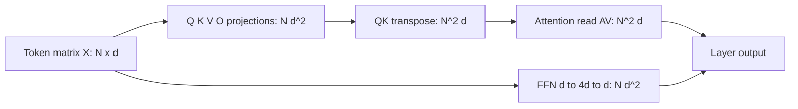
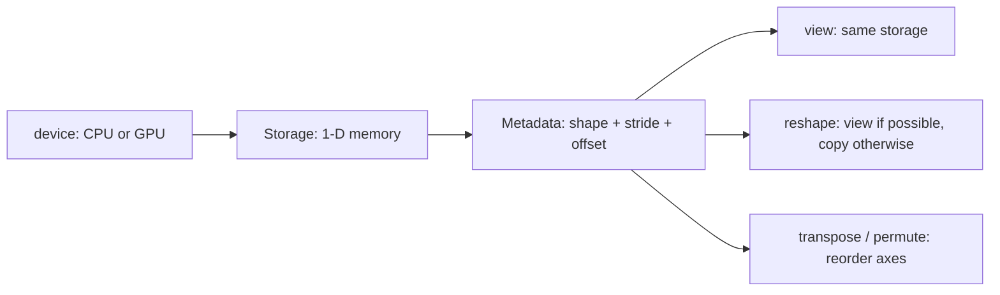

# Tensor 与矩阵乘法：神经网络里“数字怎样流动”

> 这篇从 tensor、矩阵乘法和 Linear 出发，逐步连接到 CNN、Transformer、GNN 与 DeltaNet。
> 目标不是背 API，而是看见一个 tensor 的 shape，就能预测下一步计算是否成立、输出会长什么样，以及它在神经网络里为什么总会遇到矩阵乘法。
>
> 相关笔记：第 3 章的 activation 与 hidden units；第 4 章的线性层记号；第 7 章的反向传播；第 10 章的卷积 tensor；第 12 章的 attention；第 13 章的图消息传递。

## 目录

- [0. 先把目标说清楚](#0-先把目标说清楚)
- [1. Tensor 基础](#1-tensor-先别急着当成高深数学对象)
- [2. 为什么网络总在重复加权求和](#2-为什么网络总在重复加权求和)
- [3. 从点积推导矩阵乘法](#3-从点积重新推导矩阵乘法)
- [4. Tensor 与矩阵乘法](#4-tensor-与矩阵乘法是什么关系)
- [5. 用 PyTorch 写 nn.Linear](#5-用-pytorch-写-nnlinear)
- [6. forward 与 backward](#6-一个-forward--backward-的完整执行路径)
- [7. PyTorch 运算与 einsum](#7-pytorch-里几个看似相近的运算)
- [8. CNN、Transformer 与 attention 家族](#8-cnntransformer-与-attention-家族)
  - [8.10 Attention 家族专题](#810-transformer-attention-家族从-self-attention-到-deltanet)
  - [8.10.6 独立教程：RNN 到 Hybrid DeltaNet](./deltanet_attention_family_guide.md)
- [9. MLP、CNN、Transformer 的训练流程](#9-mlpcnntransformer-的训练标准流程)
- [10. 常见误解](#10-常见误解能运行不等于语义正确)
- [11. 一张 shape 追踪图](#11-一张-shape-追踪图从输入到线性层)
- [12. 性能直觉](#12-性能直觉为什么-shape-还关系到速度和显存)
  - [12.1 Transformer 时间复杂度分析](#121-transformer-时间复杂度分析n-与-d-的军备竞赛)
  - [12.2 三个互补视角](#122-三个互补视角同一个-n²-三种疼法)
  - [12.3 自回归生成与 KV cache](#123-自回归生成kv-cache-到底省了什么)
  - [12.4 业界对 N² 的反围剿](#124-业界对-n²-的反围剿)
  - [12.5 形状操作与显存](#125-形状操作与显存完整说明见第-16-章)
- [13. 迁移练习](#13-迁移练习含答案)
- [14. 主线小结](#14-主线小结先闭环再进入专题)
- [15. 专题：W 的多种矩阵视角](#15-为什么-pytorch-的-w-是-d_out-d_in矩阵的多种视角)
  - [15.3 两种向量约定](#153-两种向量约定为什么一个人写-w另一个人写-wt)
  - [15.4–15.14 矩阵的多种视角](#154-矩阵视角一它是一张带语义的数字表)
  - [15.15 常见 convention 选择](#1515-为什么不把-pytorch-直接设计成-d_in-d_out)
  - [15.17 完整 shape 追踪](#1517-一个完整的-shape-追踪例子)
- [16. PyTorch 显存管理与 Tensor 形状操作](#16-pytorch-显存管理与-tensor-形状操作)

## 0. 先把目标说清楚

读完后，你应该能独立回答四个问题：

1. tensor、vector、matrix 分别在描述什么，为什么它们不是三种互不相干的东西？
2. 矩阵乘法为什么要求中间维度相等？这个规则不是记忆题，而是从什么计算需求推出来的？
3. 神经网络里的 `nn.Linear`，为什么可以写成 `X @ W.T + b`？
4. 看到 `[B, H, N, Dh] @ [B, H, Dh, N]` 时，为什么结果是 `[B, H, N, N]`，而不是逐元素乘法？

整篇只守一条不变量：

> **shape 的最后两个维度决定矩阵乘法；前面的维度表示可以并行处理的 batch，通常不会彼此混算。**

可以把全文的路线压成一条流水线：

```text
scalar
  │  把一个量写成数字
  ▼
vector
  │  把同类数字排成一行
  ▼
matrix
  │  把许多 vector 组成规则的表
  ▼
higher-rank tensor
  │  把许多表按 batch、channel、time 等轴堆起来
  ▼
linear / convolution / attention / graph message passing
```

这里没有魔法跳跃。每一步都是在给数字增加一种可利用的结构。

---

## 1. Tensor 先别急着当成“高深数学对象”

在神经网络的工程语境里，tensor 首先就是一块**带 shape 的多维数字容器**。它有三件事需要分开：

| 维度 | 例子 | 它回答的问题 |
|------|------|--------------|
| `shape` | `(2, 3, 4)` | 每条轴有多少个位置？ |
| `dtype` | `float32`、`int64` | 每个数字用什么数值类型存？ |
| `device` | `cpu`、`cuda` | 这块数据放在哪里计算？ |

数学上的 tensor 可以有更抽象的定义；这里先使用深度学习最有用的工程含义。`torch.Tensor` 不是“只有三维以上才算 tensor”。在 PyTorch 里，下面每个对象都是 tensor：

```python
import torch  # 导入所需的 Python 模块。

scalar = torch.tensor(3.0)                    # shape: []
vector = torch.tensor([1.0, 2.0, 3.0])        # shape: [3]
matrix = torch.tensor([[1.0, 2.0],  # 创建一个可读的示例 tensor。
                       [3.0, 4.0]])          # shape: [2, 2]
image = torch.zeros(3, 224, 224)              # shape: [3, 224, 224]
batch = torch.zeros(32, 3, 224, 224)          # shape: [32, 3, 224, 224]
```

`shape` 里有几个数字，就说它是 rank 几（也常称有几维）：

| 数学名 | PyTorch shape | 直觉 |
|--------|---------------|------|
| scalar | `[]` | 一个数 |
| vector | `[D]` | 一列或一行特征 |
| matrix | `[M, N]` | `M` 行、`N` 列的表 |
| rank-3 tensor | `[B, M, N]` | `B` 张矩阵 |
| rank-4 tensor | `[B, C, H, W]` | 一批图像 |

因此，**matrix 是 tensor 的一个特例**：所有 matrix 都是 rank-2 tensor，但一个 `[B, C, H, W]` 的图像 batch 不会因为叫 tensor 就自动变成“一个巨大矩阵”。它有四条轴，每条轴的语义不同。把这些轴弄混，代码有时仍能运行，却会悄悄计算错误的东西——这比直接报错更危险。

### 1.1 轴不是装饰：shape 也在保存语义

拿一批 RGB 图像举例：

```text
[B, C, H, W]
 │  │  │  └── width：每行有多少个像素
 │  │  └───── height：有多少行
 │  └──────── channel：RGB 三层，或卷积 feature channels
 └─────────── batch：一次并行多少张图
```

同样是数字 `3`，在 `[3, 224, 224]` 里可能表示 RGB channels；在 `[32, 3, 224, 224]` 里第一个 `32` 才是 batch。shape 的数字本身不携带语义，**轴的位置与约定**才携带语义。于是阅读 tensor 时要同时问两件事：

```text
这个 tensor 的 shape 是什么？
每个轴分别代表什么？
```

第一个问题保证计算能接上；第二个问题保证接上的计算真的是你想要的。

---

## 2. 为什么网络总在重复“加权求和”

先从最小的神经元开始。一个 neuron 接收输入 $\mathbf{x}=(x_1,\ldots,x_D)$，为每个输入学一个 weight $\mathbf{w}=(w_1,\ldots,w_D)$，再加一个 bias $b$：

$$
z = w_1x_1+w_2x_2+\cdots+w_Dx_D+b.
$$

这一步的意思很朴素：每个特征先按重要程度缩放，再把证据合在一起，最后整体平移。第 3 章把它接上 activation：

$$
h = a(z),
$$

例如 $a$ 是 ReLU。第 4 章再把许多 neuron 叠起来，得到一层网络。难点在于：一个 neuron 可以手写一行加法，但网络里有成百上千个 neuron，而且要同时处理一个 batch。逐个写加法既慢又容易漏连接；我们需要一个能批量表达“很多个加权求和”的对象。

这就是矩阵乘法登场的压力：**不是为了让公式看起来高级，而是为了把大量相同类型的点积压缩成一次规则的计算。**

---

## 3. 从点积重新推导矩阵乘法

### 3.1 一个点积：一个 neuron 的全部输入

两个长度相同的 vector 做 dot product（点积）：

$$
\mathbf{x}\cdot\mathbf{w}
=
\sum_{k=1}^{D}x_k w_k.
$$

例如

$$
[1,2,3]\cdot[10,20,30]
=1\times10+2\times20+3\times30=140.
$$

点积把两个长度为 $D$ 的向量压成一个 scalar。它也可以被理解成“先逐元素相乘，再沿 feature 轴求和”：

```text
[1, 2, 3]        input
   ×
[10,20,30]       weight
   │
[10,40,90]       elementwise product
   │ sum
  140             one scalar response
```

一个 neuron 需要一个点积。现在假设我们有 2 个 neuron，它们各自有一套 weight：

$$
\begin{aligned}
z_1 &= 1\times10+2\times20+3\times30,\\
z_2 &= 1\times40+2\times50+3\times60.
\end{aligned}
$$

把两套 weight 叠成矩阵：

$$
W=
\begin{bmatrix}
10&20&30\\
40&50&60
\end{bmatrix}
\in\mathbb{R}^{2\times3}.
$$

输入仍写成列向量 $\mathbf{x}\in\mathbb{R}^{3}$，那么两个 neuron 的结果可以一次写成

$$
W\mathbf{x}
=
\begin{bmatrix}
10&20&30\\
40&50&60
\end{bmatrix}
\begin{bmatrix}1\\2\\3\end{bmatrix}
=
\begin{bmatrix}140\\320\end{bmatrix}.
$$

矩阵的**每一行**是一套 neuron weights；矩阵乘向量的**每一个输出元素**是对应行与输入向量的点积。矩阵乘法到这里已经被重新推导出来：它只是“同时做很多个点积”。

### 3.2 两个矩阵：很多输入、很多 neuron

如果一次处理 $B$ 个样本，把每个样本放成一行：

$$
X\in\mathbb{R}^{B\times D_{in}}.
$$

仍然让

$$
W\in\mathbb{R}^{D_{out}\times D_{in}},
$$

因为每一行对应一个 output neuron。为了让样本矩阵的每一行都与每个 neuron 做点积，需要使用 $W^\top$：

$$
XW^\top
\in\mathbb{R}^{B\times D_{out}}.
$$

维度检查直接告诉你为什么：

```text
X       [B, D_in]
W.T     [D_in, D_out]
                 └── 中间两个 D_in 相等，可以收缩
结果    [B, D_out]
```

矩阵乘法的通用规则是：

$$
A\in\mathbb{R}^{M\times K},\quad
B\in\mathbb{R}^{K\times N}
\quad\Longrightarrow\quad
AB\in\mathbb{R}^{M\times N}.
$$

中间的 $K$ 必须相等，因为每个输出格子都要沿着同一条长度为 $K$ 的轴做求和：

$$
(AB)_{ij}=\sum_{k=1}^{K}A_{ik}B_{kj}.
$$

$i$ 选择左矩阵的一行，$j$ 选择右矩阵的一列，$k$ 是这两者对齐后被消掉的 feature 轴。所谓“矩阵乘法要求内维相等”，其实就是“点积的两条向量必须一样长”。

### 3.3 一个完整的小例子

这里先把一个容易混淆的约定钉死：本节有 2 个 output neurons、每个 neuron 接收 3 个 input features。我们把每个 output neuron's weights 写成 W 的一行，因此

$$
W\in\mathbb{R}^{D_{out}\times D_{in}}
$$

在本例中 W 就是 2x3。单个样本若写成列向量，计算是

$$
\underbrace{W}_{2\times3}
\underbrace{\mathbf{x}}_{3\times1}
\longrightarrow
\underbrace{\mathbf{y}}_{2\times1}
\qquad
\mathbf{y}=W\mathbf{x}.
$$

你也可以选择另一套完全等价的约定：把样本写成行向量，把 weight 存成 3x2 的转置矩阵。此时计算写成

$$
\mathbf{y}_{row}=\mathbf{x}_{row}W_{row},
\qquad
\mathbf{x}_{row}\in\mathbb{R}^{1\times3},
\quad
W_{row}\in\mathbb{R}^{3\times2}.
$$

两套写法只是向量方向不同：

```text
column convention: W [D_out, D_in] @ x [D_in, 1] -> y [D_out, 1]
row convention:    x [1, D_in] @ W [D_in, D_out] -> y [1, D_out]
```

本教程在单样本推导里先使用 column convention；进入 batch 代码后，输入按 PyTorch 常用的 row-major 形式存成 [B, D_in]，所以写成 X @ W.T。PyTorch 的 nn.Linear(in_features, out_features) 也保存 weight 为 [D_out, D_in]，因此它的 forward 正是 input @ weight.T + bias。若你坚持把 W 写成 3x2，数值完全没错，只需把后面的公式改成 X @ W。

取

$$
X=\begin{bmatrix}1&2&3\\4&5&6\end{bmatrix},
\quad
W=\begin{bmatrix}10&20&30\\40&50&60\end{bmatrix},
\quad
b=\begin{bmatrix}100&200\end{bmatrix}.
$$

这里有 $B=2$ 个样本、$D_{in}=3$ 个输入特征、$D_{out}=2$ 个 output features。于是

$$
XW^\top
=
\begin{bmatrix}140&320\\320&770\end{bmatrix},
$$

再把 bias 沿 batch 轴 broadcast：

$$
Y=XW^\top+b
=
\begin{bmatrix}240&520\\420&970\end{bmatrix}.
$$

逐行看：第一条样本 `[1,2,3]` 得到 `[240,520]`，第二条样本 `[4,5,6]` 得到 `[420,970]`。两个样本彼此独立，只是被装进同一次矩阵乘法里并行处理。

---

## 4. Tensor 与矩阵乘法是什么关系？

现在可以把关系说得很准确：

1. **Tensor 是容器和结构的总称**，可以是 scalar、vector、matrix 或更高阶数组。
2. **Matrix 是 rank-2 tensor**，有两个轴，通常解释为 rows 与 columns。
3. **矩阵乘法是一种运算**，它要求两个对象的矩阵轴对齐，并沿中间轴做点积求和。
4. **高阶 tensor 可以携带一批矩阵**。这时 `torch.matmul` 通常把最后两个轴当成矩阵轴，把前面的轴当成 batch 轴。

这四句可以画成：

```text
Tensor
├── scalar: []
├── vector: [D]
├── matrix: [M, N]  ← matrix multiplication 的基本对象
└── batch of matrices: [B, M, N]
                         │
                         └── matmul 对每个 batch 位置分别做 [M,N] × [N,K]
```

### 4.1 高阶 matmul：只把最后两轴当矩阵

先把 rank 说清楚：rank 是 tensor 的轴数，不是元素个数，也不是“模型有几层”。例如：

| tensor | rank | 每条轴的常见含义 |
|--------|------|------------------|
| x: [D] | 1 | 一个 vector，只有 feature 轴 |
| X: [M, N] | 2 | 一个 matrix，rows × columns |
| X: [B, M, N] | 3 | B 张矩阵，前面的 B 是 batch 轴 |
| q: [B, H, N, Dh] | 4 | B 个样本、H 个 head、N 个 token、每个 token Dh 个 features |

因此，Transformer 里的 rank-4 tensor 不是“一张四维矩阵”。它是一批带有四条语义轴的对象；matmul 只把最后两条轴当作当前要相乘的 matrix。

若

```text
A: [B, M, K]
B: [B, K, N]
```

那么

```text
A @ B: [B, M, N]
```

计算的是每个 batch `b` 内部的

$$
C_b=A_bB_b.
$$

不同 `b` 之间没有 cross-sample multiplication。若前面的 batch 轴不完全一样，`matmul` 可能按 broadcasting 规则扩展它们，但矩阵的最后两个轴仍要满足内维相等。

#### 用一个 Transformer attention 例子逐轴追踪

设：

```text
B  = 2    同时处理 2 个样本
H  = 4    每个样本有 4 个 attention heads
N  = 3    每个样本有 3 个 token
Dh = 8    每个 head 中每个 token 有 8 个 features
```

于是 q 和 k 都是 rank-4 tensor：

```text
q: [B, H, N, Dh] = [2, 4, 3, 8]
k: [B, H, N, Dh] = [2, 4, 3, 8]
```

把一个具体切片拿出来：

```text
q[1, 2]: [N, Dh] = [3, 8]
k[1, 2]: [N, Dh] = [3, 8]
```

q[1, 2] 表示第 2 个样本的第 3 个 head；它是一张普通的 rank-2 matrix，3 行对应 3 个 query/token positions，每行 8 个 features。k[1, 2] 同理，是同一个样本、同一个 head 的 3 个 key vectors。

现在做：

```python
import torch  # 导入所需的 Python 模块。

B, H, N, Dh = 2, 4, 3, 8  # 执行当前张量计算并保存结果。
q = torch.randn(B, H, N, Dh)  # 创建 query tensor，最后一维是 feature width。
k = torch.randn(B, H, N, Dh)  # 创建 key tensor，最后一维是 feature width。
q_one = q[1, 2]                    # [N, Dh] = [3, 8]
k_one = k[1, 2]                    # [N, Dh] = [3, 8]
score_one = q_one @ k_one.T        # [3, 8] @ [8, 3] -> [3, 3]
```

这里才是最原始的矩阵乘法：[3, 8] @ [8, 3]。中间的 8 是 Dh，代表每个 query/key vector 的 feature 轴；它被收缩，输出保留两个 3，分别代表 query positions 和 key positions。

完整的 rank-4 写法只是把所有 (b, h) 切片同时算掉：

```text
q                     [B, H, N, Dh] = [2, 4, 3, 8]
k.transpose(-2, -1)   [B, H, Dh, N] = [2, 4, 8, 3]
                         └──────┘
                         收缩 Dh = 8
scores                 [B, H, N, N] = [2, 4, 3, 3]
```

对应的逐元素公式是：

$$
\mathrm{scores}_{b,h,i,j}
=
\sum_{d=1}^{D_h}
q_{b,h,i,d}\,k_{b,h,j,d}.
$$

每个输出格子 scores[b,h,i,j] 都只在同一个样本 b、同一个 head h 内计算：第 i 个 query 与第 j 个 key 做 dot product。b 和 h 没有被求和，也没有和别的样本或 head 相乘；它们只是告诉硬件“还有多少个独立的矩阵乘法可以并行做”。

所以这个 rank-4 matmul 可以等价地想象成：

```text
# 伪代码：对每个 batch 样本分别处理。
for b in range(B):
    # 伪代码：在当前样本内，对每个 attention head 分别处理。
    for h in range(H):
        # 每个 (b, h) 都执行一次独立的 rank-2 matrix multiplication。
        scores[b, h] = q[b, h] @ k[b, h].T
```

真实 PyTorch 不会用这两个 Python for loop 慢慢跑，而是把 B×H 个 [N,Dh] @ [Dh,N] 交给 batched matrix multiplication kernel。

#### 哪些轴遵循矩阵乘法，哪些轴只是并行

以 q @ k.transpose(-2, -1) 为例：

| 轴 | 在 q 中 | 在转置后的 k 中 | 在结果中 | 角色 |
|----|---------|-----------------|----------|------|
| B | 第 0 轴 | 第 0 轴 | 保留 | batch 并行轴 |
| H | 第 1 轴 | 第 1 轴 | 保留 | head 并行轴；不是跨 head 相乘 |
| N | 倒数第 2 轴，query rows | 最后 1 轴，key columns | 保留两次 | 形成 [N,N] score table |
| Dh | 最后 1 轴 | 倒数第 2 轴 | 消失 | 矩阵乘法的 contracting dimension |

这张表是读 attention shape 的钥匙：**只有 Dh 被收缩；B、H、两个 N 都不会被收缩。**

用 PyTorch 验证：

```python
import torch  # 导入所需的 Python 模块。

B, H, N, Dh = 2, 4, 3, 8  # 执行当前张量计算并保存结果。
q = torch.randn(B, H, N, Dh)  # 创建 query tensor，最后一维是 feature width。
k = torch.randn(B, H, N, Dh)  # 创建 key tensor，最后一维是 feature width。

scores = q @ k.transpose(-2, -1)  # 计算 query 与 key 的 dot product 得分。
assert q.ndim == 4  # 验证 shape、数值或两个实现的结果一致。
assert k.transpose(-2, -1).shape == (B, H, Dh, N)  # 验证 shape、数值或两个实现的结果一致。
assert scores.shape == (B, H, N, N)  # 验证 shape、数值或两个实现的结果一致。

# 逐个 (b, h) 做 rank-2 matmul，结果应与完整写法一致。
for b in range(B):  # 遍历当前 batch、时间步或数据集合。
    for h in range(H):  # 遍历当前 batch、时间步或数据集合。
        expected = q[b, h] @ k[b, h].T  # 执行当前张量计算并保存结果。
        assert torch.allclose(scores[b, h], expected)  # 验证 shape、数值或两个实现的结果一致。
```

#### matmul、bmm、mm 对 rank 的态度

三个 API 的区别正好能帮助我们区分“矩阵轴”和“batch 轴”：

```text
mm:     只接受 [M,K] @ [K,N]
bmm:    只接受 [B,M,K] @ [B,K,N]
matmul: 接受更一般的 rank，并把前导轴当作可 broadcasting 的 batch axes
```

因此，rank-4 attention 不能直接交给 torch.mm：

```python
q = torch.randn(2, 4, 3, 8)  # 创建 query tensor，最后一维是 feature width。
k = torch.randn(2, 4, 3, 8)  # 创建 key tensor，最后一维是 feature width。

# torch.mm(q, k.transpose(-2, -1))  # 错误：mm 只接受 rank-2
scores = torch.matmul(q, k.transpose(-2, -1))  # [2,4,3,3]
```

如果把 B 和 H 合并，也可以手动把 rank-4 变成 rank-3，再使用 bmm：

```python
B, H, N, Dh = 2, 4, 3, 8  # 执行当前张量计算并保存结果。
q = torch.randn(B, H, N, Dh)  # 创建 query tensor，最后一维是 feature width。
k = torch.randn(B, H, N, Dh)  # 创建 key tensor，最后一维是 feature width。
scores = q @ k.transpose(-2, -1)  # 计算 query 与 key 的 dot product 得分。
q_flat = q.reshape(B * H, N, Dh)                 # [B*H, N, Dh]
k_flat = k.reshape(B * H, N, Dh)                 # [B*H, N, Dh]
scores_flat = torch.bmm(q_flat, k_flat.transpose(1, 2))  # 改变 shape 或轴顺序，并保留对应的 layout 语义。
scores_bmm = scores_flat.reshape(B, H, N, N)     # [B,H,N,N]
assert torch.allclose(scores, scores_bmm)  # 验证 shape、数值或两个实现的结果一致。
```

这里的 reshape 没有把不同样本或不同 head 的数字混在一个矩阵乘法里；它只是把两个并行索引 (B,H) 合并成一个 batch index B*H，以符合 bmm 的接口。

#### attention 的第二次矩阵乘法：A @ V

QK.T 只产生“应该读谁”的 score；softmax 后得到 attention weights：

```text
A: [B, H, N, N]
V: [B, H, N, Dh]
```

然后：

```text
A @ V: [B, H, N, N] @ [B, H, N, Dh]
    -> [B, H, N, Dh]
```

这次被收缩的不是 Dh，而是 key/token 轴上的 N：

$$
\mathrm{context}_{b,h,i,d}
=
\sum_{j=1}^{N}
A_{b,h,i,j}\,V_{b,h,j,d}.
$$

i 是正在更新的 query position，j 是被读取的 key/value position，d 是输出 feature。换句话说，QK.T 计算路由，A V 按路由混合内容；两次都是 batch matmul，但 contracting axis 不同。

一个常见的 broadcasting 例子是让所有 heads 共享同一组 key/value：

```text
q: [B, H, N, Dh]
k: [B, 1, N, Dh]
k.T: [B, 1, Dh, N]
q @ k.T -> [B, H, N, N]
```

这里 k 的 head 轴大小为 1，会 broadcast 到 H 个 heads；它仍然没有和 B 或 N 做矩阵乘法。broadcast 只是复制或复用 batch slice，contracting dimension 仍然必须是 Dh。

回到最短版本：

```text
rank 4 = [B, H, N, Dh]
矩阵轴 = 最后两轴 [N, Dh]
batch 轴 = 前两轴 [B, H]
Q @ K.T = [N,Dh] @ [Dh,N]，对每个 (B,H) 并行
A @ V   = [N,N]  @ [N,Dh]，对每个 (B,H) 并行
```

一个容易混淆的例子来自 Transformer。若

```text
q: [B, H, N, Dh]
k: [B, H, N, Dh]
```

先把 `k` 的最后两个轴转置：

```python
scores = q @ k.transpose(-2, -1)  # 计算 query 与 key 的 dot product 得分。
```

shape 追踪是：

```text
q                     [B, H, N, Dh]
k.transpose(-2, -1)   [B, H, Dh, N]
                       └──────┘
                         对齐并收缩 Dh
scores                 [B, H, N, N]
```

结果中的 `scores[i, j]` 是第 `i` 个 query 与第 `j` 个 key 的 dot product。这里 `B` 和 `H` 是并行的 batch axes，真正进行矩阵乘法的是每个 head 里的 `[N, Dh] @ [Dh, N]`。第 12 章里那张 attention score table，本质上就是这一步。

### 4.2 并不是所有“维度”都可以随便收缩

上一节已经看到，矩阵乘法的形状规则很严格：左边的最后一个矩阵轴必须和右边的倒数第二个矩阵轴一样长。但“长度一样”只是语法条件，不是语义保证。真正写模型时，还要回答一个问题：这个被求和的 index 到底代表什么？是 input feature、局部像素，还是图上的邻居？如果只是看到两个轴都长为 32，就把它们收缩，代码也许能运行，模型却可能已经把完全不同的东西混在了一起。

可以先记住四条检查规则：

1. **先给每个轴命名。** 不要只看 0、1、2、3；写出 B、C、H、W、N、D 这些语义。
2. **写一个输出元素的公式。** 公式中的求和 index，就是被 contraction 的轴。
3. **区分“选择位置”和“求和”。** H、W 有时只是指定当前窗口的位置，并没有被全局求和。
4. **区分 batch 处理和矩阵乘法。** batch 轴通常只是“对很多份相同结构的数据并行做同一件事”，不会和另一个 batch 轴做 dot product。

下面用 CNN 和 GNN 各走一遍这套检查流程。它们看起来都在处理 rank 3 或 rank 4 的 tensor，但被收缩的轴完全不同。

#### 4.2.1 CNN：收缩的是一个局部 patch，不是整张图

一张 batch 图像通常写成

$$
X\in\mathbb{R}^{B\times C_{\mathrm{in}}\times H\times W}.
$$

四个轴分别是：

| 轴 | 含义 | 在一次卷积输出中做什么 |
|---|---|---|
| $B$ | 同时处理的图片数 | 保留；第 $b$ 张图不会和第 $b'$ 张图相乘 |
| $C_{\mathrm{in}}$ | 输入通道，例如 RGB 的 3 个通道 | 对当前局部窗口求和 |
| $H,W$ | 空间位置 | 决定当前窗口从哪里开始；不会把整条高度或宽度一次性求和 |
| $C_{\mathrm{out}}$ | kernel 的数量，也就是输出通道 | 保留；每个 kernel 产生一张 feature map |

一个 Conv2d kernel 的 shape 是

$$
K\in\mathbb{R}^{C_{\mathrm{out}}\times C_{\mathrm{in}}\times K_h\times K_w}.
$$

为了看清到底收缩了什么，写出一个输出元素：

$$
Y_{b,o,i,j}
=
b_o+
\sum_{c=1}^{C_{\mathrm{in}}}
\sum_{u=1}^{K_h}
\sum_{v=1}^{K_w}
K_{o,c,u,v}\,
X_{b,c,i+u,j+v}.
$$

这个公式比“卷积就是矩阵乘法”更准确：

- 被求和的是 $c,u,v$，即输入通道和局部窗口里的两个偏移；
- $b$ 被保留，所以每张图片独立处理；
- $o$ 被保留，所以每个 output channel 有自己的 kernel；
- $i,j$ 被保留，所以每个空间位置都会得到一个输出；
- $H,W$ 没有被整个压扁，它们只通过不同的窗口位置参与计算。

因此，一个输出位置其实仍然是一次普通 dot product。把当前窗口摊平：

$$
\underbrace{X_{b,:,i:i+K_h,j:j+K_w}}_{\text{长度 }C_{\mathrm{in}}K_hK_w}
\quad\cdot\quad
\underbrace{K_{o,:,:,:}}_{\text{长度 }C_{\mathrm{in}}K_hK_w}.
$$

区别只在于：这个 dot product 的输入不是固定的一行，而是随着 $(i,j)$ 在图像上滑动；同一个 kernel 也会在所有位置复用。这就是 locality 和 weight sharing。

先看一个没有 batch 迷雾的小例子。输入是 $3\times3$ 的单通道图像，kernel 是

$$
K=
\begin{bmatrix}
1&0\\
0&1
\end{bmatrix}.
$$

valid convolution 会取四个 $2\times2$ 窗口：

```text
[1 2]        [2 3]        [4 5]        [5 6]
[4 5]        [5 6]        [7 8]        [8 9]

1*1 + 0*2 + 0*4 + 1*5 = 6
1*2 + 0*3 + 0*5 + 1*6 = 8
1*4 + 0*5 + 0*7 + 1*8 = 12
1*5 + 0*6 + 0*8 + 1*9 = 14
```

所以输出是

$$
\begin{bmatrix}
6&8\\
12&14
\end{bmatrix}.
$$

PyTorch 代码把每个轴也标出来：

```python
import torch  # 导入所需的 Python 模块。
import torch.nn.functional as F  # 导入所需的 Python 模块。

x = torch.arange(1, 10, dtype=torch.float32).reshape(1, 1, 3, 3)  # 构造输入或监督信号 tensor。
# [B, C_in, H, W] = [1, 1, 3, 3]

kernel = torch.tensor([[[[1.0, 0.0],  # 构造参数 tensor，并保持注释中的 shape 约定。
                         [0.0, 1.0]]]])  # 继续当前示例的 tensor 计算。
# [C_out, C_in, K_h, K_w] = [1, 1, 2, 2]

y = F.conv2d(x, kernel)  # 保存当前层或矩阵乘法的输出 tensor。
print(y.shape)  # torch.Size([1, 1, 2, 2])
print(y[0, 0])  # 打印结果，帮助观察值、shape 或 layout。
# tensor([[ 6.,  8.],
#         [12., 14.]])
```

也可以把卷积临时改写成“局部 patch 的矩阵乘法”。这叫 im2col 思路，能帮助我们理解 contraction，但不意味着高性能实现一定真的创建这么大的中间矩阵：

```python
patches = F.unfold(x, kernel_size=2)  # 执行当前张量计算并保存结果。
# [B, C_in*K_h*K_w, L] = [1, 4, 4]
# L 是输出空间位置数：2*2 = 4

patches = patches.transpose(1, 2)  # 改变 shape 或轴顺序，并保留对应的 layout 语义。
# [B, L, C_in*K_h*K_w] = [1, 4, 4]

weight_flat = kernel.reshape(1, -1)  # 构造参数 tensor，并保持注释中的 shape 约定。
# [C_out, C_in*K_h*K_w] = [1, 4]

y_cols = patches @ weight_flat.transpose(0, 1)  # 改变 shape 或轴顺序，并保留对应的 layout 语义。
# [B, L, 4] @ [4, C_out] -> [B, L, C_out]
# [1, 4, 4] @ [4, 1] -> [1, 4, 1]

y_again = y_cols.transpose(1, 2).reshape(1, 1, 2, 2)  # 改变 shape 或轴顺序，并保留对应的 layout 语义。
print(torch.equal(y, y_again))  # True
```

这里发生了两层“看起来像 batch 的事情”：

- $B=1$ 时只有一张图；如果 $B=8$，上面的矩阵乘法会对 8 张图各自执行，shape 变成 $[8,4,4]\mathbin{@}[4,1]\to[8,4,1]$；
- $L=4$ 是一张图里的 4 个局部位置。它们可以被一次 batched matmul 并行计算，但第 0 个位置和第 1 个位置并没有互相做 dot product。

所以 CNN 不是把 $[B,C,H,W]$ 随便 reshape 后做一次全局矩阵乘法。它先根据 $(i,j)$ 取局部窗口，再让窗口向量和 kernel 向量做 dot product；窗口的取法本身就是模型的 locality 约束。

#### 4.2.2 GNN：收缩的是“发送节点”轴，保留“接收节点”轴

对一个有 $N$ 个节点、每个节点有 $D$ 个 feature 的图，节点状态写成

$$
H\in\mathbb{R}^{N\times D}.
$$

如果用一个稠密 adjacency matrix 表示边，约定 $A_{i,j}$ 是“节点 $j$ 发给节点 $i$ 的权重”，那么

$$
A\in\mathbb{R}^{N\times N},
\qquad
H' = A H\in\mathbb{R}^{N\times D}.
$$

逐元素展开后：

$$
H'_{i,d}
=
\sum_{j=1}^{N} A_{i,j} H_{j,d}.
$$

这里真正被收缩的是发送节点 index $j$：

- $i$ 保留，表示正在更新哪个 receiver node；
- $d$ 保留，表示该 node 的哪一个 feature；
- $j$ 被求和，表示 receiver 从哪些 sender nodes 汇总信息；
- A 的第 $i$ 行决定 node $i$ 看谁，A 的第 $j$ 列对应 sender $j$。

举一个 3 节点的例子。下面的 A 包含 self-loop，节点 0 和 1 相连，节点 1 和 2 相连：

$$
A=
\begin{bmatrix}
1&1&0\\
1&1&1\\
0&1&1
\end{bmatrix},
\qquad
H=
\begin{bmatrix}
1&0\\
2&10\\
4&100
\end{bmatrix}.
$$

于是

$$
AH=
\begin{bmatrix}
1+2&0+10\\
1+2+4&0+10+100\\
2+4&10+100
\end{bmatrix}
=
\begin{bmatrix}
3&10\\
7&110\\
6&110
\end{bmatrix}.
$$

第一行的意思不是“把三个节点都乘了一遍”，而是 node 0 只聚合了 node 0 和 node 1；A 的第三个元素为 0，所以 node 2 没有进入这个 sum。

PyTorch 里的对应写法非常直接：

```python
A = torch.tensor([  # 创建一个可读的示例 tensor。
    [1.0, 1.0, 0.0],  # 继续当前示例的 tensor 计算。
    [1.0, 1.0, 1.0],  # 继续当前示例的 tensor 计算。
    [0.0, 1.0, 1.0],  # 继续当前示例的 tensor 计算。
])                                  # [N, N] = [3, 3]

H = torch.tensor([  # 创建一个可读的示例 tensor。
    [1.0,   0.0],  # 继续当前示例的 tensor 计算。
    [2.0,  10.0],  # 继续当前示例的 tensor 计算。
    [4.0, 100.0],  # 继续当前示例的 tensor 计算。
])                                  # [N, D] = [3, 2]

H_next = A @ H                      # [3, 3] @ [3, 2] -> [3, 2]
```

如果同时处理 $B$ 个大小相同的图，shape 可以写成

$$
A\in\mathbb{R}^{B\times N\times N},
\qquad
H\in\mathbb{R}^{B\times N\times D},
\qquad
A H\in\mathbb{R}^{B\times N\times D}.
$$

此时 $B$ 是 batch 轴，$N\times N$ 与 $N\times D$ 才是每个 batch slice 内的矩阵乘法。PyTorch 可以用

```python
A_batch = torch.randn(8, 100, 100)  # [B, N, N]
H_batch = torch.randn(8, 100, 64)   # [B, N, D]
H_next = torch.bmm(A_batch, H_batch)  # 保存当前层或矩阵乘法的输出 tensor。
# [8, 100, 100] @ [8, 100, 64] -> [8, 100, 64]
```

但一般 GNN 并不真的把图存成完整的 $N\times N$ 矩阵。真实图往往很稀疏：节点有 $N$ 个，边只有 $E$ 条，且 $E\ll N^2$。更通用的 message passing 写成

$$
m_{j\to i}=\phi(h_i,h_j,e_{j\to i}),
\qquad
h'_i=\psi\left(h_i,\operatorname{AGG}_{j\in\mathcal{N}(i)}m_{j\to i}\right).
$$

它的 data flow 是：

```text
edge list -> gather sender state -> compute each edge message
          -> aggregate messages at receiver -> update receiver state
```

用 edge list 写一个最简单的“把 sender feature 相加”的版本：

```python
H = torch.tensor([  # 创建一个可读的示例 tensor。
    [1.0,   0.0],  # 继续当前示例的 tensor 计算。
    [2.0,  10.0],  # 继续当前示例的 tensor 计算。
    [4.0, 100.0],  # 继续当前示例的 tensor 计算。
])                                      # [N, D]

src = torch.tensor([0, 1, 1, 2])        # 每条边的 sender
dst = torch.tensor([0, 0, 1, 1])        # 每条边的 receiver

messages = H[src]                       # [E, D] = [4, 2]
aggregated = torch.zeros_like(H)  # 创建用于演示的 tensor。
aggregated.index_add_(0, dst, messages)  # 继续当前示例的 tensor 计算。
# [N, D]，把同一个 receiver 的 edge message 相加
```

当 $\phi$ 只是取 sender state，且每条边的权重固定时，这个 scatter 过程才可以压缩成 $A H$。一旦 message 依赖 edge feature、receiver state，或者每条边都有由输入动态算出的 attention weight，就不能把它理解成一个固定的全局矩阵乘法。矩阵乘法是 data flow 的压缩记号；真正的本体是“谁把什么信息发给谁”。

#### 4.2.3 把三种模型放在同一张轴语义表里

| 计算 | 输入 shape | 被收缩的轴 | 保留的轴 | 交互结构 |
|---|---|---|---|---|
| CNN local dot product | $X:[B,C_{\mathrm{in}},H,W]$ 与 kernel | $C_{\mathrm{in}},K_h,K_w$ | $B,C_{\mathrm{out}},i,j$ | 固定的局部窗口 |
| GNN 的 $A H$ | $A:[N,N]$ 与 $H:[N,D]$ | sender node $j$ | receiver node $i$、feature $d$ | 图的边 |
| Transformer 的 $QK^\mathsf{T}$ | $Q:[B,H,N,D_h]$、$K:[B,H,N,D_h]$ | head feature $D_h$ | $B,H,$ query position $i,$ key position $j$ | 由内容动态决定 |
| Transformer 的 $AV$ | $A:[B,H,N,N]$、$V:[B,H,N,D_h]$ | source position $j$ | $B,H,$ receiver position $i,$ feature $d$ | 按 attention 权重聚合 token |

这张表也解释了一个常见误区：同样叫“最后一维”，它在不同计算中可能承担完全不同的角色。CNN kernel 的最后两个轴是空间窗口，GNN 的 node 轴是邻居集合，Transformer 的 $D_h$ 是被 QK contraction 的 feature 轴。写代码前先问“这个轴代表谁”，再决定用 matmul、conv 还是 gather/scatter。

#### 4.2.4 一套可以反复使用的 shape 推导流程

遇到新的网络层时，可以按下面的顺序自检：

1. **列轴名。** 例如 CNN 的 $[B,C,H,W]$，Transformer 的 $[B,H,N,D_h]$，GNN 的 $[N,D]$。
2. **写一个输出元素。** 不要先急着写 API；先写 $y_{...}=\sum ...$。
3. **圈出求和 index。** 圈出的 index 就是 contraction，不能只因为数字相等就收缩。
4. **保留其余 index。** 它们会出现在输出 shape 中，顺序再根据 API 排列。
5. **最后再选 PyTorch API。** 一个 rank 2 的乘法可用 @；带 batch 的矩阵乘法可用 matmul 或 bmm；局部窗口用 conv2d；稀疏且按边处理时用 gather、index_add 或 scatter。

做一个快速对照：

- $Q:[2,4,8,16]$ 与 $K^\mathsf{T}:[2,4,16,8]$ 相乘，收缩的是 16，也就是 $D_h$；输出是 $[2,4,8,8]$。
- $A:[5,5]$ 与 $H:[5,64]$ 相乘，收缩的是发送节点数 5；输出是 $[5,64]$，接收节点数和 feature 维保留。
- 输入 $X:[2,3,32,32]$ 经过 $C_{\mathrm{out}}=16$、$3\times3$、padding 1 的 Conv2d，空间大小仍是 $32\times32$；这里没有把 32 个高度位置和另一个 32 个宽度位置做矩阵乘法，而是在每个位置取一个 $3\times3$ 局部 patch。

只要能把这三个例子的“谁被求和、谁被保留、谁只是 batch 并行”说清楚，rank 3 和 rank 4 的矩阵乘法就不再是靠背 shape，而是可以从数据流重新推出来。

#### 4.2.5 最短版回顾

在 CNN 中，图像通常是 `[B, C, H, W]`。一个 `Conv2d` filter 会在局部空间窗口上做加权和；它不是把 `[C,H,W]` 随意压成一张矩阵再乘。卷积的核心约束是 locality 与 weight sharing：只看附近的 pixels，并在所有位置复用同一组 kernel。

在 GNN 中，node state 常写成 `H: [N, D]`，adjacency matrix 写成 `A: [N, N]`。特殊的线性 message passing 可以写成

```text
A @ H: [N, N] @ [N, D] -> [N, D]
```

这表示每个 node 按 adjacency 把其他 node 的 state 加权汇总。但一般 GNN 还会在每条 edge 上计算 message，再按 receiver scatter；这时“一个 adjacency 矩阵乘法”只是某个线性特例。矩阵乘法是压缩写法，data flow 才是本体。

---

## 5. 用 PyTorch 写出 `nn.Linear`

### 5.1 先不用神经网络模块，直接写公式

下面代码把上一节的数字原样搬进 PyTorch：

```python
import torch  # 导入所需的 Python 模块。

X = torch.tensor([  # 构造输入或监督信号 tensor。
    [1.0, 2.0, 3.0],  # 继续当前示例的 tensor 计算。
    [4.0, 5.0, 6.0],  # 继续当前示例的 tensor 计算。
])                         # [B, D_in] = [2, 3]

W = torch.tensor([  # 构造参数 tensor，并保持注释中的 shape 约定。
    [10.0, 20.0, 30.0],  # 继续当前示例的 tensor 计算。
    [40.0, 50.0, 60.0],  # 继续当前示例的 tensor 计算。
])                         # [D_out, D_in] = [2, 3]

b = torch.tensor([100.0, 200.0])     # [D_out] = [2]

Y = X @ W.T + b                       # [2, 3] @ [3, 2] -> [2, 2]

print(Y)  # 打印结果，帮助观察值、shape 或 layout。
# tensor([[240., 520.],
#         [420., 970.]])
```

`b` 的 shape 是 `[2]`，而 `X @ W.T` 的 shape 是 `[2,2]`。PyTorch 会把同一个 bias vector broadcast 到每个 batch row：

```text
[[140, 320],       + [100, 200]
 [320, 770]]
```

如果你把 `W` 存成 `[D_in, D_out]`，也可以写 `X @ W + b`。两种 convention 都能工作；关键是要先明确 weight 的哪一轴表示 input features，哪一轴表示 output features。PyTorch 的 `nn.Linear(in_features, out_features)` 采用的 weight shape 是 `[out_features, in_features]`，所以 forward 内部等价于 `input @ weight.T + bias`。

### 5.2 用 `nn.Linear` 复现同一层

```python
import torch  # 导入所需的 Python 模块。
from torch import nn  # 导入所需的 PyTorch API。

layer = nn.Linear(in_features=3, out_features=2, bias=True)  # 创建 neural network layer 或 module。

with torch.no_grad():  # 在这个上下文中执行临时的计算或资源管理。
    layer.weight.copy_(W)              # [2, 3]
    layer.bias.copy_(b)                # [2]

Y_from_module = layer(X)  # 执行当前张量计算并保存结果。
print(torch.allclose(Y_from_module, Y))  # 打印结果，帮助观察值、shape 或 layout。
# True
```

`nn.Linear` 负责保存可学习的 `weight` 与 `bias`，并在 forward 时执行线性变换。它没有把矩阵乘法变成另一种数学；它只是把参数管理、初始化、autograd 连接和设备迁移包装起来。

### 5.3 为什么神经网络还要 activation

如果连续堆叠两层线性变换，中间没有 activation：

$$
W_2(W_1x+b_1)+b_2
=
(W_2W_1)x+(W_2b_1+b_2),
$$

仍然只是一个线性变换。第 3 章强调的 ReLU、GELU 等非线性，正是为了阻止多层矩阵乘法塌缩成一层矩阵乘法。典型的 MLP data flow 是：

```text
X [B, D_in]
   │
   ▼
Linear: X @ W1.T + b1       [B, D_hidden]
   │
   ▼
ReLU / GELU                 [B, D_hidden]
   │
   ▼
Linear: H @ W2.T + b2       [B, D_out]
```

矩阵乘法负责“混合 features”；activation 负责“把函数族折弯”。两者缺一不可。

---

## 6. 一个 forward + backward 的完整执行路径

前向时，网络把输入 tensor 变成预测；loss 把预测压成一个 scalar；`backward()` 从这个 scalar 沿计算图反向传播。第 7 章说的“反向传播主成本也是矩阵乘”，就在这里发生。

```python
import torch  # 导入所需的 Python 模块。
from torch import nn  # 导入所需的 PyTorch API。

torch.manual_seed(0)  # 固定随机种子，让示例结果可复现。

X = torch.tensor([  # 构造输入或监督信号 tensor。
    [1.0, 2.0, 3.0],  # 继续当前示例的 tensor 计算。
    [4.0, 5.0, 6.0],  # 继续当前示例的 tensor 计算。
])                              # [B, D_in] = [2, 3]
target = torch.tensor([  # 构造输入或监督信号 tensor。
    [0.0, 1.0],  # 继续当前示例的 tensor 计算。
    [1.0, 0.0],  # 继续当前示例的 tensor 计算。
])                              # [B, D_out] = [2, 2]

model = nn.Sequential(  # 创建 neural network layer 或 module。
    nn.Linear(3, 4),  # 执行当前 PyTorch 运算。
    nn.ReLU(),  # 执行当前 PyTorch 运算。
    nn.Linear(4, 2),  # 执行当前 PyTorch 运算。
)  # 结束当前多行调用、容器或代码块。

prediction = model(X)                  # [2, 2]
loss = (prediction - target).pow(2).mean()  # scalar: []
loss.backward()  # 反向传播，计算所有可训练参数的 gradient。

for name, parameter in model.named_parameters():  # 遍历当前 batch、时间步或数据集合。
    print(name, parameter.shape, parameter.grad.shape)  # 打印结果，帮助观察值、shape 或 layout。
```

你应该看到类似：

```text
0.weight torch.Size([4, 3]) torch.Size([4, 3])
0.bias   torch.Size([4])   torch.Size([4])
2.weight torch.Size([2, 4]) torch.Size([2, 4])
2.bias   torch.Size([2])   torch.Size([2])
```

梯度 shape 与参数 shape 一致，不是巧合。对一层

$$
Z=XW^\top+b
$$

来说，某个 batch 的 weight gradient 可以理解成 output-side gradient 与 input activation 的外积，再沿 batch 求和：

$$
\frac{\partial L}{\partial W}
\propto
\left(\frac{\partial L}{\partial Z}\right)^\top X.
$$

若 `dZ` 是 `[B, D_out]`，那么 `dZ.T @ X` 是 `[D_out, B] @ [B, D_in] -> [D_out, D_in]`，正好与 `W` 的 shape 对齐。反向传播不是“另有一套形状规则”；它仍然靠矩阵乘法，只是沿相反方向传递 sensitivity。

---

## 7. PyTorch 里几个看似相近的运算

名称很像，语义却不同。先看表，再看小例子：

| 写法 | 主要含义 | 常见 shape 要求 |
|------|----------|----------------|
| `a * b` | elementwise multiplication | shape 相同或可 broadcast |
| `a @ b` | matrix multiplication | 最后矩阵轴满足内维相等 |
| `torch.matmul(a, b)` | `@` 的函数形式，支持 batch matmul | 支持多种 rank 与 broadcasting |
| `torch.mm(a, b)` | 纯二维矩阵乘法 | 两个输入都必须 rank-2 |
| `torch.bmm(a, b)` | batch matrix multiplication | 两个输入都必须 rank-3，不能自动 broadcast batch |
| `torch.einsum(...)` | 用下标明确指定哪些轴相乘、求和 | 由 equation 决定 |

### 7.1 `*` 不是矩阵乘法

```python
a = torch.tensor([[1.0, 2.0],  # 创建一个可读的示例 tensor。
                  [3.0, 4.0]])  # 继续当前示例的 tensor 计算。
b = torch.tensor([[10.0, 20.0],  # 构造参数 tensor，并保持注释中的 shape 约定。
                  [30.0, 40.0]])  # 继续当前示例的 tensor 计算。

print(a * b)  # 打印结果，帮助观察值、shape 或 layout。
# tensor([[ 10.,  40.],
#         [ 90., 160.]])

print(a @ b)  # 打印结果，帮助观察值、shape 或 layout。
# tensor([[ 70., 100.],
#         [150., 220.]])
```

第一种是对应位置相乘；第二种是行和列做点积。把 `*` 写成 `@`，不是换一种排版，而是换了计算。

### 7.2 `mm`、`matmul`、`bmm` 如何选择

```python
A = torch.randn(2, 3)  # 创建用于演示的 tensor。
B = torch.randn(3, 4)  # 创建用于演示的 tensor。
C = torch.mm(A, B)          # [2, 4]
D = torch.matmul(A, B)      # [2, 4]
E = A @ B                   # [2, 4]

batch_A = torch.randn(5, 2, 3)  # 更新当前统计量或数据分片。
batch_B = torch.randn(5, 3, 4)  # 更新当前统计量或数据分片。
batch_C = torch.bmm(batch_A, batch_B)       # [5, 2, 4]
batch_D = torch.matmul(batch_A, batch_B)    # [5, 2, 4]
```

实际代码中，`@` 通常最接近数学记号；需要明确函数调用或处理更复杂的 rank 时，使用 `torch.matmul`。`bmm` 是“我确定两边都是三维 batch，而且 batch size 已经对齐”的专用版本。

### 7.3 `einsum`：把轴的故事写出来

Transformer 的 score 可以用 `einsum` 表示：

```python
q = torch.randn(2, 4, 8, 16)       # [B, H, N, Dh]
k = torch.randn(2, 4, 8, 16)       # [B, H, N, Dh]

scores = torch.einsum("bhid,bhjd->bhij", q, k)  # 计算 query 与 key 的 dot product 得分。
# [B, H, N, N] = [2, 4, 8, 8]
```

公式中的 `d` 在两边都出现，所以沿 `d` 求和；`i` 与 `j` 保留下来，形成 query-key 的二维表；`b` 与 `h` 也保留，表示 batch 与 head。它和 `q @ k.transpose(-2, -1)` 表达的是同一类计算，但 `einsum` 把“哪些轴对齐、哪些轴消失”写得更显式。

---

#### 7.3.1 einsum equation 的基本语法

einsum 是 Einstein summation notation 的工程化写法。它把“每个字母代表哪条轴、哪些字母要保留、哪些字母要相乘后求和”直接写进 equation，所以特别适合检查复杂 tensor 的 shape。

一个 equation 通常长这样：

```text
输入 1 的标签, 输入 2 的标签, ... -> 输出标签
        │                         │
        │                         └── 输出中出现的标签会被保留
        └── 同名标签表示要对齐；没有出现在输出中的标签会被求和
```

以

```text
bhid,bhjd->bhij
```

为例：

| 字母 | 含义 | 在计算中发生什么 |
|---|---|---|
| b | batch | 两个输入的 b 对齐，并保留 |
| h | attention head | 两个输入的 h 对齐，并保留 |
| i | query position | 只在第一个输入出现，保留在输出 |
| j | key position | 只在第二个输入出现，保留在输出 |
| d | head feature | 两个输入都出现，但没有写在输出中，因此沿 d 求和 |

读 equation 时可以固定使用三步：

1. **把标签和轴一一对应。** q 的 b、h、i、d 对应 shape 的四条轴。
2. **找重复标签。** 两个输入中都出现的标签表示对齐或相乘。
3. **看箭头右侧。** 出现在右侧的标签保留；输入中出现但右侧没有的标签被 contraction。

同一个标签在两个 operand 中出现时，相关轴必须兼容；通常 size 相同，size 为 1 时可以按 broadcasting 规则扩展。一个 operand 里的标签数量必须和它的 rank 对应，除非使用后面介绍的 ellipsis。

#### 7.3.2 从最小例子重新推导常见运算

先用只有一条轴的向量把规则跑通。令

```python
x = torch.tensor([1.0, 2.0, 3.0])  # 构造输入或监督信号 tensor。
y = torch.tensor([10.0, 20.0, 30.0])  # 保存当前层或矩阵乘法的输出 tensor。
```

向量点积写成：

```python
dot = torch.einsum("d,d->", x, y)  # 调用 PyTorch 运算得到新的 tensor 或统计量。
# 1*10 + 2*20 + 3*30 = 140
# 输出 shape 是 []，也就是 scalar
```

标签 d 在两个输入中出现，表示对应位置相乘；右侧没有 d，表示乘完后沿 d 求和。若把 d 放进输出，就不再求和，而是得到逐元素乘法：

```python
elementwise = torch.einsum("d,d->d", x, y)  # 调用 PyTorch 运算得到新的 tensor 或统计量。
# tensor([10., 40., 90.])
# shape = [3]
```

outer product 不共享标签：

```python
outer = torch.einsum("i,j->ij", x, y)  # 调用 PyTorch 运算得到新的 tensor 或统计量。
# shape = [3, 3]
# outer[i, j] = x[i] * y[j]
```

这里 i 和 j 都出现在输出，所以它们都保留；没有 contraction。这个例子说明：einsum 里的“相乘”不一定意味着求和，是否求和取决于标签是否从输出中消失。

矩阵乘法只是同样的规则再加一条轴。令 A 的 shape 为 [M,K]，B 的 shape 为 [K,N]：

```python
A = torch.randn(2, 3)  # 创建用于演示的 tensor。
B = torch.randn(3, 4)  # 创建用于演示的 tensor。

C = torch.einsum("ik,kj->ij", A, B)  # 调用 PyTorch 运算得到新的 tensor 或统计量。
# [2, 3] 与 [3, 4] -> [2, 4]
```

逐元素写出来：

$$
C_{i,j}
=
\sum_{k=1}^{K} A_{i,k}B_{k,j}.
$$

k 在两个输入中出现、但不在输出中，所以是内维，也是被收缩的轴；i 和 j 被保留，形成输出的行列。这个 equation 与 A @ B 完全等价：

```python
torch.allclose(C, A @ B)  # True
```

转置只是交换输出标签，不需要乘法：

```python
AT = torch.einsum("ij->ji", A)  # 调用 PyTorch 运算得到新的 tensor 或统计量。
# [M, K] -> [K, M]
```

对角线和 trace 也能用重复标签表达：

```python
M = torch.randn(4, 4)  # 创建用于演示的 tensor。
diagonal = torch.einsum("ii->i", M)  # 取主对角线，[4]
trace = torch.einsum("ii->", M)      # 对角线再求和，scalar
```

这里 ii 出现在同一个输入中，意思不是两个不同的轴相乘，而是选择两个轴上 index 相同的位置。它和“两个 operand 共享标签”的 contraction 是两种不同情况，写错时很容易把对角线误解成矩阵乘法。

##### 显式箭头和省略箭头

箭头右侧明确指定输出标签，推荐在教学和调试代码中始终写出来：

```python
C1 = torch.einsum("ik,kj->ij", A, B)  # 调用 PyTorch 运算得到新的 tensor 或统计量。
```

如果省略箭头，PyTorch 会根据规则推断输出标签：只出现一次的标签被保留，并按字母顺序排列。简单例子通常没问题，但复杂 equation 中输出顺序不够直观，因此显式的 ->ij 更安全。

##### ellipsis：不想逐个列出 batch 轴时怎么办

三个点表示“任意数量的前置轴”。例如：

```python
A = torch.randn(8, 2, 3)  # 创建用于演示的 tensor。
B = torch.randn(8, 3, 5)  # 创建用于演示的 tensor。
C = torch.einsum("...ik,...kj->...ij", A, B)  # 调用 PyTorch 运算得到新的 tensor 或统计量。
# [8, 2, 3] 与 [8, 3, 5] -> [8, 2, 5]
```

这里 ... 代表 batch-like 的 [8]，真正的矩阵轴仍是 ik 和 kj。若有多个前置 batch 轴，ellipsis 会一起代表它们：

```python
A = torch.randn(2, 4, 3, 5)  # 创建用于演示的 tensor。
B = torch.randn(2, 4, 5, 7)  # 创建用于演示的 tensor。
C = torch.einsum("...ik,...kj->...ij", A, B)  # 调用 PyTorch 运算得到新的 tensor 或统计量。
# [2, 4, 3, 5] 与 [2, 4, 5, 7] -> [2, 4, 3, 7]
```

因此 ...ik,...kj->...ij 可以看成“对任意 batch shape 做 batched matrix multiplication”。它和显式写 b、h 的版本表达同一个 contraction，但不要求你预先知道前面有几条 batch 轴。

#### 7.3.3 batch matmul、CNN 和 GNN 的 einsum 写法

对 rank-3 的 batch matrix multiplication，写出 batch 标签即可：

```python
A = torch.randn(8, 2, 3)  # [B, M, K]
B = torch.randn(8, 3, 4)  # [B, K, N]

C = torch.einsum("bik,bkj->bij", A, B)  # 调用 PyTorch 运算得到新的 tensor 或统计量。
# [B, M, K] 与 [B, K, N] -> [B, M, N]
```

b 在输出中，所以每个 batch slice 独立计算；k 不在输出中，所以对内维 k 求和。这里 b 不是和另一个 b 做 dot product，它只是把第几个矩阵配对保留下来。

CNN 的局部 patch 也可以写成 einsum。假设已经用 unfold 得到：

```text
patches: [B, L, P]       P = C_in * K_h * K_w
weight:  [C_out, P]
```

其中 L 是一张图片里的局部窗口数量，P 是每个窗口摊平后的长度。卷积的局部 dot product 是：

```python
y_cols = torch.einsum("blp,op->blo", patches, weight)  # 调用 PyTorch 运算得到新的 tensor 或统计量。
# [B, L, P] 与 [C_out, P] -> [B, L, C_out]
```

p 在两个输入中出现但没有出现在输出中，所以对 patch feature 求和；b、l、o 被保留。它和前面 4.2 节的 patches @ weight.T 是同一件事，只是 einsum 把“沿哪个轴收缩”写得更直接。

GNN 的稠密 message passing：

```python
A = torch.randn(5, 5)       # [receiver_i, sender_j]
H = torch.randn(5, 64)      # [sender_j, feature_d]

H_next = torch.einsum("ij,jd->id", A, H)  # 保存当前层或矩阵乘法的输出 tensor。
# [5, 5] 与 [5, 64] -> [5, 64]
```

j 是 sender node 轴，被收缩；i 是 receiver node 轴，d 是 feature 轴，都保留。批量图则增加 b：

```python
A = torch.randn(8, 5, 5)    # [B, receiver_i, sender_j]
H = torch.randn(8, 5, 64)   # [B, sender_j, feature_d]

H_next = torch.einsum("bij,bjd->bid", A, H)  # 保存当前层或矩阵乘法的输出 tensor。
# [8, 5, 5] 与 [8, 5, 64] -> [8, 5, 64]
```

#### 7.3.4 Transformer attention：两个 contraction 轴

Transformer 的 attention 正好展示了“同一组 tensor 先后沿不同标签收缩”：

```python
q = torch.randn(2, 4, 8, 16)  # [B, H, query_i, feature_d]
k = torch.randn(2, 4, 8, 16)  # [B, H, key_j, feature_d]
v = torch.randn(2, 4, 8, 16)  # [B, H, value_j, feature_d]

scores = torch.einsum("bhid,bhjd->bhij", q, k)  # 计算 query 与 key 的 dot product 得分。
# d 消失：对 feature 做 dot product
# [B, H, N, D_h] 与 [B, H, N, D_h] -> [B, H, N, N]

attention = torch.softmax(scores, dim=-1)  # 沿 source/key 轴归一化得分，得到 attention weights。

context = torch.einsum("bhij,bhjd->bhid", attention, v)  # 保存当前层或矩阵乘法的输出 tensor。
# j 消失：按 attention 权重聚合 source/value position
# [B, H, query_i, key_j] 与 [B, H, value_j, feature_d]
# -> [B, H, query_i, feature_d]
```

第一步的逐元素公式是

$$
\mathrm{scores}_{b,h,i,j}
=
\sum_{d=1}^{D_h}q_{b,h,i,d}k_{b,h,j,d}.
$$

第二步是

$$
\mathrm{context}_{b,h,i,d}
=
\sum_{j=1}^{N}A_{b,h,i,j}v_{b,h,j,d}.
$$

所以：

- QK 的 equation 中 d 消失，表示沿 feature 维求相似度；
- AV 的 equation 中 j 消失，表示沿 source token 维做加权聚合；
- b、h 一直保留，表示每个 batch、每个 head 独立进行；
- i 在 context 中保留，表示每个 query 得到自己的输出。

这比只写 q @ k.transpose(-2, -1) 更透明：后者依靠“最后两个轴”的通用规则，einsum 直接把 query、key、feature 的角色写在 equation 里。

#### 7.3.5 einsum 的常见错误和排查顺序

第一类错误是标签数量和 rank 对不上。例如 q 的 shape 是 [B,H,N,D]，却写成 bhidj，PyTorch 会发现 5 个标签对应 4 条轴并报错。先把每个 operand 的 shape 写在 equation 旁边，通常就能发现。

第二类错误是把本来应该保留的标签漏在箭头右边。例如：

```python
wrong = torch.einsum("bhid,bhjd->bhj", q, k)  # 调用 PyTorch 运算得到新的 tensor 或统计量。
# i 被漏掉了，结果只保留 key_j，不再是完整的 query-key score table
```

第三类错误是把 batch 标签漏掉，意外地让不同 batch 之间互相配对。例如 q 和 k 都是 [B,H,N,D]，写成 bhid,hjd->bhij 会把 q 的 b 轴省略在第二个 operand 中；这可能触发 broadcasting，也可能得到与预期不同的批处理语义。

可以用下面这份检查表：

1. 每个输入的标签数是否等于它的 rank（ellipsis 除外）？
2. 同名标签的 size 是否兼容？
3. 想求和的标签是否故意没有写在输出里？
4. 想保留的 query、batch、head 标签是否都写在输出里？
5. 输出标签的顺序是否和后续代码期待的 shape 一致？

einsum 不是“任何操作都比 @ 高级”。只有当轴语义复杂、需要多个 batch 轴或需要一次表达多个 contraction 时，它才明显更清楚。简单二维矩阵乘法使用 @ 往往更易读，也更容易让底层库使用专门优化的 GEMM kernel。调试时先用小 tensor 对比：

```python
left = torch.randn(2, 3)  # 创建用于演示的 tensor。
right = torch.randn(3, 4)  # 创建用于演示的 tensor。

by_einsum = torch.einsum("ik,kj->ij", left, right)  # 调用 PyTorch 运算得到新的 tensor 或统计量。
by_matmul = left @ right  # 执行当前张量计算并保存结果。
print(torch.allclose(by_einsum, by_matmul))  # True
```

#### 7.3.6 PyTorch 的 dim 是 axis 编号，不是 rank

先直接回答：**不是。** 在 PyTorch 中，rank（也可以写成 tensor.ndim）表示 tensor 有多少个轴；dim 通常表示“选择哪一个轴”的编号。两者是数量和位置的区别。

例如：

```python
x = torch.zeros(2, 3, 4)  # 构造输入或监督信号 tensor。
print(x.shape)  # [2, 3, 4]
print(x.ndim)   # 3，rank 是 3
```

这个 tensor 有 3 个轴，但轴的编号是：

| 写法 | 轴编号 | size | 可能的语义 |
|---|---:|---:|---|
| dim=0 | 0 | 2 | batch |
| dim=1 | 1 | 3 | channel、token 或 row |
| dim=2 | 2 | 4 | feature、column 或最后一个位置 |
| dim=-1 | 2 | 4 | 最后一个轴 |
| dim=-2 | 1 | 3 | 倒数第二个轴 |

负数 dim 是从末尾倒着数。对于 rank 为 $r$ 的 tensor，合法的单个轴编号是

$$
-r,\ldots,-1,0,\ldots,r-1.
$$

所以 rank-3 tensor 的 dim=-1 等于 dim=2，dim=-2 等于 dim=1，但它们都不是“rank 等于 -1 或 -2”。如果写了超出这个范围的 dim，PyTorch 会报 dimension out of range。

##### softmax(dim=-1) 到底沿哪一条轴归一化

假设

```python
x = torch.tensor([  # 构造输入或监督信号 tensor。
    [1.0, 2.0, 3.0],  # 继续当前示例的 tensor 计算。
    [4.0, 5.0, 6.0],  # 继续当前示例的 tensor 计算。
])  # 继续当前示例的 tensor 计算。
# shape = [2, 3], rank = 2
```

softmax(dim=-1) 等价于 softmax(dim=1)，会沿每一行的 3 个元素做归一化：

$$
\operatorname{softmax}(x)_{i,j}
=
\frac{\exp(x_{i,j})}
{\sum_{j'=1}^{3}\exp(x_{i,j'})}.
$$

因此每一行的和是 1，两个 batch row 之间互不混合。相反，softmax(dim=0) 会沿列归一化：

$$
\operatorname{softmax}(x)_{i,j}
=
\frac{\exp(x_{i,j})}
{\sum_{i'=1}^{2}\exp(x_{i',j})},
$$

此时每一列的和是 1。两段代码的输出 shape 都是 [2, 3]，但概率分布的方向不同；只看 shape 看不出这个区别。

在 Transformer attention 中，这个方向尤其重要。若

$$
\mathrm{scores}\in\mathbb{R}^{B\times H\times N\times N},
\qquad
\mathrm{scores}_{b,h,i,j}
$$

表示第 $i$ 个 query 对第 $j$ 个 key 的分数，那么标准写法是：

```python
attention = torch.softmax(scores, dim=-1)  # 沿 source/key 轴归一化得分，得到 attention weights。
# [B, H, N, N]，最后一个 N 是 key/source position
```

对应的公式是

$$
A_{b,h,i,j}
=
\frac{\exp(\mathrm{scores}_{b,h,i,j})}
{\sum_{j'=1}^{N}
\exp(\mathrm{scores}_{b,h,i,j'})}.
$$

固定 $(b,h,i)$ 后，沿 $j$ 求和，所以

$$
\sum_{j=1}^{N}A_{b,h,i,j}=1.
$$

直觉上，每一个 query $i$ 都在给所有 key $j$ 分配一组总和为 1 的注意力权重。如果误写成 softmax(dim=-2)，就会沿 query position $i$ 归一化；数学上仍然合法，但含义变成“同一个 key 被哪些 query 分摊”，不是标准的每个 query 选择 key。

这里也能看出为什么 dim=-1 很常见：只要约定最后一个轴是需要归一化的 feature、类别、key 或 token 轴，前面增加 B、H 等 batch-like 轴都不会影响代码。但如果你通过 transpose 或 permute 改过布局，就必须重新确认最后一轴的语义，不能机械地永远写 -1。

##### 不同函数里的 dim，动作并不一样

dim 只是“轴的位置”；函数决定沿这条轴做什么。常见情况如下：

| 函数 | dim 选择的轴上发生什么 | rank 是否通常改变 |
|---|---|---|
| sum、mean、max、argmax | 沿该轴聚合或选最大值 | 会减少 1；keepdim=True 时保留大小为 1 的轴 |
| softmax、log_softmax | 沿该轴归一化或计算 log-probability | 不改变 |
| cat | 在已有轴上拼接，其他轴必须相同 | 不改变 |
| stack | 在指定位置插入新轴，再堆叠 tensors | 增加 1 |
| unsqueeze | 插入一个 size 为 1 的轴 | 增加 1 |
| squeeze | 删除 size 为 1 的轴 | 减少 1，前提是该轴 size 为 1 |
| transpose | 交换两个轴 | 不改变 |
| permute | 按给定顺序重排所有轴 | 不改变 |

例如，sum 的 dim 是 contraction 轴：

```python
x = torch.randn(2, 3, 4)  # 构造输入或监督信号 tensor。

y = x.sum(dim=-1)  # 保存当前层或矩阵乘法的输出 tensor。
print(y.shape)  # [2, 3]

y_keep = x.sum(dim=-1, keepdim=True)  # 执行当前张量计算并保存结果。
print(y_keep.shape)  # [2, 3, 1]
```

keepdim=True 很有用，因为后续 broadcast 仍然能看到原来的轴位置。它不是把 rank 恢复成原样的魔法，而是让被求和的轴留下来，只把 size 改成 1。

cat 的 dim 不是求和轴，而是“沿哪条已有轴接长”：

```python
a = torch.randn(2, 3)  # 创建用于演示的 tensor。
b = torch.randn(2, 5)  # 构造参数 tensor，并保持注释中的 shape 约定。

print(torch.cat([a, b], dim=1).shape)  # [2, 8]
# dim=1：第二个轴接长，dim=0 的 size 必须相同
```

stack 则是在指定位置创建新轴：

```python
a = torch.randn(2, 3)  # 创建用于演示的 tensor。

print(torch.stack([a, a], dim=0).shape)  # [2, 2, 3]
print(torch.stack([a, a], dim=1).shape)  # [2, 2, 3]
print(torch.stack([a, a], dim=2).shape)  # [2, 3, 2]
```

这三个结果的数字总数相同，但新增的轴放置位置不同。cat 和 stack 都有 dim 参数，却都不是矩阵乘法，也不是 reduction。

##### 用一个“轴账本”避免 dim 写错

处理复杂 tensor 时，建议在代码旁边写一行轴账本：

```text
scores: [B, H, query_i, key_j]
                         └── dim=-1
```

然后问三个问题：

1. 我想让谁的元素加起来等于 1，或者被 sum 掉？
2. 这个轴当前真的位于最后吗？中间是否做过 transpose 或 permute？
3. 操作以后，这个轴应该消失、保留，还是变成一个新轴？

对于 einsum，可以把同一套思路写成字母：

```python
# 沿 j 求和，等价于对 attention 的 source/key 轴做 sum
row_sum = torch.einsum("bhij->bhi", attention)  # 调用 PyTorch 运算得到新的 tensor 或统计量。
# [B, H, N, N] -> [B, H, N]
```

这里 j 只出现在输入、没有出现在输出，所以它被求和；b、h、i 出现在输出，所以它们被保留。softmax 还多了一步 exponential 和除以总和，但“沿哪个轴处理”的判断方法完全相同。

一句话总结：**rank 告诉你有几条轴，dim 告诉你要操作哪一条轴；dim=-1 只是“最后一条轴”，绝不是“rank”。**

## 8. CNN、Transformer 与 attention 家族

前面我们把矩阵乘法还原成了“很多个 dot product”。现在把镜头拉回两个真实模型：CNN 和 Transformer。它们都处理 tensor，也都大量使用乘法，但它们对“谁应该和谁相乘”的回答完全不同：

| architecture | 输入的主要形状 | 谁和谁交互 | 矩阵乘法在其中扮演什么角色 |
|--------------|----------------|------------|------------------------------|
| CNN | [B, C, H, W] | 局部空间邻域 | kernel 与 local patch 做 dot product |
| Transformer | [B, N, D] | token 对 token，连接由内容决定 | Q 乘 K 转置产生路由分数，A 乘 V 聚合内容 |

一句话的直觉是：

```text
CNN:         “我只看附近，而且同一把尺子滑过所有位置。”
Transformer: “我可以看全局，但先根据内容决定该听谁。”
```

这不是“CNN 使用矩阵乘法、Transformer 不使用矩阵乘法”。两者都使用矩阵乘法；差别在于连接结构是预先固定的局部窗口，还是由当前输入动态生成的 attention 表。

### 8.1 CNN 例子一：用一个 kernel 找上升沿

先把图像压成一条亮度序列，输入为

$$
x=[0,0,1,1].
$$

我们希望找到“从暗变亮”的位置，准备一个 kernel：

$$
w=[-1,0,1].
$$

valid convolution（深度学习框架通常实际计算 cross-correlation）会产生两个窗口：

```text
window 0: [0, 0, 1]  ->  -1*0 + 0*0 + 1*1 = 1
window 1: [0, 1, 1]  ->  -1*0 + 0*1 + 1*1 = 1
```

所以输出是 [1, 1]。每个输出位置都在做一个长度为 3 的 dot product；kernel 没有记住“这是第 0 个位置”或“这是第 1 个位置”，同一组 weights 被滑动复用。这就是 CNN 的 locality + weight sharing。

PyTorch 代码把 shape 写得很明确：

```python
import torch  # 导入所需的 Python 模块。
import torch.nn.functional as F  # 导入所需的 Python 模块。

x = torch.tensor([[[0.0, 0.0, 1.0, 1.0]]])  # [B, C, L] = [1, 1, 4]
kernel = torch.tensor([[[-1.0, 0.0, 1.0]]])  # [C_out, C_in, K] = [1, 1, 3]

y = F.conv1d(x, kernel)  # 保存当前层或矩阵乘法的输出 tensor。
print(y.shape)   # torch.Size([1, 1, 2])
print(y[0, 0])   # tensor([1., 1.])
```

注意 conv1d 的输入不是 [4]，而是 [B, C, L]。第一维告诉框架这是一个样本，第二维告诉它有几个输入 channels，第三维才是空间或时间位置。少掉 batch/channel 轴，有时会直接报错；放错轴，则可能得到一个形状看似合理、语义却错位的结果。

### 8.2 CNN 例子二：二维图像里的 tensor shape

一批 RGB 图像通常写成

```text
X: [B, C_in, H, W] = [2, 3, 32, 32]
```

执行下面的卷积：

```python
import torch  # 导入所需的 Python 模块。

conv = torch.nn.Conv2d(  # 创建 neural network layer 或 module。
    in_channels=3,  # 执行当前张量计算并保存结果。
    out_channels=8,  # 执行当前张量计算并保存结果。
    kernel_size=3,  # 执行当前张量计算并保存结果。
    padding=1,  # 执行当前张量计算并保存结果。
)  # 结束当前多行调用、容器或代码块。

x = torch.randn(2, 3, 32, 32)  # 构造输入或监督信号 tensor。
y = conv(x)  # 保存当前层或矩阵乘法的输出 tensor。

print(conv.weight.shape)  # [8, 3, 3, 3]
print(conv.bias.shape)    # [8]
print(y.shape)            # [2, 8, 32, 32]
```

conv.weight 的四条轴分别是 [C_out, C_in, K_h, K_w]。对某个 output channel、某个空间位置 (i, j)，计算可以写成：

$$
y_{o,i,j}
=
b_o+
\sum_{c=1}^{C_{in}}
\sum_{u=1}^{K_h}
\sum_{v=1}^{K_w}
w_{o,c,u,v}\,x_{c,i+u,j+v}.
$$

这还是 dot product，只是把 kernel 的三个轴 [C_in, K_h, K_w] 展平后，与对应的 image patch 做点积。padding=1 让 3x3 kernel 在边缘也有足够的上下文，因此 stride 默认为 1 时，32x32 的空间尺寸保持不变。

### 8.3 CNN 例子三：把卷积暂时改写成矩阵乘法

为了看清“卷积和矩阵乘法并不矛盾”，取一张单通道 4x4 图像和一个 2x2 kernel：

$$
X=
\begin{bmatrix}
1&2&3&4\\
5&6&7&8\\
9&10&11&12\\
13&14&15&16
\end{bmatrix},
\qquad
K=
\begin{bmatrix}
1&0\\
0&1
\end{bmatrix}.
$$

valid 卷积有 3x3=9 个输出位置。第一个 patch 是

$$
\begin{bmatrix}1&2\\5&6\end{bmatrix},
\qquad
1\cdot1+2\cdot0+5\cdot0+6\cdot1=7.
$$

把 9 个 2x2 patch 各自 flatten 成长度为 4 的 row，可以得到一个 patch matrix：

```text
patches: [9, 4]
kernel:  [1, 4]

patches @ kernel.T -> [9, 1]
reshape(3, 3)      -> convolution output
```

这就是经典的 im2col 视角：把局部窗口收集成一张大表，再用一次 dense matrix multiplication 批量完成 dot product。真实实现可能使用更专门的 CUDA kernel、implicit GEMM 或 Winograd 等优化，但 shape 契约没有变：

```text
每一行 patch [C_in*K_h*K_w]
        @
每个 filter  [C_in*K_h*K_w]
        ↓
一个 output response
```

代价也由此可见：im2col 会复制重叠的像素，换取矩阵乘法库擅长的连续计算。卷积不是“没有矩阵乘法”，而是对矩阵乘法的连接模式施加了稀疏和共享约束。

### 8.4 Transformer 例子一：从 token tensor 到 Q、K、V

Transformer 的输入通常是

```text
x: [B, N, D]
```

B 是 batch size，N 是 token 数，D 是每个 token 的 representation width。比如两句话、每句四个 token、每个 token 八个 features：

```text
x: [2, 4, 8]
```

可以把它想成两张表：每张表 4 行，每行 8 个数字。一个 Linear(8, 24) 对最后一个 feature 轴做投影，把每个 token 变成 3D=24 个数字，再拆成 Q、K、V：

```python
import torch  # 导入所需的 Python 模块。
from torch import nn  # 导入所需的 PyTorch API。

B, N, D, H = 2, 4, 8, 2  # 执行当前张量计算并保存结果。
Dh = D // H  # 执行当前张量计算并保存结果。
x = torch.randn(B, N, D)              # [2, 4, 8]
qkv = nn.Linear(D, 3 * D)(x)          # [2, 4, 24]
qkv = qkv.reshape(B, N, 3, H, Dh)     # [2, 4, 3, 2, 4]
q, k, v = qkv.permute(2, 0, 3, 1, 4)  # 改变 shape 或轴顺序，并保留对应的 layout 语义。
                                      # each: [B, H, N, Dh] = [2, 2, 4, 4]
```

这里 reshape 只重新分组，permute 才改变轴的顺序。最后每个 head 都拥有一张 [N, Dh] 的 token 表；不同 head 可以在不同的 feature 子空间里匹配 token。

### 8.5 Transformer 例子二：QK.T 是“比较”，不是逐元素乘法

先只看一个 head、一个句子，并取一个极小的例子：

$$
Q=K=
\begin{bmatrix}
1&0\\
0&1\\
1&1
\end{bmatrix}
\in\mathbb{R}^{3\times2}.
$$

转置后：

$$
QK^\top
=
\begin{bmatrix}
1&0&1\\
0&1&1\\
1&1&2
\end{bmatrix}.
$$

矩阵中第 (i, j) 个格子是第 i 个 query 与第 j 个 key 的 dot product。例如右下角 2 来自 [1,1] 与 [1,1] 的点积；第一行第三列 1 来自 [1,0] 与 [1,1] 的点积。Transformer 用

$$
\operatorname{softmax}\left(\frac{QK^\top}{\sqrt{D_h}}\right)
$$

把相似度变成每个 query 的路由权重。除以 $\sqrt{D_h}$ 是为了避免 feature 维度变大后 dot product 的数值过大，让 softmax 过早饱和。

```python
q = torch.tensor([[[[1.0, 0.0],  # 创建 query tensor，最后一维是 feature width。
                    [0.0, 1.0],  # 继续当前示例的 tensor 计算。
                    [1.0, 1.0]]]])  # [B,H,N,Dh] = [1,1,3,2]
k = q.clone()  # 创建 key tensor，最后一维是 feature width。

scores = q @ k.transpose(-2, -1)  # 计算 query 与 key 的 dot product 得分。
print(scores.shape)  # [1, 1, 3, 3]
print(scores[0, 0])  # 打印结果，帮助观察值、shape 或 layout。
# tensor([[1., 0., 1.],
#         [0., 1., 1.],
#         [1., 1., 2.]])

attention = (scores / (2 ** 0.5)).softmax(dim=-1)  # 沿 source/key 轴归一化得分，得到 attention weights。
print(attention.sum(dim=-1))  # 打印结果，帮助观察值、shape 或 layout。
# every row is approximately tensor([1., 1., 1.])
```

softmax(dim=-1) 沿最后一个 N 做：对每个 query，把它对所有 key 的权重归一化为 1。这里的最后一个 N 是“被读取的 key positions”，不是 batch，也不是 feature。

### 8.6 Transformer 例子三：A 与 V 才是在混合内容

attention 有两次容易被混在一起的矩阵乘法：

```text
Q @ K.T  -> scores       “我应该听谁？”
softmax  -> A            “每个候选人的权重是多少？”
A @ V    -> context      “按这些权重，把谁说的话混合起来？”
```

仍取三个 token，并令

$$
A=
\begin{bmatrix}
0.7&0.2&0.1\\
0.1&0.8&0.1\\
0.2&0.2&0.6
\end{bmatrix},
\qquad
V=
\begin{bmatrix}
10&0\\
0&20\\
5&5
\end{bmatrix}.
$$

那么

$$
AV=
\begin{bmatrix}
7.5&4.5\\
1.5&16.5\\
5.0&7.0
\end{bmatrix}.
$$

第一行的第一维是 0.7*10 + 0.2*0 + 0.1*5 = 7.5。第一行主要读取第 0 个 token，所以结果更接近 V[0]；第二行主要读取第 1 个 token，所以第二维更接近 20。QK.T 负责产生连接表，AV 负责沿连接表搬运信息。两步都是矩阵乘法，但负责的语义不同。

```python
A = torch.tensor([  # 创建一个可读的示例 tensor。
    [0.7, 0.2, 0.1],  # 继续当前示例的 tensor 计算。
    [0.1, 0.8, 0.1],  # 继续当前示例的 tensor 计算。
    [0.2, 0.2, 0.6],  # 继续当前示例的 tensor 计算。
])  # 继续当前示例的 tensor 计算。
V = torch.tensor([  # 创建一个可读的示例 tensor。
    [10.0, 0.0],  # 继续当前示例的 tensor 计算。
    [0.0, 20.0],  # 继续当前示例的 tensor 计算。
    [5.0, 5.0],  # 继续当前示例的 tensor 计算。
])  # 继续当前示例的 tensor 计算。

context = A @ V                  # [N, N] @ [N, Dh] -> [N, Dh]
print(context)  # 打印结果，帮助观察值、shape 或 layout。
# tensor([[7.5000, 4.5000],
#         [1.5000, 16.5000],
#         [5.0000, 7.0000]])
```

### 8.7 同一张图，CNN 和 Transformer 的两种读法

Vision Transformer（ViT）把图像切成 patch，再把 patch 当 token。假设输入是 [B, 3, 32, 32]，patch size 为 4：

```text
每个 patch: 3 * 4 * 4 = 48 个数字
patch 数量: (32 / 4) * (32 / 4) = 64
patch tensor: [B, 64, 48]
linear embedding -> [B, 64, 128]
```

从这里开始，Transformer 看到的是 64 个 token，而不是原来的二维像素网格：

```text
CNN:  [B, 3, 32, 32]
      └── local 3x3 / 5x5 windows, shared filters

ViT:  [B, 64, 128]
      └── token pairs, QK.T creates a [64,64] routing table
```

CNN 的一个 3x3 kernel 只和附近像素交互；ViT 的一个 token 在一层 self-attention 中原则上可以读取全部 64 个 token。CNN 的先验是“附近更相关、同一种局部模式可以平移复用”；Transformer 的先验更弱，但付出的代价是要计算 token-pair 表。

用一个“看猫耳朵”的故事理解差异：CNN 的浅层先找局部边缘和纹理，深层逐渐扩大 receptive field，把耳朵、眼睛、轮廓组合成猫；Transformer 可以让代表“耳朵”的 patch 直接给代表“脸部”的 patch 发权重，但这张连接表的大小随 token 数平方增长。

### 8.8 对照表：同样是 tensor，不同的连接契约

| 问题 | CNN | Transformer |
|------|-----|-------------|
| 输入 | [B,C,H,W] | [B,N,D] |
| 基本单元 | pixel / local feature | token |
| 谁决定连接 | 固定的 local window | 当前输入产生的 attention scores |
| 参数共享 | 同一个 kernel 滑过空间位置 | 同一组 Q/K/V 投影作用于各 token |
| 一次核心计算 | patch 与 filter 的 dot product | QK.T、A V |
| 主要代价 | kernel 位置数 × 局部窗口大小 | token pair 数，约为 $N^2$ |
| 典型优势 | locality、平移复用、计算稳定 | 全局路由、内容相关的交互 |
| 典型风险 | 远距离关系需要堆深或扩大感受野 | 长序列 attention 的显存与计算昂贵 |

这里的“CNN vs Transformer”不是优劣排行榜。它们是在同一组 tensor 原语上选择了不同的 inductive bias：CNN 先把很多不合理的远距离连接删掉；Transformer 保留更多可能的连接，再让数据决定权重。

### 8.9 三个 shape 预测题

**题 1：卷积输出。**

```python
x = torch.randn(4, 3, 28, 28)  # 构造输入或监督信号 tensor。
conv = nn.Conv2d(3, 16, kernel_size=5, stride=2, padding=2)  # 创建 neural network layer 或 module。
y = conv(x)  # 保存当前层或矩阵乘法的输出 tensor。
```

输出 shape 是 [4, 16, 14, 14]。空间公式是

$$
H_{out}
=
\left\lfloor\frac{H_{in}+2P-K}{S}\right\rfloor+1
=
\left\lfloor\frac{28+4-5}{2}\right\rfloor+1
=14.
$$

**题 2：attention score。**

```python
q = torch.randn(8, 4, 128, 32)  # 创建 query tensor，最后一维是 feature width。
k = torch.randn(8, 4, 128, 32)  # 创建 key tensor，最后一维是 feature width。
scores = q @ k.transpose(-2, -1)  # 计算 query 与 key 的 dot product 得分。
```

输出是 [8, 4, 128, 128]。32 被收缩，两个 128 分别留下 query 与 key positions。

**题 3：ViT patch 数。**

一张 [B, 3, 224, 224] 的图像，patch size 为 16，不加特殊 class token 时有多少 token？如果 embedding width 是 768，patch embedding 后 shape 是什么？

**答案：** 每条边有 224 / 16 = 14 个 patch，总数是 14*14=196。把每个 3*16*16=768 维 patch 投影到 768 维后，shape 是 [B, 196, 768]；若加一个 CLS token，则变成 [B, 197, 768]，attention score 也从 [B,H,196,196] 变成 [B,H,197,197]。

---

### 8.10 Transformer attention 家族：从 self-attention 到 DeltaNet

前面的章节已经把 QKᵀ 和 AV 拆成了两个矩阵乘法，但还留下一个更实际的问题：这些 attention 机制到底有什么区别？self-attention、cross-attention、causal mask、KV cache、Grouped-Query Attention 和 DeltaNet 不在同一个抽象层级上。有些是在改变“谁可以看谁”，有些是在改变“哪些 head 共享 K/V”，有些只是推理时的缓存策略，还有一个则是用 recurrent linear attention 替代标准 softmax attention。

先把所有机制放回同一个基准公式。令输入序列为

$$
X\in\mathbb{R}^{B\times N\times D},
$$

经过 projection 和 multi-head reshape 后：

$$
Q,K,V\in\mathbb{R}^{B\times H\times N\times d_h},
\qquad D=H d_h.
$$

标准 scaled dot-product attention 是

$$
\operatorname{Attn}(Q,K,V)
=
\operatorname{softmax}\left(
\frac{QK^\mathsf{T}}{\sqrt{d_h}}+M
\right)V.
$$

对应的 shape 流程是：

```text
Q: [B, H, N_query, d_h]
K: [B, H, N_key,   d_h]
V: [B, H, N_key,   d_h]
             │
             └── Q @ K.T -> scores [B, H, N_query, N_key]
                                 │
                                 └── softmax over key axis
                                     A @ V -> [B, H, N_query, d_h]
```

后面所有变体都可以问四个问题：Q 来自哪里？K/V 来自哪里？哪些位置被 mask？K/V 是逐 token 缓存，还是压缩成一个 recurrent state？

#### 8.10.1 Self-attention：同一段序列内部互相读取

self-attention 的关键不是“用了 Q、K、V”，而是三者都由同一个序列 X 产生：

$$
Q=XW_Q,\qquad K=XW_K,\qquad V=XW_V.
$$

因此第 $i$ 个 token 可以拿自己的 query 去比较所有 token 的 key，再按分数读取它们的 value。单头版本的一个输出元素是

$$
o_i
=
\sum_{j=1}^{N}
\operatorname{softmax}_j
\left(\frac{q_i^\mathsf{T}k_j}{\sqrt{d_h}}\right)v_j.
$$

PyTorch 中可以把核心计算写得很直白：

```python
import math  # 导入所需的 Python 模块。
import torch  # 导入所需的 Python 模块。

q = torch.randn(2, 4, 8, 16)  # [B, H, N, d_h]
k = torch.randn(2, 4, 8, 16)  # 创建 key tensor，最后一维是 feature width。
v = torch.randn(2, 4, 8, 16)  # 创建 value tensor，最后一维是 feature width。

scores = q @ k.transpose(-2, -1) / math.sqrt(q.size(-1))  # 计算 query 与 key 的 dot product 得分。
# [2, 4, 8, 16] @ [2, 4, 16, 8] -> [2, 4, 8, 8]

weights = torch.softmax(scores, dim=-1)  # 沿 source/key 轴归一化得分，得到 attention weights。
output = weights @ v  # 保存当前层或矩阵乘法的输出 tensor。
# [2, 4, 8, 8] @ [2, 4, 8, 16] -> [2, 4, 8, 16]
```

这里的最后一个 $N$ 是 source/key position。softmax(dim=-1) 后，固定一个 query $(b,h,i)$，所有 source position $j$ 的权重之和为 1。self-attention 本身没有规定“能不能看未来”；双向 encoder 可以让每个 token 看完整序列，causal decoder 则要额外加下文的 mask。

#### 8.10.2 Cross-attention：Q 来自目标序列，K/V 来自另一段序列

cross-attention 的变化只有一个，但影响很大：query 和 key/value 不再来自同一段序列。设 source 序列是 $X_s$，target 或 decoder 序列是 $X_t$：

$$
Q=X_tW_Q,\qquad K=X_sW_K,\qquad V=X_sW_V.
$$

如果 target 有 $N_t$ 个 token，source 有 $N_s$ 个 token，那么

$$
Q:[B,H,N_t,d_h],\quad
K,V:[B,H,N_s,d_h],
$$

并且

$$
QK^\mathsf{T}:
[B,H,N_t,d_h]\,[B,H,d_h,N_s]
\to[B,H,N_t,N_s].
$$

矩阵的每一行对应一个 target query，每一列对应一个 source token：

```text
target query 0  ──┐
target query 1  ──┼── attend to source tokens 0 ... N_s-1
target query 2  ──┘
```

最小 PyTorch 例子：

```python
q = torch.randn(2, 4, 6, 16)  # decoder: [B, H, N_target, d_h]
k = torch.randn(2, 4, 10, 16) # encoder:  [B, H, N_source, d_h]
v = torch.randn(2, 4, 10, 16)  # 创建 value tensor，最后一维是 feature width。

scores = q @ k.transpose(-2, -1)  # 计算 query 与 key 的 dot product 得分。
# [2, 4, 6, 16] @ [2, 4, 16, 10] -> [2, 4, 6, 10]

weights = torch.softmax(scores, dim=-1)  # 沿 source/key 轴归一化得分，得到 attention weights。
context = weights @ v  # 保存当前层或矩阵乘法的输出 tensor。
# [2, 4, 6, 10] @ [2, 4, 10, 16] -> [2, 4, 6, 16]
```

这就是 encoder-decoder Transformer 中 decoder 读取 encoder 输出的方式，也可以用于 image-to-text：Q 来自文本 decoder，K/V 来自图像 patch。cross-attention 的 source 轴通常不是 causal 的，因为 source 整体已经给定；decoder 是否不能看未来，通常由它前面的 causal self-attention 保证。推理时，encoder 的 K/V 可以在开始时计算一次并复用，真正逐 token 增长的是 decoder self-attention 的 cache。

#### 8.10.3 Causal Transformer：用 mask 把未来挡住

causal Transformer 不是另一种 Q/K/V 公式，而是给 self-attention 加了一个可见性约束：位置 $i$ 只能读取 $j\le i$ 的 token，不能读取未来 $j>i$。

长度为 4 时，允许读取的位置是一个下三角矩阵：

$$
M_{\mathrm{causal}}=
\begin{bmatrix}
1&0&0&0\\
1&1&0&0\\
1&1&1&0\\
1&1&1&1
\end{bmatrix}.
$$

代码中通常把不允许的位置填成负无穷：

```python
B, H, N, d_h = 2, 4, 6, 16  # 执行当前张量计算并保存结果。
q = torch.randn(B, H, N, d_h)  # 创建 query tensor，最后一维是 feature width。
k = torch.randn(B, H, N, d_h)  # 创建 key tensor，最后一维是 feature width。
v = torch.randn(B, H, N, d_h)  # 创建 value tensor，最后一维是 feature width。

scores = q @ k.transpose(-2, -1) / math.sqrt(d_h)  # 计算 query 与 key 的 dot product 得分。
allowed = torch.tril(torch.ones(N, N, dtype=torch.bool))  # 创建用于演示的 tensor。
scores = scores.masked_fill(~allowed, float("-inf"))  # 计算 query 与 key 的 dot product 得分。

weights = torch.softmax(scores, dim=-1)  # 沿 source/key 轴归一化得分，得到 attention weights。
output = weights @ v  # 保存当前层或矩阵乘法的输出 tensor。
```

softmax 后，被填成负无穷的位置权重为 0，所以第 $i$ 行只会在前 $i+1$ 个 key 上分配概率。也可以把 padding mask 叠加进来：causal mask 负责时间方向，padding mask 负责无效 token，二者是不同约束。

训练时，整段序列可以一次性并行计算：

```text
input:  [B, t0, t1, t2, t3]
target: [   t1, t2, t3, t4, t5]
mask:   每个位置只能看到自己和左边的位置
```

因此训练不是一个 token 一个 token 地循环，但因果 mask 让每个位置看到的信息仍然和自回归生成一致。推理时没有未来 target，只能按 token 逐步生成。

#### 8.10.4 KV cache：结合 decoder-only 推理看懂

decoder-only LM 的推理可以压缩成一条循环：

```text
token ids -> token/position embedding -> decoder blocks -> logits
                                                        |
                                      sample next token <-
```

每个 decoder block 都有 causal self-attention。假设 prompt 是 `[a, b, c]`：

```text
prefill: 输入 [a, b, c]，并行算完整个 prompt，保存每层的 K/V
         取最后一个位置的 logits，采样出 d

decode:  输入 [d]，只算 d 的 Q/K/V
         d 的 Q 读取 [a, b, c, d] 的 K/V，得到下一组 logits
         采样 e；下一轮只输入 [e]
```

关键不变量是：causal mask 让旧位置看不到新 token，所以旧位置的 hidden state 不会改变。于是历史 Q 的输出已经完成，不必保存；历史 K/V 会被每个新 Q 重复读取，才值得缓存。

下面是一个最小但完整的 decoder-only 骨架。它只有一个 decoder block，真实模型会把 `blocks` 堆叠成 $L$ 层；因此 `past_kv` 是“每层一份 `(K, V)`”，而不是全模型只有一份。

```python
import math  # 导入所需的 Python 模块。
import torch  # 导入所需的 Python 模块。
from torch import nn  # 导入所需的 PyTorch API。

class DecoderBlock(nn.Module):  # 定义一个可复用的 neural network module。
    def __init__(self, d_model=32, n_heads=4):  # 定义一个封装当前计算流程的函数。
        super().__init__()  # 初始化父类 nn.Module 的状态。
        assert d_model % n_heads == 0  # 验证 shape、数值或两个实现的结果一致。
        self.n_heads, self.d_h = n_heads, d_model // n_heads  # 保存 module 的子层或可训练参数。
        self.ln1 = nn.LayerNorm(d_model)  # 保存 module 的子层或可训练参数。
        self.qkv = nn.Linear(d_model, 3 * d_model)  # 保存 module 的子层或可训练参数。
        self.proj = nn.Linear(d_model, d_model)  # 保存 module 的子层或可训练参数。
        self.ln2 = nn.LayerNorm(d_model)  # 保存 module 的子层或可训练参数。
        self.mlp = nn.Sequential(  # 保存 module 的子层或可训练参数。
            nn.Linear(d_model, 4 * d_model), nn.GELU(),  # 执行当前 PyTorch 运算。
            nn.Linear(4 * d_model, d_model),  # 执行当前 PyTorch 运算。
        )  # 结束当前多行调用、容器或代码块。

    def forward(self, x, past_kv=None):  # 定义一个封装当前计算流程的函数。
        # x: [B, T, D]; K/V: [B, H, T, d_h]
        h = self.ln1(x)  # 执行当前张量计算并保存结果。
        B, T, D = h.shape  # 读取 tensor 的元数据。
        q, k, v = self.qkv(h).chunk(3, dim=-1)  # 执行当前张量计算并保存结果。
        shape = (B, T, self.n_heads, self.d_h)  # 执行当前张量计算并保存结果。
        q = q.view(shape).transpose(1, 2)  # 创建 query tensor，最后一维是 feature width。
        k = k.view(shape).transpose(1, 2)  # 创建 key tensor，最后一维是 feature width。
        v = v.view(shape).transpose(1, 2)  # 创建 value tensor，最后一维是 feature width。

        past_len = 0 if past_kv is None else past_kv[0].size(2)  # 执行当前张量计算并保存结果。
        if past_kv is not None:  # 根据当前条件选择是否执行这一分支。
            k = torch.cat((past_kv[0], k), dim=2)  # 创建 key tensor，最后一维是 feature width。
            v = torch.cat((past_kv[1], v), dim=2)  # 创建 value tensor，最后一维是 feature width。

        # Query at position past_len+i may read key positions <= past_len+i.
        S = k.size(2)  # 执行当前张量计算并保存结果。
        q_pos = past_len + torch.arange(T, device=x.device)  # 执行当前张量计算并保存结果。
        k_pos = torch.arange(S, device=x.device)  # 调用 PyTorch 运算得到新的 tensor 或统计量。
        allowed = k_pos[None, :] <= q_pos[:, None]  # 执行当前张量计算并保存结果。
        scores = q @ k.transpose(-2, -1) / math.sqrt(self.d_h)  # 计算 query 与 key 的 dot product 得分。
        scores = scores.masked_fill(~allowed[None, None], float("-inf"))  # 计算 query 与 key 的 dot product 得分。
        attn = torch.softmax(scores, dim=-1)  # 调用 PyTorch 运算得到新的 tensor 或统计量。
        y = attn @ v  # 保存当前层或矩阵乘法的输出 tensor。
        y = y.transpose(1, 2).contiguous().view(B, T, D)  # 保存当前层或矩阵乘法的输出 tensor。

        x = x + self.proj(y)  # 构造输入或监督信号 tensor。
        x = x + self.mlp(self.ln2(x))  # 构造输入或监督信号 tensor。
        return x, (k, v)  # 返回当前函数的计算结果。

class TinyDecoderOnlyLM(nn.Module):  # 定义一个可复用的 neural network module。
    def __init__(self, vocab=100, max_len=128, d_model=32, n_heads=4):  # 定义一个封装当前计算流程的函数。
        super().__init__()  # 初始化父类 nn.Module 的状态。
        self.tok_emb = nn.Embedding(vocab, d_model)  # 保存 module 的子层或可训练参数。
        self.pos_emb = nn.Embedding(max_len, d_model)  # 保存 module 的子层或可训练参数。
        self.blocks = nn.ModuleList([DecoderBlock(d_model, n_heads)])  # 保存 module 的子层或可训练参数。
        self.ln_f = nn.LayerNorm(d_model)  # 保存 module 的子层或可训练参数。
        self.lm_head = nn.Linear(d_model, vocab, bias=False)  # 保存 module 的子层或可训练参数。

    def forward(self, input_ids, past_kv=None):  # 定义一个封装当前计算流程的函数。
        B, T = input_ids.shape  # 读取 tensor 的元数据。
        past_len = 0 if past_kv is None else past_kv[0][0].size(2)  # 执行当前张量计算并保存结果。
        pos = torch.arange(past_len, past_len + T, device=input_ids.device)  # 调用 PyTorch 运算得到新的 tensor 或统计量。
        x = self.tok_emb(input_ids) + self.pos_emb(pos)[None, :, :]  # 构造输入或监督信号 tensor。

        new_cache = []  # 执行当前张量计算并保存结果。
        for block, layer_cache in zip(self.blocks, past_kv or [None]):  # 遍历当前 batch、时间步或数据集合。
            x, layer_cache = block(x, layer_cache)  # 执行当前张量计算并保存结果。
            new_cache.append(layer_cache)  # 继续当前示例的 tensor 计算。
        logits = self.lm_head(self.ln_f(x))  # [B, T, vocab]
        return logits, new_cache  # 返回当前函数的计算结果。

torch.manual_seed(0)  # 固定随机种子，让示例结果可复现。
model = TinyDecoderOnlyLM().eval()  # 执行当前张量计算并保存结果。
prompt = torch.tensor([[1, 2, 3]])  # 创建一个可读的示例 tensor。

with torch.no_grad():  # 在这个上下文中执行临时的计算或资源管理。
    # Prefill: process the prompt and cache every layer's K/V.
    logits, cache = model(prompt)  # 执行当前张量计算并保存结果。
    next_id = logits[:, -1:].argmax(dim=-1)  # 执行当前张量计算并保存结果。
    generated = prompt.clone()  # 执行当前张量计算并保存结果。

    # Decode: consume one sampled token per iteration.
    for _ in range(2):  # 遍历当前 batch、时间步或数据集合。
        current = next_id  # 执行当前张量计算并保存结果。
        logits, cache = model(current, cache)  # 执行当前张量计算并保存结果。
        generated = torch.cat((generated, current), dim=1)  # 调用 PyTorch 运算得到新的 tensor 或统计量。

        # Full-prefix computation is only a correctness reference.
        reference, _ = model(generated)  # 执行当前张量计算并保存结果。
        assert torch.allclose(logits[:, -1], reference[:, -1], atol=1e-5)  # 验证 shape、数值或两个实现的结果一致。

        next_id = logits[:, -1:].argmax(dim=-1)  # 执行当前张量计算并保存结果。
        print("cache K:", cache[0][0].shape)  # 打印结果，帮助观察值、shape 或 layout。
```

代码中最容易混淆的三点：

1. `past_kv[0]` 是第 0 层的 `(K, V)`；第 0 层的 K shape 是 `[B, H, cached_T, d_h]`。`torch.cat(..., dim=2)` 沿 token 轴追加，不是沿 feature 轴拼接。
2. `q @ k.transpose(-2, -1)` 是 `[B, H, T_new, d_h] @ [B, H, d_h, T_all]`，结果 `[B, H, T_new, T_all]`。prefill 时 `T_new=T_all=T`；decode 时 `T_new=1`，`T_all` 每轮加一。
3. `logits[:, -1]` 才是“预测下一个 token”的分布。采样出的 token 要到下一轮作为 `input_ids` 送入模型，才会产生自己的 K/V；采样不等于已经写入 cache。

`reference` 每次把完整前缀重算，只用于验证；真正推理只走带 cache 的分支。KV cache 减少了旧 token 的重复投影和 attention 计算，但新 query 仍要读取全部历史 key，因此标准 attention 的读取量仍随上下文长度增长。工程实现通常预分配 cache 或使用 paged cache，示例里的 `torch.cat` 只是为了把 token 轴的变化讲清楚。

#### 8.10.5 Grouped-Query Attention：让多个 Q head 共享 K/V head

这里把你说的 group transformer 按大模型语境中最常见的含义理解为 Grouped-Query Attention（GQA）。它不是一个完整的 Transformer architecture，而是 multi-head attention 的 head-sharing 设计。

普通 Multi-Head Attention（MHA）中，Q、K、V 的 head 数相同：

$$
H_Q=H_K=H_V.
$$

GQA 让 query head 更多，而 key/value head 更少。若

$$
H_Q=8,\qquad H_{KV}=2,
$$

那么每个 K/V head 被 4 个 Q heads 共享：

```text
Q heads:  q0 q1 q2 q3 | q4 q5 q6 q7
KV group: k0 k0 k0 k0 | k1 k1 k1 k1
```

三种设计的对照：

| 设计 | Q head 数 | K/V head 数 | 直觉 | KV cache |
|---|---:|---:|---|---|
| MHA | $H$ | $H$ | 每个 query head 有自己的 K/V | 最大 |
| MQA | $H$ | 1 | 所有 Q head 共享一组 K/V | 最小 |
| GQA | $H_Q$ | $H_{KV}$ | 每组 Q head 共享一组 K/V | 介于两者之间 |

教育版代码可以显式复制 K/V head：

```python
B, H_q, H_kv, N, d_h = 2, 8, 2, 16, 64  # 执行当前张量计算并保存结果。
q = torch.randn(B, H_q, N, d_h)  # 创建 query tensor，最后一维是 feature width。
k = torch.randn(B, H_kv, N, d_h)  # 创建 key tensor，最后一维是 feature width。
v = torch.randn(B, H_kv, N, d_h)  # 创建 value tensor，最后一维是 feature width。

group_size = H_q // H_kv  # 执行当前张量计算并保存结果。
k_for_q = k.repeat_interleave(group_size, dim=1)  # 执行当前张量计算并保存结果。
v_for_q = v.repeat_interleave(group_size, dim=1)  # 执行当前张量计算并保存结果。

scores = q @ k_for_q.transpose(-2, -1)  # 计算 query 与 key 的 dot product 得分。
weights = torch.softmax(scores / math.sqrt(d_h), dim=-1)  # 沿 source/key 轴归一化得分，得到 attention weights。
out = weights @ v_for_q  # 保存当前层或矩阵乘法的输出 tensor。
# scores: [B, H_q, N, N]
# out:    [B, H_q, N, d_h]
```

高性能 kernel 往往不会真的复制 K/V，而是在计算时根据 group 映射读取共享 head。GQA 的核心收益在 KV cache：相比 MHA，K/V cache 大约缩小为 $H_{KV}/H_Q$。上面的例子从 8 个 K/V heads 降到 2 个，缓存约为原来的四分之一。

GQA 不会改变 causal mask 的方向，也不会改变 QK 的 contraction 轴。它可以和 self-attention、causal attention、KV cache 同时使用：self/causal 决定可见性，GQA 决定 head 如何共享，KV cache 决定推理时是否复用历史 K/V。

#### 8.10.6 DeltaNet：独立教程入口

本节已拆成独立教程，按第一性原理串起 RNN、LSTM、Transformer、linear attention、DeltaNet、Gated DeltaNet 与 Hybrid DeltaNet。每一部分都包含核心思想、比喻、公式、PyTorch 示例和注释。

请阅读：[从 RNN 到 Hybrid DeltaNet：序列记忆机制的第一性原理教程](./deltanet_attention_family_guide.md)。

本节只保留一句定位：**DeltaNet = linear attention + delta rule；Gated DeltaNet = delta correction + learned decay；Hybrid DeltaNet = compressed recurrent memory + occasional exact retrieval。**

#### 8.10.7 把这些名字放回正确的层级

这几个概念不是六种互斥模型，而是不同维度的选择：

| 概念 | 它主要改变什么 | 是否改变 Q/K/V 来源 | 是否改变 attention 核心 |
|---|---|---|---|
| self-attention | Q/K/V 都来自同一序列 | 是，三者同源 | 否 |
| cross-attention | Q 来自 target，K/V 来自 source | 是，变成异源 | 否 |
| causal Transformer | 加入未来位置不可见的 mask | 否 | 改变可见性 |
| KV cache | 推理时复用历史 K/V | 否 | 不改变数学公式 |
| GQA | 多个 Q heads 共享 K/V heads | 不改变序列来源 | 改变 head 组织 |
| DeltaNet | 用 recurrent state 替代完整 softmax score table | 不再是标准全量 K/V 表 | 是，换成 linear/delta attention |

一个 decoder-only LLM 的常见组合可能是：

```text
causal self-attention + GQA + KV cache
```

一个 encoder-decoder 模型的 decoder block 可能是：

```text
causal self-attention
  -> cross-attention over encoder K/V
  -> MLP
```

一个长上下文混合模型则可能在部分层使用：

```text
GQA causal attention
  <-> DeltaNet / gated linear attention
```

最后用一张流程图收束：

```text
同一序列 X
  └─ self-attention：      Q,K,V 都来自 X

source X_s + target X_t
  └─ cross-attention：     Q 来自 X_t，K,V 来自 X_s

causal mask
  └─ 限制 score[i,j]：     只允许 j <= i

KV cache
  └─ 保存历史 K,V：        当前 Q 读取全部历史

GQA
  └─ 共享 K/V heads：      多个 Q head 复用一组 K/V

DeltaNet
  └─ 更新 recurrent state：不保留完整历史 token 表
```

看到一个具体实现时，可以按这个顺序读：先确认它是 self 还是 cross，再看有没有 causal mask；接着看 Q/K/V head 数是否相同，判断是不是 GQA；最后看 inference state 是逐 token 的 K/V cache，还是固定大小的 recurrent state。这样就不会把“attention 连接方式”“head 压缩方式”“推理缓存方式”和“替代 attention 的新算子”混成一个名词。

## 9. MLP、CNN、Transformer 的训练标准流程

前面的例子一直在追踪 forward：输入 tensor 经过几次线性或局部/全局混合，最后变成 prediction。训练还缺一半：模型怎样知道 prediction 好不好，怎样把错误传回参数，怎样在下一轮使用更新后的参数。MLP、CNN、Transformer 的 architecture 不同，但一轮 supervised training 的骨架高度相同：

```text
Dataset
  │  (x, y)
  ▼
DataLoader
  │  一个 batch
  ▼
model.train()
  │
  ├── forward: prediction = model(x)
  ├── loss:     loss_fn(prediction, y)
  ├── backward: loss.backward()
  └── update:   optimizer.step()
       ▲
       └── optimizer.zero_grad()

每个 epoch 结束后：
model.eval() + no_grad() -> validation metrics
```

这条流水线里每个部件各自拥有一份责任：

| 部件 | 负责什么 | 不负责什么 |
|------|----------|------------|
| Dataset / DataLoader | 取样本、组成 batch、打乱训练集 | 不更新模型参数 |
| model | 根据输入计算 logits 或其他 prediction | 不决定“错多少” |
| loss function | 把 prediction 与 target 比成 scalar | 不执行参数更新 |
| backward | 计算每个参数的 gradient | 不清空旧 gradient |
| optimizer | 用 gradient 更新 parameters | 不知道数据的语义 |
| train / eval | 切换 Dropout、BatchNorm 等状态 | 不会自动训练模型 |

### 9.1 一个可复用的分类训练循环

先写一个只处理“每个样本一个类别标签”的 helper。MLP 和 CNN 都可以共用它：

```python
import torch  # 导入所需的 Python 模块。
from torch import nn  # 导入所需的 PyTorch API。

def train_one_epoch(model, loader, loss_fn, optimizer, device="cpu"):  # 定义一个封装当前计算流程的函数。
    model.train()  # 继续当前示例的 tensor 计算。
    total_loss = 0.0  # 更新当前统计量或数据分片。
    total_correct = 0  # 更新当前统计量或数据分片。
    total_items = 0  # 更新当前统计量或数据分片。

    for xb, yb in loader:  # 遍历当前 batch、时间步或数据集合。
        xb, yb = xb.to(device), yb.to(device)  # 执行当前张量计算并保存结果。

        optimizer.zero_grad(set_to_none=True)  # 更新或清理 optimizer 的状态。
        logits = model(xb)  # 执行当前张量计算并保存结果。
        loss = loss_fn(logits, yb)  # 执行当前张量计算并保存结果。
        loss.backward()  # 反向传播，计算所有可训练参数的 gradient。
        optimizer.step()  # 更新或清理 optimizer 的状态。

        batch_size = yb.shape[0]  # 更新当前统计量或数据分片。
        total_loss += loss.item() * batch_size  # 更新当前统计量或数据分片。
        total_correct += (logits.argmax(dim=1) == yb).sum().item()  # 更新当前统计量或数据分片。
        total_items += batch_size  # 更新当前统计量或数据分片。

    return total_loss / total_items, total_correct / total_items  # 返回当前函数的计算结果。


@torch.no_grad()  # 为下面的函数添加装饰器行为。
def evaluate(model, loader, loss_fn, device="cpu"):  # 定义一个封装当前计算流程的函数。
    model.eval()  # 继续当前示例的 tensor 计算。
    total_loss = 0.0  # 更新当前统计量或数据分片。
    total_correct = 0  # 更新当前统计量或数据分片。
    total_items = 0  # 更新当前统计量或数据分片。

    for xb, yb in loader:  # 遍历当前 batch、时间步或数据集合。
        xb, yb = xb.to(device), yb.to(device)  # 执行当前张量计算并保存结果。
        logits = model(xb)  # 执行当前张量计算并保存结果。
        loss = loss_fn(logits, yb)  # 执行当前张量计算并保存结果。

        batch_size = yb.shape[0]  # 更新当前统计量或数据分片。
        total_loss += loss.item() * batch_size  # 更新当前统计量或数据分片。
        total_correct += (logits.argmax(dim=1) == yb).sum().item()  # 更新当前统计量或数据分片。
        total_items += batch_size  # 更新当前统计量或数据分片。

    return total_loss / total_items, total_correct / total_items  # 返回当前函数的计算结果。
```

这里有三个容易漏掉的动作：

1. zero_grad 必须在当前 batch 的 backward 之前调用。PyTorch 默认会累加 gradient；不清零就等于无意中做 gradient accumulation。
2. optimizer.step 必须在 loss.backward 之后。前者读取后者产生的 grad。
3. 验证时要用 eval 和 no_grad。前者关闭 Dropout 的随机丢弃并固定 BatchNorm 的行为，后者不构建反向图，减少显存和计算。

对于多类分类，CrossEntropyLoss 直接接 raw logits，不要在 model 末尾手动加 softmax。它内部会完成数值稳定的 log-softmax 与 negative log-likelihood。

下面的代码把留出的数据命名为 val，表示 validation split：训练过程中可以用它选择 learning rate、epoch 数和模型 checkpoint。真正的 test split 应该只在所有选择完成后评估一次；否则你会不知不觉把测试集也拿来调参。

### 9.2 MLP：二维点的分类

先做一个没有图像和序列结构的任务。数据是三个二维高斯 blob；每个样本只有两个 features，所以 MLP 的输入 shape 是 [B, 2]。

```python
from torch.utils.data import DataLoader, TensorDataset  # 导入所需的 PyTorch API。

def make_blobs(n, seed):  # 定义一个封装当前计算流程的函数。
    generator = torch.Generator().manual_seed(seed)  # 调用 PyTorch 运算得到新的 tensor 或统计量。
    centers = torch.tensor([  # 创建一个可读的示例 tensor。
        [-2.0, -1.0],  # 继续当前示例的 tensor 计算。
        [2.0, -1.0],  # 继续当前示例的 tensor 计算。
        [0.0, 2.0],  # 继续当前示例的 tensor 计算。
    ])  # 继续当前示例的 tensor 计算。
    labels = torch.randint(0, 3, (n,), generator=generator)  # 调用 PyTorch 运算得到新的 tensor 或统计量。
    features = centers[labels] + 0.55 * torch.randn(  # 创建用于演示的 tensor。
        n, 2, generator=generator  # 执行当前张量计算并保存结果。
    )  # 结束当前多行调用、容器或代码块。
    return features, labels  # 返回当前函数的计算结果。


x, y = make_blobs(1200, seed=0)  # 执行当前张量计算并保存结果。
train_x, val_x = x[:1000], x[1000:]  # 更新当前统计量或数据分片。
train_y, val_y = y[:1000], y[1000:]  # 更新当前统计量或数据分片。

train_loader = DataLoader(  # 更新当前统计量或数据分片。
    TensorDataset(train_x, train_y),  # 继续当前示例的 tensor 计算。
    batch_size=64,  # 更新当前统计量或数据分片。
    shuffle=True,  # 执行当前张量计算并保存结果。
)  # 结束当前多行调用、容器或代码块。
val_loader = DataLoader(  # 更新当前统计量或数据分片。
    TensorDataset(val_x, val_y),  # 继续当前示例的 tensor 计算。
    batch_size=256,  # 更新当前统计量或数据分片。
)  # 结束当前多行调用、容器或代码块。

mlp = nn.Sequential(  # 创建 neural network layer 或 module。
    nn.Linear(2, 32),  # 执行当前 PyTorch 运算。
    nn.ReLU(),  # 执行当前 PyTorch 运算。
    nn.Linear(32, 3),  # 执行当前 PyTorch 运算。
)  # 结束当前多行调用、容器或代码块。
loss_fn = nn.CrossEntropyLoss()  # 创建 neural network layer 或 module。
optimizer = torch.optim.AdamW(mlp.parameters(), lr=1e-2)  # 调用 PyTorch 运算得到新的 tensor 或统计量。

for epoch in range(20):  # 遍历当前 batch、时间步或数据集合。
    train_loss, train_acc = train_one_epoch(  # 更新当前统计量或数据分片。
        mlp, train_loader, loss_fn, optimizer  # 继续当前示例的 tensor 计算。
    )  # 结束当前多行调用、容器或代码块。
    val_loss, val_acc = evaluate(mlp, val_loader, loss_fn)  # 更新当前统计量或数据分片。
    if epoch == 0 or (epoch + 1) % 5 == 0:  # 根据当前条件选择是否执行这一分支。
        print(  # 打印结果，帮助观察值、shape 或 layout。
            epoch + 1,  # 继续当前示例的 tensor 计算。
            train_loss,  # 继续当前示例的 tensor 计算。
            train_acc,  # 继续当前示例的 tensor 计算。
            val_loss,  # 继续当前示例的 tensor 计算。
            val_acc,  # 继续当前示例的 tensor 计算。
        )  # 结束当前多行调用、容器或代码块。
```

shape 追踪是：

```text
xb       [B, 2]
Linear   [B, 32]
ReLU    [B, 32]
Linear   [B, 3]    logits for 3 classes
target   [B]       integer class IDs: 0, 1, or 2
loss     []        one scalar
```

这个例子里，MLP 不需要知道二维点的“附近”在原始数据中意味着什么。它只看到两个 feature，并通过全连接矩阵学习一条分类边界。若把 features 的量纲改得极不平衡，例如第一列在百万级、第二列在小数级，优化会更难；实际任务通常会在 Dataset 或 preprocessing 阶段做标准化。

一次 batch 的控制流可以用一句话复述：

$$
[B,2]
\xrightarrow{\text{Linear + ReLU + Linear}}
[B,3]
\xrightarrow{\text{CrossEntropy with }[B]}
L\in\mathbb{R}.
$$

### 9.3 CNN：横条和竖条的图像分类

现在把输入换成图像。为了让示例离线可运行，我们造两类 16x16 单通道图片：class 0 中间有一条竖条，class 1 中间有一条横条，再加一点噪声。任务的关键不是数据集，而是输入 shape 和 CNN 如何保留局部空间结构。

```python
def make_bars(n, seed):  # 定义一个封装当前计算流程的函数。
    generator = torch.Generator().manual_seed(seed)  # 调用 PyTorch 运算得到新的 tensor 或统计量。
    images = 0.15 * torch.randn(  # 创建用于演示的 tensor。
        n, 1, 16, 16, generator=generator  # 执行当前张量计算并保存结果。
    )  # 结束当前多行调用、容器或代码块。
    labels = torch.randint(0, 2, (n,), generator=generator)  # 调用 PyTorch 运算得到新的 tensor 或统计量。

    vertical = labels == 0  # 执行当前张量计算并保存结果。
    horizontal = labels == 1  # 执行当前张量计算并保存结果。
    images[vertical, 0, :, 7:9] += 1.0  # 执行当前张量计算并保存结果。
    images[horizontal, 0, 7:9, :] += 1.0  # 执行当前张量计算并保存结果。
    return images, labels  # 返回当前函数的计算结果。


train_x, train_y = make_bars(1000, seed=1)  # 更新当前统计量或数据分片。
val_x, val_y = make_bars(240, seed=2)  # 更新当前统计量或数据分片。
train_loader = DataLoader(  # 更新当前统计量或数据分片。
    TensorDataset(train_x, train_y),  # 继续当前示例的 tensor 计算。
    batch_size=64,  # 更新当前统计量或数据分片。
    shuffle=True,  # 执行当前张量计算并保存结果。
)  # 结束当前多行调用、容器或代码块。
val_loader = DataLoader(  # 更新当前统计量或数据分片。
    TensorDataset(val_x, val_y),  # 继续当前示例的 tensor 计算。
    batch_size=256,  # 更新当前统计量或数据分片。
)  # 结束当前多行调用、容器或代码块。

cnn = nn.Sequential(  # 创建 neural network layer 或 module。
    nn.Conv2d(1, 8, kernel_size=3, padding=1),  # 执行当前张量计算并保存结果。
    nn.ReLU(),  # 执行当前 PyTorch 运算。
    nn.MaxPool2d(kernel_size=2),  # 执行当前张量计算并保存结果。
    nn.Conv2d(8, 16, kernel_size=3, padding=1),  # 执行当前张量计算并保存结果。
    nn.ReLU(),  # 执行当前 PyTorch 运算。
    nn.AdaptiveAvgPool2d(1),  # 执行当前 PyTorch 运算。
    nn.Flatten(),  # 执行当前 PyTorch 运算。
    nn.Linear(16, 2),  # 执行当前 PyTorch 运算。
)  # 结束当前多行调用、容器或代码块。
loss_fn = nn.CrossEntropyLoss()  # 创建 neural network layer 或 module。
optimizer = torch.optim.AdamW(cnn.parameters(), lr=1e-3)  # 创建 neural network layer 或 module。

for epoch in range(8):  # 遍历当前 batch、时间步或数据集合。
    train_loss, train_acc = train_one_epoch(  # 更新当前统计量或数据分片。
        cnn, train_loader, loss_fn, optimizer  # 继续当前示例的 tensor 计算。
    )  # 结束当前多行调用、容器或代码块。
    val_loss, val_acc = evaluate(cnn, val_loader, loss_fn)  # 更新当前统计量或数据分片。
    print(epoch + 1, train_loss, train_acc, val_loss, val_acc)  # 打印结果，帮助观察值、shape 或 layout。
```

shape 追踪：

```text
xb                         [B, 1, 16, 16]
Conv2d(1, 8, 3, padding=1) [B, 8, 16, 16]
MaxPool2d(2)                [B, 8, 8, 8]
Conv2d(8, 16, 3, padding=1)[B, 16, 8, 8]
AdaptiveAvgPool2d(1)        [B, 16, 1, 1]
Flatten                     [B, 16]
Linear                      [B, 2]       logits
target                      [B]
```

CNN 比 MLP 多了一条重要的 architecture 约束：3x3 kernel 先看局部邻域，同一组 weights 在整张图上滑动。于是竖条无论出现在左边还是右边，都可以被同一类 line detector 捕捉。MaxPool 和 stride 逐步压缩空间尺寸，换来更大的 effective receptive field 与更低的计算量。

如果把这段 CNN 改成一个 MLP，需要先把 [B,1,16,16] flatten 成 [B,256]；这样第一层全连接会丢掉“相邻像素更相关”的结构先验。它仍可能学会这个小任务，但需要更多参数，也更难把同一条线平移到新位置。

### 9.4 Transformer：next-token prediction

Transformer 的常见训练目标不是“整句话一个 label”，而是每个位置预测下一个 token。输入与 target 错开一格：

```text
tokens:  [t0, t1, t2, t3, t4]
input:   [t0, t1, t2, t3]
target:  [t1, t2, t3, t4]
```

下面构造一个简单规律：词表中的下一个 token 总是当前 token 加 1（模 10）。模型没有见过某个具体序列，也必须从上下文和位置中学会这个 transition。

```python
import torch.nn.functional as F  # 导入所需的 Python 模块。

def make_incrementing_sequences(n, seq_len, vocab_size, seed):  # 定义一个封装当前计算流程的函数。
    generator = torch.Generator().manual_seed(seed)  # 调用 PyTorch 运算得到新的 tensor 或统计量。
    starts = torch.randint(0, vocab_size, (n,), generator=generator)  # 调用 PyTorch 运算得到新的 tensor 或统计量。
    positions = torch.arange(seq_len)  # 调用 PyTorch 运算得到新的 tensor 或统计量。
    tokens = (starts[:, None] + positions[None, :]) % vocab_size  # 执行当前张量计算并保存结果。
    return tokens[:, :-1], tokens[:, 1:]  # 返回当前函数的计算结果。


class TinyTransformerLM(nn.Module):  # 定义一个可复用的 neural network module。
    def __init__(self, vocab_size, d_model=32, nhead=4, layers=2):  # 定义一个封装当前计算流程的函数。
        super().__init__()  # 初始化父类 nn.Module 的状态。
        self.token_embedding = nn.Embedding(vocab_size, d_model)  # 保存 module 的子层或可训练参数。
        self.position_embedding = nn.Parameter(  # 保存 module 的子层或可训练参数。
            torch.zeros(1, 64, d_model)  # 执行当前 PyTorch 运算。
        )  # 结束当前多行调用、容器或代码块。
        encoder_layer = nn.TransformerEncoderLayer(  # 创建 neural network layer 或 module。
            d_model=d_model,  # 执行当前张量计算并保存结果。
            nhead=nhead,  # 执行当前张量计算并保存结果。
            dim_feedforward=4 * d_model,  # 执行当前张量计算并保存结果。
            dropout=0.0,  # 执行当前张量计算并保存结果。
            batch_first=True,  # 更新当前统计量或数据分片。
            norm_first=True,  # 执行当前张量计算并保存结果。
        )  # 结束当前多行调用、容器或代码块。
        self.encoder = nn.TransformerEncoder(encoder_layer, layers)  # 保存 module 的子层或可训练参数。
        self.lm_head = nn.Linear(d_model, vocab_size)  # 保存 module 的子层或可训练参数。

    def forward(self, input_ids):  # 定义一个封装当前计算流程的函数。
        batch_size, length = input_ids.shape  # 更新当前统计量或数据分片。
        x = self.token_embedding(input_ids)  # 构造输入或监督信号 tensor。
        x = x + self.position_embedding[:, :length]  # 构造输入或监督信号 tensor。

        causal_mask = torch.triu(  # 调用 PyTorch 运算得到新的 tensor 或统计量。
            torch.full(  # 执行当前 PyTorch 运算。
                (length, length),  # 继续当前示例的 tensor 计算。
                float("-inf"),  # 继续当前示例的 tensor 计算。
                device=input_ids.device,  # 执行当前张量计算并保存结果。
            ),  # 结束当前多行调用、容器或代码块。
            diagonal=1,  # 执行当前张量计算并保存结果。
        )  # 结束当前多行调用、容器或代码块。
        hidden = self.encoder(x, mask=causal_mask)  # 执行当前张量计算并保存结果。
        return self.lm_head(hidden)  # 返回当前函数的计算结果。


vocab_size = 10  # 执行当前张量计算并保存结果。
train_x, train_y = make_incrementing_sequences(  # 更新当前统计量或数据分片。
    n=2000,  # 执行当前张量计算并保存结果。
    seq_len=12,  # 执行当前张量计算并保存结果。
    vocab_size=vocab_size,  # 执行当前张量计算并保存结果。
    seed=3,  # 执行当前张量计算并保存结果。
)  # 结束当前多行调用、容器或代码块。
val_x, val_y = make_incrementing_sequences(  # 更新当前统计量或数据分片。
    n=400,  # 执行当前张量计算并保存结果。
    seq_len=12,  # 执行当前张量计算并保存结果。
    vocab_size=vocab_size,  # 执行当前张量计算并保存结果。
    seed=4,  # 执行当前张量计算并保存结果。
)  # 结束当前多行调用、容器或代码块。
train_loader = DataLoader(  # 更新当前统计量或数据分片。
    TensorDataset(train_x, train_y),  # 继续当前示例的 tensor 计算。
    batch_size=64,  # 更新当前统计量或数据分片。
    shuffle=True,  # 执行当前张量计算并保存结果。
)  # 结束当前多行调用、容器或代码块。
val_loader = DataLoader(  # 更新当前统计量或数据分片。
    TensorDataset(val_x, val_y),  # 继续当前示例的 tensor 计算。
    batch_size=256,  # 更新当前统计量或数据分片。
)  # 结束当前多行调用、容器或代码块。

lm = TinyTransformerLM(vocab_size)  # 执行当前张量计算并保存结果。
optimizer = torch.optim.AdamW(lm.parameters(), lr=3e-3)  # 调用 PyTorch 运算得到新的 tensor 或统计量。

for epoch in range(10):  # 遍历当前 batch、时间步或数据集合。
    lm.train()  # 继续当前示例的 tensor 计算。
    total_loss = 0.0  # 更新当前统计量或数据分片。
    total_tokens = 0  # 更新当前统计量或数据分片。
    for input_ids, target_ids in train_loader:  # 遍历当前 batch、时间步或数据集合。
        optimizer.zero_grad(set_to_none=True)  # 更新或清理 optimizer 的状态。
        logits = lm(input_ids)              # [B, N, vocab_size]
        loss = F.cross_entropy(  # 执行当前张量计算并保存结果。
            logits.reshape(-1, vocab_size),  # 继续当前示例的 tensor 计算。
            target_ids.reshape(-1),  # 继续当前示例的 tensor 计算。
        )  # 结束当前多行调用、容器或代码块。
        loss.backward()  # 反向传播，计算所有可训练参数的 gradient。
        optimizer.step()  # 更新或清理 optimizer 的状态。
        total_loss += loss.item() * target_ids.numel()  # 更新当前统计量或数据分片。
        total_tokens += target_ids.numel()  # 更新当前统计量或数据分片。

    lm.eval()  # 继续当前示例的 tensor 计算。
    with torch.no_grad():  # 在这个上下文中执行临时的计算或资源管理。
        input_ids, target_ids = next(iter(val_loader))  # 执行当前张量计算并保存结果。
        logits = lm(input_ids)  # 执行当前张量计算并保存结果。
        predictions = logits.argmax(dim=-1)  # 执行当前张量计算并保存结果。
        accuracy = (predictions == target_ids).float().mean()  # 执行当前张量计算并保存结果。
    print(epoch + 1, total_loss / total_tokens, accuracy.item())  # 打印结果，帮助观察值、shape 或 layout。
```

这里的 shape 与 MLP/CNN 有一个本质差别：

```text
input_ids                   [B, N]
token embedding             [B, N, D]
Q, K, V per head             [B, H, N, Dh]
Q @ K.T                      [B, H, N, N]
attention @ V                [B, H, N, Dh]
lm_head                      [B, N, vocab_size]
target_ids                   [B, N]
flatten for CrossEntropy     [B*N, vocab_size] vs [B*N]
```

最后的 flatten 不是为了改变语义，而是把“每个 batch、每个 token 都是一个分类位置”交给 CrossEntropyLoss。causal mask 则保证位置 i 不能读取未来位置 i+1 之后的 token；否则训练时模型会偷看答案，loss 看起来很漂亮，推理却会崩。

训练完成后，给一个 prefix 逐步生成：

```python
prefix = torch.tensor([[3, 4, 5]])  # 创建一个可读的示例 tensor。
with torch.no_grad():  # 在这个上下文中执行临时的计算或资源管理。
    next_token = lm(prefix)[:, -1].argmax(dim=-1)  # 执行当前张量计算并保存结果。
print(next_token)   # 这个合成任务中应接近 tensor([6])
```

### 9.5 三种训练流程放在一张表里

| 模型 | 输入 | prediction | target | 常用 loss | 最容易错的地方 |
|------|------|------------|--------|-----------|----------------|
| MLP 分类 | [B,D] | [B,C] | [B] | CrossEntropyLoss | feature 维度、数值尺度 |
| CNN 分类 | [B,C,H,W] | [B,C_out] | [B] | CrossEntropyLoss | channel 顺序、flatten 时机 |
| Transformer LM | [B,N] token IDs | [B,N,V] | [B,N] | token-level CrossEntropy | target shift、causal mask、flatten |

把三者的训练过程抽象成同一条链：

$$
\text{batch}
\rightarrow
\text{forward}
\rightarrow
\text{logits}
\rightarrow
\text{loss scalar}
\rightarrow
\text{backward}
\rightarrow
\text{optimizer update}.
$$

变化的主要是中间的 representation 和连接方式：MLP 用 dense feature mixing，CNN 用 local shared mixing，Transformer 用 content-dependent global mixing。训练器并没有因为 architecture 换了就换一套物理定律。

### 9.6 训练时的检查清单

每次遇到 loss 不下降，按下面顺序查，通常比立刻换 optimizer 更快：

1. **先查 shape。** 打印一个 batch 的 input、prediction、target；确认 logits 的 class/token 轴和 target 对齐。
2. **再查 target。** CrossEntropyLoss 需要整数 class IDs，不是 one-hot 浮点向量；语言模型 target 必须右移一格。
3. **再查模式。** 训练阶段 model.train，验证阶段 model.eval；验证代码包在 torch.no_grad 中。
4. **再查梯度。** 确认 loss 是 scalar，参数的 grad 不是 None，也没有 NaN 或 Inf。
5. **最后调优化。** 先尝试让一个很小的 batch 过拟合；如果连 8 个样本都记不住，问题通常在数据、shape、mask 或 loss，而不是泛化能力。

---

## 10. 常见误解：能运行不等于语义正确

### 10.1 “tensor 就是矩阵”

不准确。matrix 是二维 tensor；图像 batch、视频、attention states 都通常是更高阶 tensor。你可以在特定情况下 reshape 成矩阵，但 reshape 只改变索引视图，不会自动告诉模型哪一轴是 batch、哪一轴是 channel。

### 10.2 “只要元素总数一样，reshape 就随便做”

`reshape` 只关心元素总数能否对应；模型语义不一定允许你这样做。比如 `[B, C, H, W]` reshape 成 `[B, C*H*W]` 是把每张图 flatten，常用于接 fully connected head；但把 `[B, C, H, W]` reshape 成 `[B*C, H*W]` 会把 channel 当成了独立样本，通常改变了问题。

### 10.3 “transpose 和 reshape 都是在换形状，所以可以互换”

不可以。`transpose` / `permute` 交换轴的解释；`reshape` 重新组织元素的线性视图。以 attention 为例，`k.transpose(-2, -1)` 是把 `[N, Dh]` 变成 `[Dh, N]`，让 `q @ k.T` 的内维 `Dh` 对齐。如果先随意 reshape，数字仍在，但 query 与 key 的坐标关系可能已经被打乱。

### 10.4 “bias 也是矩阵乘法的一部分”

bias 是加法项，不是乘法项：

$$
Y=XW^\top+b.
$$

它通常沿 batch 轴 broadcast。把 bias 看作“每个 output neuron 的整体平移”更准确。

### 10.5 “矩阵乘法越大，信息混合就越好”

不一定。全连接矩阵允许任意 input-output 连接，表达能力强，但参数量与计算量可能爆炸，也不利用图像的 locality 或图的 permutation structure。卷积用稀疏连接与 weight sharing 换效率和先验；attention 用内容决定连接；GNN 用 edge structure 路由消息。矩阵乘法是底层积木，architecture 决定哪些积木可以互相连。

---

## 11. 一张 shape 追踪图：从输入到线性层

假设 batch 中有 32 个样本，每个样本 128 个 features，隐藏层宽度 64，输出类别数 10：

```text
input X                         [32, 128]
       │
       │  W1: [64, 128]
       │  X @ W1.T: [32,128] @ [128,64]
       ▼
hidden pre-activation Z1         [32, 64]
       │
       │  ReLU: same shape
       ▼
hidden activation H1             [32, 64]
       │
       │  W2: [10, 64]
       │  H1 @ W2.T: [32,64] @ [64,10]
       ▼
logits                           [32, 10]
       │
       ▼
cross-entropy loss               []
```

这一张图同时展示了三个规律：

- 每层的 output width 等于 weight 的第一维，也就是 `out_features`；
- 每层的 input width 必须等于上一层的 output width；
- loss 通常把 batch 和 class 轴进一步 reduce 成一个 scalar，才能让反向传播有明确的起点。

若某一步写成 `[32,128] @ [64,128]`，错误不在“PyTorch 不够聪明”，而在于两边的 feature 轴没有对齐。此时要么写 `.T`，要么重新审视 weight 的 convention；不要盲目 `reshape` 直到错误消失。

---

## 12. 性能直觉：为什么 shape 还关系到速度和显存

先抓住本章的核心：Transformer 同时在和两个规模赛跑——`N` 是 token 数，决定全局 token-pair 交互有多贵；`d` 是 hidden width，决定每个 token 的 feature mixing 有多贵。Attention 主要支付 $N^2$ 的账单，projection 和 FFN 主要支付 $d^2$ 的账单；到底谁主导，不是看 “N 大不大” 这么简单，而是看 $N/d$ 的比例。训练时 Transformer 用大规模并行把昂贵的全局交互摊开，推理时 `KV cache` 避免反复重算历史；但当 `N` 足够长时，那个平方项仍然会回来敲门。

矩阵乘法的基础账单先从这里开始：

$$
[M,K]@[K,N]
\quad\Rightarrow\quad
\text{约 }MKN\text{ 个 multiply-add 对}.
$$

这里把一次乘法和一次加法放在一起计作一个 multiply-add 对；如果硬件文档把乘法和加法分别计作两个 FLOPs，下面的数值系数整体乘 2，但大 O 结论不变。`shape` 之所以直接决定性能，是因为它决定了矩阵乘法里的 $M$、$K$、$N$ 到底是谁。

### 12.1 Transformer 时间复杂度分析：N 与 d 的军备竞赛

#### 先立符号：这场比赛的参赛者

| 符号 | 含义 | 说明 |
|---|---|---|
| $N$ | token 数，也就是 sequence length | 越长，可能发生交互的 token pair 越多 |
| $d$ | $d_{\text{model}}$，hidden width | 每个 token 携带多少 feature |
| $h$ | attention head 数 | $h\,d_h=d$，其中 $d_h$ 是每个 head 的宽度 |
| $L$ | Transformer layer 数 | 单层账单最后乘上 $L$ |

先把一个常见的 Transformer layer 拆成两块：`Attention` 负责 token 之间交换信息，`FFN` 负责每个 token 内部做更宽的 feature mixing。可以把 data flow 画成：



这张图只想让你记住一件事：Attention 的昂贵处是 token 之间的全局 pair，FFN 和 projection 的昂贵处是每个 token 都要经过宽矩阵。

#### 单层账单：Attention 和 FFN 各自花在哪里

下面假设一个 self-attention block 使用四个 dense projection（Q、K、V、O），FFN 的 expansion ratio 是 4；暂时忽略 bias、LayerNorm、residual、activation 和 kernel 融合带来的常数差异。表中的“计算量”按 multiply-add 对计：

| 组件 | 主要矩阵乘法 | 计算量（multiply-add 对） | 为什么是这个量级 |
|---|---|---:|---|
| Q/K/V/O projection | 4 次 $[N,d]@[d,d]$ | $4Nd^2$ | 每个 token 都过 4 个宽度为 $d$ 的线性层 |
| $QK^\mathsf{T}+AV$ | $[N,d]@[d,N]$ 与 $[N,N]@[N,d]$ | $2N^2d$ | 先得到 token-pair score，再按 score 读取 value |
| FFN：$d\rightarrow4d\rightarrow d$ | $[N,d]@[d,4d]$ 与 $[N,4d]@[4d,d]$ | $8Nd^2$ | 两个矩阵各自包含约 $4d^2$ 个参数 |

因此，一个 layer 的粗略计算量是

$$
C_{\text{layer}}
\approx
\underbrace{2N^2d}_{\text{Attention 的全局 pair}}
+
\underbrace{12Nd^2}_{\text{Q/K/V/O projection + FFN}}.
$$

如果坚持使用严格的 FLOPs 口径（一个 multiply-add 对算两个 FLOPs），就是

$$
F_{\text{layer}}
\approx
4N^2d+24Nd^2.
$$

两种写法的大 O 完全相同：

$$
\boxed{O(N^2d+Nd^2)}.
$$

这里有一个容易被忽略的细节：FFN 的参数量约为 $8d^2$，但把它应用到 $N$ 个 token 上，计算量是 $8Nd^2$；“参数量”和“运行一次的计算量”不是同一个单位。

#### 总账与临界点：到底是 N² 项还是 d² 项主导？

堆叠 $L$ 层后，单个样本的一次完整 forward 的粗略账单是

$$
\boxed{
C_{\text{total}}
\approx
L\left(2N^2d+12Nd^2\right)
}
$$

或者只看增长阶：

$$
\boxed{O\left(LN^2d+LNd^2\right)}.
$$

令两项一样大，可以找到一个有用的分界线：

$$
2N^2d=12Nd^2
\quad\Longrightarrow\quad
N\approx6d.
$$

所以可以用一个很快的比例判断：

$$
\frac{\text{Attention 项}}{\text{projection+FFN 项}}
\approx
\frac{N}{6d}.
$$

| $N/(6d)$ | 粗略主导项 | 读法 |
|---:|---|---|
| 远小于 1 | $Nd^2$ | token 还不够长，宽矩阵更贵 |
| 接近 1 | 两者相当 | 进入真正的折返点 |
| 远大于 1 | $N^2d$ | 全局 token-pair 开始碾压线性层 |

举两个数字，防止被“长序列”三个字带跑偏：

- $d=4096$ 时，粗略临界点是 $N\approx6\times4096=24576$，也就是约 25k token。
- $N=4096,d=4096$ 时，比例约为 $1/6$；按本节把 FFN 和四个 projection 都算进去的模型，线性项仍约为 Attention 项的 6 倍。Attention 已经是很大的开销，但还不能直接说它占了大头；真实 kernel、batch、硬件和 FFN expansion ratio 会改变常数。
- $N=100000,d=4096$ 时，比例约为 $4.1$；此时 Attention 项才明显超过 projection+FFN 项。

这就是 `N` 与 `d` 的军备竞赛：增大 `d` 是让每个 token 变得更“宽”、更有表达容量；增大 `N` 是让每个 token 面对更多“潜在对话对象”。前者付 $d^2$，后者付 $N^2$。

#### 为什么 head 数 h 不出现在大 O 里？

每个 head 的宽度是 $d_h=d/h$。所有 head 的 score 计算加起来是

$$
h\times N^2d_h
=
N^2(hd_h)
=
N^2d.
$$

所以在固定 $d$ 的前提下，`h` 不改变主阶；它会影响常数、kernel 利用率、每个 head 的表示粒度，以及 KV cache 的 head 维度。特别是显存账单里会出现 $h$，因为朴素实现可能真的保存 `[B, h, N, N]` 的 score 或 probability tensor。

### 12.2 三个互补视角：同一个 N²，三种疼法

同一个 $N^2$，可以从三个角度感受到它的重量。把它们分开，很多“为什么理论一样、实际速度却不同”的疑问就不会打架。

#### 1. 计算视角：FLOPs 是全局视野的门票

Attention 的 $QK^\mathsf{T}$ 会为每个 query-token 和每个 key-token 生成一个 pair score，数量约为 $N^2$；`AV` 又要把这张路由表应用到 value。可以把它想成一场大型圆桌会：每个 token 都有机会和全部 token 对话，全局性很强，但桌上的潜在对话对数也按平方增长。

#### 2. 显存视角：score matrix 可能先把显存吃掉

朴素实现常会物化一个

$$
\text{scores}\in\mathbb{R}^{B\times h\times N\times N}
$$

的 tensor。若每个元素占 $s$ byte，它的一张 score matrix 约占

$$
M_{\text{scores}}=B\,h\,N^2\,s\quad\text{bytes}.
$$

例如 $B=1,h=1,N=100000$，使用 `float32`（$s=4$）时，仅一个 head 的一张 `[N,N]` score matrix 就是

$$
100000^2\times4
=40{,}000{,}000{,}000\text{ bytes}
\approx37.3\text{ GiB}.
$$

这还没有算 probability tensor、Q/K/V、output、backward 保存的 activation 和其他 workspace；如果有 32 个 heads，单张同类矩阵的十进制大小就会到约 1.28 TB。

`FlashAttention` 的关键贡献不是把数学上的 pair 数量变成线性，而是采用 IO-aware、分块的计算：它不把完整 `[N,N]` score/probability 矩阵写回 high-bandwidth memory，而是在 tile 内完成 softmax 和 value mixing。于是计算复杂度仍是 $O(N^2d)$，但 attention 中间结果的显存随固定 $d$ 对 `N` 近似线性增长，而不是保存完整的 $N^2$ 表。

#### 3. 并行视角：Transformer 贵，但它能一起算

Transformer 的 $N^2$ pair 可以切成许多 block，交给 GPU 同时计算；RNN 每一步必须等上一步的 hidden state，因此虽然单步可能只花 $O(d^2)$，时间轴上的 $N$ 步很难完全并行。这个 trade-off 可以这样对照：

| Architecture | 每个位置/时间步的典型计算 | 序列总计算 | 时间轴并行性 | 长程依赖 |
|---|---:|---:|---|---|
| RNN | $O(d^2)$ | $O(Nd^2)$ | 受 recurrent state 限制 | 有一条长链，但可能遗忘 |
| CNN | $O(kd^2)$ | $O(Nkd^2)$ | 可以并行 | 单层看局部，需堆层扩大 receptive field |
| Transformer attention | 一个 query 读取 $N$ 个 key：$O(Nd)$ | $O(N^2d)$ | 高度并行 | 一层就能直接访问全序列 |

表中只比较 sequence mixing；Transformer 的 projection/FFN、CNN 的 channel 约定和具体 kernel 还会贡献额外项。不要把“总计算量更小”和“端到端延迟更低”混成一个问题：RNN 可能 FLOPs 少，却因为串行而跑不满硬件；Transformer 可能 FLOPs 多，却能用 GPU 的并行吞吐把它摊平。

### 12.3 自回归生成的账：KV cache 到底省了什么？

先区分两个问题：一次长度为 `N` 的完整 forward，标准 attention 本身仍然是 $O(N^2d)$；而自回归生成是连续做 $N$ 次“从当前前缀预测下一个 token”。`KV cache` 改变的是后一个总过程：历史的 K/V 只计算并保存一次，后续只读取它们。

假设从空上下文开始，每一步生成一个 token，忽略 batch 和 layer 常数。第 $t$ 步如果**没有 cache**，模型要把长度为 $t$ 的前缀重新跑一遍：

$$
C_t^{\text{no-cache}}
=O(t^2d+td^2).
$$

把 $t=1\ldots N$ 的所有步骤加起来：

$$
\sum_{t=1}^{N}t^2d=O(N^3d),
\qquad
\sum_{t=1}^{N}td^2=O(N^2d^2),
$$

因此总账是

$$
C_{\text{decode}}^{\text{no-cache}}
=O(N^3d+N^2d^2).
$$

第 $t$ 步如果**有 cache**，新 token 只需要做自己的 projection/FFN，并用新 query 读取长度为 $t$ 的历史 K/V：

$$
C_t^{\text{cache}}=O(td+d^2).
$$

累加所有 decode steps 后得到

$$
C_{\text{decode}}^{\text{cache}}
=O(N^2d+Nd^2).
$$

| 方案 | 第 $t$ 步 | 生成 $N$ 个 token 的总量 | 省下了什么 |
|---|---|---|---|
| 无 cache | $O(t^2d+td^2)$ | $O(N^3d+N^2d^2)$ | 什么都不复用，历史每步重算 |
| 有 KV cache | $O(td+d^2)$ | $O(N^2d+Nd^2)$ | 旧 K/V 和旧 token 的 projection/FFN 不再重算 |

所以，`KV cache` 不会让**单个新 query** 不再读取全部历史；第 $t$ 步仍要做约 $t$ 个 key match。它改变的是整个生成过程的渐进复杂度：Attention 部分从反复重算的立方级降到平方级。说它“只省常数”是不准确的；在长文本生成的总账里，它省掉的是一整个重复计算维度。

cache 自己也要占显存。若共有 $L$ 层、batch size 为 $B$、K/V head 数为 $h_{KV}$，每个 head 宽度为 $d_h$，元素大小为 $s$ byte，则 K 和 V 的 cache 近似为

$$
M_{KV}
\approx
2BLNh_{KV}d_hs\quad\text{bytes}.
$$

`MHA` 中 $h_{KV}=h$；`GQA/MQA` 减少的是 $h_{KV}$，因此能按 $h_{KV}/h$ 的比例缩小 K/V cache 和相关 memory traffic，但不会自动消灭标准 full attention 的 $N^2$ score 计算。

还要区分 `prefill` 和 `decode`：把一段已有 prompt 一次送入模型是 prefill，仍然要处理整段 token 的 attention；之后逐 token 生成才进入 cache 复用的 decode 阶段。

### 12.4 业界对 N² 的反围剿

不同路线攻击的是不同瓶颈，不能把它们都叫作“把 Transformer 变成线性”：

| 路线 | 核心思路 | Attention 计算趋势 | 主要省什么 |
|---|---|---|---|
| `FlashAttention` | block/tile + IO-aware，不物化完整 score | 仍是 $O(N^2d)$ | 显存读写和中间 tensor，常数显著下降 |
| sliding window | 每个 token 只看邻近 $w$ 个 token | $O(Nwd)$ | 远距离 pair 的计算与显存 |
| sparse attention（如 Longformer） | 每个 token 只连接模式允许的 $s$ 个位置 | $O(Nsd)$；若 $s\approx\sqrt N$，就是 $O(N^{3/2}d)$ | 被稀疏模式删掉的 pair |
| linear attention | 用 kernel/代数重排维护固定 state | 常见为 $O(Nd^2)$ | 把 token-pair 表换成 state，通常牺牲 exact softmax 能力 |
| `MQA/GQA` | 多个 Q head 共享较少的 K/V heads | 标准 full attention 仍约 $O(N^2d)$ | K/V cache 和 memory bandwidth |
| `DeltaNet` | 用 recurrent state + delta update 压缩并改写记忆 | 教学版总量约 $O(Nd^2)$ | 不保存完整历史，换取容量/精度取舍 |

这张表的读法是：`FlashAttention` 主要打显存访问，window/sparse 直接减少连接数，linear attention/DeltaNet 改变历史表示，MQA/GQA 主要压缩推理 cache。它们可以组合，例如一个模型可以同时使用 causal mask、GQA、KV cache 和 FlashAttention。

#### 读一张复杂度表前，先问三个问题

1. **是在算一次 forward，还是在算整段 autoregressive decode？** 前者的 full attention 是 $O(N^2d)$；后者还要把每个时间步加起来。
2. **有没有物化 `[N,N]`？** 计算量不变，不代表显存和 memory traffic 不变；FlashAttention 的价值就在这里。
3. **`N` 和 `d` 哪个在增长？** $N$ 长到 $6d$ 附近才会跨过本节粗略账单的临界点；如果 `d` 也跟着变大，不能只盯着 $N^2$。

可以做一个快速迁移练习：若 $d=4096,N=8192$，则 $N/(6d)=1/3$，按本节的完整 layer 模型，projection+FFN 仍更大；若把 full attention 改成窗口 $w=512$，attention mixing 的 pair 数从约 $N^2$ 降到约 $Nw$，连接数大约减少 $N/w=16$ 倍，但模型也失去了直接读取任意远 token 的能力。

### 12.5 形状操作与显存：完整说明见第 16 章

第 12 章从性能角度提到 shape、layout 和显存之间的关系。`view`、`reshape`、`transpose`、`squeeze`、`unsqueeze` 以及 PyTorch CUDA memory allocator 的完整 mental model，统一放在文末的[第 16 章](#16-pytorch-显存管理与-tensor-形状操作)中，便于单独复习。记住一个连接点：复杂度告诉你“理论上要做多少工作”，`stride`、contiguous layout、dtype、device 和 allocator 则决定这些工作在真实硬件上要搬多少数据、占多少显存。

## 13. 迁移练习（含答案）

### 练习 1：预测输出 shape

已知

```python
x = torch.randn(7, 20)  # 构造输入或监督信号 tensor。
layer = nn.Linear(20, 5)  # 创建 neural network layer 或 module。
y = layer(x)  # 保存当前层或矩阵乘法的输出 tensor。
```

`y` 的 shape 是什么？

**答案：** `[7, 5]`。7 是 batch size，20 是 input features，5 是 output features。对应公式是 `[7,20] @ [20,5] -> [7,5]`。

### 练习 2：判断哪一行是矩阵乘法

```python
a = torch.randn(4, 3)  # 创建用于演示的 tensor。
b = torch.randn(4, 3)  # 构造参数 tensor，并保持注释中的 shape 约定。
c = torch.randn(3, 6)  # 创建用于演示的 tensor。
```

哪些表达式成立，结果 shape 是什么？

```python
a * b  # 继续当前示例的 tensor 计算。
a @ c  # 继续当前示例的 tensor 计算。
a @ b  # 继续当前示例的 tensor 计算。
```

**答案：** `a * b` 成立，逐元素结果是 `[4,3]`；`a @ c` 成立，结果是 `[4,6]`；`a @ b` 不成立，因为 `[4,3] @ [4,3]` 的内维 `3` 与 `4` 不相等。若想乘 `b` 的转置，应写 `a @ b.T`，结果是 `[4,4]`，它计算每一对 row 的 dot product。

### 练习 3：attention shape

```python
q = torch.randn(2, 8, 16, 32)  # 创建 query tensor，最后一维是 feature width。
k = torch.randn(2, 8, 16, 32)  # 创建 key tensor，最后一维是 feature width。
scores = q @ k.transpose(-2, -1)  # 计算 query 与 key 的 dot product 得分。
```

`scores` 的 shape 是什么？`16` 和 `32` 分别代表什么？

**答案：** `scores` 是 `[2,8,16,16]`。2 是 batch size，8 是 attention heads，16 是 token 数 `N`，32 是每个 head 的 feature width `Dh`。`Dh` 被收缩掉，两个 `N` 被保留成 query-key score table。

### 练习 4：故意制造一个错误

```python
layer = nn.Linear(10, 4)  # 创建 neural network layer 或 module。
x = torch.randn(3, 8)  # 构造输入或监督信号 tensor。
y = layer(x)  # 保存当前层或矩阵乘法的输出 tensor。
```

为什么报错？不要通过 reshape 修复，先说出真实问题。

**答案：** layer 声明每个输入样本有 10 个 features，但 `x` 的最后一维是 8。正确修复是确认上游表示究竟应该是 8 维还是 10 维，然后让 `nn.Linear` 的 `in_features` 与真实输入契约一致。reshape 可能把数字凑成 10 个，却会改变特征语义。

---

## 14. 主线小结：先闭环，再进入专题

到这里，本文的主线已经闭环：先从 tensor 和 dot product 出发，再经过 Linear、CNN、Transformer、训练流程、性能和迁移练习。下一节的第 15 章是一个可以独立阅读的专题篇，专门解释 PyTorch 为什么把 Linear 的 weight 存成 [D_out, D_in]；它不是前面小节的漏编号，而是对 W 的一次纵向深挖。

把神经网络里的 tensor 想成“带标签的数字表”：shape 告诉你有几条轴，轴语义告诉你每条轴代表 batch、feature、channel、token 还是 node。

矩阵乘法不是另一个神秘世界。它把“左边每一行”和“右边每一列”做 dot product；中间那条相等的轴是被聚合掉的 feature 轴，外面的两条轴留在输出里。高阶 tensor 只是同时携带许多这样的矩阵，`matmul` 默认沿最后两个轴做同样的事，前面的轴用于并行。

在 `nn.Linear` 中，这件事写成 `X @ W.T + b`；在 attention 中写成 `Q @ K.T`；在某些 GNN 中写成 `A @ H`；在卷积中则把连接限制在局部窗口并共享 kernel。不同模型的差别，常常不在“有没有乘法”，而在“谁可以和谁相乘、哪些轴被收缩、权重在哪里共享”。

最后用三句自检：

```text
看到 tensor：先问 shape，再问每个轴的语义。
看到 @：先看最后两个矩阵轴，确认内维相等。
看到网络层：把它还原成“加权汇总 + 非线性 + shape 契约”。
```

如果这三句已经能让你在代码旁边预测下一行 shape，tensor 与矩阵乘法就不再是术语，而是同一条 data flow 的不同视图。

把它们放回训练循环再看一遍：MLP 把 [B,D] 变成每个样本的 logits；CNN 在 [B,C,H,W] 上用共享局部 kernel 提取空间证据；Transformer 在 [B,N,D] 上先用 QK.T 决定信息从哪里来，再用 A V 混合内容。三者都经历同一条闭环：

```text
数据 batch
  → forward 得到 logits
  → loss 把 logits 与 target 对齐成一个 scalar
  → backward 沿计算图传 gradient
  → optimizer 更新 parameters
  → validation 检查下一轮是否真的更好
```

所以真正需要牢牢记住的不是某个模型的代码模板，而是两个契约：shape 契约决定计算能否正确连接，训练契约决定错误能否沿计算图回到参数。换 architecture，只是换了中间的 tensor 结构和连接偏好；这两个契约仍然在场。

---

## 15. 为什么 PyTorch 的 W 是 [D_out, D_in]：矩阵的多种视角

前面多次写过：

$$
Y=XW^\mathsf{T}+b,
$$

其中

$$
X:[B,D_{\mathrm{in}}],
\qquad
W:[D_{\mathrm{out}},D_{\mathrm{in}}],
\qquad
b:[D_{\mathrm{out}}],
\qquad
Y:[B,D_{\mathrm{out}}].
$$

很多人第一次看到 PyTorch 的 weight 都会问：既然输入有 $D_{\mathrm{in}}$ 个 feature、输出有 $D_{\mathrm{out}}$ 个 feature，为什么 W 不直接写成 $[D_{\mathrm{in}},D_{\mathrm{out}}]$？答案先放在最前面：

> **[D_out, D_in] 不是唯一正确的矩阵排布，而是 PyTorch 选择的参数 convention。它让 W 的每一行对应一个 output neuron，同时也正好符合列向量写法 $y=Wx$。由于 PyTorch 的 batch 输入通常把每个样本放在一行，所以 forward 写成 $XW^\mathsf{T}$。**

如果你采用另一种 convention，当然也可以把参数存成 $[D_{\mathrm{in}},D_{\mathrm{out}}]$，然后写 $XW$。数学没有禁止它；只是那时你没有遵循 PyTorch 的 nn.Linear 参数契约。

这一章不只回答“为什么是这个 shape”，还把矩阵在神经网络里最有用的几种视角串起来。看到一个矩阵时，可以把它同时看成一张表、一个线性函数、若干个 neuron 的权重集合、若干个 basis vector 的去向、一个几何变换、一个 batch operator，甚至是一张反向传播中的梯度账本。

### 15.1 先锁定一个最小例子

设每个样本有 3 个输入 feature，线性层产生 2 个输出 feature：

$$
D_{\mathrm{in}}=3,\qquad D_{\mathrm{out}}=2.
$$

取

$$
W=
\begin{bmatrix}
10&20&30\\
40&50&60
\end{bmatrix},
\qquad
b=
\begin{bmatrix}
100\\
200
\end{bmatrix}.
$$

W 的 shape 是 $[2,3]$。输入一个 row vector：

$$
x=
\begin{bmatrix}
1&2&3
\end{bmatrix}.
$$

PyTorch 的计算是

$$
xW^\mathsf{T}+b
=
\begin{bmatrix}
1&2&3
\end{bmatrix}
\begin{bmatrix}
10&40\\
20&50\\
30&60
\end{bmatrix}
+
\begin{bmatrix}
100&200
\end{bmatrix}
=
\begin{bmatrix}
240&520
\end{bmatrix}.
$$

逐个 output 写出来更直观：

$$
y_0=1\cdot10+2\cdot20+3\cdot30+100=240,
$$

$$
y_1=1\cdot40+2\cdot50+3\cdot60+200=520.
$$

W 的第一行只负责 $y_0$，第二行只负责 $y_1$。这已经暴露了 PyTorch 选择 $[D_{\mathrm{out}},D_{\mathrm{in}}]$ 的第一层原因：**输出有几个 neuron，W 就有几行；每一行放这个 neuron 看待全部输入 feature 的权重。**

用 PyTorch 验证：

```python
import torch  # 导入所需的 Python 模块。
from torch import nn  # 导入所需的 PyTorch API。

x = torch.tensor([[1.0, 2.0, 3.0]])  # [B, D_in] = [1, 3]
W = torch.tensor([  # 构造参数 tensor，并保持注释中的 shape 约定。
    [10.0, 20.0, 30.0],               # output neuron 0
    [40.0, 50.0, 60.0],               # output neuron 1
])                                   # [D_out, D_in] = [2, 3]
b = torch.tensor([100.0, 200.0])     # [D_out] = [2]

y = x @ W.T + b  # 保存当前层或矩阵乘法的输出 tensor。
print(y)                             # tensor([[240., 520.]])
```

### 15.2 从“一个 neuron”推导出 W 的行

不要先背矩阵 shape，先问一个 neuron 需要什么。

一个 neuron 要接收 $D_{\mathrm{in}}$ 个输入 feature，因此它需要 $D_{\mathrm{in}}$ 个 weight：

$$
w_o=
\begin{bmatrix}
w_{o,1}&w_{o,2}&\cdots&w_{o,D_{\mathrm{in}}}
\end{bmatrix}.
$$

它产生一个 scalar：

$$
y_o=w_o x+b_o.
$$

如果有 $D_{\mathrm{out}}$ 个 output neuron，就把这 $D_{\mathrm{out}}$ 组权重堆起来：

$$
W=
\begin{bmatrix}
w_0\\
w_1\\
\vdots\\
w_{D_{\mathrm{out}}-1}
\end{bmatrix}
\in\mathbb{R}^{D_{\mathrm{out}}\times D_{\mathrm{in}}}.
$$

对列向量 $x\in\mathbb{R}^{D_{\mathrm{in}}\times1}$：

$$
y=Wx+b,
\qquad
y\in\mathbb{R}^{D_{\mathrm{out}}\times1}.
$$

矩阵乘法的第 $o$ 行正好是 $w_o x$，因此第 $o$ 行对应第 $o$ 个输出。bias 也自然是 $[D_{\mathrm{out}}]$：每个 output neuron 有一个自己的偏置。

这比从“矩阵乘法要求内维相等”倒推更有解释力。shape 规则只是结果；真正的压力来自网络结构：**要从 $D_{\mathrm{in}}$ 个输入数字产生 $D_{\mathrm{out}}$ 个独立输出数字，就需要 $D_{\mathrm{out}}$ 个长度为 $D_{\mathrm{in}}$ 的加权汇总器。**

可以把数据流画成：

```text
one input sample x: [D_in]
        │
        ├── dot with W row 0 -> output y[0]
        ├── dot with W row 1 -> output y[1]
        ├── ...
        └── dot with W row D_out-1 -> output y[D_out-1]

W: [D_out, D_in]
    └── one row per output neuron
```

### 15.3 两种向量约定：为什么一个人写 W，另一个人写 W.T

很多“W 到底应该是 [in,out] 还是 [out,in]”的争论，根源不是数学冲突，而是大家把向量摆放方向混在了一起。

#### 15.3.1 列向量 convention：W 直接作用在 x 左边

数学教材常把一个样本写成列向量：

$$
x_{\mathrm{col}}\in\mathbb{R}^{D_{\mathrm{in}}\times1}.
$$

此时最自然的线性映射是

$$
y_{\mathrm{col}}=W x_{\mathrm{col}}+b_{\mathrm{col}},
$$

所以 W 必须是

$$
[D_{\mathrm{out}},D_{\mathrm{in}}].
$$

因为

$$
[D_{\mathrm{out}},D_{\mathrm{in}}]
[D_{\mathrm{in}},1]
\to
[D_{\mathrm{out}},1].
$$

#### 15.3.2 行向量 convention：PyTorch batch 把样本放在行里

工程代码通常把一个 batch 写成：

$$
X_{\mathrm{row}}\in\mathbb{R}^{B\times D_{\mathrm{in}}},
$$

每一行是一个样本。为了让输出仍然是一行一个样本：

$$
Y_{\mathrm{row}}
=
X_{\mathrm{row}}W^\mathsf{T}
+
b.
$$

shape 是

$$
[B,D_{\mathrm{in}}]
[D_{\mathrm{in}},D_{\mathrm{out}}]
\to
[B,D_{\mathrm{out}}].
$$

注意这里真正参与右乘的是 $W^\mathsf{T}$，它的 shape 才是 $[D_{\mathrm{in}},D_{\mathrm{out}}]$。PyTorch 只是把参数本体 W 存成转置前的 $[D_{\mathrm{out}},D_{\mathrm{in}}]$，因此代码里看到了 .T。

同一个计算用两种写法表示：

```python
x_col = torch.tensor([[1.0], [2.0], [3.0]])  # [D_in, 1]
x_row = x_col.T                             # [1, D_in]

W = torch.tensor([  # 构造参数 tensor，并保持注释中的 shape 约定。
    [10.0, 20.0, 30.0],  # 继续当前示例的 tensor 计算。
    [40.0, 50.0, 60.0],  # 继续当前示例的 tensor 计算。
])                                           # [D_out, D_in]

y_col = W @ x_col                           # [D_out, 1]
y_row = x_row @ W.T                         # [1, D_out]

print(y_col.T.equal(y_row))                 # True
```

因此：

| 视角 | 样本摆放 | 公式 | weight shape |
|---|---|---|---|
| column-vector math | 每个样本是 $[D_{\mathrm{in}},1]$ | $y=Wx+b$ | $[D_{\mathrm{out}},D_{\mathrm{in}}]$ |
| row-vector batch code | 每个样本是 $[1,D_{\mathrm{in}}]$ | $y=xW^\mathsf{T}+b$ | 参数仍存为 $[D_{\mathrm{out}},D_{\mathrm{in}}]$ |
| alternative parameter convention | 每个样本是 row | $y=xA+b$ | $A:[D_{\mathrm{in}},D_{\mathrm{out}}]$ |

最后一行也完全成立：

```python
A = W.T                                      # [D_in, D_out]
y_alternative = x_row @ A                    # [1, D_out]
print(y_alternative.equal(y_row))             # True
```

所以不能说 $[D_{\mathrm{in}},D_{\mathrm{out}}]$ 是错的。准确说法是：**它是另一种 parameter convention；PyTorch 的 nn.Linear 选择了相反的存储 convention。**

### 15.4 矩阵视角一：它是一张带语义的数字表

最朴素的视角是把 W 看成表格：

$$
W_{o,i}
$$

表示“输入 feature $i$ 对 output feature $o$ 的 weight”。行和列不是空洞的编号，而是两个角色：

| 位置 | 语义 |
|---|---|
| 行 $o$ | 哪一个 output neuron |
| 列 $i$ | 读哪一个 input feature |
| 单元格 $W_{o,i}$ | 这个 input 对这个 output 的影响强度 |

在最小例子中：

$$
W_{1,2}=60
$$

表示第二个 output neuron 读取第三个 input feature 时使用权重 60。索引从 0 开始的代码写法是 W[1, 2]。

这个视角适合排查 shape 和语义错误。若你看到一个 weight 的第一维是 2、第二维是 3，就问：“是 2 个输出各自读取 3 个输入，还是 3 个输入各自连接 2 个输出？”数字本身不能回答，参数 convention 才能回答。

### 15.5 矩阵视角二：它是很多个 output neuron 的权重集合

把 W 按行拆开：

$$
W=
\begin{bmatrix}
\text{weights of output 0}\\
\text{weights of output 1}\\
\vdots\\
\text{weights of output }D_{\mathrm{out}}-1
\end{bmatrix}.
$$

于是

$$
y_o=W_{o,:}x+b_o.
$$

这也是最贴近 MLP 的视角。每一行都可以单独拿出来做一个 neuron：

```python
x = torch.tensor([1.0, 2.0, 3.0])  # 构造输入或监督信号 tensor。
W = torch.tensor([  # 构造参数 tensor，并保持注释中的 shape 约定。
    [10.0, 20.0, 30.0],  # 继续当前示例的 tensor 计算。
    [40.0, 50.0, 60.0],  # 继续当前示例的 tensor 计算。
])  # 继续当前示例的 tensor 计算。
b = torch.tensor([100.0, 200.0])  # 构造参数 tensor，并保持注释中的 shape 约定。

y0 = W[0] @ x + b[0]  # 执行当前张量计算并保存结果。
y1 = W[1] @ x + b[1]  # 执行当前张量计算并保存结果。
y = W @ x + b  # 保存当前层或矩阵乘法的输出 tensor。

print(y0, y1)            # tensor(240.) tensor(520.)
print(torch.stack([y0, y1]).equal(y))  # True
```

矩阵乘法只是把“逐个 neuron 计算”打包成一次 kernel。GPU 并没有改变这个语义；它只是同时算很多行和很多样本。

### 15.6 矩阵视角三：它是一个线性映射

不要把 W 只看成参数表。更抽象地，W 是一个函数：

$$
W:\mathbb{R}^{D_{\mathrm{in}}}\to\mathbb{R}^{D_{\mathrm{out}}}.
$$

它接收一个 $D_{\mathrm{in}}$ 维向量，输出一个 $D_{\mathrm{out}}$ 维向量。若加入 bias：

$$
f(x)=Wx+b
$$

严格来说这是 affine map（仿射映射），不是纯 linear map；当 $b=0$ 时才是线性映射。

在这个视角下，shape 的含义不是“表格有几行几列”，而是：

$$
\underbrace{\mathbb{R}^{D_{\mathrm{in}}}}_{\text{输入空间}}
\xrightarrow{\quad W\quad}
\underbrace{\mathbb{R}^{D_{\mathrm{out}}}}_{\text{输出空间}}.
$$

这立刻解释了为什么第一维是 D_out、第二维是 D_in：矩阵的行数是值域维度，列数是定义域维度。一个 $2\times3$ 的 W 把三维输入映射到二维输出；把它写成 $3\times2$，默认就变成了把二维输入映射到三维输出，除非你同时改变乘法方向或转置约定。

### 15.7 矩阵视角四：W 的列是 input basis 的去向

这是最有几何味道、也最容易被忽略的视角。设输入空间的标准 basis 是

$$
e_1=
\begin{bmatrix}1\\0\\ \vdots\\0\end{bmatrix},
\quad
e_2=
\begin{bmatrix}0\\1\\ \vdots\\0\end{bmatrix},
\quad \ldots
$$

W 作用在第 $i$ 个 basis 上：

$$
We_i=W_{:,i}.
$$

也就是说，W 的第 $i$ 列就是输入 basis $e_i$ 被映射到输出空间后的坐标。

对前面的 W：

$$
W=
\begin{bmatrix}
10&20&30\\
40&50&60
\end{bmatrix},
$$

有

$$
We_1=
\begin{bmatrix}10\\40\end{bmatrix},
\qquad
We_2=
\begin{bmatrix}20\\50\end{bmatrix},
\qquad
We_3=
\begin{bmatrix}30\\60\end{bmatrix}.
$$

任意输入都可以写成 basis 的线性组合：

$$
x=x_1e_1+x_2e_2+x_3e_3.
$$

因此

$$
Wx=x_1We_1+x_2We_2+x_3We_3.
$$

这句话的直觉是：输入的每个 coordinate 都拿着自己的系数，去缩放一根“输入 basis 的去向”，最后把所有去向相加。矩阵的列视角回答的是“每个 input feature 会把信息送到哪些 output feature”；矩阵的行视角回答的是“每个 output neuron 会从哪些 input feature 收信息”。

### 15.8 矩阵视角五：它是几何变换的坐标规则

对二维输入，W 可以改变平面上的点、线和方向：

| W 的结构 | 几何效果 |
|---|---|
| 对角矩阵 | 各坐标轴独立缩放 |
| 正交矩阵 | rotation 或 reflection，长度和角度保持 |
| 非零非对角项 | 一个坐标混入另一个坐标，常表现为 shear 或 rotation + scale |
| rank 小于输入/输出维度 | 把空间压到更低维的子空间，存在信息丢失 |
| 可逆方阵 | 可把输入空间一一变换到输出空间 |

例如：

$$
R=
\begin{bmatrix}
0&-1\\
1&0
\end{bmatrix}
$$

把 $(1,0)$ 变成 $(0,1)$，把 $(0,1)$ 变成 $(-1,0)$，也就是逆时针旋转 90 度。

而

$$
P=
\begin{bmatrix}
1&0\\
0&0
\end{bmatrix}
$$

把所有点投影到 x 轴。它的输入和输出都是二维，但第二个输出坐标永远为 0；这说明“shape 相同”不代表信息没有损失。

在神经网络里，linear layer 通常不追求把输入图形做一个可解释的旋转。它学的是对任务有用的坐标系：某些方向可能代表边缘、颜色组合、词法模式或 attention feature。几何视角帮助我们理解“线性层是在重新组织空间”，但不要把每个训练出的 W 机械解释成一个简单旋转。

### 15.9 矩阵视角六：每个输出是一个 dot product / readout

W 的每一行都可以看成一个 detector。输入 x 与第 o 行越 aligned：

$$
W_{o,:}x
$$

就越大。若先把行向量归一化，这个值和 cosine similarity 有直接关系：

$$
\frac{W_{o,:}}{\|W_{o,:}\|}
\cdot
\frac{x}{\|x\|}.
$$

这也是分类层的一个直觉：最后一层的每个 output row 可以学习一个“类别方向”，logit 衡量输入在这个方向上的响应，再由 softmax 把 logits 变成类别概率。

例如二分类 logits：

```python
x = torch.tensor([[2.0, 1.0]])      # [B, D_in] = [1, 2]
W = torch.tensor([  # 构造参数 tensor，并保持注释中的 shape 约定。
    [1.0, 0.0],                     # class 0 detector
    [0.0, 2.0],                     # class 1 detector
])                                  # [2, 2]
b = torch.zeros(2)  # 构造参数 tensor，并保持注释中的 shape 约定。

logits = x @ W.T + b                # [1, 2] = [[2, 2]]
prob = torch.softmax(logits, dim=-1)  # 调用 PyTorch 运算得到新的 tensor 或统计量。
```

这里两个 class detector 对输入的 response 一样，所以概率相同。训练会调整 W 的行和 bias，使正确类别的 row 对目标输入产生更大的 logit。

### 15.10 矩阵视角七：它是一个 batch operator，而不是每个样本一套 W

真实训练通常不是一个 x，而是一个 batch：

$$
X=
\begin{bmatrix}
x_1^\mathsf{T}\\
x_2^\mathsf{T}\\
\vdots\\
x_B^\mathsf{T}
\end{bmatrix}
\in\mathbb{R}^{B\times D_{\mathrm{in}}}.
$$

一次计算：

$$
Y=XW^\mathsf{T}+b
\in\mathbb{R}^{B\times D_{\mathrm{out}}}.
$$

展开第 b 行：

$$
Y_{b,:}=X_{b,:}W^\mathsf{T}+b.
$$

所以 batch 维 B 不是 W 的一部分，也没有参与 dot product。W 只描述“一个样本如何从输入空间映射到输出空间”，然后同一套 W 被复用给所有样本。这个 weight sharing 正是神经网络能从很多样本中学习共同规律的原因。

PyTorch 的输入还可以有多个 leading dimensions。比如 Transformer 中：

```python
x = torch.randn(2, 8, 32)          # [B, N, D_in]
layer = nn.Linear(32, 64)  # 创建 neural network layer 或 module。
y = layer(x)  # 保存当前层或矩阵乘法的输出 tensor。
print(layer.weight.shape)          # [64, 32]
print(y.shape)                     # [2, 8, 64]
```

这里 nn.Linear 只把最后一条轴 32 映射到 64；前面的 [B,N] 被当成 batch-like leading dimensions 并行处理。等价的 shape 记号是

$$
[B,N,D_{\mathrm{in}}]
\,[D_{\mathrm{out}},D_{\mathrm{in}}]^\mathsf{T}
\to
[B,N,D_{\mathrm{out}}].
$$

### 15.11 矩阵视角八：它是线性层的参数表，也是一个可学习的接口契约

调用

```python
layer = nn.Linear(in_features=3, out_features=2)  # 创建 neural network layer 或 module。
```

实际上声明了四件事：

1. 输入最后一维必须是 3；
2. 输出最后一维会是 2；
3. weight 的参数 shape 是 [2, 3]；
4. bias 的 shape 是 [2]。

因此 [D_out,D_in] 不是一个只影响内部实现的细节，它参与了 module 的输入输出契约。若写成：

```python
layer = nn.Linear(3, 2)  # 创建 neural network layer 或 module。
x = torch.randn(5, 4)  # 构造输入或监督信号 tensor。
y = layer(x)  # 保存当前层或矩阵乘法的输出 tensor。
```

错误不是“矩阵乘法 API 不聪明”，而是 x 的最后一维 4 和 layer 宣布的 input feature 数 3 不一致。正确修复是确认上游表示的真实语义，然后改变 layer 的 in_features 或上游投影；不要随手 reshape 让数字凑数。

如果手动实现 alternative convention：

```python
class RowLinear(nn.Module):  # 定义一个可复用的 neural network module。
    def __init__(self, d_in, d_out):  # 定义一个封装当前计算流程的函数。
        super().__init__()  # 初始化父类 nn.Module 的状态。
        self.weight = nn.Parameter(torch.randn(d_in, d_out))  # 保存 module 的子层或可训练参数。
        self.bias = nn.Parameter(torch.zeros(d_out))  # 保存 module 的子层或可训练参数。

    def forward(self, x):  # 定义一个封装当前计算流程的函数。
        return x @ self.weight + self.bias  # 返回当前函数的计算结果。
```

这也能工作，但它与 nn.Linear 的参数 shape 不同。加载 checkpoint、复制权重、写初始化和比较梯度时，必须明确两者是否互为转置。

### 15.12 矩阵视角九：两层线性层是矩阵的函数复合

假设第一层和第二层分别是：

$$
W_1\in\mathbb{R}^{D_1\times D_0},
\qquad
W_2\in\mathbb{R}^{D_2\times D_1}.
$$

列向量写法是：

$$
x
\xrightarrow{W_1}
h=W_1x
\xrightarrow{W_2}
y=W_2h=W_2W_1x.
$$

所以矩阵乘法的顺序是“后发生的映射写在左边”。这也是 composition 视角：

```text
input space D0 --W1--> hidden space D1 --W2--> output space D2
                         └── W2 depends on W1's output width
```

在 row-batch 写法中：

$$
Y=XW_1^\mathsf{T}W_2^\mathsf{T}
=X(W_2W_1)^\mathsf{T}.
$$

如果中间没有 activation，两个 Linear 可以合并成一个 Linear（bias 也要一起合并）。这再次说明 W 的 shape 不是装饰：第一层的 output width 必须等于第二层的 input width。

加上 ReLU、GELU 等 activation 后，不能再简单合并，因为非线性打断了矩阵的纯函数复合：

$$
y=W_2\,\sigma(W_1x+b_1)+b_2.
$$

### 15.13 矩阵视角十：它是反向传播中的梯度账本

前向时，一个样本的输出是

$$
y=Wx+b.
$$

若上游传回 output gradient

$$
g_y=\frac{\partial L}{\partial y}\in\mathbb{R}^{D_{\mathrm{out}}},
$$

那么这个样本对 W 的贡献是一个 outer product：

$$
\frac{\partial L}{\partial W}
=
g_y\,x^\mathsf{T}
\in
\mathbb{R}^{D_{\mathrm{out}}\times D_{\mathrm{in}}}.
$$

为什么 shape 恰好和 W 一样？因为每个 output neuron 的 error signal 都要乘以每个 input feature，形成一张“output × input”的更新表：

$$
\left(\frac{\partial L}{\partial W}\right)_{o,i}
=
\frac{\partial L}{\partial y_o}\,x_i.
$$

对一个 batch：

$$
\frac{\partial L}{\partial W}
=
G_Y^\mathsf{T}X,
$$

其中

$$
G_Y:[B,D_{\mathrm{out}}],
\qquad
X:[B,D_{\mathrm{in}}],
\qquad
G_Y^\mathsf{T}X:
[D_{\mathrm{out}},B][B,D_{\mathrm{in}}]
\to[D_{\mathrm{out}},D_{\mathrm{in}}].
$$

PyTorch 里的小验证：

```python
x = torch.tensor([[1.0, 2.0, 3.0],  # 构造输入或监督信号 tensor。
                  [4.0, 5.0, 6.0]], requires_grad=True)  # 执行当前张量计算并保存结果。
layer = nn.Linear(3, 2, bias=True)  # 创建 neural network layer 或 module。

y = layer(x)  # 保存当前层或矩阵乘法的输出 tensor。
loss = y.sum()  # 执行当前张量计算并保存结果。
loss.backward()  # 反向传播，计算所有可训练参数的 gradient。

print(layer.weight.grad.shape)  # [2, 3]
print(layer.bias.grad.shape)    # [2]
```

把 W 存成 output-first 的 shape，让 forward 的每个 row、bias 的每个元素和 backward 的每个 output error 都有同一个 output-first 语义。这是非常整齐的参数账本。

### 15.14 矩阵视角十一：CNN、attention 和 embedding 里的 output-first

PyTorch 的 output-first 习惯不只出现在 nn.Linear。

#### Conv2d

Conv2d 的 weight shape 通常是

$$
[C_{\mathrm{out}},C_{\mathrm{in}},K_h,K_w].
$$

第一维仍然表示有多少个 output channel，也就是多少个 filter；第二维表示每个 filter 读取多少个 input channel；后两维是局部空间窗口。它是线性层的同一个思想，只是把 input feature 的一维索引拆成了 channel 和 local spatial offset：

```text
Linear:  weight [D_out, D_in]
Conv2d:  weight [C_out, C_in, K_h, K_w]
                         └── input side is factored into axes
```

#### Attention projection

若 Transformer 的 model width 是 D，Q projection 输出 H d_h 个 feature，那么可以用

$$
W_Q:[H d_h,D].
$$

输入 X:[B,N,D] 经过

$$
Q_{\mathrm{flat}}=XW_Q^\mathsf{T}
\to[B,N,Hd_h],
$$

再 reshape 成 [B,H,N,d_h]。这里第一维仍是 projection 输出宽度；head 只是之后对 output feature 的重新分组。

#### Embedding

Embedding 看起来像反例，因为 Embedding.weight 的 shape 是

$$
[N_{\mathrm{vocab}},D_{\mathrm{embedding}}],
$$

第一维是 token id 的数量，第二维是每个 token 的 vector width。它不是一个 Linear weight 的“output neuron × input feature”表，而是一个 lookup table：第 i 行就是 token i 的 embedding。矩阵的行仍然有明确语义，只是从 output neuron 变成了 vocabulary item。

这个对照提醒我们：看到一个矩阵的 shape，不能只套一个口诀；必须先问它的 operation 是 linear projection、convolution、lookup 还是 adjacency。

### 15.15 为什么不把 PyTorch 直接设计成 [D_in, D_out]

现在可以把“为什么不是反过来”拆成几个真实原因：

1. **每行一个 output neuron 很自然。** weight[o] 就是第 o 个输出的全部输入权重，和 bias[o] 对齐。
2. **符合 column-vector 的标准线性映射。** $y=Wx$ 直接要求 W 是 [D_out,D_in]。
3. **和卷积的 output-channel-first 习惯一致。** Conv2d、Conv1d 等也把 output channel 放在 weight 的前面。
4. **参数初始化和检查更直接。** 初始化一个 output unit 的权重，就是取一整行；检查 output width，就是看第一维。
5. **和 autograd 的梯度 shape 对齐。** batch gradient 是 $G_Y^\mathsf{T}X$，自然得到 [D_out,D_in]。
6. **历史 API 和底层 kernel 共同形成了 convention。** 这不是一个必须由数学唯一决定的答案；换成 [D_in,D_out] 也可以，只是所有接口和 transpose 位置要一起换。

最后一条很重要：不要把“PyTorch 这样存”误读成“矩阵只能这样写”。数学、代码和硬件分别有自己的方向约定，真正不能变的是数据流契约：

$$
\text{每个 output 都要读取所有 input，}
\qquad
\text{输出宽度必须是 }D_{\mathrm{out}}.
$$

### 15.16 常见写反的地方

#### 把 W 的 shape 和实际右乘矩阵混为一谈

在 PyTorch 中：

```text
parameter W:        [D_out, D_in]
actual right side:  W.T = [D_in, D_out]
input X:            [B, D_in]
output X @ W.T:     [B, D_out]
```

所以看到 X @ W.T 不要以为 W 本身是 [D_in,D_out]；.T 改变的是参与这次 row-vector multiplication 的视图。

#### 把 W 写成 [D_in,D_out] 后仍然调用 F.linear

F.linear 的 weight 参数遵循 nn.Linear convention：

```python
x = torch.randn(4, 3)  # 构造输入或监督信号 tensor。
wrong_weight = torch.randn(3, 2)  # 创建用于演示的 tensor。

# F.linear(x, wrong_weight) 会把 wrong_weight 当成 [D_out, D_in]
# 因此它期待 x 的最后一维是 2，而实际 x 的最后一维是 3。
```

如果你的参数确实采用 alternative convention，就显式写：

```python
y = x @ wrong_weight  # 保存当前层或矩阵乘法的输出 tensor。
# [4, 3] @ [3, 2] -> [4, 2]
```

#### 在高阶 tensor 上乱用 .T

对二维 W，W.T 很清楚。但如果 input 是 [B,N,D]，不要用 input.T 代替“最后两轴转置”；高阶 tensor 的 .T 会反转所有轴，通常不是你想要的。attention 中应该写：

```python
k_transposed = k.transpose(-2, -1)  # 改变 shape 或轴顺序，并保留对应的 layout 语义。
```

这里仅交换 [N,D]，保留前面的 batch/head axes。

#### 只看数字，不看轴的语义

如果 $D_{\mathrm{in}}=D_{\mathrm{out}}=64$，那么 [64,64] 看起来无论怎么解释都能运行。但一个轴可能代表 input feature，另一个代表 output feature；当两者尺寸碰巧相等时，错误不会触发 shape exception，只会悄悄改变模型含义。这就是为什么本章一直强调“行是谁，列是谁”。

### 15.17 一个完整的 shape 追踪例子

考虑一个 batch size 为 2、输入宽度为 3、隐藏宽度为 4、输出类别数为 2 的 MLP：

```python
X = torch.randn(2, 3)           # [B, D0]
W1 = torch.randn(4, 3)          # [D1, D0]
b1 = torch.randn(4)             # [D1]
W2 = torch.randn(2, 4)          # [D2, D1]
b2 = torch.randn(2)             # [D2]

H = X @ W1.T + b1               # [2, 3] @ [3, 4] -> [2, 4]
H = torch.relu(H)               # [2, 4]
Y = H @ W2.T + b2               # [2, 4] @ [4, 2] -> [2, 2]
```

逐层看：

| 张量 | shape | 谁在读谁 |
|---|---|---|
| X | [2,3] | 2 个样本，每个 3 个 input feature |
| W1 | [4,3] | 4 个 hidden neuron，每个读取 3 个 input |
| H | [2,4] | 2 个样本，每个得到 4 个 hidden feature |
| W2 | [2,4] | 2 个 output neuron，每个读取 4 个 hidden feature |
| Y | [2,2] | 2 个样本，每个得到 2 个 logits |

如果把 W1 错写成 [3,4] 但仍执行 X @ W1.T，shape 会变成 [2,3] @ [4,3]，内维 3 和 4 不匹配，立刻报错。如果改成 X @ W1，代码可能运行，但这时你实际使用的是 alternative convention，不再是 nn.Linear 的 weight convention。

### 15.18 转移练习：不看答案先预测

**练习 1。** layer = nn.Linear(7, 5) 的 weight 和 bias shape 是什么？输入 x:[4, 10, 7] 的输出 shape 是什么？

**答案：** weight 是 [5,7]，bias 是 [5]，输出是 [4,10,5]。前两条轴只是 batch-like leading dimensions，Linear 只作用在最后的 7 维。

**练习 2。** W 是 [6,4]，列向量 x 是 [4,1]。W 的一行和一列分别回答什么问题？

**答案：** 一行回答“某个 output neuron 如何读取 4 个 input feature”；一列回答“某个 input basis / input feature 会把影响送到 6 个 output coordinates 的什么强度”。

**练习 3。** 为什么 X:[8,3] @ W:[3,5] 可以运行，但 nn.Linear(3,5).weight 却是 [5,3]？

**答案：** 前者把 W 当作 alternative row-vector parameter convention；后者的参数本体遵循 PyTorch output-first convention，需要写 X @ layer.weight.T。两者可以表示同一函数，但 checkpoint shape 不同。

**练习 4。** 两层 Linear 的 weight 是 W1:[4,3] 和 W2:[2,4]。为什么这个顺序合法？

**答案：** 第一层把 3 维输入映射成 4 维 hidden，第二层读取 4 维 hidden 再映射成 2 维输出；列向量组合是 W2 W1，shape 为 [2,4] @ [4,3] -> [2,3]。

### 15.19 合上本章：记住一个不容易翻车的模型

看到 PyTorch 的 W:[D_out,D_in] 时，不要只背“输出在前、输入在后”。同时启动下面五个问题：

1. **neuron 视角：** 有 D_out 行，每行是一个 output neuron 的 D_in 个权重。
2. **linear-map 视角：** W 把输入空间 $\mathbb{R}^{D_{\mathrm{in}}}$ 映射到输出空间 $\mathbb{R}^{D_{\mathrm{out}}}$。
3. **basis 视角：** W 的第 i 列是输入 basis $e_i$ 在输出空间的去向。
4. **batch 视角：** row-batch 输入用 X @ W.T，同一套 W 复用于所有样本。
5. **gradient 视角：** batch 更新是 output-gradient 的转置乘 input，仍然得到 [D_out,D_in]。

最短的 shape 口诀是：

```text
W 的一行：一个输出在看所有输入。
W 的一列：一个输入会影响所有输出。
列向量：   y = W x。
行 batch：  Y = X W.T。
PyTorch：  weight 存 [D_out, D_in]，bias 存 [D_out]。
```

当你能在 row、column、function、geometry、batch、gradient 这几个视角之间来回切换时，W 为什么是 [D_out,D_in] 就不再是框架规定的神秘数字，而是同一条数据流在不同坐标系下的自然结果。

## 16. PyTorch 显存管理与 Tensor 形状操作

先记住下面几句核心判断，后面的 API 都只是它们的具体表现：

1. **shape 讲“怎么看”，stride 讲“怎么走”，storage 才是实际存数字的地方。**
2. **view 只换解释方式，要求 layout 兼容，并共享原来的 storage。**
3. **reshape 先尝试做 view；做不到时会 copy，所以它更方便，但不保证零拷贝。**
4. **transpose / permute 交换轴的顺序；squeeze 删除 size 为 1 的轴；unsqueeze 插入 size 为 1 的轴。它们通常只改 metadata，不改变元素总数。**
5. **显存由 numel × dtype bytes 决定只是起点；训练还要加上 gradients、optimizer state、activations 和 temporary workspace。**
6. **memory_allocated 是 live tensor 正在使用的显存，memory_reserved 是 PyTorch caching allocator 保留的显存；empty_cache 不能释放仍被引用的 tensor。**

这一章的目标很具体：看到一段 PyTorch 代码时，你应该能预测三件事——**输出的 shape 是什么、底层 storage 是否被共享、显存为什么会上升或下降**。

这一节回答一个经常让人“代码能跑、脑子没跟上”的问题：**改变 tensor 的 `shape`，到底是在改数据，还是只是在换一副看数据的眼镜？**

先把四个概念拆开：

- `storage`：真正存放数字的一段内存；
- `shape`：每条轴有多少个位置；
- `stride`：沿某条轴移动一个位置时，底层内存要跳过多少个元素；
- `device`：这段 storage 在 CPU memory 还是 GPU memory。

因此，一个 tensor 可以先看成下面这张“账本”：



图里最重要的箭头是：`view`、`reshape`、`transpose` 先处理 metadata；只有在 layout 不允许继续共享 storage 时，PyTorch 才需要创建一份 copy。`device` 则决定这段 storage 属于哪一块显存或内存。

### 16.1 一个 tensor 不只有数字：`shape`、`stride`、`device`

```python
import torch  # 导入 PyTorch，提供 tensor 与 layout 查询 API。

x = torch.arange(12, dtype=torch.float32).reshape(3, 4)  # 创建 12 个连续元素，并暂时排成 [3, 4]。
print(x)  # 打印逻辑上的二维数值表。
print(x.shape)  # 查看每条轴的长度，结果是 torch.Size([3, 4])。
print(x.stride())  # 查看沿每条轴移动一步要跨过多少个元素，连续 [3, 4] 通常是 (4, 1)。
print(x.storage_offset())  # 查看第一个逻辑元素在底层 storage 中的偏移量。
print(x.dtype)  # 查看每个元素的数值类型，例如 float32。
print(x.device)  # 查看 storage 所在设备，CPU 示例通常显示 cpu。
print(x.is_contiguous())  # 检查当前 layout 是否符合默认 contiguous 顺序。
```

对 `[3, 4]` 的 contiguous tensor，`stride=(4,1)` 的读法是：沿第 0 轴前进一格，要跳过一整行的 4 个元素；沿第 1 轴前进一格，只需跳过 1 个元素。它可以用下面的地址公式理解：

$$
\mathrm{offset}(i_0,i_1)=\mathrm{storage\_offset}+i_0\,\mathrm{stride}_0+i_1\,\mathrm{stride}_1.
$$

这里 `offset` 是底层元素位置，`storage_offset` 是起点偏移，`i_0,i_1` 是索引，`stride_0,stride_1` 是两条轴的步长；它们的单位都是“元素”，不是 byte。

### 16.2 `view`：只换 shape，共享同一份 storage

`view` 的核心承诺是：**不搬数字，只换解释方式**。所以它要求原 tensor 的 stride 能支持目标 shape；如果 layout 不兼容，`view` 会直接报错，而不是偷偷复制。

```python
x = torch.arange(6, dtype=torch.float32)  # 创建一段连续的一维 storage。
y = x.view(2, 3)  # 只改变 shape，不分配新的数字 storage。
print(x.data_ptr() == y.data_ptr())  # True：两个 tensor 从同一个首地址读取数据。
print(y._base is not None)  # True：y 是从另一个 tensor 派生出的 view。

y[0, 0] = 99.0  # 通过 view 修改共享 storage 中的第一个元素。
print(x[0])  # 99：原 tensor 也能看到这次修改。
```

这就是 aliasing（别名）：`x` 和 `y` 是两张 shape 不同的“地图”，但地图指向同一块地。要注意，`view` 不会复制数据并不等于它永远安全；对参与 autograd 的 tensor 做不恰当的 in-place 修改，可能破坏 backward 所需的中间值。

### 16.3 `reshape`：优先尝试 view，必要时自动 copy

`reshape` 的目标是“给我这个 shape”。它会在 layout 允许时返回 view；如果不能共享 storage，就创建一个新的 contiguous copy。因此，`reshape` 更方便，但它没有 `view` 那么强的“绝不复制”承诺。

```python
x = torch.arange(6, dtype=torch.float32)  # 创建连续的一维 tensor。
y = x.reshape(2, 3)  # 当前 layout 兼容，所以这一步通常仍然是 view。
print(y.data_ptr() == x.data_ptr())  # True：这里没有发生数据复制。

z = y.transpose(0, 1)  # 交换两条轴，只改 metadata，通常得到 non-contiguous view。
r = z.reshape(-1)  # 为了得到一维结果，reshape 可能创建新的 contiguous copy。
print(z.is_contiguous())  # False：转置后的 stride 通常不再是默认连续顺序。
print(r.is_contiguous())  # True：reshape 的结果通常可按一维连续读取。
print(r.data_ptr() == z.data_ptr())  # 通常是 False：这里展示 reshape 可能已经复制。
```

所以不要用“`reshape` 一定不复制”或“`reshape` 一定复制”这种口号。若程序依赖 aliasing，请用 `data_ptr()`、`_base` 和 `is_contiguous()` 检查，而不是猜。

### 16.4 `transpose` / `permute`：交换轴，通常只改 stride

`transpose(dim0, dim1)` 交换两条轴；`permute(...)` 可以一次重新排列所有轴。它们通常返回共享 storage 的 non-contiguous view，底层数字顺序没有被重写。

```python
x = torch.arange(6, dtype=torch.float32).reshape(2, 3)  # 创建一个 [2, 3] 的 contiguous tensor。
t = x.transpose(0, 1)  # 把第 0 轴和第 1 轴交换，得到逻辑 shape [3, 2]。
p = x.permute(1, 0)  # 用完整轴顺序表达同一个 [3, 2] 的重排。
print(t.shape, p.shape)  # 两个结果都为 torch.Size([3, 2])。
print(t.stride(), p.stride())  # 两个结果通常都为 (1, 3)，说明读取步长被交换。
print(t.data_ptr() == x.data_ptr())  # True：转置通常不复制底层 storage。
print(t.is_contiguous())  # False：逻辑轴顺序与默认连续顺序不一致。
```

在二维 tensor 上，`x.T` 可以表达转置；在高阶 tensor 上更建议明确写 `x.transpose(-2, -1)` 或 `x.permute(...)`，因为你需要清楚指定哪两条轴交换。矩阵乘法里的 attention 例子正是：

```python
q = torch.randn(2, 4, 8, 16)  # 创建 [B, H, N, Dh] 的 query tensor。
k = torch.randn(2, 4, 8, 16)  # 创建 [B, H, N, Dh] 的 key tensor。
k_t = k.transpose(-2, -1)  # 只交换最后两轴，得到 [B, H, Dh, N]。
scores = q @ k_t  # 沿 Dh 收缩，输出 [B, H, N, N]。
```

### 16.5 `contiguous`：需要连续 layout 时显式付出 copy 成本

很多 kernel 或 `view` 需要 contiguous layout。此时可以调用 `contiguous()`：如果 tensor 已经连续，它通常直接返回自身；如果不连续，它会分配新 storage 并复制元素。

```python
x = torch.arange(6, dtype=torch.float32).reshape(2, 3)  # 创建 [2, 3] 的连续 tensor。
t = x.transpose(0, 1)  # 得到共享 storage 的 [3, 2] non-contiguous view。
t_contiguous = t.contiguous()  # 必要时复制成新的 contiguous storage。
print(t_contiguous.is_contiguous())  # True：新结果可以按默认顺序连续读取。
print(t_contiguous.data_ptr() == t.data_ptr())  # False：这里确实有新的 storage。
flat = t_contiguous.view(-1)  # 连续 layout 允许安全地 view 成一维。
print(flat.shape)  # torch.Size([6])：元素数量没有改变。
```

`contiguous()` 是一个明确的性能边界：它可能带来额外 memory traffic 和显存占用。不要为了“看起来整齐”对每个 tensor 无条件调用；先确认下游 API 是否真的需要 contiguous。

### 16.6 shape 不变，显存也可能变：`dtype`、`device` 和 `numel`

对一个 tensor，元素数量和每个元素的字节数决定了数据本体的大小：

$$
N=\prod_{i=0}^{r-1}S_i,
\qquad
M_{\mathrm{bytes}}=N\times \mathrm{element\_size}.
$$

| 符号 | 含义 | 单位 |
|---|---|---|
| $r$ | tensor 的 rank | 无量纲 |
| $S_i$ | 第 $i$ 条轴的长度 | 个元素 |
| $N$ | `numel()`，元素总数 | 个元素 |
| `element_size` | 一个元素占用的 byte 数 | byte/元素 |
| $M_{\mathrm{bytes}}$ | 仅数据本体的理论大小 | byte |

`shape` 只决定 $N$，`dtype` 决定 `element_size`，`device` 决定这些 byte 放在 CPU memory 还是 GPU memory。下面的例子不要求 CUDA，也能先把公式跑通：

```python
import torch  # 导入 PyTorch，用于创建不同 dtype 的 tensor。

for dtype in (torch.float32, torch.float16, torch.int64):  # 比较常见 dtype 的单元素大小。
    x = torch.zeros(1024, 1024, dtype=dtype)  # 创建相同 shape、不同 dtype 的 tensor。
    theoretical = x.numel() * x.element_size()  # 按元素数量乘单元素 byte 数计算理论数据大小。
    print(dtype, x.numel(), x.element_size(), x.nbytes, theoretical)  # 对照 PyTorch 的 nbytes 与公式结果。
```

例如 `[1024,1024]` 有 $1{,}048{,}576$ 个元素；`float32` 每个元素 4 byte，所以数据本体约为 $4$ MiB，`float16` 约为 $2$ MiB，`int64` 约为 $8$ MiB。实际训练占用通常还要加上 gradient、optimizer state、temporary workspace 和 activation 保存。

如果机器有 CUDA，可以额外观察 allocator 的统计量：

```python
if torch.cuda.is_available():  # 只有 CUDA 可用时才读取 GPU allocator 统计量。
    torch.cuda.reset_peak_memory_stats()  # 清零本段示例的 peak memory 计数。
    device = torch.device("cuda")  # 选择当前可见的 GPU device。
    x_gpu = torch.empty(1024, 1024, dtype=torch.float16, device=device)  # 直接在 GPU memory 分配 tensor。
    print(x_gpu.device)  # 确认 tensor 确实位于 cuda device。
    print(torch.cuda.memory_allocated(device))  # 查看仍被 live tensor 使用的显存。
    print(torch.cuda.memory_reserved(device))  # 查看 caching allocator 向 CUDA 申请并保留的显存。
    print(torch.cuda.max_memory_allocated(device))  # 查看本段代码以来的 live allocation 峰值。
else:  # CPU-only 环境没有 CUDA allocator 可供查询。
    print("CUDA is unavailable; the previous CPU examples still apply.")  # 给出可运行的降级提示。
```

`memory_allocated` 更接近“当前 tensor 真正在用多少”，`memory_reserved` 还包含 PyTorch caching allocator 暂存的块；释放 tensor 后，reserved 不一定立刻归零。`torch.cuda.empty_cache()` 只能释放未使用的缓存块，不能让仍被 Python 引用的 tensor 凭空消失。

### 16.7 squeeze 和 unsqueeze：只处理 size 为 1 的轴

这两个 API 是“轴管理器”：

- squeeze(dim) 删除指定的 size-1 轴；
- squeeze() 删除所有 size-1 轴；
- unsqueeze(dim) 在指定位置插入一个 size-1 轴。

它们都不改变元素总数：

$$
\mathrm{numel}_{\mathrm{before}}
=
\mathrm{numel}_{\mathrm{after}}.
$$

```python
import torch  # 导入 PyTorch，用于演示 singleton axis 操作。

x = torch.randn(1, 3, 1, 4)  # 创建带两个 size-1 轴的 tensor，shape 是 [1, 3, 1, 4]。
all_removed = x.squeeze()  # 删除所有 size-1 轴，结果 shape 是 [3, 4]。
batch_removed = x.squeeze(0)  # 只删除第 0 轴，结果 shape 是 [3, 1, 4]。
middle_removed = x.squeeze(2)  # 只删除第 2 轴，结果 shape 是 [1, 3, 4]。
restored = middle_removed.unsqueeze(2)  # 在第 2 轴重新插入 size-1 轴，恢复 [1, 3, 1, 4]。
print(x.shape, all_removed.shape)  # 对照删除所有 singleton axes 的结果。
print(batch_removed.shape, middle_removed.shape)  # 对照指定 dim 的删除结果。
print(restored.shape)  # 验证 unsqueeze 可以把轴插回指定位置。
print(x.numel() == restored.numel())  # True：插入或删除 size-1 轴不改变元素总数。
```

最危险的写法是无参数的 squeeze：

```python
x = torch.randn(1, 3, 224, 224)  # 创建 batch size 恰好为 1 的图像 batch。
bad = x.squeeze()  # 结果变成 [3, 224, 224]，batch 轴被意外删除。
safe = x.squeeze(1)  # 只有第 1 轴 size 为 1 时才删除它，显式表达意图。
```

在 batch 代码里，如果你只想去掉模型输出末尾的 class 轴，优先写 squeeze(-1)；如果你只想去掉某个确定的 batch-like 轴，写出具体 dim。让代码表达“我知道要删哪一轴”，少给未来的自己挖坑。

### 16.8 一套不容易翻车的诊断顺序

当一个 `view` 报错、显存突然上升，或输出 shape 看起来对但数值不对时，可以按下面顺序排查：

```python
x = torch.randn(2, 3, 4)  # 先构造一个带 batch、row、feature 三条轴的 tensor。
print("shape:", x.shape)  # 第一步：确认逻辑 shape。
print("stride:", x.stride())  # 第二步：确认每条轴的底层跳步。
print("device:", x.device)  # 第三步：确认数据在哪个 memory space。
print("dtype:", x.dtype)  # 第四步：确认单元素占多少 byte。
print("numel:", x.numel())  # 第五步：确认元素总数。
print("bytes:", x.nbytes)  # 第六步：估算数据本体占用的 byte 数。

x_t = x.transpose(1, 2)  # 制造一个轴顺序改变的 view。
print("transposed:", x_t.shape, x_t.stride(), x_t.is_contiguous())  # 一次观察 shape、stride 与 contiguous 状态。
x_safe = x_t.contiguous()  # 只有下游要求连续 layout 时才显式复制。
print("safe:", x_safe.shape, x_safe.stride(), x_safe.is_contiguous())  # 验证复制后的 layout。
```

可以把这套顺序压缩成一句话：**先看 shape 确认“你想表达什么”，再看 stride 确认“底层怎样走”，最后看 device、dtype 和 bytes 确认“代价在哪里”。** `view`、`reshape`、`transpose` 并不是三个互相替代的“改形状按钮”：它们分别对应共享 storage 的重新解释、尽量复用的重排，以及轴顺序与 stride 的改变。
