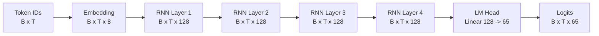

# Toy RNN 字符级语言模型说明

这份说明把本目录里的 Tiny Shakespeare 数据、`CharLanguageModelDataset` 和
`toy_rnn.py` 串成一条完整的数据流。读完后，应该能回答三个问题：一个字符
ID 怎样进入 RNN；RNN 为什么在每个时间步都输出 65 个分数；训练时 `x`、`y`、
`logits` 和 `CrossEntropyLoss` 怎样对齐。

## 1. 数据源：Tiny Shakespeare

数据来自 Andrej Karpathy 的公开 `char-rnn` 仓库：

<https://github.com/karpathy/char-rnn/blob/master/data/tinyshakespeare/input.txt>

原始文件是约 1.1 MB 的 Shakespeare 戏剧文本，已经保存到：

```text
data/tiny_shakespeare/input.txt
```

这里使用**字符级（character-level）**建模，而不是把整句话切成 word。数据中
出现的每一个不同字符都得到一个整数 ID。预处理脚本
`data/tiny_shakespeare/prepare.py` 按字符排序后建立词表：

```python
chars = sorted(set(text))
stoi = {char: index for index, char in enumerate(chars)}
itos = chars
```

两张表的方向相反：

```text
stoi["a"] -> 39       character -> integer ID
itos[39]  -> "a"      integer ID -> character
```

当前词表大小是 `65`，完整映射保存在：

```text
data/tiny_shakespeare/metadata.json
```

`metadata.json` 中的 `itos` 是列表，`stoi` 是 JSON object。模型只需要知道
`vocab_size = 65`，解码时才需要使用 `itos` 把预测出的 ID 还原成字符。

### 1.1 数据切分与存储格式

预处理将整段字符流按时间顺序切成：

| split | 比例 | 作用 |
|---|---:|---|
| `train` | 90% | 更新模型参数 |
| `valid` | 5% | 调参和观察泛化 |
| `test` | 5% | 最终评估 |

`train.pt`、`valid.pt`、`test.pt` 在磁盘上用 `torch.uint8` 保存，因为词表只有
65 个字符；读取一个样本时，`CharLanguageModelDataset` 会将窗口转换成
`torch.long`，以便作为 `Embedding` 的索引和 `CrossEntropyLoss` 的 target。

```text
input.txt
    │  character-level encode
    ▼
uint8 token stream: [c₀, c₁, c₂, ...]
    │  split into train/valid/test
    ▼
train.pt / valid.pt / test.pt
```

## 2. `x` 和 `y`：相邻窗口的 next-character 任务

`CharLanguageModelDataset` 每次取出长度为 `seq_len + 1` 的连续窗口，然后切成
两个长度相同的张量：

```python
window = tokens[index : index + seq_len + 1]
x = window[:-1]
y = window[1:]
```

例如原文片段是 `hello`，`seq_len=4` 时：

```text
位置:  0   1   2   3
x:     h   e   l   l       给模型的输入
y:     e   l   l   o       每个位置的正确答案
```

因此 `y[t]` 是模型在读完 `x[t]` 后应该预测的下一个字符。批处理后：

```text
x: [B, T]       B=batch size, T=sequence length
y: [B, T]
```

下面这个断言检查的不是 `x == y`，而是 next-token 的位移关系：

```python
assert torch.equal(x[:, 1:], y[:, :-1])
```

它表达的是：`x` 的第二个字符开始，应该等于 `y` 的第一个字符开始。

## 3. ToyRNN 的架构

当前训练配置在 `train()` 中是：

```text
vocab_size    = 65
embedding_size = 8
d_model       = 128
n_layer       = 4
```

整体数据流如下。图中的英文标签对应代码中的张量语义，中文解释放在图外，
这样 shape 不会被文字淹没。



### 3.1 Embedding：把 ID 变成向量

输入 `x` 是整数 ID，不能直接拿来做 RNN 的线性计算。`Embedding` 可以看成
一张可学习的表：表有 65 行，每行是一个 8 维向量。

```python
self.embedding_layer = nn.Embedding(
    num_embeddings=output_size,  # 65
    embedding_dim=embedding_size,  # 8
)
```

形状变化是：

```text
x                    [B, T]
embedding_layer(x)   [B, T, 8]
```

例如 `x[b, t] == 43`，Embedding 就取出词表第 43 行作为第 `t` 个时间步的
输入向量。这个向量不是 one-hot；它是模型在训练中学出来的字符表示。

### 3.2 RNNCell：更新一个时间步的状态

`RNNCell` 同时接收当前输入 `x_t` 和上一步状态 `h_{t-1}`：

$$
h_t = \tanh(W_x x_t + W_h h_{t-1} + b)
$$

代码中的两个 `nn.Linear` 分别负责当前输入和旧状态：

```python
memory = self.memory_fn(h)
new_info = self.current_fn(x)
h = torch.tanh(memory + new_info)
```

在一个 layer 内，`h` 按时间顺序传递：

```text
x₀ + h₀ -> h₁
x₁ + h₁ -> h₂
x₂ + h₂ -> h₃
...
xₜ + hₜ -> hₜ₊₁
```

这里的“记忆”就是旧状态 `h`。它不是额外的字符缓存，而是过去输入已经
压缩进当前状态后，对下一步计算产生的影响。

### 3.3 多层 RNN：上一层的序列输出接到下一层

每一层都会扫描完整的时间维 `T`。第一层接收 embedding 输出；后面的层接收
上一层在每个时间步产生的 hidden sequence：

```text
layer 1: [B, T, 8]   -> [B, T, 128]
layer 2: [B, T, 128] -> [B, T, 128]
layer 3: [B, T, 128] -> [B, T, 128]
layer 4: [B, T, 128] -> [B, T, 128]
```

`h_out` 还保存每一层最后一个状态，形状为：

```text
torch.stack(h_out, dim=0): [n_layer, B, 128]
```

但字符预测使用的是所有时间步的 `layer_out`，不是只使用最后一个状态。

### 3.4 LM head：把 hidden state 映射到 65 个字符

最后一层是：

```python
self.lm_head = nn.Linear(d_model, output_size)
```

它对每一个时间步独立地产生 65 个 logits：

```text
hidden: [B, T, 128]
lm_head(hidden): [B, T, 65]
```

`65` 不是 batch 维，也不是序列维；它是 vocabulary 维。`logits[b, t, k]`
表示：模型在第 `t` 个位置认为第 `k` 个字符是下一个字符的分数。

训练时保留全部时间步，所以输出是 `[B, T, 65]`。如果只想根据整段序列
预测一个下一个字符，才取最后一个位置：

```python
next_logits = logits[:, -1, :]  # [B, 65]
```

## 4. 一次训练迭代怎样流动

一次 batch 的完整流程可以写成：

```text
x [B,T] ──Embedding──> [B,T,8]
                         │
                         └─ RNN layers ─> hidden [B,T,128]
                                             │
                                             └─ lm_head ─> logits [B,T,65]

y [B,T] ───────────────────────────────────────────────┘
                         CrossEntropyLoss
```

代码对应关系是：

```python
x, y = x.to(Config.device), y.to(Config.device)
logits, hidden = toy_rnn(x)

loss = F.cross_entropy(
    logits.transpose(1, 2),  # [B, 65, T]
    y,                        # [B, T]
)

loss.backward()
optimizer.step()
optimizer.zero_grad()
```

`CrossEntropyLoss` 对每一个 `(batch, time)` 位置分别计算分类损失：

```text
logits[b, t, :]  ->  65 个候选字符的分数
y[b, t]          ->  正确字符的整数 ID
```

PyTorch 的 `cross_entropy` 约定分类维在第 2 维，因此需要把
`[B, T, 65]` 转成 `[B, 65, T]`。target 保持 `[B, T]`，不要 one-hot，也不要
在 loss 前调用 `softmax` 或 `argmax`。

### 4.1 参数更新与 scheduler

当前代码使用 `AdamW` 更新模型参数，并在每个 epoch 结束后调用一次：

```python
scheduler.step()
```

因此 `Config.cosine_anneal_T_0 = 10` 表示每 10 个 epoch 完成一次
CosineAnnealingWarmRestarts 周期。`optimizer.step()` 必须先于
`scheduler.step()`；前者更新参数，后者更新下一次参数更新所使用的 learning
rate。

## 5. 怎样把输出还原成字符

模型输出的 `logits` 不是字符，而是 65 个候选字符的分数。查看预测时先取
分数最大的 ID，再用 `itos` 反查：

```python
pred_ids = logits.argmax(dim=-1)  # [B, T]
text = "".join(Config.itos[int(i)] for i in pred_ids[0])
print(repr(text))
```

生成时也可以对最后一个位置的 logits 做 temperature sampling：

```python
last_logits = logits[0, -1] / temperature
probs = torch.softmax(last_logits, dim=-1)
next_id = torch.multinomial(probs, num_samples=1).item()
next_char = Config.itos[next_id]
```

`argmax` 更确定但容易重复；sampling 更有变化，但也可能产生不稳定字符。

## 6. 当前代码的边界

`toy_rnn.py` 是教学版骨架，当前已经具备：

- Tiny Shakespeare 的字符 ID 输入；
- `Embedding`、多层手写 `RNNCell` 和 `lm_head`；
- `[B,T] -> [B,T,65]` 的 next-character 预测路径；
- `CrossEntropyLoss`、`AdamW` 和按 epoch 更新的 scheduler；
- `dataset_test()` 对 `x/y` 右移关系的断言。

仍然可以继续补充的工程部分包括：

- `eval()` 中的 validation/test loss 和 perplexity；
- checkpoint 保存与恢复；
- 从 prompt 开始的自回归生成循环；
- gradient clipping，避免长序列训练时梯度爆炸；
- 将 `Config` 和训练函数拆成更容易复用的模块。

这些不是数据格式的要求，而是训练脚本从“能看懂数据流”走向“可长期训练”时
需要补齐的功能。

## 7. 最小检查清单

跑 demo 时可以按这个顺序排查：

```text
1. x.dtype == torch.long
2. x.shape == y.shape == [B, T]
3. embedding(x).shape == [B, T, embedding_size]
4. logits.shape == [B, T, vocab_size]
5. logits.transpose(1, 2).shape == [B, vocab_size, T]
6. loss 是标量，并且 loss.backward() 能成功
7. x[:, 1:] == y[:, :-1]
```

一句话收束：`x` 是字符序列题目，RNN 用状态逐步读题，`lm_head` 在每个位置
给出 65 个候选字符的 logits，`y` 是逐位置右移后的标准答案，
`CrossEntropyLoss` 负责把两者对齐并产生训练信号。
